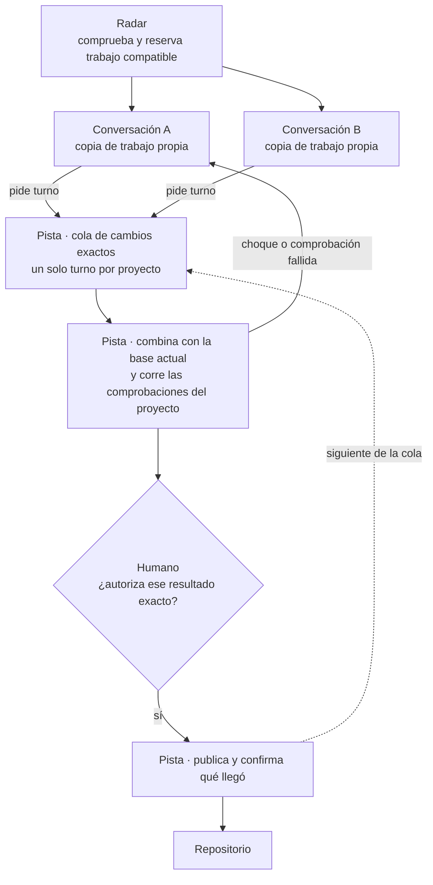

# Pista — entrega ordenada por proyecto

> **Estado:** propuesta definida con el mantenedor el 2026-10-01. Nada está implementado.
>
> **Propósito:** dejar citable lo que se decidió sobre la herramienta de control de entregas, la evidencia que lo respalda y las ambigüedades de configuración que siguen vivas.
>
> **Evidencia de código:** `control-tower@d8d12d0` en `master`, por lectura. No se ejecutó ninguna prueba ni se probó el funcionamiento simultáneo de dos conversaciones.
>
> **Límite:** este documento no reemplaza el plan ni el canon, no asigna IDs de Sesión, no cambia el alcance aprobado de V1 y no autoriza implementación, instalación ni entrega. Mover prioridades en `openspec/plan.yaml` es un paso aparte.

## 1. Decisiones del mantenedor (2026-10-01)

| # | Decisión | Consecuencia |
|---|---|---|
| D1 | La coordinación de entregas la hace una **herramienta determinista por proyecto**, no un agente Main. | Ninguna conversación es jefa de otra. Un agente interpreta; una herramienta aplica reglas. |
| D2 | La herramienta es **nueva, en Go, con la forma de Radar**. No se termina de cablear el semáforo ni el flujo de entrega en JavaScript. | Se reusan las ideas ya probadas, no el código. |
| D3 | La herramienta se llama **Pista**. | Radar ve qué puede convivir, la Torre autoriza, en la pista se aterriza de a uno. |
| D4 | Pista entra en **V2**. Lo que hoy es V2 (Torre automática) pasa a **V3**. | V1 conserva su definición: adopción project-local, sin semáforo. |
| D5 | Primero se cierra la limpieza de skills (`odd/tasks/chanks-gentle-boundary.md`); recién después se crea la Sesión de Pista. | La Sesión no se escribe sobre configuraciones a medio propagar. |

Descartado: un agente Main coordinador (depende de una conversación abierta y de su contexto) y la Torre automática completa (más alcance del necesario para esta promesa).

## 2. El problema, con un caso real

El 2026-10-01, en el repo `ecom-ecuador`, dos conversaciones trabajaron en paralelo y aparecieron en una tarde los tres problemas que Pista resuelve:

| Qué pasó | Qué lo habría evitado |
|---|---|
| Una entrega (PR #69) agregó una carpeta sin Zona y dejó `radar check` con 1 error en `main`. El plan quedó inválido para todos los agentes. | Una comprobación obligatoria antes de dejar entrar un cambio. |
| Otro cambio ya validado tuvo que revalidarse a mano porque `main` se movió minutos antes de subirlo (PR #70). | Verificar el resultado combinado, de a uno. |
| Radar informó qué Zonas podían convivir y aclaró «Radar no reserva el asiento». | Una reserva segura ante solicitudes simultáneas. |

Ninguno de los tres casos necesitaba interpretación. Necesitaban una regla que no dependa de que alguien la recuerde.

## 3. La promesa

> Dos conversaciones independientes trabajan en paralelo en el mismo proyecto y entregan por una sola puerta, sin agente jefe.

El trabajo ocurre en paralelo. La entrada de cambios al repositorio ocurre de a uno.

## 4. Qué es Pista

### Forma

- Un solo ejecutable en Go, instalado global, que se corre desde el proyecto o con `-C <repo>`.
- Sin proceso encendido y sin base de datos: cada comando hace una cosa y termina.
- El estado vive en el directorio común de Git del proyecto, compartido por todas las copias de trabajo, igual que las marcas de despacho de Radar.
- Salida en texto para el humano y `--json` con esquema versionado para los agentes.
- No necesita leer las conversaciones ni saber cómo trabaja cada agente. Recibe un cambio identificado y sus evidencias.

### Comandos

| Comando | Qué hace |
|---|---|
| `pista encolar <commit>` | Registra un cambio exacto (OID de commit), su Sesión y su destino. No recibe una rama que puede seguir cambiando. |
| `pista estado` | Muestra la cola, quién tiene el turno y qué pasó con cada entrega. |
| `pista integrar` | Toma el turno, combina el cambio con la base actual en una copia aislada y corre las comprobaciones que declara el proyecto, incluida `radar check`. |
| `pista publicar` | Publica solo si existe una autorización humana para ese resultado exacto, y confirma qué llegó al repositorio. |
| `pista retirar <id>` | Quita de la cola una solicitud todavía no ejecutada. |
| `pista liberar` | Destrabe manual del turno. Solo humano. |

### Las seis tareas

1. Recibir un cambio exacto, no «mi rama está lista».
2. Guardarlo en una cola persistente que sobreviva al cierre de la conversación.
3. Integrar uno por vez en el destino del proyecto.
4. Comprobar el resultado combinado: después de entrar el primero, el segundo se verifica contra esa base nueva.
5. Publicar únicamente con la autorización que exige el proyecto.
6. Registrar qué pasó y frenar ante la incertidumbre, sin repetir una publicación a ciegas.

### Cuando algo sale mal

| Situación | Qué hace Pista |
|---|---|
| Choque de código al combinar | Frena, marca la entrega como rechazada con el motivo y la devuelve a la conversación que la mandó. No resuelve conflictos. |
| Comprobación fallida | Igual: rechazada con el motivo. |
| La base cambió antes de publicar | No fuerza la entrada. Vuelve a combinar y comprobar. |
| El resultado autorizado cambió | No reutiliza una autorización vieja. |
| No se sabe si se publicó | Se detiene y espera al humano. No reintenta. |
| El dueño del turno murió | El turno detecta al dueño muerto y queda disponible, sin esperar un destrabe manual. |

### Qué no hace

No elige trabajo, no abre terminales, no despacha Sesiones, no implementa, no revisa código, no resuelve conflictos y no reserva asientos. El registro de Pista describe operaciones de entrega; no reemplaza el estado del plan que calcula Radar.

## 5. La reserva en Radar va primero

Pista ordena la salida. La entrada la ordena Radar, y hoy tiene una ventana.

- **Lo técnico:** `radar marcar` lee una foto de las marcas vivas y después escribe la marca nueva, sin llave entre un paso y el otro (`agent-workflows/tools/radar/etapa.go:590-597`). La guarda de escritura solo evita dos marcas para el mismo ID (`etapa.go:505-509`).
- **En simple:** dos conversaciones pueden tomar a la vez dos Sesiones incompatibles, y cada una ve a la otra como libre.

Arreglo propuesto: que `radar marcar` tome una llave antes de comprobar y registrar. Ordenar las entregas después no corrige ese problema anterior; solo lo descubre tarde. El registro de la limpieza ya lista esta carrera como defecto diferido de Radar (`odd/tasks/chanks-gentle-boundary.md`, sección de defectos de Radar).

## 6. Despacho

No hace falta un agente ni una herramienta nueva. `radar marcar <ID> --worktree` ya registra qué Sesión corre en qué copia de trabajo. Falta un comando que haga los tres pasos juntos: crear la copia, crear la rama y marcar. El humano elige la Sesión; el comando hace lo mecánico.

## 7. Qué existe hoy en el repo

| Afirmación | Veredicto | Evidencia |
|---|---|---|
| El semáforo da exclusión compartida entre copias de trabajo | Cierto | SQLite con `BEGIN IMMEDIATE` en `<git-common-dir>/control-tower/tower.db` (`semaphore.mjs:29-95,176-193`) |
| El semáforo detecta dueños muertos | Falso | Sin PID, latido ni vencimiento; solo liberación humana (`semaphore.mjs:231-240`) |
| La cola existente es de mensajes, no de entregas | Cierto | Tabla `message` (`semaphore.mjs:81-90,143-173`). El orden de entregas solo existe como texto en la skill `torre-control-entregas` |
| El flujo de entrega protege un candidato a la vez | Cierto | La llave es por candidato (`delivery/workflow.mjs:28`, `delivery/ledger.mjs:100-133`). Dos candidatos distintos corren a la vez |
| El flujo de entrega usa el semáforo | Falso | Ninguna referencia al semáforo bajo `delivery/` |
| El flujo de entrega corre en producción | Falso | `executeDelivery` solo lo llaman las pruebas, con piezas falsas |
| Los adaptadores encajan en el flujo | Falso | El adaptador de git devuelve `eligible` y el flujo solo muta con `absent` (`delivery/git-adapter.mjs:24`, `delivery/reconciliation.mjs:23`) |
| Radar tiene una ventana entre comprobar y registrar | Cierto | `etapa.go:590-597` |

### Las seis tareas contra el código actual

| Tarea | Estado | Qué falta |
|---|---|---|
| Recibir un cambio exacto | Parcial | La identidad del candidato existe (`contracts/candidate-revision.mjs:7-15`); no hay ningún comando que lo reciba |
| Cola persistente | Falta | Hay historia por candidato (`delivery/ledger.mjs:134-168`), no una cola ordenada entre candidatos |
| Integrar de a uno | Parcial | La llave existe pero el flujo no la toma; no hay código que combine un cambio con un destino que se movió |
| Verificar el resultado combinado | Falta | Solo hay un gancho inyectable (`delivery/workflow.mjs:33`) |
| Publicar con autorización | Parcial | Política y registro de autorización existen (`policy/delivery-policy.mjs:10,26`, `main-store/store.mjs:409-480`); el flujo ignora `admitted: false` (`delivery/workflow.mjs:37`) |
| Registrar y frenar | Parcial | Estados `DELIVERED`, `UNRECONCILED`, `ATTEMPT_FAILED` y tres intentos con reconciliación previa (`delivery/reconciliation.mjs:12-36`); `ESCALATED` no queda registrado |

Ideas que Pista hereda: identidad del cambio por digest, registro de solo agregar, reconciliar antes de reintentar, detección de dueño muerto por PID (`delivery/ledger.mjs:58-71,113-117`).

### Cómo está hecho Radar (la forma a copiar)

- Go, una dependencia (`gopkg.in/yaml.v3`), 44 archivos, 27 de pruebas, unas 15.300 líneas.
- Se instala con `agent-workflows/tools/install-radar.sh` en `$HOME/.local/bin/radar`. La admisión usa el binario instalado, nunca el código del checkout.
- Lee `openspec/plan.yaml`. El estado se deriva del plan, de Git y de las marcas; no se guarda.
- Lo único que escribe: marcas en `<git-common-dir>/chanks/despachos/<ID>.json`, `openspec/ROADMAP.md` y el archivo de Sesiones.
- Sin base de datos y sin proceso encendido.
- `status --json` con esquema `radar.snapshot/v1`; un consumidor que no reconoce el esquema debe detenerse.
- Pruebas en Go con archivos dorados y repos Git descartables.

## 8. La puerta protegida

Si los agentes pueden publicar por fuera de Pista, no hay garantía completa: es coordinación por acuerdo. El 2026-10-01 una conversación publicó con `gh pr merge` directo y nada lo impidió.

- La puerta se cierra en el repositorio remoto (rama protegida con comprobación obligatoria), no en la herramienta.
- Protección de rama, comprobaciones obligatorias y cola nativa de integración son capacidades distintas. Dependen del plan contratado y la cola nativa no está disponible automáticamente para una cuenta personal. No se verificó la cuenta del mantenedor.
- `control-tower` entrega con commit directo a `master`, sin PR (`AGENTS.md:70-83`). `ecom-ecuador` entrega con PR. Pista tiene que soportar las dos formas desde el inicio. Cambiar la política de un repo es una decisión del mantenedor, no viene escondida en la herramienta.

## 9. Orden de construcción

| # | Pieza | Sirve sola porque |
|---|---|---|
| 1 | Reserva segura en `radar marcar` | Cierra la entrada de trabajos incompatibles |
| 2 | Cola, turno, estado y registro | Da fila ordenada aunque se integre a mano |
| 3 | Integrar y verificar el resultado combinado | Es la pieza que hoy no existe |
| 4 | Publicar con autorización | Ata la aprobación humana a un resultado exacto |

## 10. Qué queda abierto

- **La definición de V1 se contradice en el plan.** `openspec/plan.yaml:67-69` dice que Torre V1 «no depende de semáforo»; la Sesión archivada `S149` dice que «la Torre V1 es el semáforo compilado, Radar y las skills» (`openspec/archive/sesiones/S149.md:6`). Los Cimientos del plan siguen listando archivos del semáforo (`plan.yaml:111,124,127,130,168`).
- **Renumerar V2 y V3 en el plan.** Hoy `torre-v2` es la Torre automática. Las Sesiones abiertas de esa prioridad son `S165`, `S4.12`, `S9.8`, `S107` y `S169`.
- **Puerta protegida:** depende del plan de GitHub, sin verificar.
- **Nada está probado en simultáneo.** Es diseño sobre lectura de código.
- **Partes no leídas:** `core.mjs` completo, `mcp.mjs`, `continuation/`, y las secciones 5 a 21 de `docs/architecture/torre-motor-determinista.md`.

## 11. Auditoría de ambigüedades de configuración (2026-10-01, 14:05 a 14:21)

Auditoría de solo lectura sobre los cinco runtimes (Claude Code, Codex, OpenCode, Pi y Hermes), la fuente en `agent-workflows/skills/` y el estado vivo del repo. La limpieza desplegó Hermes a las 14:13, durante la auditoría; los resultados usan el estado posterior.

### Lo que quedó bien

- Los cinco runtimes tienen los 57 archivos de skills idénticos a la fuente. No sobran ni faltan skills.
- Los cinco archivos de instrucciones personales llevan el bloque corto «Chanks and Gentle AI boundary», idéntico en los cinco. El bloque largo anterior (Herdr, Intercom, coordinador manual) ya no está en ninguno.
- `chanks-6-politica-de-entrega` y `chanks-7-session-doc` están archivadas bajo `.retired-skills/`.
- `chanks-3-coordinador-manual` y `chanks-3-despacho-herdr` siguen instaladas **a propósito**: son solo de V2 y llevan `disable-model-invocation: true`. No son restos.
- Ninguna skill de V1 menciona el semáforo.
- Ninguna Sesión abierta de `torre-v1` depende del semáforo, de Herdr, de Intercom ni de un coordinador Main.

### Lo que ninguna tarea cubre

Prioridad alta: puede revertir la limpieza o hacer que un agente actúe mal.

| # | Qué | Evidencia | Por qué es ambiguo |
|---|---|---|---|
| N1 | El respaldo de bloques manuales guarda todavía el bloque largo viejo | `~/.claude/.skill-backups/manual-blocks/{claude/03-…,opencode/02-…,pi/02-…}`, 7858 bytes, 08:16 | Un `restore` después de un sync devuelve el bloque viejo a tres runtimes. Falta un `save` nuevo |
| N3 | Hermes conserva el bloque `UNATTENDED-SEALED-CONSENT` | `~/.hermes/SOUL.md:951-971` | Dice que el sello supera a «nunca respondas por el humano» y avisa a «Main» por Intercom. Contradice «si chocan, gana Gentle» en el mismo archivo (`SOUL.md:975`). Se quitó de los otros runtimes |
| N4 | La regla de cierre nombra una skill que ya no existe | `chanks-7-session-doc` en `~/.claude/CLAUDE.md:365`, `~/.config/opencode/AGENTS.md:217`, `~/.pi/agent/APPEND_SYSTEM.md:75` | El nombre vigente es `chanks-5-session-doc` |
| N5 | Hay dos fuentes de verdad para las skills | Mapa de propagación: editar `~/.claude/skills` y correr `sync-skills.sh` (`CLAUDE.md:591,614-615`), con gancho automático (`~/.claude/settings.json:83`). El registro de la limpieza dice que la fuente es el repo y que ese sync es peligroso | Una edición bajo `~/.claude/skills` pisa todos los runtimes, saltándose el repo y el instalador acotado |
| N7 | No está claro quién integra y entrega | `chanks-4-unattended-implementation/SKILL.md:47-49` («Main en la etapa 5»), `chanks-3-coordinador-manual/SKILL.md:150`, `chanks-3-paralelo/SKILL.md:53` (sin actor) contra `chanks-4-puente/SKILL.md:22-23` y `chanks-5-politica-de-entrega/SKILL.md:12` (entrega Gentle AI) | Un agente que sigue las skills de V1 no sabe quién mergea. Es exactamente el hueco que cubre Pista |
| N2 | La etapa 3 tiene dos nombres | Radar dice «Despachar» y «Entregar y cerrar» (`etapa.go:375,379`); el bloque de instrucciones dice «Paralelo» y «Cerrar» | El agente recibe un nombre de la herramienta y otro de sus instrucciones |
| N6 | «V1» significa dos cosas opuestas | Torre con semáforo en `chanks-3-coordinador-manual/SKILL.md:18,24,162-174` y `chanks-3-despacho-herdr/SKILL.md:25,86`; ruta sin Torre en `chanks-3-paralelo/SKILL.md:33,64` y en `plan.yaml:67-69` | La misma palabra nombra el pasado y el presente |

Prioridad media: estado vivo que confunde.

| # | Qué | Evidencia | Por qué es ambiguo |
|---|---|---|---|
| N9 | Marca de despacho de `S165` viva sobre una Sesión diferida | `<git-common-dir>/chanks/despachos/S165.json` (2026-09-28); `radar sesion S165` da DIFERIDO | Reserva `implementer-2`, la rama `work/S165` y sus archivos contra otras Sesiones sin representar trabajo |
| N10 | Copia de trabajo `issue-resolver` con 17 rutas sin guardar | `Worktrees/issue-resolver`, rama `work/issue-150`, último cambio 2026-09-29 | Edita las skills de V2 y los controles de Pi que la limpieza reescribió. No se sabe si está vivo o abandonado |
| N8 | Sesiones abiertas con el límite duro de 400 líneas | `S174` (`plan.yaml:2140`, la única LISTO), `S150` (`:1197`), `S173` (`:2214`) | Es la regla que la limpieza quitó de las skills, viva en el plan |
| N13 | `S169` apunta a la skill ya adelgazada | `radar sesion S169` (`torre-v2`, DIFERIDO) | Su texto asume un coordinador que la limpieza aisló como solo V2 |
| N14 | `S149` y los Cimientos afirman un V1 con semáforo | Ver sección 10 | El registro de la limpieza lo excluye de forma explícita |
| N11 | Pi conserva controles de Chanks e Intercom fuera de las skills | `~/.pi/agent/extensions/chanks-controls.ts`, `~/.pi/agent/settings.json:10` (`pi-intercom`), ganchos `chanks-etapa.sh`, `torre-firma.sh`, `herdr-agent-state.sh` | Inertes con el interruptor apagado. Nada dice si se quedan |

Prioridad baja: copias viejas y documentos.

| # | Qué | Evidencia |
|---|---|---|
| N12 | Skills viejas en Windows y Gemini (26 directorios, incluidas `chanks-6` y `chanks-7`) | `/mnt/c/Users/emili/*/skills`, `~/.gemini/config/skills` |
| N15 | Documentos fuente sin aviso de históricos | `agent-workflows/EJECUCION-EN-PARALELO.md:3`, `docs/flujo/chanks-guia-de-etapas.html:30,33,69,72`, `agent-workflows/README.md:132-133` |
| N16 | Codex y Hermes no tienen los bloques de cierre documental, nombres de plan ni explicación simple | Inventario de bloques por runtime. No se sabe si es intencional |
| N17 | `chanks-3-paralelo` no dice si cada Sesión del lote pasa por la admisión del arranque | `chanks-3-paralelo/SKILL.md:39-52` contra `chanks-3-session-kickoff/SKILL.md:12-29` |
| N18 | Registros de skills que apuntan a rutas archivadas | `~/.atl/skill-registry.md`, `~/projects/.atl/skill-registry.md`, `ecom-ecuador/Main/.atl/skill-registry.md:59-60` |

### Lo que no se pudo comprobar

- Si Codex, OpenCode, Pi y Hermes respetan `disable-model-invocation`. Solo se observó el catálogo de Claude Code.
- Si algún runtime carga las skills archivadas bajo `.retired-skills/`.
- Si hay sesiones de Pi abiertas.
- Los archivos de instrucciones de Windows.
- Que una conversación nueva cargue de verdad las instrucciones nuevas. Las conversaciones abiertas antes de las 13:58 siguen con las anteriores.

## 12. Procedencia

- Definido en una conversación con el mantenedor el 2026-10-01, trabajando desde `ecom-ecuador`.
- Dos mapeos de solo lectura sobre `control-tower@d8d12d0`: verificación de las piezas de entrega y auditoría de configuración.
- Diagrama de la etapa 5 actualizado en el documento «Chanks como guía de etapas — análisis por tramos», marcado ahí como propuesta.
- Una propuesta paralela de otro agente coincide en el motor por proyecto, las seis tareas y la separación entre Radar y la herramienta de salida.
