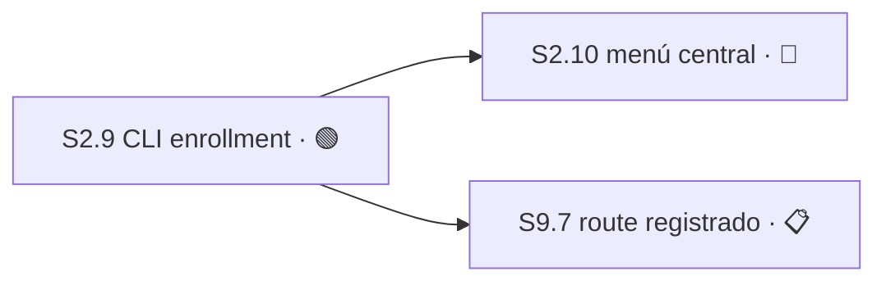

# Plan 2 — Contratos y registro de producto

**Estado:** 🔵 EN CURSO

## Verdad ejecutable actual

- `S2.1`–`S2.6` y `S2.8` están cerradas; `S2.7` está archivada. `S2.9` enumera el caller CLI de enrollment y `S2.10` conserva bloqueada la integración del menú central hasta ubicar su renderer/owner real.
- `S2.8` fue entregada a `origin/master` mediante el código `480afb92bf99d38ee166070d09ec6485bc5de2c4` y el cierre documental `6bd1477ddc6c242ac5ff9aa8459f48daedffe40f`.
- **Cola global:** `S2.9` entra en la cola; `S2.10` queda fuera por 🔴 BLOQUEADO. Ver [master-index](../master-index.md).
- **Denominador:** `—`. Aunque `S2.9` y `S2.10` enumeran las superficies públicas de enrollment, storage/revisión, alias/resolución y validación de root/common-dir/remote siguen sin Sesión; por la [decisión 57](../decision-register.md), el porcentaje no es derivable.

## Sesiones cerradas

| ID | Estado | Resultado entregado | Evidencia durable |
|---|---|---|---|
| S2.1 | ✅ COMPLETO | Diez schemas y validación duplicate-safe | [tasks](../../changes/sdd-tower-contract-schemas/tasks.md) · PR #67 |
| S2.2 | ✅ COMPLETO | JCS, ArtifactRef e idempotencia | [tasks](../../changes/sdd-tower-contract-schemas/tasks.md) · PR #72 · merge `bbb59af9ca4de9223e0ec06474725f13329993b6` · 44/44 contracts |
| S2.3 | ✅ COMPLETO | Main store con autoridad, atomicidad y límites de Change A/B | [tasks](../../changes/sdd-tower-contract-schemas/tasks.md) · PR #78 · merge `8139849df44a81ecac6eaafa0c9a2c847e08c77e` · 13/13 focused, 57/57 aggregate, 25/25 probes |
| S2.4 | ✅ COMPLETO | Registry storage y resolución XDG path-neutral | [tasks](../../changes/archive/2026-07-31-sdd-tower-project-registry/tasks.md) · PRs #82, #84, #86, #88 · 14/14 storage, 57/57 combined |
| S2.5 | ✅ COMPLETO | Preflight de colisiones para enrollment legado | [tasks](../../changes/archive/2026-07-31-sdd-tower-legacy-import-preflight/tasks.md) · [apply](../../changes/archive/2026-07-31-sdd-tower-legacy-import-preflight/apply-progress.md) · [verify](../../changes/archive/2026-07-31-sdd-tower-legacy-import-preflight/verify-report.md) · PRs #94, #96, #114, #116 · 5/5 requisitos, 9/9 escenarios, 12/12 tareas |
| S2.6 | ✅ COMPLETO | La Torre adoptó el contrato de ejecución y volvió opacos los bloques ajenos sin cambiar registry/payload | [decisiones 71 y 79](../decision-register.md) · commit `c91fddd5c74019de2ef7d691a43d403558c3a92e` · cierre `f2d1a81` · 87 tests focalizados, 892 integrales |
| S2.8 | ✅ COMPLETO | `inputs` opaco sin nombres de fase; contrato restante y membresía preservados | [decisión 103](../decision-register.md) · código entregado `480afb92bf99d38ee166070d09ec6485bc5de2c4` · 45 líneas authored · AC1–AC5 PASS · AC6 excepción autorizada, no PASS |

## Sesión archivada

| ID | Estado | Razón y evidencia durable |
|---|---|---|
| S2.7 | 📚 ARCHIVADO | La [decisión 78](../decision-register.md) retiró el lector `contracts/session-plan-snapshot.mjs`; sin copia no existe deriva que vigilar. La convención sigue gobernando desde el harness y `S5.15` posee el retiro. |

## Responsabilidades de Change B todavía sin ID

El [apéndice de migración](../plan-vocabulary-migration-appendix.md) preserva, sin inventar denominador: storage y actualización atómica; bootstrap, enrollment y revisionado; UX de alias y resolución inequívoca; validación de root, common-dir y remote. `S2.9` enumera sólo el caller público de enrollment y `S2.10` sólo su integración de menú; las otras responsabilidades siguen sin enumerar, por lo que P2 conserva porcentaje `—`. El [inventario de producto](../inventario-de-producto.md) las cruza contra `console/vocabulary.mjs`.

## Sesión 2.9 — Enrollment público canónico por CLI

**Estado:** 🟢 LISTO

**Depende de:** —

**Área:** `bin/torre`, `enroll/index.mjs`, `test/console/cli.test.mjs`, `test/enroll/enroll.test.mjs`

**Recurso:** registro central de proyectos y lock/escritura atómica ya propiedad de `enrollProject`; sin activación Tower ni lifecycle de hosts.

**Decisiones:**
- `escala`, resuelta — la operación pública canónica es `torre enroll --repo <ruta>` y llama al `enrollProject` existente; `torre on --repo` queda estrictamente activation-only y rechaza un proyecto no registrado explicando primero `torre enroll`. **Clase:** API pública; contrato visible del producto; seguridad y permisos. **Autoridad:** decisión 104 y Engram 10008. **Contamina:** `S9.7`.
- `derivable` — traducción de argumentos hacia el request existente. **Criterio:** la CLI no duplica validación, identidad, preflight ni persistencia de `enrollProject`; cualquier segunda implementación falsifica la derivación.

**Ruta:** `direct` — caller público acotado sobre una operación existente y criterios binarios cerrados.

**Autoridad:** decisión 104, Engram 10008 y contrato entregado de `S8.3`.

**Criterios de aceptación** — todos deben pasar:
- [ ] `torre enroll --repo <ruta>` invoca el `enrollProject` existente y devuelve identidad/revisión del proyecto registrado sin duplicar su lógica.
- [ ] Repetir enrollment idéntico converge según el contrato existente; conflicto o layout inseguro falla cerrado antes de escribir.
- [ ] `torre on --repo <ruta>` activa sólo proyectos ya registrados; uno no registrado no crea registro ni `ACTIVE` y explica el comando `torre enroll`.
- [ ] `torre enroll` no activa la Torre, no inicia procesos y no muta worktrees.
- [ ] El diff toca sólo `Área`.

### Módulo M2.9.1 — Caller CLI y separación enroll/on · forecast 220–340 authored
- [ ] Tarea T2.9.1.1 — RED: cubrir enrollment exitoso/idempotente, conflicto/layout inseguro y `torre on` no registrado sin mutación.
- [ ] Tarea T2.9.1.2 — GREEN: cablear el subcomando a `enrollProject` y cercar `on` como activation-only.
- [ ] Tarea T2.9.1.3 — REFACTOR: eliminar validación duplicada, estabilizar errores/ayuda y repetir testigos de registro/`ACTIVE`.

**Forecast de Sesión:** 220–340 líneas authored; un resultado revisable y revertible de ≤400.

## Sesión 2.10 — Enrollment desde el menú central

**Estado:** 🔴 BLOQUEADO

**Depende de:** `S2.9`

**Área:** `OWNER SIN RESOLVER — renderer/handler del menú central no localizado en este checkout`; pruebas del mismo owner, también sin localizar.

**Recurso:** menú central y registro de proyectos; serial con `S2.9` por la operación canónica de enrollment.

**Decisiones:**
- `escala` — pregunta exacta: ¿qué repositorio y path poseen el renderer/handler del menú central que debe ofrecer enrollment y cómo invoca la CLI canónica sin duplicar lógica? **Clase:** dependencias o evidencia contradictorias; expansión de alcance. **Evidencia:** el screenshot aprobado existe, pero el renderer no fue localizado en este checkout. **Opciones:** ubicar el owner real y agregar allí una entrada que llame `torre enroll` (mantiene UX híbrida); declarar que el menú vive fuera del producto y registrar su repositorio (cambia ownership, no el contrato); no hacer nada (deja incompleta la UX pública aprobada). **Checkpoint:** antes de RED y antes de nombrar cualquier path. **Contamina:** criterios y primer Módulo de `S2.10`; no contamina `S2.9` ni el route CLI de `S9.7`.

**Ruta:** `blocked` — falta evidencia del owner real; no se inventa archivo ni responsable.

**Autoridad:** decisión 104 y Engram 10008.

**Criterios de aceptación** — todos deben pasar para cerrar:
- [ ] El owner y los paths reales del menú quedan probados antes de editar.
- [ ] El menú ofrece enrollment y delega a la operación canónica `torre enroll --repo <ruta>` sin reimplementar validación o persistencia.
- [ ] Éxito, conflicto y layout inseguro se presentan con resultado coherente con la CLI; enrollment no activa la Torre.
- [ ] El diff toca sólo el `Área` real aprobado después de resolver el checkpoint.

**Módulo M2.10.1 — Integración de menú · 🔴 BLOQUEADO.** Las Tareas RED→GREEN→REFACTOR se enumerarán sólo cuando el owner/path real esté probado; hacerlo antes inventaría alcance.

**Forecast de Sesión:** 160–260 líneas authored una vez resuelto el owner; un resultado revisable y revertible de ≤400.

## Grafo de dependencias nuevas de P2

## Sesión 2.8 — Los nombres de fase salen del contrato de binding

| Campo | Contrato vigente |
|---|---|
| Estado | ✅ COMPLETO — código `480afb92bf99d38ee166070d09ec6485bc5de2c4` y cierre documental `6bd1477ddc6c242ac5ff9aa8459f48daedffe40f` entregados a `origin/master` |
| Depende de | — |
| Área | `schemas/binding-delta-v1.schema.json`; `test/contracts/schema.test.mjs`; `test/fixtures/contracts/schema-cases-v1.json` |
| Prohibido | `contracts/schema-registry.mjs`; `contracts/validate.mjs`; `install/**`; `scripts/payload-closure.mjs`; `schemas/execution-contract-v1.schema.json` |
| Recurso | — (sin DB, migraciones ni token de entrega) |
| Ruta | `design-tasks` — cerrada; la implementación y sus pruebas quedaron dentro del `Área` exacta |
| Autoridad | [decisión 78](../decision-register.md), [frontera Torre ↔ gentle-ai](../frontera-torre-gentle-ai.md) y precedente entregado de `S2.6` |
| Orden/cola | Fuera de la cola por ✅ COMPLETO |

**Resultado único:** `inputs` pasa a opaco como `{"type":"object"}`. La Torre conserva y sella el objeto sin interpretar nombres de fase; `git`, `contracts` y todo campo fuera de `inputs` permanecen byte-idénticos. `binding-delta-v1` conserva membresía en registry y payload.

**Decisiones:**
- `derivable` — volver opacos los seis campos actuales sin eliminarlos ni renombrarlos. **Autoridad:** decisión 78 y precedente `S2.6`. **Criterio:** el objeto entero acepta cualquier forma y deja de exigir miembros internos. **Falsificador:** un delta sellado con la forma actual deja de validar, o una forma alternativa no valida. **Contamina:** `S2.8`, desde `M2.8.1`.
- `derivable` — preservar todo lo ajeno a `inputs`. **Autoridad:** alcance aprobado de `S2.8` y decisión 78. **Criterio:** sólo cambian la definición de `inputs`, sus fixtures y pruebas dentro de `Área`. **Falsificador:** cambia un byte de otro campo o cambia la membresía en registry/payload. **Contamina:** `S2.8`, desde `M2.8.2`.
- Toda decisión no listada escala por defecto; ninguna autoridad de esta Sesión permite cambiar producto, API pública, seguridad, membresía, dependencias o alcance.

**Criterios de aceptación — cierre factual:**
- [x] AC1 — `rg 'proposal|specs|design|tasks' schemas/binding-delta-v1.schema.json` devuelve cero
- [x] AC2 — Un `binding-delta` sellado con los seis campos actuales sigue validando contra el schema recortado
- [x] AC3 — Un `binding-delta` con `inputs` de forma distinta también valida
- [x] AC4 — `binding-delta-v1` sigue declarado en `contracts/schema-registry.mjs` y en el payload, sin cambio de membresía
- [x] AC5 — Ningún campo fuera de `inputs` cambia un byte
- [x] AC6 — **EXCEPCIÓN HUMANA AUTORIZADA; NO PASS.** La única corrida integral fue 952/953 por la falla preexistente y fuera de `Área` en `test/hosts/candidate-fence.test.mjs:432`; el diagnóstico aislado autorizado pasó 17/17 y el caso exacto pasó/no reprodujo. El diff toca sólo los tres paths de `Área`. Ver [decisión 103](../decision-register.md).

**Evidencia de cierre ligada a bytes:** código `480afb92bf99d38ee166070d09ec6485bc5de2c4`, parent `c2fb6399ee1332821663735d02833f78b9371402`, tres paths exactos, 45 líneas authored y digest registrado `f1d31462…`. Safety 72/72; `M2.8.1` RED 72 pass/1 fail → GREEN 74/74; `M2.8.2` RED 74 pass/1 fail → GREEN 75/75. La lente reliability quedó no disponible por `no current controller-owned candidate view lineage binding`; no existe PASS ni receipt.

**Ownership de planificación:** este `STATUS.md` es el único autor de Módulos/Tareas. `session-plan` puede emitir después un solo delta compacto para precisar técnica; no crea proposal, spec, SDD completo, otra descomposición ni SDD por Módulo.

### Módulo 2.8.1 — Opacidad del contrato

**Paths:** `schemas/binding-delta-v1.schema.json`, `test/contracts/schema.test.mjs`
- [x] `T2.8.1.1` **RED** — demostrar que una forma de `inputs` ajena a SDD falla hoy y que el delta sellado actual debe seguir aceptado
- [x] `T2.8.1.2` **GREEN** — reemplazar la definición interna de `inputs` por un objeto opaco sin restricciones internas
- [x] `T2.8.1.3` **REFACTOR** — probar cero nombres de fase y comparar que ningún campo del schema fuera de `inputs` cambió

### Módulo 2.8.2 — Compatibilidad y membresía

**Paths:** `test/fixtures/contracts/schema-cases-v1.json`, `test/contracts/schema.test.mjs`
- [x] `T2.8.2.1` **RED** — fijar casos para el delta actual, un `inputs` alternativo y la membresía vigente en registry/payload
- [x] `T2.8.2.2` **GREEN** — actualizar fixtures y pruebas para que ambas formas validen sin tocar archivos prohibidos
- [x] `T2.8.2.3` **REFACTOR** — triangular correcciones de revisión, membresía inmutable, suite focalizada e integral y límite exacto de `Área`

**Medición:** 45 líneas authored en implementación, pruebas y fixture; una unidad verificable y revertible entregada a `origin/master` mediante `480afb92bf99d38ee166070d09ec6485bc5de2c4`.
