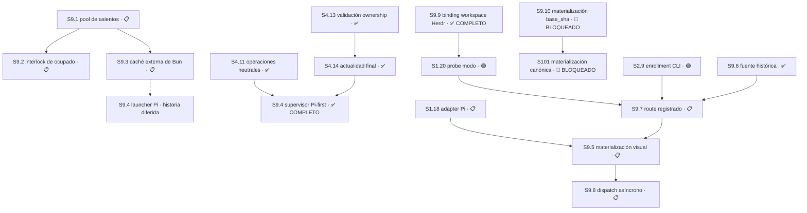

# Plan 9 — Asientos de trabajo y reciclado seguro

**Propósito:** que existan asientos de trabajo estables que Main pueda asignar, materializar visualmente y reciclar sin pisar a un agente trabajando, y que tener varios no cueste una instalación de dependencias por cada uno.

**Estado:** 🔵 EN CURSO
**Avance:** 40% (4/10 S)

> **Reordenado y recortado el 2026-08-21 por la [decisión 62](../decision-register.md), tras la auditoría exclusiva de P9.**
> Los IDs son posicionales según el [estándar de planes](/home/<usuario>/.claude/skills/_shared/plan-naming-convention.md), así que
> cambiar el orden cambia el número. La tabla de migración de abajo conserva la trazabilidad de toda referencia histórica.

## Entrega de sustrato del 2026-08-30 — previa al cierre de S9.1

**Esta entrega no cerró ninguna Sesión: el avance quedó en 0% (0/5 S) y así se registró.** `S9.1`
cerró después, ese mismo día y en commits separados, apoyándose en este sustrato; su cierre está
documentado en su propia Sesión más abajo. Esta sección se conserva sin reescritura porque mide
un corte anterior y porque retira una causa de deriva que era real y estaba medida.

**Causa medida.** `hosts/production-provider.mjs:257` creaba el pane del worker con
`herdr pane split --current`, que parte el pane enfocado; el código **no tenía concepto de
pestaña**. La topología obligatoria `MAIN → SUPPORT → AGENTES` existía sólo como prosa en
`skills/torre-control/SKILL.md`, así que un orquestador compactado la perdía y los workers
nacían en la pestaña equivocada. El commit `078f160` del 2026-08-30 endureció esa prosa y no
agregó enforcement.

**Entregado** en `origin/master@6c79223`, tres commits directos verificables y revertibles:

| Commit | Resultado | Líneas |
|---|---|---:|
| `cb3ed7e` | `hosts/herdr-topology.mjs` resuelve la pestaña `AGENTES`, la crea sosteniendo el primer asiento, parte de lado desde su último pane y **verifica pestaña, `cwd` y `foreground_cwd` por readback**, cerrando lo que abrió ante cualquier mismatch. No lee `ACTIVE`. | 215 |
| `4f3a022` | `workspace/seat-inventory.mjs` clasifica cada worktree en `main`/`support`/`permanent`/`temporary` y decide si el descarte *podría* ser seguro; `hosts/seat-cli.mjs` lo expone como `torre asiento list \| abrir \| limpiar`. | 342 |
| `6c79223` | El skill deja de repetir la topología y enruta a la cerradura: su primera regla dura es *nunca invoques `herdr` para sentar un worker, siempre `torre asiento`*. | 79 |

**Regla de asientos temporales, ahora en código.** El pool permanente es `implementer-1`,
`implementer-2`, `implementer-3` más `support-agent`; **cualquier otro worktree nace temporal y
debe descartarse cuando su trabajo aterriza**. El descarte nunca es automático: `limpiar`
previsualiza, y `--confirmar` sólo retira asientos probadamente en rama, limpios, desocupados y
totalmente mergeados; una ocupación de panes ilegible **falla cerrado** en vez de borrar un
asiento cuyo agente no se pudo ver.

**Qué NO entregó, y hay que decirlo con precisión.** No existe registro de asientos ni binding
de asignación por Main —eso es `S9.1`—; no hay lock exclusivo ni interlock de asiento ocupado
—eso es `S9.2`—; no hay caché de dependencias —`S9.3`—; y no hay materialización automática
posterior al brief —`S9.5`—. `torre asiento` es operado a mano por Main, exactamente como
`jornada.sh --reciclar`.

**Efecto sobre las Sesiones abiertas, medido en ese corte.** `S9.1` conservaba su contrato íntegro
con un vecino entregado que debía respetar en vez de reimplementar —`workspace/seat-inventory.mjs`
ya nombraba el pool y `hosts/herdr-topology.mjs` ya era dueño de la topología—; **así ocurrió, y
`S9.1` cerró reutilizando ambos.** `S9.5` conserva sus siete criterios de aceptación; dos de ellos
—pane dentro de la pestaña aprobada y prueba de `cwd`/`foreground_cwd` antes del prompt— ya tienen
implementación verificable que `S9.5` debe **invocar, no reescribir**.

**Evidencia:** `bun test` 978 pass / 0 fail sobre `6c79223`; `torre asiento list` ejecutado
contra este repositorio identifica los tres asientos permanentes, `support-agent`, `Main` y dos
temporales reclamables (`diagnostic-launch-timeout`, `implementer-temp-s4-14`).

## Traspaso a Pi — estado de asientos al 2026-08-30

Los asientos quedaron preparados para que el trabajo siga desde Pi sobre la base entregada
`origin/master@b305079`. **Sólo se reciclaron los dos asientos limpios**; los dos que conservan
evidencia congelada de `S9.4` no se tocaron, y el reciclador además aborta solo ante un árbol sucio.

| Asiento | Rama | Estado | Disposición |
|---|---|---|---|
| `implementer-2` | `feat/s9.4-kernel-currentness` | limpio, `0/0` contra `origin/master` | **Asiento de trabajo.** Reciclado desde `origin/master` con `jornada.sh --reciclar`. |
| `support-agent` | `support/read-only-20260830` | limpio, `0/0` | Al día. Antes estaba 13 commits atrasado, lo que habría producido un brief equivocado. |
| `implementer-1` | `feat/s9.4-validated-pure-route-supervisor` | sucio (2), `32/1` | **NO TOCAR.** Evidencia congelada: M1 en `a7d724dc` y M2 como dos archivos sin trackear. |
| `implementer-3` | `feat/s9.4-pi-supervisor-binding` | sucio (3), `39/2` | **NO TOCAR.** Evidencia congelada del SDD fallido, incluido `openspec/changes/s9-4-pi-supervisor-binding/`. |

**Readback post-push.** La tabla de traspaso quedó publicada en `origin/master@d044fc4`, con `HEAD`
local igual a `origin/master`. **Los dos asientos limpios se nivelan contra la punta publicada de
`master` como último paso de la jornada**, después de que toda la documentación esté entregada, para
que Pi arranque sin deuda en vez de quedar un commit detrás de los documentos que describen su
propio traspaso. Verificado con `torre asiento pool`: `implementer-2` figura como el único asiento
libre.

**Trabajo siguiente, ya acotado:** cerrar la mitad de kernel del criterio 1 de `S9.4` — un puerto
`observeProcess` que compare PID, cwd y start-token antes y después de la observación async, como
enuncia la autoridad Engram 9748. Es lo único entre `S9.4` y ✅ COMPLETO. El `Área` de la Sesión no
cambia: `workspace/pi-supervisor.mjs`, `workspace/pi-binding.mjs` y sus dos tests.

**Ramas viejas conservadas.** No se pasó `--borrar-rama-vieja`: `docs/proportional-plan-migration-v2`
y `support/read-only-20260813` siguen existiendo. Borrarlas es una decisión aparte.

**Worktrees temporales sin reclamar.** `diagnostic-launch-timeout` e `implementer-temp-s4-14` siguen
siendo reclamables y **no se borraron**: el descarte es irreversible y no fue autorizado. Cuando el
maintainer lo apruebe, `torre asiento limpiar --confirmar` los retira. `Worktrees/plan-1` existe en
disco pero **no es un worktree registrado en git**, así que el inventario no lo ve; necesita
disposición propia.

## Tabla de migración de IDs

Las decisiones 49–54 del [registro](../decision-register.md) y las referencias en [release-chain](../release-chain.md) y el
[master-index](../master-index.md) usan los IDs anteriores. **No se reescribe la historia**: esta tabla es el puente.

| Antes | Ahora | Qué pasó |
|---|---|---|
| `S9.4` | **`S9.1`** | Pasa al frente. No cambia su contrato: no rompe ningún contrato existente y usa `jornada.sh --reciclar` tal como está. |
| `S9.1` | **`S9.2`** | **Reducida de nueve Módulos a un solo resultado.** Sobrevive el interlock de asiento ocupado; se descarta el resto. |
| `S9.2` (mitad caché) | **`S9.3`** | La Sesión se parte. Sobrevive la caché externa de Bun, que es lo que abarata tener varios asientos. |
| `S9.2` (mitad Pi) | **`S9.4`** | La otra mitad. 🟡 DIFERIDO junto a `S1.17`–`S1.19`: Pi es un **segundo host**, posterior a cerrar la ruta OpenCode. |
| `S9.3` | — | **Eliminada.** Existía para volver a encender el reciclador que el primer Módulo de la vieja `S9.1` apagaba. Sin apagado no hay reencendido. |
| `M9.1.7`, `M9.1.8`, `M9.1.9` | — | **Eliminados.** 640 líneas de RFC V2, requirements V2 y guarda de procedencia que el maintainer nunca pidió. |

## Qué se retiró y por qué

**La escala no cerraba.** `jornada.sh:257-286` recicla un worktree en **28 líneas de bash** que funcionan hoy: exige `--nueva-rama`, aborta con `git status --porcelain` si el árbol está sucio, crea rama fresca con `git switch -c <nueva> <trunk> --no-track`, y sólo borra la rama vieja después de que `git cherry` pruebe que nada quedó sin mergear. La vieja `S9.1` proyectaba **~1.900 líneas en nueve Módulos** para reemplazarlas.

**Tres de los nueve Módulos no entregaban código.** `M9.1.7` era un RFC V2 de 240 líneas, `M9.1.8` un requirements V2 de 240 y `M9.1.9` un manifest con guarda de procedencia de 160. **640 líneas de documentación sobre el reciclado, dentro de una Sesión que existe para rotarle la rama a una carpeta.** El maintainer no las pidió y se eliminan. La [decisión 58](../decision-register.md) ya nombró a `console/vocabulary.mjs` autoridad de alcance y la 60 dejó el [inventario](../inventario-de-producto.md) como mapa; un RFC V2 sería un tercer documento gobernando lo mismo.

**La maquinaria de seguridad defendía de un atacante ajeno a este proyecto.** `M9.1.3` exigía por archivo la secuencia `pre-lstat → open O_RDONLY|O_NOFOLLOW → fstat inmediato → digest → post-fstat → post-lstat`, más dos observaciones canónicas independientes RFC8785/JCS, matrices de precedencia de siete códigos y once arreglos `argv` exactos para `git`. Eso defiende de ataques de enlace simbólico y carreras TOCTOU, que exigen **un atacante con el mismo usuario en la misma máquina** — quien llegó ahí ya tiene las claves SSH y el token de GitHub. Es la misma clase que la [decisión 59](../decision-register.md) resolvió para `capabilities/registry.mjs`: maquinaria correcta y bien probada para un modelo de amenaza que no es el de este proyecto.

**El riesgo real es más chico y sí justifica trabajo:** una carrera entre el maintainer y Main. El bash es manual y una persona no compite consigo misma; la invocación programática de Main sí puede reciclar un asiento ocupado, o dos Main pueden tocar el mismo. Eso es lo que conserva la nueva `S9.2`.

**El plan estaba invertido.** La pieza más barata y más útil —el pool de asientos— era la última y dependía de una Sesión cuyo primer Módulo apagaba el mecanismo que ella necesitaba.

## Resumen auditable

| Campo | Contrato |
|---|---|
| Orden histórico OpenCode-first | `S9.1 → S9.2 → S9.3`; `S9.4` estaba 🟡 DIFERIDO. La autoridad Pi-first vigente está en la reconciliación del 2026-08-27. |
| Avance canónico | 40% (4/10 S). `S9.1`, `S9.4`, `S9.6` y `S9.9` están ✅ COMPLETO; `S9.10` es una Sesión nueva, separada y 🔴 BLOQUEADO antes de RED. |
| Entrega | Commit directo a `master`, sin PR. `S9.9` queda completo por `e9bcba7a8e9b7cc5ac7de67a11a867b17c8978f5` (181 adiciones + 62 eliminaciones = 243 authored) y esta documentación lo acompaña en el mismo push atómico pendiente. |
| Próxima acción | Resolver la sintaxis pública CLI/API de `asignar` para `S9.10`; sin mutar `asignar` ni `jornada.sh`. Después: implementar y entregar `S9.10` en un commit independiente ≤400, y retomar P0 `S101`. |
| Decisión abierta | `S9.10`: sintaxis pública CLI/API de `asignar`, siempre escalada. La decisión 108 resuelve únicamente el bootstrap acotado ya ejecutado de `S9.9`. |
| Autoridad histórica | Engram 8478 rev8, 8506, 8645, 8646, 8647 rev2, 8894, 8898, 8950, 8955, 8908; decisiones 49–54 y 62. Los artefactos SDD de la vieja `S9.1` viven en `openspec/changes/s9-1-safe-slot-lifecycle/` y describen un alcance **superado**: se conservan como evidencia, no como autoridad de implementación. |

---

## Sesión 9.1 — Pool de asientos permanentes y asignación por Main

**Estado:** ✅ COMPLETO — entregada el 2026-08-30 en `origin/master@56753b4`.

**Depende de:** nada dentro de P9. No rompió ningún contrato existente.

**Área — enumerada al implementar, como el contrato autorizaba:** `workspace/slots.mjs`,
`test/workspace/slots.test.mjs`, más la superficie de invocación en `hosts/seat-cli.mjs`,
`test/hosts/seat-cli.test.mjs`, `bin/torre`, el payload de runtime y `skills/torre-control/SKILL.md`.
El contrato preservado enumeraba sólo los dos primeros; se amplió deliberadamente porque un pool
que ningún comando puede consultar es código dormido, y este Plan ya nombró eso *una trampa* al
retirar el adaptador legado de `S4.2`. La ampliación no agrega alcance de producto: expone lo
mismo que el módulo ya decide.

### Cómo se cumplió cada punto del contrato

| Contrato | Implementación | Prueba |
|---|---|---|
| 1. Pool fijo de asientos permanentes, ni creados ni destruidos por Sesión | `POOL_SIZE` deriva de `PERMANENT_SEATS`; `ensure()` provisiona sólo lo faltante y es idempotente | *provisions only the missing seats and is idempotent on a complete pool* |
| 2. El rol pertenece a la asignación, no al agente | `assign()` valida `role` y `lane` contra los enums de `assignment-v1`; el asiento no los guarda | *does not specialize a seat: the same seat serves either role* |
| 3. Asientos intercambiables | Cualquier asiento libre atiende cualquier rol; el orden del pool es la única preferencia | idem |
| 4. Main asigna consultando libres y ligando rama y `base_sha` | `list()` deriva ocupación del worktree; `assign()` devuelve el binding con `path`, `branch` y `base_sha` | *assigns the first free seat deterministically, and repeats that choice* |
| 5. Formato de rama `<tipo>/s<sesión>-<slug>` | `SEAT_BRANCH_PATTERN`, validado antes de elegir asiento | *rejects a malformed branch, role, lane or base sha before choosing a seat* |
| Tamaño tres (decisión del maintainer, 2026-08-21) | `PERMANENT_SEATS.length`; un pool lleno falla cerrado en vez de crear un cuarto | *fails closed when every seat is occupied instead of creating a fourth* |
| El reciclador manual queda intacto | `assign()` no ejecuta `switch`, `checkout` ni `branch`; sólo lee | *leaves the manual recycler untouched* |

**La ocupación se deriva, no se persiste.** Un asiento está libre sólo cuando nada se perdería al
rotarlo: sin cambios sin commitear, sin commits sin mergear y con rama. El trabajo sin commitear
manda sobre lo no mergeado porque es lo único que git no puede recuperar solo. Por eso esta Sesión
no introduce autoridad Main, ni SQLite, ni API pública, tal como exigía su aceptación.

**Determinismo por construcción.** El orden del pool es fijo, así que «el primer asiento libre» es
estable entre invocaciones sin necesidad de estado. Verificado en el repositorio real: con
`implementer-1` e `implementer-3` sucios, `asignar` eligió `implementer-2` y repitió esa elección.

**Lo que sigue sin entregar, y es deliberado.** No hay lock exclusivo ni interlock de asiento
ocupado — eso es `S9.2`, y esta Sesión lo deja preparado pero no lo implementa: dos Main
concurrentes todavía pueden leer el mismo asiento como libre.

**Readback post-push.** El código quedó publicado en `origin/master@56753b4` y su cierre documental
en `d7be093e7edf0fa50d87665911bf369db04eb80c`; `HEAD` local y `origin/master` coinciden en ese SHA.
`bun test` 992 pass / 0 fail sobre el árbol entregado. `torre asiento pool`, `provisionar` y
`asignar` fueron ejecutados contra este repositorio antes de entregar: con `implementer-1` e
`implementer-3` sucios, `asignar` eligió `implementer-2` y repitió esa elección.

**Recurso:** el registro de asientos y el binding de asignación. Sin transporte propio.

**Ruta:** `design-tasks`.

### Por qué no rompe nada — verificado el 2026-08-20 y reconfirmado el 2026-08-21

| Lo que necesita | Estado hoy |
|---|---|
| Identidad estable del asiento | `core.mjs:4328-4331` identifica un worktree **por su path, nunca por su rama**, con el comentario explícito *"jornada scripts recycle a worktree across branches, so the branch is not stable between sessions"*. La identidad del asiento **ya es el path**. |
| Rotar rama y base sin tocar el asiento | `schemas/assignment-v1.schema.json` ya separa `workspace.path`, `workspace.branch` y `workspace.base_sha`. Fijar el path y rotar los otros dos es lo que el contrato **ya permite**. |
| Rotación efectiva de la rama | `jornada.sh --reciclar <ruta> --nueva-rama <nombre>` ya la implementa, con sus salvaguardas. **Esta Sesión lo usa tal como está.** |
| Precedente de asiento con nombre fijo | `Worktrees/support-agent` ya existe y funciona así. |

### Contrato — aprobado por la decisión 51, conservado íntegro

1. **Pool fijo de asientos con nombre permanente.** Los asientos no se crean ni se destruyen por Sesión; existen y se reciclan. El nombre es estable y no describe el trabajo que aloja.
2. **El rol pertenece a la asignación, no al agente.** Se usa el `assignment-v1.role` existente (`planning` | `implementation`) más su `lane`. Un asiento no se especializa.
3. **Asientos intercambiables.** Un pool de N debe poder atender N trabajos del mismo tipo.
4. **Main asigna.** Main consulta asientos libres y liga cada uno a una asignación con su rama y su `base_sha`.
5. **Formato de rama:** `<tipo>/s<sesión>-<slug>` — por ejemplo `feat/s1.3-idempotent-delivery`, `audit/s2.1-lock-huerfano`.

### Decisiones

- `escala` — **el tamaño del pool. RESUELTA por el maintainer el 2026-08-21: tres asientos.** **Clase:** expansión de alcance; dinero y cuotas, porque cada asiento cuesta una instalación de dependencias hasta que `S9.3` la abarate. **Resolución:** tres — uno planificando, uno implementando, uno libre para una urgencia. Cubre el patrón de trabajo real sin abrir un costo indefinido, y con la caché de `S9.3` el tercero es casi gratis. **Falsificable:** un pool de tres que no pueda atender el patrón real de trabajo sin crear asientos nuevos. **Contamina:** `S9.1` y el dimensionamiento de `S9.3`.

**P9 queda decision-clean.** No resta ninguna decisión abierta en todo el Plan.

---

## Sesión 9.2 — Interlock de asiento ocupado

**Estado:** 📋 PLANIFICADO

**Depende de:** `S9.1` — el interlock protege asientos, así que primero tienen que existir.

**Área:** `PENDIENTE DE ENUMERAR`.

**Recurso:** lock exclusivo de mutación de asiento; estado de ocupación.

**Ruta:** `design-tasks`.

**Resultado, uno solo:** **Main no puede reciclar un asiento ocupado.** La ocupación es legible y el reciclado toma un lock exclusivo que falla cerrado si el asiento está tomado o si otro Main lo está mutando.

**Qué NO entrega, y es deliberado.** Se descartan de la vieja `S9.1`: la seguridad de descriptores contra symlink y TOCTOU, la doble observación canónica RFC8785/JCS, las matrices de precedencia de siete códigos, la enumeración de once arreglos `argv` exactos, y el interlock one-way que apagaba `jornada.sh --reciclar`. **El reciclador manual se conserva intacto** — la [decisión 50](../decision-register.md) ya había reabierto ese Módulo justamente porque apagaba una herramienta en uso.

**Decisiones:** ninguna abierta. La frontera quedó fijada por la decisión 62.

---

## Sesión 9.3 — Caché externa congelada de Bun

**Estado:** 📋 PLANIFICADO

**Depende de:** `S9.1` — la caché existe para abaratar un pool de N asientos.

**Área:** `workspace/dependency-cache.mjs`, `schemas/dependency-fingerprint-v1.schema.json`, `schemas/dependency-install-receipt-v1.schema.json`, `test/workspace/**`, tests de schemas bajo `test/contracts/**`.

**Recurso:** roots externas exactas de caché y estado; lock por `input-digest`.

**Ruta:** `design-tasks`.

**Autoridad:** decisión 53 del 2026-08-20 — **fast-frozen-only**. Siempre `bun ci`, con caché de descargas Bun externa y acotada al proyecto, manteniendo `materialized_node_modules_reuse: disabled` y `authorizes_install_skip: false`. Cada asiento instala desde cero pero descarga de caché local; si algo no cierra, falla en vez de improvisar. **Descartada:** el árbol materializado reutilizable entre asientos — más rápido a la larga, pero abre un contrato nuevo y otra ronda de decisiones.

**Criterios de aceptación:**

- [ ] `bun ci` corre siempre; caché, receipt o árbol previo nunca autorizan omitirlo
- [ ] El fingerprint liga inputs, versión de Bun, CPU/OS, roots, argv y environment exactos
- [ ] La publicación del receipt ocurre atómicamente después de una instalación exitosa
- [ ] Una instalación parcial falla cerrado en vez de aceptarse
- [ ] El diff toca sólo `Área` y no introduce autoridad Main, SQLite ni API pública

**Módulos:** los dos primeros de la vieja `S9.2` se conservan — fingerprint y schemas cerrados, y caché externa con receipt de instalación. El tercero era el binding del launcher Pi y se movió a `S9.4`.

---

## Sesión 9.4 — Binding del launcher Pi y failure fence — contrato histórico

**Estado histórico:** 🟡 DIFERIDO

**Razón registrada.** Pi es un **segundo host** para la Torre, no un transporte. Su `Área` es `hosts/pi-launcher.mjs` y su `Recurso` es un namespace de proceso y raíz Pi. Queda diferido bajo el mismo criterio que `S1.17`–`S1.19` de P1: **la Torre opera con un provider a la vez, y OpenCode va primero.** Se reactiva cuando la ruta OpenCode esté cerrada.

**Corrección registrada.** La auditoría exclusiva de P9 afirmó en su primera versión que «Pi root fresco se va con Moshi». **Era falso**, y repetía el mismo error que el maintainer ya había corregido sobre `S1.17`–`S1.19`. Moshi reemplaza el **transporte remoto**, no un host de ejecución. Nada de Pi se elimina.

**Depende de:** `S9.3` al reactivar, y de que la ruta OpenCode esté cerrada.

**Efecto sobre el avance:** permanece en el denominador. Bajo la regla de la [decisión 57](../decision-register.md), un diferido-con-intención se conserva; sólo sale del denominador lo archivado-fuera-de-alcance.

---

## Grafo de dependencias

`S9.2` y `S9.3` no dependen entre sí. `S9.9` cerró el gate de workspace sin cambiar la semántica de `S1.20`. `S9.10` es el prerrequisito independiente de materialización exacta que bloquea P0 `S101` hasta resolver su sintaxis pública; no modifica `asignar` ni el reciclado trunk de `jornada.sh`. `S9.6` permanece como fuente histórica cerrada; `S9.7` posee la corrección pública y espera `S1.20 + S2.9 + S9.6`. `S9.5` espera `S1.18 + S9.7`, materializa sólo la topología aprobada y no despacha; `S9.8` agrega después la política fire-and-forget. Ninguna de estas Sesiones crea, asigna ni recicla worktrees.

## Qué queda pendiente de reconciliar fuera de este Plan

- ~~**`master-index.md`** conserva los IDs anteriores y no se toca en esta pasada: tiene cambios sin commitear de `S8.10` y esta sesión no toca trabajo en implementación. Es el mismo bloqueo que la tarea 0.4 del plan de depuración.~~ **Resuelto el 2026-08-25 en `master@37fd3e3`**: el bloqueo era el árbol sucio de `S8.10`, y `S8.10` cerró e integró. El `master-index` quedó reconciliado contra `master@49825aa` con el punto de retoma reescrito.
- **`release-chain.md`** referencia la vieja `S9.2`; se reconcilia junto con el `master-index`.
- Los artefactos SDD en `openspec/changes/s9-1-safe-slot-lifecycle/` describen el alcance superado. **Se conservan como evidencia histórica**, con su autoridad Engram intacta, y **no son autoridad de implementación** de la nueva `S9.2`.

## Reconciliación de asientos — 2026-08-25

**Cerrada en `master@4720f02`.** Cadena de entrega: `a303145` (AGENTS.md) → `49825aa` (este
registro) → `37fd3e3` (master-index) → `4720f02` (cierre del bloqueo del master-index).

Reconciliación completa de los nueve checkouts sobre `master@a303145`. Ningún asiento queda
sucio. Ninguna rama previa se borró. Disposición aprobada por el maintainer: rescatar
planificación, estacionar código.

### Entregado

- **`a303145`** — `AGENTS.md` incorpora la excepción *Bootstrap de coordinación con la Torre
  apagada*, que venía preparada sin commitear en el asiento `s9-1-planning` sobre una base 39
  commits atrás. Es la regla que exige disposición explícita del maintainer —entregar,
  estacionar o abandonar— por cada worktree sucio antes de reciclarlo. No toca el bloque
  `delivery-policy` y por lo tanto no colisiona con el Área de `S5.13`.

### Estacionado — commiteado en su rama, nunca entregado

| Asiento | Rama | Commit | Contenido |
|---|---|---|---|
| `s5-13-main-policy-evidence` | `feat/plan-5/s5-13-main-policy-evidence` | `fd56b80` | SDD completo de la `S5.13` **anterior** a la Fase 3 |
| `s5-5` | `feat/plan-5/s5-5-parking-resume` | `acd8f7f` | `escalation/{parked,resume}.mjs` + 3 tests |
| `s10-2-integration` | `feat/s8.11-shared-dependency-environment` | `3cb83fe` | 12 commits de `S8.11` + reescritura de fixtures |

Las tres ramas existen **sólo en local**. No hay respaldo remoto.

### Descartado — verificado superado antes de descartar

- **`s5-9`**: los once archivos ya estaban en `master`. Diez byte-idénticos; el undécimo,
  `hosts/production-provider.mjs:179`, era la versión previa a la selección explícita de campos.
- **Cuatro documentos de plan** duplicados byte-a-byte entre `s5-5` y `s5-13`
  (`decision-register`, `master-index`, `plan-5/STATUS`, `release-chain`): borrador anterior a
  la Fase 3. `plan-5/STATUS.md` tenía 956 líneas contra 1137 entregadas.
- **`s8-11-fixture-rewrite`**: segundo intento divergente del mismo arreglo de fixtures que
  `s10-2-integration`, sobre los mismos 12 commits. Sobrevive el de `s10-2-integration`.

Respaldo de todo lo descartado —parches y untracked— tomado antes de descartar.

### El SDD estacionado de `S5.13` no es autoridad de implementación

Describe *Trusted Main Policy Evidence and Main-Only Dispatch* bajo la decisión 57. La Fase 3
redefinió `S5.13` como **retiro de la verificación de proceso de la entrega** bajo la decisión
64. Mismo ID, Sesión distinta. Se conserva como evidencia histórica, igual que
`openspec/changes/s9-1-safe-slot-lifecycle/`, y **no se entrega a `master`**.

### Contradicción abierta — la suite no está verde

`test/install/launch-worker-cli.test.mjs:51` falla por timeout a los 5000 ms esperando
`CT_LAUNCH_BINDING_INVALID`, y recibe `""`. Reproducido de forma determinista en tres corridas.
**Es preexistente**: falla igual en el árbol limpio de `ee03ec5`, sin ningún cambio aplicado.
La suite completa da **862 pass / 13 todo / 1 fail**, contra los 863 / 13 / 0 registrados al
cerrar la Fase 3. Sin dueño asignado.

## Reconciliación Pi-first — 2026-08-27

La tabla de migración y los contratos completos de `S9.1`–`S9.3` anteriores permanecen como autoridad OpenCode preservada; no se eliminan ni se sustituyen por Git history. Para hacerlos ejecutables sin reinterpretación se cierran aquí sus campos faltantes, manteniendo resultados y orden históricos.

### Contratos ejecutables preservados de S9.1–S9.3
- **S9.1 — Pool de tres asientos.** **Estado:** 📋 PLANIFICADO · **Depende de:** — · **Área:** `workspace/slots.mjs`, `test/workspace/slots.test.mjs` · **Recurso:** tres worktrees/asientos persistentes · **Decisiones:** tamaño tres, resuelto por decisión 62 · **Ruta:** `design-tasks`, porque debe fijar layout/ownership sin reemplazar `jornada.sh --reciclar`. **Aceptación:** crea exactamente tres asientos; asignación Main es determinista; reciclador manual queda intacto; sólo toca `Área`. **Módulo M9.1.1:** `T9.1.1.1` RED pool incompleto/duplicado; `T9.1.1.2` GREEN crear/listar/asignar; `T9.1.1.3` REFACTOR aislar layout y readback.
- **S9.2 — Interlock de asiento ocupado.** **Estado:** 📋 PLANIFICADO · **Depende de:** `S9.1` · **Área:** `workspace/slot-lock.mjs`, `test/workspace/slot-lock.test.mjs` · **Recurso:** lock exclusivo por asiento · **Decisiones:** frontera reducida, resuelta por decisión 62; la decisión histórica 53 permanece trazable por la tabla de migración · **Ruta:** `design-tasks`, por concurrencia y fallo parcial. **Aceptación:** Main no recicla ocupado; dos Main no mutan el mismo asiento; lock stale se resuelve fail-closed; `jornada.sh --reciclar` no cambia; sólo toca `Área`. **Módulo M9.2.1:** `T9.2.1.1` RED ocupado/concurrencia/stale; `T9.2.1.2` GREEN lock y readback; `T9.2.1.3` REFACTOR cleanup determinista.
- **S9.3 — Caché externa congelada de Bun.** **Estado:** 📋 PLANIFICADO · **Depende de:** `S9.1` · **Área:** `workspace/dependency-cache.mjs`, `schemas/dependency-{fingerprint,install-receipt}-v1.schema.json`, `test/workspace/**`, `test/contracts/**` · **Recurso:** caché externa por fingerprint · **Decisiones:** `derivable`, contenido exacto por lock/runtime/arquitectura; autoridad contrato histórico, falsificador: dos inputs distintos comparten fingerprint · **Ruta:** `full-sdd`, porque crea schemas y lifecycle compartido. **Aceptación:** fingerprint exacto; publicación inmutable/atómica; instalación parcial falla cerrado; ningún binding Pi entra; sólo toca `Área`. **Módulo M9.3.1:** `T9.3.1.1` RED fingerprint/partial/corrupción; `T9.3.1.2` GREEN schemas+caché+receipt; `T9.3.1.3` REFACTOR atomicidad y cleanup.

### Contrato vigente de S9.4 — Supervisor y binding del launcher Pi

**Historia preservada:** el contrato anterior “Pi segundo host, después de OpenCode” queda etiquetado arriba como plan histórico parqueado.

**Estado:** ✅ COMPLETO — los dos Módulos y los ocho criterios están cerrados. El gate de brief fresco quedó satisfecho (Engram 9891, contra `fb80de2`); `M9.4.1` cerró en `origin/master@9f29f20`, `M9.4.2` en `696f500` y la mitad restante de observación del kernel del criterio 1 en `2b6dd52`. Ese último commit completa `observeProcess`: comprueba PID, cwd y start-token antes y después de la observación async sin ampliar el contrato aprobado.

**Cierre verificable del criterio 1:** `2b6dd52` suma 153 líneas authored (132 adiciones + 21 eliminaciones) y toca exactamente los cuatro paths de `Área`. Strict TDD observó primero 12 pass / 5 fail sobre el comportamiento original y 16 pass / 1 fail después de corregir el token; el focused final pasó 38/38, 0 fallos, 186 assertions en 2 archivos y 301 ms. La suite integral del candidato exacto pasó 1080/1080, 0 fallos, 6069 assertions, 83 archivos y 147,70 s; HEAD y los hashes del candidato permanecieron inalterados. La revisión de reliability quedó limpia. El rollback es el commit independiente `2b6dd52`, limitado a `workspace/pi-supervisor.mjs`, `workspace/pi-binding.mjs`, `test/workspace/pi-supervisor.test.mjs` y `test/workspace/pi-binding.test.mjs`. Device/inode queda como follow-up explícito fuera del criterio aprobado, no como trabajo oculto de esta Sesión.

**Depende de:** `S4.11` ✅ COMPLETO, `S4.13` ✅ COMPLETO y `S4.14` ✅ COMPLETO.

**Área:** `workspace/pi-supervisor.mjs`, `workspace/pi-binding.mjs`, `test/workspace/pi-supervisor.test.mjs`, `test/workspace/pi-binding.test.mjs`.

**Recurso:** un broker/listener exacto por worktree sólo después de `broker.start`; keepalive Tower-owned; IDs aleatorios; ownership y capacidad de cierre exacta retenidos por `S4.10`. `runtimeRoute` es dato y no reclama recurso.

**Decisiones:**

- `escala`, resuelta — decisiones 82–84 y 86–87 fijan aislamiento, capacidades, contrato neutral, topología y mailbox.
- `escala`, resuelta — decisión 96 fija `runtimeRoute` puro y `broker.start` como primera adquisición dentro del ownership neutral.
- `escala`, resuelta — decisión 97 / Engram 9755 fija el puerto opcional caller-neutral `acquire → validate unpublished → publish`, con `close` exacto privado y exact-close o cuarentena ante fallo.
- `escala`, resuelta — decisión 98 / Emilio Engram 9773 aprobó el guard sincrónico final-currentness de `S4.14`; su entrega levantó esa contaminación de `S9.4` y downstream. **Clase:** contrato visible del producto; API pública; seguridad y permisos; expansión de alcance; dependencias o evidencia contradictorias.
- `derivable` — nombres de helpers privados, sólo si no cambian ninguna forma pública ni introducen efectos antes de `broker.start`. **Autoridad:** decisiones 84, 96–98. **Falsificador:** el nombre o la extracción altera el shape público, adquiere un recurso o crea una capacidad de cleanup.

**Ruta:** `direct` después del gate — se preservó el contrato route-as-data de Engram 9747/9748. El pipeline `full-sdd` corrió una vez; su diseño fallido y sus intentos quedan como evidencia, no como ruta de continuación. El brief fresco de Support sobre la base entregada de `S4.14` confirmó capacidad viva, validó el worktree exacto y habilitó al executor general que cerró la Sesión, sin segundo SDD ni SDD por Módulo.

**Autoridad de ejecución:**

- Engram 9746 — raíz causal verificada.
- Engram 9747 — resolución del maintainer y cierre de la decisión escalada.
- Engram 9748 — contrato final de `session-plan`, criterios y matriz de Tareas.
- Decisión 96 — serialización canónica de la frontera route-as-data.
- Emilio Engram 9755 y decisión 97 — validación neutral pre-publicación aprobada.
- Engram 9756 revisión 2 — gate corregido y orden de reanudación; Engram 9754 conserva la evidencia del bloqueo.

**Secuencia de ownership:**

| Momento | Contrato |
|---|---|
| Preparación | Construye y valida `runtimeRoute`; cero efectos y cero cleanup. |
| Verificación | Comprueba el binding exacto antes y después de cada `await`. `F1` devuelve el `close` exacto al registro antes de su `validateUnpublished` async. |
| Primera adquisición | `broker.start` corre dentro de `S4.10 acquireAtReservation`. |
| Ownership | `S4.10` retiene el `close` exacto devuelto por `broker.start`. |
| Fallo posterior | Usa ese `close` exacto o deja cuarentena explícita. |

**Safety gate previo a ejecución — satisfecho:**

| Gate | Estado actual | Evidencia necesaria para avanzar |
|---|---|---|
| Autoridad de producto | Resuelta | Decisiones 97–98 / Emilio Engram 9755 y 9773 |
| Guardia final neutral | Entregada | `S4.14` ✅ COMPLETO, decisión 98 / Engram 9773–9774 |
| Estado implementer-1 | Parcial, no asignable | M1 en `a7d724dc`; M2 son exactamente dos archivos no trackeados, checkpoint Engram 9772; corrección no consumida hasta recibir un brief fresco de Support |
| Estado implementer-2/3 | Evidencia inmutable | Se preserva sin resume, corrección, rebase ni promoción a capacidad |
| Brief Support | **Emitido** — Engram 9891, contra `fb80de2` | Dependencias, `Área`, `Recurso` y riesgos recalculados; capacidad viva **1 asiento** (`implementer-2`); `implementer-1` e `implementer-3` excluidos por evidencia congelada. Independencia reducida: lo produjo la misma sesión Claude actuando como Main, registrado explícitamente |
| Executor | **Cerrado** | `M9.4.1` ✅ COMPLETO en `9f29f20`; `M9.4.2` ✅ COMPLETO en `696f500`; criterio 1 ✅ COMPLETO en `2b6dd52`. Ninguna evidencia congelada fue consumida, rebasada ni corregida |

**Qué permanece congelado:**

- Candidato histórico: `304d534`, tree `8049d32`; evidencia inmutable del bloqueo verificado.
- Implementer-1: M1 `a7d724dc`; M2 exactamente dos archivos no trackeados, checkpoint Engram 9772; corrección disponible no consumida.
- Implementer-2 e implementer-3: evidencia inmutable, sin promoción a capacidad.
- Antes del brief fresco ya satisfecho regía: cero resume, corrección, rebase, cherry-pick o mutación; valor como capacidad: ninguno.

**Condición de retoma satisfecha — registro del gate:**

1. `S4.14` está entregada sobre la nueva base canónica.
2. Support relee esa base, recalcula dependencias, `Área`, `Recurso` y riesgos, confirma capacidad viva y valida el worktree exacto.
3. Support emite un brief nuevo con esas comprobaciones; no enmienda evidencia previa.
4. Sólo después de que ese brief confirme capacidad viva y valide el worktree exacto, un executor fresco comienza desde la base canónica; no consume la corrección disponible ni retoma estados parciales.
5. Los criterios y Módulos siguientes se conservan como contrato, sujetos al brief fresco.

**Criterios de aceptación — los ocho son binarios y están cerrados.**

- [x] El binding exacto se valida antes y después de cada `await` contra el contexto de `S4.10`, el keepalive Tower-owned se registra dentro de esa frontera verificada y `observeProcess` comprueba que PID, cwd y start-token del kernel coinciden antes y después de la observación async. Entregado en `2b6dd52` conforme a la autoridad Engram 9748.
- [x] `runtimeRoute` es dato puro: preparación y validación no crean socket, archivo, listener, lock, reserva ni capacidad de `close`/`release`.
- [x] Ruta inválida o stale, pérdida del binding actual o `dispose` antes de start dejan cero broker/listener y ejecutan cero cleanup.
- [x] `broker.start`, llamado dentro de `S4.10 acquireAtReservation`, es el primer efecto y devuelve el `close` exacto que `S4.10` retiene como owner.
- [x] Todo fallo posterior a start consume ese `close` exacto o deja la adquisición en cuarentena explícita; ninguna capa reconstruye o adivina cleanup.
- [x] Repetir el mismo input converge; conflicto o pérdida de actualidad fallan cerrado sin promover una ruta o binding rival.
- [x] El mailbox sigue volátil y no autoritativo: no se agrega mensajería durable, broker compartido, adopción de procesos ajenos, aislamiento de OS ni cambios a Pi/`pi-intercom`.
- [x] Strict TDD registra RED enfocado, suite combinada y suite completa verdes; el diff toca exactamente `Área` y cada Módulo queda en un commit independiente/revertible de ≤400 líneas authored.

#### Módulo M9.4.1 — Verificador de binding exacto · ✅ COMPLETO

**Entregado** el 2026-08-30 en `origin/master@9f29f20`, sobre la base canónica `fb80de2` y el brief
fresco de Support (Engram 9891). Suite completa 1006 pass / 0 fail; combinada `workspace` +
`contracts` 210/210. `git diff --check` limpio; el diff toca exactamente los dos paths de abajo.

**Readback post-push.** El código quedó publicado en `9f29f20` y su cierre documental en
`4fd5b2e3b56755b48fea7a98eeca57635e364b63`; `HEAD` local y `origin/master` coinciden en ese SHA
con árbol limpio. `workspace/pi-binding.mjs` **no entra al payload de runtime** todavía y eso es
correcto: nadie lo importa hasta que `M9.4.2` lo cablee en `pi-supervisor.mjs`, y
`payload-closure.mjs` reportó `unchanged`.

**Hallazgo del brief, corregido al implementar.** El brief planteó que `M9.4.1` podía necesitar
comparar el contexto antes contra el después. **Era falso y se verificó:** `matches()` en
`contracts/host-runtime/binding-context.mjs` ya compara los seis identificadores contra el binding
congelado, y `schema_version` es `const`, así que un contexto que resuelve después del `await` es
el mismo que resolvió antes. Lo que el Módulo sí aporta es la disciplina que `resolveExactContext`
no puede imponer sola: binding congelado en construcción y segunda comprobación garantizada
**también cuando la frontera lanza**, que es justo donde un binding perdido más importa.

**Decisión de diseño registrada.** Un binding perdido gana sobre el fallo propio de la frontera —el
llamador ya no puede confiar en el contexto que ese fallo describe— y el fallo de la frontera queda
registrado como diagnóstico `{ component: "boundary", category: "failed" }`, de modo que ninguno de
los dos eventos se pierde. La construcción valida sólo el schema: crear un verificador no observa
nada y las comprobaciones de la frontera siguen siendo las primeras lecturas.

**Área del Módulo:** `workspace/pi-binding.mjs`, `test/workspace/pi-binding.test.mjs`.

**Resultado verificable:** el binding no cambia inadvertidamente a través de fronteras async.

**Pronóstico:** 160–230 líneas authored. **Real: 224** (48 fuente + 176 test), dentro del pronóstico.

**Entrega:** commit independiente; rollback limitado a esos dos archivos.

- [x] Tarea T9.4.1.1 — RED: fijar la matriz de binding exacto antes/después de `await`, stale, conflicto y pérdida de actualidad.
- [x] Tarea T9.4.1.2 — GREEN: implementar el verificador mínimo sin cambiar forma pública ni adquirir recursos.
- [x] Tarea T9.4.1.3 — TRIANGULATE/REFACTOR: cubrir alternos negativos y simplificar manteniendo el RED enfocado verde.

#### Módulo M9.4.2 — Supervisor de ruta pura y adquisición broker-first · ✅ COMPLETO

**Entregado** el 2026-08-30. Combinada `pi-binding` + `pi-supervisor` 34/34; suite completa verde;
`payload-closure` `unchanged` (nadie lo importa todavía); `git diff --check` limpio.

**Pronóstico excedido y registrado:** 371 líneas authored contra un pronóstico de 270–360. Queda
**dentro del límite duro de ≤400** del criterio 8, pero se anota en vez de esconderse: la matriz de
la autoridad 9748 pedía once escenarios y la triangulación sumó cuatro alternos más.

**Defecto propio encontrado y corregido antes de entregar.** La primera versión del módulo escribió
dos bytes `NUL` literales como separador de un `join`. Git clasificaba el archivo como **binario**,
lo que habría dejado su diff ilegible para siempre. Se reemplazó por una comparación de claves
elemento a elemento, sin separador. Verificado: `file` reporta `JavaScript source, UTF-8 text` y el
conteo de NUL es cero.

**Readback post-push.** El código quedó publicado en `origin/master@696f500` y su cierre documental
en `6443945d75107ee3466fd4f0a8230d85530ad08e`; `HEAD` local y `origin/master` coinciden en ese SHA
con árbol limpio. Suite completa sobre los bytes entregados: **1026 pass / 0 fail**.
`workspace/pi-supervisor.mjs` **no entra al payload de runtime** y es correcto: nadie lo importa
todavía, y `payload-closure.mjs` reportó `unchanged`. **Cómo detectar el defecto de NUL en el
futuro:** `file <ruta>` reporta `data` en vez de `JavaScript source`, y `git diff --numstat` devuelve
guiones en vez de conteos. Ninguna suite lo detecta.

**Depende de:** `M9.4.1` ✅ COMPLETO.

**Área del Módulo:** `workspace/pi-supervisor.mjs`, `test/workspace/pi-supervisor.test.mjs`.

**Resultado verificable:** la ruta permanece dato hasta que `S4.10` adquiere y retiene el broker/listener exacto.

**Pronóstico:** 270–360 líneas authored.

**Entrega:** commit independiente; rollback limitado a esos dos archivos.

- [x] Tarea T9.4.2.1 — RED: cubrir la matriz async/effect completa — invalid, stale, dispose pre-start, start, fallo post-start, cuarentena, convergencia, conflicto y pérdida de actualidad.
- [x] Tarea T9.4.2.2 — GREEN: producir `runtimeRoute` puro y hacer `broker.start` primero dentro de `S4.10 acquireAtReservation`, preservando ownership y `close` exactos de `S4.10`.
- [x] Tarea T9.4.2.3 — TRIANGULATE/REFACTOR: cerrar alternos, correr suites combinada y completa y verificar límites de `Área`, efectos y rollback.

**Evidencia congelada — no es implementación ni capacidad:**

- El candidato exacto `304d534` (tree `8049d32`) y sus cinco intentos conservan evidencia de la raíz causal y del diseño fallido.
- Queda inmutable: cero corrección, rebase, cherry-pick, resume o mutación sobre esos bytes.
- En ese checkpoint, su existencia no satisfacía ningún criterio de `S9.4` ni autorizaba runtime, Tower, DB, worktree o peer actions; el brief fresco posterior satisfizo ese gate según la autoridad vigente de `S9.4`, sin convertir estos bytes congelados en continuación.
- La exigencia histórica de brief fresco queda preservada como evidencia del gate ya satisfecho; capacidad viva, asignación y worktree exacto siguen requiriendo validación operativa nueva.

**Candidatos superados descartados el 2026-09-01 — cero crédito de entrega o avance.** La decisión
Engram 10031 autorizó abandonar los dos intentos después de una auditoría semántica fresca: no había
bytes reanudables ni correspondía crear commits de estacionamiento. `implementer-1` dejó la rama
`feat/s9.4-validated-pure-route-supervisor@a7d724dc72e566d061565f69bc1526d34b73dff0`;
su patch único fue `4d6a311391de1ade3939291c76bcfe23278b30fc2405fe05280aee4ebda1a53d`,
los archivos sucios runtime/test tenían hashes `012d6aee86644649d93e759469bc44720dfaed2a616a8a1f6bfbf17a4c913406` y
`64e9b14c7eafd3e92b304819ab89016b845d9da7c93fdca13108d2ad5c5998de`; se descartaron 296 líneas
sucias de 470 authored totales preservadas antes del borrado. `implementer-3` dejó
`feat/s9.4-pi-supervisor-binding@8a12144b3c421ff7467e691dc6ff342147235680`; su patch
commiteado fue `3fc3f7f1df38f36f5d66b5cc289cea578230affd54bd10b8819b31f3f97016c0`, el
patch tracked sucio `fef73566b07bfa4b8c725fbf78e581a268139b8fdd04200029470990824e9277`, y
se descartaron 913 líneas sucias de 1.429 authored de rama más árbol sucio. Los hashes completos de
cada blob y de los cuatro candidatos temporales quedaron preservados en
[`2026-09-01-permanent-seat-reconciliation.md`](../../maintenance/2026-09-01-permanent-seat-reconciliation.md).
Ambas ramas obsoletas fueron eliminadas y los asientos quedaron limpios en
`idle/implementer-1@38cb3daaec230b38642b3849ec0bc1525603d27b` e
`idle/implementer-3@38cb3daaec230b38642b3849ec0bc1525603d27b`.

**Único aprendizaje reutilizable para la revisión futura de `S4.12`:** después de una adquisición
esperada que devuelve un recurso con cleanup, hay que retener el recurso exacto antes de cercar;
la ruta stale o inválida lo consume, o deja en cuarentena la incertidumbre. Ningún byte de los
supervisores obsoletos es reutilizable. `S9.4` sigue ✅ COMPLETO y P9 permanece en 38% (3/8 S).

## Contrato histórico de S9.5 — Materialización determinista de Main, Support y Agentes

> Preservado como historia del corte anterior a la decisión 104. La autoridad vigente y acotada de `S9.5` aparece después de este bloque; sus dependencias, Área, criterios y forecast reemplazan este contrato sin reabrir Sesiones cerradas.

**Estado histórico:** 📋 PLANIFICADO

**Depende de:** `S1.18`, `S9.6`.

**Área:** `skills/torre-control-entregas/**`, `skills/torre-herdr-seat-materialization/**`, `workspace/herdr-seat-materializer.mjs`, `test/skills/herdr-seat-materialization.test.mjs`, `test/workspace/herdr-seat-materializer.test.mjs`.

**Recurso:** sesión Herdr enfocada, panes y nombres de agente exactos del brief; adapter Pi/Intercom de `S1.18` y route validado por `S9.6`. Sin DB, migraciones, worktree lifecycle ni token de entrega.

**Decisiones:**
- `escala`, **resuelta por la decisión 91 / Engram 9652** — el brief explícitamente confirmado autoriza automáticamente sólo los asientos visibles exactos que enumera. **Clase:** seguridad y permisos; contrato visible del producto. **Contaminaba:** toda `S9.5` antes del primer RED. **Contamina:** `S8.12 → S8.13`.
- `escala`, **resuelta por Engram 9921** — toda intención válida de Sesión llega por el route inmutable `torre-control`; no existe degradación a `session-kickoff`. **Clase:** contrato visible del producto. **Contamina:** `S9.5 → S8.12 → S8.13`.
- `derivable` — reutilización segura. **Criterio:** nombre de agente, worktree exacto, readiness Pi y conectividad Intercom coinciden con el brief; cualquier mismatch falla cerrado y no se repara por inferencia. **Autoridad:** decisión 91. **Falsificador:** un pane o proceso preexistente se reutiliza con uno de los cuatro hechos distinto o no probado.
- `derivable` — contrato Herdr. **Criterio:** la hija obtiene sintaxis y capacidades del runtime instalado mediante `herdr --skill`; no copia comandos ni toma el foco implícito de otro pane. **Autoridad:** decisión 91 y contrato dinámico Herdr. **Falsificador:** una actualización compatible exige editar sintaxis duplicada en la skill Tower.
- `derivable` — fallback manual. **Criterio:** Herdr ausente o incompatible devuelve instrucciones acotadas para los asientos aún no materializados, conserva evidencia de los ya validados y nunca declara el conjunto listo. **Autoridad:** Engram 9652. **Falsificador:** éxito parcial presentado como total o creación adicional fuera del brief.

**Ruta:** `design-tasks` — producto, autoridad y fallos están cerrados; falta fijar el seam técnico mínimo entre skill hija y materializador sin duplicar el CLI Herdr.

**Autoridad:** decisiones 91 y 101; Engram 9652 (`Automático tras brief`); Engram 9921 (`decision/pi-first-input-interceptor-contract`); decisiones 88 y 100 para el source root Tower-owned que después empaqueta `S8.12`; contrato vivo leído exclusivamente con `herdr --skill`.

**Frontera de implementación:** `S9.5` sigue sin implementar. Debe automatizar y materializar la topología ya definida —madre Tower → hija Tower/Herdr → materializador— y el binding de asiento ya vigente; no vuelve a diseñar ownership, routing, roles ni membresía del bundle.

**Criterios de aceptación** — todos deben pasar para cerrar:
- [ ] Sólo después de confirmar un brief con path y rama exactos, Main crea o reutiliza exactamente sus panes y sesiones nombrados; cero asiento no aprobado se abre o recibe prompt.
- [ ] `MAIN`, `SUPPORT` y cada worker prueban `cwd` y `foreground_cwd` iguales a su worktree aprobado antes del prompt/dispatch; Support/worker desde Main, cambio de cwd o worktree ausente fallan cerrados sin `cd`, reciclado ni reuse cruzado.
- [ ] Repetir el mismo input converge sin duplicar panes, procesos, nombres ni prompts, y produce el mismo reporte por asiento.
- [ ] El contrato padre/router Tower-owned conserva autoridad; `torre-control-entregas` carga una sola hija Tower/Herdr, la hija no planifica ni despacha y el materializador no lee planes.
- [ ] La integración usa el contrato dinámico `herdr --skill`, no sintaxis duplicada, foco implícito ni cierre de panes/sesiones ajenos.
- [ ] Herdr ausente o incompatible produce fallback manual acotado y veraz, sin mutación parcial presentada como éxito.
- [ ] El diff toca sólo `Área`; no modifica Pi, Pi-intercom, skills genéricas Gentle AI, `S8.12`, `S8.13`, worktrees ni runtime vivo.

### Matriz skill-composer

| Componente | Responsabilidad | Trigger | Entrada | Salida | Dependencias / autoridad |
|---|---|---|---|---|---|
| Madre `torre-control-entregas` | Custodiar brief confirmado, orden y dispatch | brief exacto confirmado | lista inmutable de asientos aprobados | invocación única de la hija o rechazo | Main; nunca controla Herdr directamente |
| Hija `torre-herdr-seat-materialization` | Traducir esa lista a una operación Tower/Herdr | sólo la madre, después del gate | asientos exactos + contrato `herdr --skill` | reporte creado/reutilizado/pendiente | decisión 91; sin autoridad de planificación o dispatch |
| `herdr-seat-materializer` | Crear/reusar y validar hechos de runtime de forma idempotente | llamada tipada de la hija | nombre, path/rama, `cwd`, `foreground_cwd`, pane/session, adapter `S1.18` y route `S9.6` | evidencia por asiento + fallback acotado | decisiones 91/101, Engram 9921; Herdr, Pi e Intercom |

**Topología:** madre → hija lazy-loaded → materializador. No hay ciclos, doble autoridad ni trigger público alternativo. Herdr aporta mecánica; la Torre no la reimplementa. La hija y el materializador son una ruta especializada, no un segundo dispatcher.

### Módulo M9.5.1 — Routing madre/hija Tower/Herdr · commit directo ≤400 authored

- [ ] Tarea T9.5.1.1 — RED: probar que brief no confirmado, asiento extra, trigger directo o contrato Herdr ausente no alcanzan el materializador.
- [ ] Tarea T9.5.1.2 — GREEN: agregar la hija lazy-loaded y el único route gate desde `torre-control-entregas` con input exacto e inmutable.
- [ ] Tarea T9.5.1.3 — REFACTOR: eliminar duplicación de reglas, probar autoridad única y dejar las skills genéricas fuera del grafo.

### Módulo M9.5.2 — Materializador determinista y fallback · commit directo ≤400 authored

- [ ] Tarea T9.5.2.1 — RED: cubrir create/reuse, mismatch de nombre/cwd/readiness/Intercom, repetición idempotente, incompatibilidad y parcialidad.
- [ ] Tarea T9.5.2.2 — GREEN: materializar y validar exactamente cada asiento aprobado usando IDs/respuestas reales del contrato Herdr.
- [ ] Tarea T9.5.2.3 — REFACTOR: estabilizar reporte/fallback, preservar foco y prohibir cierre o prompt sobre recursos ajenos.

**Forecast histórico:** dos commits directos secuenciales. Queda supersedido por la división `S9.5` materialización visual → `S9.8` dispatch asíncrono; no autoriza una Sesión mayor de 400 authored.

---

## Sesión 9.5 — Topología y materialización visual determinista

**Estado:** 📋 PLANIFICADO

**Depende de:** `S1.18`, `S9.7`

**Área:** `hosts/herdr-topology.mjs`, `test/hosts/herdr-topology.test.mjs`, `workspace/herdr-seat-materializer.mjs`, `test/workspace/herdr-seat-materializer.test.mjs`

**Recurso:** sesión Herdr enfocada, tabs/panes exactos y worktrees aprobados; sin autoridad de dispatch, DB, lifecycle de worktrees ni token de entrega.

**Decisiones:**
- `escala`, resuelta — Herdr posee la topología visual/procesal y su observación determinista: labels exactos `MAIN`, `SUPPORT`, `AGENTES`, panes, `cwd` y `foreground_cwd` por readback. **Clase:** contrato visible del producto; seguridad y permisos. **Autoridad:** decisión 104 y Engram 10008. **Falsificador:** la skill duplica sintaxis/topología o un pane recibe prompt sin readback coincidente.
- `derivable` — reutilización segura. **Criterio:** label, pane, worktree, cwd y foreground_cwd coinciden con el brief; mismatch falla cerrado sin `cd`, reciclado ni adopción.

**Ruta:** `direct` — el owner Herdr y la topología exacta ya están aprobados; esta Sesión sólo materializa y lee de vuelta.

**Autoridad:** decisión 104, decisión 101 y Engram 10008.

**Criterios de aceptación** — todos deben pasar:
- [ ] Herdr materializa exactamente tabs `MAIN`, `SUPPORT` y `AGENTES`; ningún alias o label aproximado pasa.
- [ ] MAIN y SUPPORT ocupan sus panes/worktrees exactos y AGENTES contiene sólo workers enumerados por el brief.
- [ ] Antes de cualquier prompt, cada pane prueba por readback `cwd` y `foreground_cwd` iguales al worktree aprobado; mismatch falla cerrado sin reparar por inferencia.
- [ ] Repetir el mismo input converge sin duplicar tabs, panes o procesos; un recurso ajeno nunca se cierra ni reutiliza.
- [ ] El diff toca sólo `Área` y no despacha trabajo, modifica skills, Pi/Intercom, worktrees ni runtime vivo.

### Módulo M9.5.1 — Materialización y readback Herdr · forecast 260–390 authored
- [ ] Tarea T9.5.1.1 — RED: cubrir labels exactos, pane extra/faltante, worktree/cwd/foreground_cwd divergentes, repetición y recurso ajeno.
- [ ] Tarea T9.5.1.2 — GREEN: componer el materializador sobre `hosts/herdr-topology.mjs` y devolver evidencia por pane sin despachar.
- [ ] Tarea T9.5.1.3 — REFACTOR: eliminar topología duplicada, estabilizar readback/fallback y probar convergencia.

**Forecast de Sesión:** 260–390 líneas authored; un resultado revisable y revertible de ≤400.

---

## Sesión 9.7 — Route padre registrado y triggers públicos exactos

**Estado:** 📋 PLANIFICADO

**Depende de:** `S1.20`, `S2.9`, `S9.6` ✅

**Área:** `extensions/pi/tower-session-router.ts`, `extensions/pi/package.json`, `test/extensions/pi/tower-session-router.test.mjs`, `skills/torre-control/SKILL.md`

**Recurso:** cadena global `pi.on("input")`, probe tipado de modo y resolución canónica de proyecto enrolado; sin Herdr, DB mutable ni procesos.

**Decisiones:**
- `escala`, resuelta — un único parent route `torre-control` detecta ON/OFF/INDETERMINATE y acepta exactamente, para proyectos registrados, “empezamos la jornada”, “prepará el espacio de trabajo”, “continuemos con la implementación” y “quiero continuar con la implementación”, con Sesión/topic opcional. **Clase:** contrato visible del producto; API pública. **Autoridad:** decisión 104 y Engram 10008. **Falsificador:** el usuario debe declarar el modo, se acepta una quinta frase o se conserva el route público genérico anterior.
- `derivable` — INDETERMINATE falla cerrado con diagnóstico local y cero turno de modelo; OFF y ON seleccionan su ejecución después del mismo route, sin transferir autoridad. **Criterio:** el probe `S1.20` es la única clasificación de modo.

**Ruta:** `direct` — gramática y selección de route están cerradas; no requiere rediseñar el interceptor completado.

**Autoridad:** decisión 104, Engram 10008 y fuente cerrada de `S9.6` como antecedente, no como contrato visible vigente.

**Criterios de aceptación** — todos deben pasar:
- [ ] En un proyecto registrado, cada una de las cuatro frases exactas, con o sin Sesión/topic, alcanza el mismo parent route `torre-control`; ninguna otra frase se acepta.
- [ ] El route consulta el probe compartido y selecciona ON u OFF sin pedir al usuario que declare el modo; INDETERMINATE falla cerrado y no llega al modelo.
- [ ] Un proyecto no registrado continúa sin captura y explica enrollment sólo cuando el usuario invoca explícitamente la superficie Tower correspondiente.
- [ ] OFF usa peers vivos aprobados y skills sin fabricar garantías Tower; ON exige binding/persistencia/ack/retry Tower-owned.
- [ ] El contrato viejo de `S9.6` queda como historia cerrada y no se reabre ni recibe crédito nuevo.
- [ ] El diff toca sólo `Área`.

### Módulo M9.7.1 — Gramática registrada y selección de modo · forecast 260–390 authored
- [ ] Tarea T9.7.1.1 — RED: cubrir las cuatro frases exactas, Sesión/topic opcional, quinta forma, repo no registrado y ON/OFF/INDETERMINATE sin declaración del usuario.
- [ ] Tarea T9.7.1.2 — GREEN: enrutar el snapshot validado al único parent `torre-control` y consumir el probe tipado.
- [ ] Tarea T9.7.1.3 — REFACTOR: retirar aliases públicos supersedidos, preservar provenance/orden de transforms y estabilizar errores fail-closed.

**Forecast de Sesión:** 260–390 líneas authored; un resultado revisable y revertible de ≤400.

---

## Sesión 9.8 — Dispatch fire-and-forget y cierre asíncrono

**Estado:** 📋 PLANIFICADO

**Depende de:** `S9.5`, `S1.18`

**Área:** `skills/torre-control/SKILL.md`, `skills/torre-control-entregas/SKILL.md`, `test/extensions/pi/tower-session-router.test.mjs`

**Recurso:** `dispatch_id`, canal Intercom ya ligado por `S1.18` y mailbox de Main; sin ownership de Herdr, lifecycle de procesos o entrega Git.

**Decisiones:**
- `escala`, resuelta — dispatch es fire-and-forget: Main bloquea sólo ante una decisión verdadera; `send` lleva progreso/completion y `ask` queda reservado a decisión humana. **Clase:** contrato visible del producto; seguridad y permisos. **Autoridad:** decisión 104 y Engram 10008.
- `derivable` — Main acredita avance sólo al recibir un terminal válido ligado al `dispatch_id`. **Criterio:** `COMPLETED` exige evidence refs, changed paths y tests; `BLOCKED`/`FAILED` exigen razón y recoverability. **Falsificador:** estado parcial, pane visible o candidato local suma progreso.

**Ruta:** `direct` — política operacional y formas terminales ya están aprobadas; esta Sesión las vuelve ejecutables en las skills/routing.

**Autoridad:** decisión 104 y Engram 10008.

**Criterios de aceptación** — todos deben pasar:
- [ ] Main despacha Support/worker, registra `dispatch_id` y vuelve inmediatamente a coordinar después del acknowledgment de envío.
- [ ] Progreso y cierre llegan por `send`; `ask` sólo aparece con una pregunta de decisión exacta y deja el assignment `BLOCKED` recuperable.
- [ ] Cada assignment acepta exactamente un terminal `COMPLETED`, `BLOCKED` o `FAILED` con los campos de evidencia/recoverability aprobados; duplicado, stale o sin `dispatch_id` falla cerrado.
- [ ] Un candidato local, un pane activo o trabajo parcial sin terminal no acredita progreso ni habilita downstream.
- [ ] OFF no atribuye persistencia/retry Tower-owned; ON no despacha sin binding, acknowledgment y retry.
- [ ] El diff toca sólo `Área`.

### Módulo M9.8.1 — Política de dispatch y contrato terminal · forecast 180–300 authored
- [ ] Tarea T9.8.1.1 — RED: cubrir espera ordinaria prohibida, uso indebido de `ask`, terminal faltante/duplicado/stale y crédito falso por candidato parcial.
- [ ] Tarea T9.8.1.2 — GREEN: registrar `dispatch_id`, retornar tras acknowledgment y consumir `send` terminal con evidencia/recoverability exactas.
- [ ] Tarea T9.8.1.3 — REFACTOR: separar coordinación de seguimiento, estabilizar rechazo fail-closed y probar divergencia ON/OFF sin cambiar autoridad.

**Forecast de Sesión:** 180–300 líneas authored; un resultado revisable y revertible de ≤400.

---

## Sesión 9.9 — Binding explícito de workspace Herdr

**Estado:** ✅ COMPLETO — producido por el mismo push atómico pendiente que incluirá esta documentación.

**Depende de:** —.

**Área exacta:** `hosts/herdr-topology.mjs`, `hosts/seat-cli.mjs`, `test/hosts/herdr-topology.test.mjs`, `test/hosts/seat-cli.test.mjs`, `test/install/launch-worker-cli.test.mjs`.

**Recurso:** binding explícito de workspace Herdr y fixtures aislados; los tests no mutan panes, tabs, procesos, Tower, runtime ni DB reales.

**Decisiones:** la decisión 108 reabre y resuelve sólo esta corrección: `HERDR_WORKSPACE_ID` se propaga `runSeatCli → topology`; discovery, creación y readback quedan en ese workspace; ausencia, invalidez o divergencia fallan cerrado y limpian únicamente recursos de esa llamada. Sin fallback enfocado/default, Herdr raw o selección cross-workspace por label. **Clase:** seguridad y permisos; expansión de alcance; dependencias o evidencia contradictorias. **Contamina:** `S9.9`, apertura/dispatch Tower y `S101`.

**Ruta:** `direct` — contrato y fallos estaban cerrados; el bootstrap autorizado no abrió Herdr.

**Criterios de aceptación — cerrados:**
- [x] Dos workspaces aíslan `AGENTES` y el pane; abrir afecta sólo el workspace ligado.
- [x] Binding ausente, inválido o divergente falla cerrado y el cleanup no toca recursos ajenos.
- [x] Cada uno de los cinco paths exactos es el diff; no hubo mutación Herdr, Tower, runtime ni DB.
- [x] Focused final: 36 pass / 0 fail / 139 assertions; suite completa: 1175 pass / 0 fail / 6390 assertions / 88 archivos; diff y sintaxis PASS.
- [x] El commit `e9bcba7a8e9b7cc5ac7de67a11a867b17c8978f5`, tree `1a7a030ed4992db4e9c82b04faebd735e2ca59b3`, contiene 181 adiciones + 62 eliminaciones = 243 authored.

### Módulo M9.9.1 — Propagación, scope y readback del workspace · ✅ COMPLETO
- [x] Tarea T9.9.1.1 — RED correctivo posterior a la autoridad persistida: 17 pass / 4 fail. El RED inicial 20 pass / 13 fail ocurrió antes de que el packet literal quedara en Engram 10510 y no acredita cumplimiento.
- [x] Tarea T9.9.1.2 — GREEN: propagar binding, acotar comandos y validar workspace por readback.
- [x] Tarea T9.9.1.3 — REFACTOR: fixtures de dos workspaces, negativos y validación final sin fallback.

**Verificación independiente:** PASS funcional. La revisión nativa `review-reliability` quedó unavailable por faltar lineage controller candidate-view; no es aprobación. Tower OFF; no hubo runtime/DB. Push directo a `master`, sin PR, autorizado; este commit documental lo acompaña, sin entrega todavía.

---

## Sesión 9.10 — Materialización canónica desde `base_sha` aprobado

**Estado:** 🔴 BLOQUEADO — antes de RED.

**Resultado:** materializar un asiento permanente limpio desde el `base_sha` exacto aprobado no-master, sin alterar `asignar` ni la semántica de reciclado trunk de `jornada.sh`.

**Depende de:** `S9.9` ✅ COMPLETO.

**Área:** frontera pública de `asignar` y su test/fixture exactos, por enumerar sólo al resolver la sintaxis aprobada; ninguna superficie mutable está autorizada antes de esa decisión.

**Recurso:** worktree permanente limpio, `base_sha` no-master exacto y la interfaz pública de `asignar`.

**Ruta:** `design-tasks`; permanece `🔴 BLOQUEADO` hasta resolver la sintaxis pública y luego continúa por diseño, Tareas, implementación, verificación y entrega de un commit independiente, revertible y ≤400 líneas authored.

**Decisiones:**
- `escala` — sintaxis pública CLI/API de `asignar`. **Clase:** contrato visible del producto; API pública; seguridad y permisos. **Contamina:** `S9.10` y P0 `S101`. **Checkpoint:** antes de RED; no se inventa sintaxis.

**Criterios de aceptación — aún no ejecutables sin autoridad:**
- [ ] La sintaxis pública aprobada materializa desde el `base_sha` no-master exacto y deja un asiento permanente limpio.
- [ ] `asignar` no cambia y `jornada.sh` conserva el reciclado trunk.
- [ ] El commit toca sólo el Área autorizada, es ≤400 authored, verificable y revertible.
- [ ] Sólo después de entregar `S9.10` se retoma P0 `S101`.

**Módulos y Tareas:** se enumeran después de resolver la sintaxis; hacerlo antes inventaría un contrato público.

---

## Sesión 9.6 — Interceptor de intención Pi-first

**Resultado:** la fuente Tower-owned de una extensión global Pi instalable intercepta únicamente `empezamos la sesión`, `continuemos con la implementación`, `start session`, `resume implementation` y la invocación explícita `/skill:session-kickoff ...`. Una intención válida produce el bloque expandido exacto de Pi `<skill name="torre-control" location="…">…</skill>`, construido desde un único snapshot capturado de bytes de skill ya validados más el contexto normalizado de la Sesión; nunca degrada a un literal `/skill:torre-control`. La clasificación de enrolamiento precede cualquier captura: un repositorio ordinariamente no enrolado, sin evidencia candidata, devuelve `continue` byte por byte para toda entrada, incluso si coincide con una frase o invocación Tower; evidencia candidata insegura, corrupta o ambigua ante una entrada Tower-shaped devuelve un error local estable `CT_PI_TOWER_*` con `handled` y cero turno de modelo. Sólo después de una coincidencia enrolada única se validan la entrada, la carga real de la extensión, el fingerprint cerrado de capacidades Pi, skill/provenance, package manifest, snapshot/orden revisados y drift post-captura; capacidad ausente, rota o ambigua, fallo de carga o cualquier otro fallo devuelve `CT_PI_TOWER_*` con `handled` y cero turno de modelo. La cadena de versión por sí sola no acepta ni rechaza compatibilidad; Pi 0.84.4 queda únicamente como baseline probado y registro de evidencia. Una entrada no Tower siempre continúa byte por byte. `S9.6` es dueño del contrato fuente y del gate de capacidad inyectable; su packaging pertenece a `S8.12` y el probe del runtime instalado, activación y rollback a `S8.13`.

**Estado:** ✅ COMPLETO — fuente y contrato cerrados en `355397e` (`M9.6.1`) y `826ba07` (`M9.6.2`).

**Cierre verificado:** los dos commits quedaron independientes, revertibles y dentro del máximo duro de 400 líneas authored: 377 y 287, respectivamente. Sobre el HEAD exacto `826ba071777293d7197843293484c364e0524723`, la suite integral pasó **1076/1076**, con **6023 expectativas**, **83 archivos** y **0 fallos** en **82,18 s**; el árbol quedó limpio e inalterado. Los probes reales de carga sobre Pi 0.84.4 también pasaron, pero esa versión es sólo evidencia de baseline: la compatibilidad la decide el fingerprint conductual.

**Límite de producto:** este cierre completa la **fuente** Tower-owned y su contrato. No activa todavía el comportamiento global instalado: `S8.12` debe empaquetar esos bytes y `S8.13` debe materializar, probar, activar y poder revertir `control-tower-activation.json`.

**Depende de:** —.

**Área:** `extensions/pi/tower-session-router.ts`, `extensions/pi/package.json`, `test/extensions/pi/tower-session-router.test.mjs`.

**Recurso:** cadena global de transforms `pi.on("input")`; snapshot exacto del conjunto de extensiones y su orden revisado; fingerprint cerrado de capacidades del runtime Pi instalado, con Pi 0.84.4 sólo como baseline probado; un único snapshot capturado de bytes validados, provenance y digest de la skill `torre-control`. Sin DB, migraciones, worktree lifecycle, Herdr ni token de entrega.

**Decisiones:**

- `escala`, **resuelta por el maintainer en Engram 9921 y 9963** — gramática cerrada de cuatro frases, rewrite explícito de `/skill:session-kickoff ...`, route obligatorio al bloque expandido exacto de `torre-control`, compatibilidad Pi decidida por capacidades probadas y rechazo fail-closed sin turno de modelo. **Clase:** contrato visible del producto. **Contamina:** `S9.6 → S9.5 → S8.12 → S8.13`.
- `derivable` — forma interna del parser y códigos locales. **Criterio:** aceptación exclusiva de las cuatro frases autorizadas y de la invocación explícita sólo tras una coincidencia enrolada única; toda entrada en un repositorio ordinariamente no enrolado, sin evidencia candidata, y todo input no Tower pasan byte por byte con `continue`. En un repositorio enrolado único, todo Tower-shaped inválido devuelve un `CT_PI_TOWER_*` estable con `handled`; cualquier quinta forma aceptada o cualquier fallo que llegue al modelo falsifica la derivación. **Autoridad:** Engram 9921 y 9963.
- `derivable` — comprobación de runtime, enrolamiento y provenance. **Criterio:** la ausencia ordinaria de evidencia candidata de enrolamiento devuelve `continue` sin cambios, incluso para texto parecido a intención Tower; evidencia candidata insegura, corrupta o ambigua combinada con una entrada Tower-shaped devuelve `CT_PI_TOWER_*` con `handled`. Tras probar una coincidencia enrolada única, la carga real y un fingerprint cerrado deben probar factory de extensión de un argumento, `pi.on("input")`, campos y manejo de `source` requeridos de `InputEvent`, resultados `continue|transform|handled` y notificación local; capacidad ausente, rota o ambigua, fallo de carga, bytes/provenance/digest divergentes de `torre-control`, manifest inválido o drift posterior a la captura devuelven `CT_PI_TOWER_*` con `handled`, antes de cualquier turno de modelo. La cadena de versión sola nunca acepta ni rechaza. **Autoridad:** Engram 9921, 9956 rev2 y 9963. **Falsificador:** un repositorio ordinariamente no enrolado se captura, una versión decide compatibilidad sin prueba conductual o el bloque se construye desde bytes no capturados por el snapshot validado único.
- `derivable` — determinismo del conjunto de transforms. **Criterio:** después de una coincidencia enrolada única, `extensions/pi/package.json` prueba provenance/digest de skill, inventario y orden revisados de transforms y el fingerprint cerrado requerido por el router; Pi 0.84.4 sólo registra el baseline probado. Manifest faltante o inválido, prioridad implícita, extensión desconocida, transformación rival, inventario ambiguo o drift post-captura fallan cerrados con `CT_PI_TOWER_*`, `handled` y cero turno de modelo. **Autoridad:** Engram 9921, 9956 rev2 y 9963. **Falsificador:** el resultado depende de una versión, un orden no declarado o más de un snapshot de bytes.

**Ruta:** `design-tasks` — resultado, gramática y fallos están cerrados; la elaboración técnica acotada fija el seam de extensión, manifest y gate de capacidad inyectable sin rediseñar el contrato visible ni asumir compatibilidad por versión. **Autoridad de ruta:** Engram 9921, 9956 rev2 y 9963, y `planificador-granular` §Decision Gates.

**Criterios de aceptación** — todos deben pasar para cerrar:

- [x] Tras una coincidencia enrolada única, cada una de las cuatro frases autorizadas produce el bloque expandido exacto de Pi `<skill name="torre-control" location="…">…</skill>` desde un snapshot validado más contexto de Sesión normalizado; ninguna otra frase se acepta y nunca se emite un literal `/skill:torre-control`.
- [x] Tras una coincidencia enrolada única, `/skill:session-kickoff ...` se reescribe al mismo bloque expandido con el contexto normalizado; no existe route válido al kickoff genérico.
- [x] Antes del route se prueba una coincidencia canónica única de enrolamiento Tower; sólo después la carga real y el fingerprint cerrado prueban factory de extensión de un argumento, `pi.on("input")`, campos y `source` requeridos de `InputEvent`, `continue|transform|handled`, notificación local e inventario/orden revisados de transforms, junto con bytes/provenance/digest exactos de la skill inmutable y package manifest; capacidad ausente, rota o ambigua, fallo de carga, incompatibilidad o drift post-captura terminan en `CT_PI_TOWER_*`, `handled` y cero turno de modelo, mientras la versión por sí sola no acepta ni rechaza.
- [x] Evidencia de enrolamiento insegura, corrupta o ambigua ante input Tower-shaped, e input Tower-shaped inválido en un repositorio enrolado único, fallan cerrados con error local estable `CT_PI_TOWER_*`, `handled` y cero turno de modelo; no hay degradación genérica ni prioridad asumida.
- [x] Un repositorio ordinariamente no enrolado, sin evidencia candidata, devuelve `continue` byte por byte para cualquier input —incluidas frases o invocaciones parecidas a intención Tower—; input no Tower hace lo mismo en todos los repositorios, sin transformación ni falsa captura.
- [x] Repetir el mismo input bajo el mismo snapshot capturado de skill, manifest y transforms converge al mismo resultado y evidencia ese único snapshot validado.
- [x] El diff toca sólo `Área`; no modifica Pi core, skills genéricas, `torre-control`, runtime global, worktrees ni evidencia estacionada.

### Módulo M9.6.1 — Gramática cerrada y route inmutable · ✅ COMPLETO · real 377 authored

**Entrega:** `355397e` — 377 líneas authored en los tres paths de `Área`; commit independiente, verificable, revertible y dentro del máximo de 400.

- [x] Tarea T9.6.1.1 — RED: cubrir literalmente `empezamos la sesión`, `continuemos con la implementación`, `start session`, `resume implementation`, una quinta forma, Tower-shaped inválido tras enrolamiento único, input no Tower, cada frase en repo ordinariamente no enrolado sin evidencia candidata, rewrite explícito de `/skill:session-kickoff ...` y el seam del gate de capacidad inyectable sin consultar una versión como autoridad.
- [x] Tarea T9.6.1.2 — GREEN: implementar el parser cerrado y, sólo tras una coincidencia enrolada única y un gate de capacidad inyectable aprobado, construir el bloque expandido exacto `<skill name="torre-control" location="…">…</skill>` desde un único snapshot capturado de bytes validados más contexto de Sesión normalizado, sin emitir `/skill:torre-control`.
- [x] Tarea T9.6.1.3 — REFACTOR: estabilizar `continue` byte por byte para repositorio ordinariamente no enrolado sin evidencia candidata y para todo input no Tower, y errores locales `CT_PI_TOWER_*` con `handled` y cero turno de modelo para Tower-shaped inválido tras enrolamiento único o gate inyectado fallido, sin ampliar la gramática, introducir fallback ni acoplar el contrato fuente a una versión.

### Módulo M9.6.2 — Preflight de enrolamiento, runtime, provenance y transforms · ✅ COMPLETO · real 287 authored

**Entrega:** `826ba07` — 287 líneas authored en los tres paths de `Área`; commit independiente, verificable, revertible y dentro del forecast de 240–310 y del máximo de 400.

- [x] Tarea T9.6.2.1 — RED: cubrir repo ordinariamente no enrolado sin evidencia candidata y sin cambios, evidencia candidata insegura/corrupta/ambigua con input Tower-shaped, y, tras match enrolado único, fallo de carga real, factory con aridad incompatible, ausencia o forma inválida de `pi.on("input")`, `InputEvent`/`source`, `continue|transform|handled` o notificación local, skill faltante o con provenance/digest divergente, package manifest inválido, snapshot mutado y conflicto, inventario ambiguo u orden no revisado de transforms; probar además que Pi 0.84.4 es baseline y que otra versión no se acepta ni rechaza sin fingerprint.
- [x] Tarea T9.6.2.2 — GREEN: clasificar primero el enrolamiento; tras una coincidencia enrolada única, hacer que la carga real y `extensions/pi/package.json` produzcan y validen el fingerprint cerrado de capacidades, provenance/digest de `torre-control` e inventario/orden revisados de transforms antes de capturar el único snapshot usado por el route, sin gate de versión.
- [x] Tarea T9.6.2.3 — REFACTOR: congelar snapshot/fingerprint/evidencia, probar convergencia y devolver `CT_PI_TOWER_*` + `handled` ante evidencia de enrolamiento insegura/corrupta/ambigua para input Tower-shaped o ante capacidad ausente/rota/ambigua, fallo de carga, conflicto o drift posterior al match enrolado único, sin depender de versión, prioridad implícita ni ejecutar un turno de modelo.

**Evidencia final:** autoridad documental en `3a4c612`; implementación en `355397e` (377 authored) y `826ba07` (287 authored). Suite integral sobre `826ba071777293d7197843293484c364e0524723`: **1076 pass / 0 fail / 6023 expectativas / 83 archivos / 82,18 s**. Los probes reales de carga Pi 0.84.4 pasaron como baseline conductual, nunca como gate de versión.
