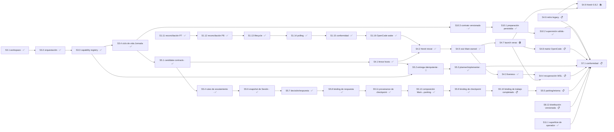
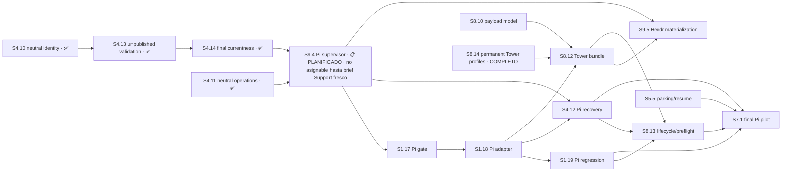
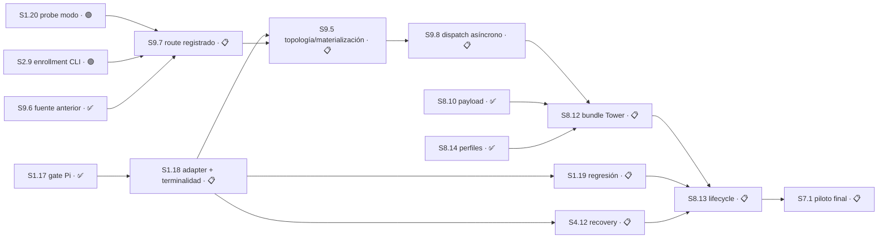

# Cadena de release — producto único

> **Autoridad vigente:** la reconciliación Pi-first del 2026-08-27 al final de este archivo. Todo lo anterior se preserva como traza histórica y no autoriza iniciar OpenCode mientras esté parqueado.

> Decidido el 2026-08-01 por el maintainer. Este archivo define **qué tiene que estar
> cerrado para declarar la primera versión del producto**, y en qué orden lo permite el
> grafo de dependencias.
>
> El [master-index](master-index.md) dice DÓNDE estamos. Este archivo dice QUÉ FALTA
> para salir. El estado del código vive en [implementation-state](implementation-state.md).

## La decisión

**Control Tower es un solo producto, con un solo roadmap y un solo release.** Las etiquetas
`installable-v1`, `autonomous-v2`, “V1” y “V2” sobreviven sólo como nombres de artefactos
históricos; no son identidades vigentes de producto ni de release.

Motivo: el maintainer definió que la primera versión no se declara hasta poder **aprobar
desde el teléfono** las decisiones que requieren su autoridad. Esa capacidad está
especificada en `sdd-tower-implementation-v1-requirements.md` §16–§17, y el split del
2026-07-31 la había reasignado al lane `autonomous-v2`. Con ese alcance dentro, la
frontera entre los dos "productos" ya no describe el trabajo: dejó de separar dos cosas
entregables y pasó a separar la primera versión de sí misma.

### Lo que NO cambia

1. **La entrega sigue siendo incremental.** Un roadmap único no significa que nada sale
   hasta que sale todo. Cada Sesión sigue siendo una unidad entregable a `master`, y el
   orden lo dicta el grafo, no un big bang.
2. **`CT_V2_ONLY` no se borra.** `bin/torre:28` corta capacidades en código, no en prosa.
   Al desaparecer la frontera de producto, esa línea pasa a ser un **flag de capacidad
   opt-in, apagado por defecto**. La autonomía se enciende porque alguien la enciende,
   nunca porque se cayó una etiqueta.
3. **Las etiquetas históricas pueden orientar la lectura de artefactos**, nunca dividir el producto,
   el roadmap o el release.
4. **El orden de hosts se acota.** OpenCode cierra primero mediante una raíz primaria Main-owned con vista adjunta no autoritativa. `S4.2` conserva la entrega Herdr inicial como historia; `S4.5` reemplaza su lifecycle futuro. `S1.17`–`S1.19` siguen diferidas.

## El punto de release

La primera versión OpenCode se declara cuando el maintainer puede, desde Moshi:

- ver el estado y los escalamiento que Main le presenta;
- decidir sobre el objetivo exacto que Main mantiene como autoridad;
- continuar el loop planner N+1 / implementer N sin que el wake otorgue autorización.

Main posee backend, proceso y raíz primaria por worktree. La TUI adjunta sólo permite steering local y su cierre no afecta la raíz; Herdr puede ser como máximo un launcher de vista reemplazable. La recuperación queda limitada al mismo host/worktree/checkpoint: una vista perdida reconecta el root vivo y una muerte probada crea root/epoch sucesores con lineage, brief durable y fencing stale, sin reutilizar el ID anterior.

## La cadena

| Orden | ID | Resultado | Estado | Depende de |
|---|---|---|---|---|
| ✅ | `S8.8` | Adopción del instalable en el runtime en uso | ✅ COMPLETO | `S8.2` ✅ |
| ✅ | `S0.3` | Enmienda del requisito de puente acotado | ✅ COMPLETO | — |
| ✅ | `S3.1` | Workspace | ✅ COMPLETO | `S2.4` ✅ |
| ✅ | `S3.2` | Orquestación | ✅ COMPLETO | `S3.1` ✅; implementación `22c43ae`, 14/14 criterios `CORROBORATED_FIXED` |
| ✅ | `S3.3` | Agent Capability Registry | ✅ COMPLETO | `S3.2` ✅; implementación `4621d3f`, 14/14 criterios verificados por el planner contra el SHA integrado |
| ✅ | `S3.4` | Persistencia y ciclo de vida de Jornada | ✅ COMPLETO | `S3.2` ✅, `S3.3` ✅; implementación `b6dda84`, 11/11 criterios verificados por el planner contra el SHA integrado. **Cierra P3 entero** |
| ✅ | `S5.1` | Candidate contracts, authorization store y frontera Support | ✅ COMPLETO | `S3.2` ✅, `S3.3` ✅, `S3.4` ✅; candidato `c7c2472`, 27/27 criterios y 537/537 tests |
| ✅ | `S4.1` | Hosts y línea exclusiva | ✅ COMPLETO | `S3.1` ✅, `S3.2` ✅, `S5.1` ✅; cierre técnico `1f5fea7`, 19/19 criterios |
| ✅ | `S1.11` | Reconciliación independiente legacy P7 | ✅ COMPLETO | `S1.9` ✅, `S1.10` ✅; publicado en `origin/master@3db3c121` |
| ✅ | `S1.12` | Reconciliación independiente P8 | ✅ COMPLETO | `S1.11` ✅; `6bb7019` es ancestro de `origin/master@a3d9e51` |
| ✅ | `S1.13` | Root lifecycle e invalidación sincrónica | ✅ COMPLETO | `S1.12` ✅; `794611f` es ancestro de `origin/master@a3d9e51`; focused 10/0/73 y full 620/0/3691 |
| ✅ | `S1.14` | Polling y wake safety | ✅ COMPLETO | `S1.13` ✅; `9886af9` es ancestro de `origin/master@a3d9e51`; focused 18/0/175, full 628/0/3793, 392 líneas authored |
| ✅ | `S1.15` | Conformidad lifecycle OpenCode | ✅ COMPLETO | `S1.14` ✅; `428b3ed` y documentación `e37a159` son ancestros de `origin/master@a3d9e51`; full 643/0/3818 en 41 archivos, 399 líneas authored |
| ✅ | `S1.16` | Transporte reconciliado y composición wake | ✅ COMPLETO | `S1.15` ✅; implementación `da4e391`, parent `a3d9e51`; focused expandida 49/0/304, full 671/0/4020 en 43 archivos, 298 líneas authored; la entrega directa incluye este cierre documental |
| ✅ | `S4.2` | Lanzamiento visible de raíz OpenCode | ✅ COMPLETO | Entregada en `61a5aa2`; Herdr 0.8 conserva valor histórico, no lifecycle futuro |
| ✅ | `S4.5` | Raíz primaria Main-owned con vista adjunta | ✅ COMPLETO | `S4.2` ✅ |
| ✅ | `S4.3` | Inspección, liveness y rehidratación segura | ✅ COMPLETO | `S4.5` ✅ |
| — | `S1.17` | Gate y RED Pi/Intercom | 🟡 DIFERIDO | trabajo posterior host-neutral; no bloquea OpenCode |
| — | `S1.18` | Adapter Pi/Intercom | 🟡 DIFERIDO | `S1.17` diferida |
| — | `S1.19` | Regresión Pi/Intercom | 🟡 DIFERIDO | `S1.18` diferida |
| 2 | `S4.4` | Recuperación lógica same-host con raíz sucesora | 📋 PLANIFICADO | `S4.3` ✅ y `S4.7`; reconexión o raíz/epoch sucesores |
| 1 | `S4.7` | Launch Main-owned veraz y vista autenticada | 🟢 LISTO | `S4.5` ✅; timeout sólo si reproduce el mismo launch path |
| 4 | `S4.6` | Retiro legacy y pin Herdr | 📋 PLANIFICADO | `S8.10` ✅; serial con `S4.7` por Área compartida |
| 5 | `S4.8` | Matriz real OpenCode 1.18.23 | 📋 PLANIFICADO | `S4.7`; alinea plugin/SDK juntos sólo en verde |
| 6 | `S4.9` | Probe/adopción guardada Herdr 0.8.2 | 📚 ARCHIVADO | retirada 2026-08-29 por la [decisión 99](decision-register.md); `0.8.2` adoptado fuera del plan y la Sesión se quedó sin sujeto; **nunca gateó la release** |
| ✅ | `S11.1` | Ejecutor y superficie de operador | ✅ COMPLETO | Código `8d86bf6` → `2dbb714`, reconciliación OpenSpec en el commit documental posterior de la misma publicación y suite 884/0/5.068; la actualización no destructiva de Notion es el paso post-push |
| ✅ | `S5.4` | Ruteo de escalamiento fuera/en casa | ✅ COMPLETO | `S5.1` ✅; publicado en `origin/master` mediante `976b8d0`, `75549a7`, `f9f2869` y reconciliado en `d114677`; 9/9 Tareas, 15/15 criterios. **No** depende de `S8.7` |
| — | `S5.2` | Entrega idempotente y post-check | 🔴 BLOQUEADO | `S4.1` ✅, `S3.3` ✅; recheck 8193 mantiene abiertos 1/3/5 y decisión 8195 estaciona el candidato NOT READY |
| ✅ | `S5.6` | Contrato canónico de snapshot de Sesión | ✅ COMPLETO | `S5.4` ✅; publicado en `origin/master@75ddcf9`, 10/10 Tareas, 10/10 criterios, focused 75/0/348 y full 588/0/3452 |
| ✅ | `S5.7` | Contratos canónicos de decisión estacionada y respuesta | ✅ COMPLETO | `S5.6` ✅; publicado en `origin/master@3db3c121` e integrado en `master@427b14e` |
| ✅ | `S5.8` | Binding de opción seleccionada en autoridad canónica | ✅ COMPLETO | `S5.7` ✅; integrada y verificada localmente en `master@427b14e` mediante `6bb7019`, focused 42/0/250 y full 610/0/3618, sin push remoto |
| ✅ | `S5.11` | Productores canónicos de provenance del checkpoint | ✅ COMPLETO | `S5.8` ✅; integrada y verificada localmente en `master@b4d7fcd` (tree `7873570`), 12/12 criterios, full 656/0/3941 en 42 archivos, 620 líneas authored bajo `size:exception`, sin push remoto |
| ✅ | `S5.12` | Composición única de productores hacia parking bajo Main | ✅ COMPLETO | `S5.11` ✅; implementación `e7b1437f8c98c5856236e06e4c1fb5c40e9dc8ef`, 8/8 criterios, focused 52/0/306, full 663/0/3986 y publicación probada en `origin/master@cebcaeb` |
| ✅ | `S5.9` | Binding autoritativo del checkpoint estacionado | ✅ COMPLETO | Entregada el 2026-08-18 en `3c3040d`, `754c698` y `8d4b28a`; `full-sdd` completo hasta verify, 7/8 criterios con evidencia de runtime y el criterio 2 enmendado por la decisión 41 |
| — | `S5.10` | Binding inmutable del trabajo independiente completado | 📋 PLANIFICADO | `S5.9`; ruta `design-tasks` |
| — | `S5.5` | Parking y retoma del loop | 📋 PLANIFICADO | `S5.10`; planner N+1 / implementer N |
| ✅ | `S5.3` | Continuación planner/implementer | ✅ COMPLETO | Base `master@88d1de4`; candidato verificado `163a9f9`; dependencia de `S7.1` satisfecha |
| — | `S8.7` | Puente Hermes/Telegram | 📚 ARCHIVADO | supersedido por Moshi; no integra producto ni release OpenCode |
| ✅ | `S10.3` | Contrato de ejecución versionado | ✅ COMPLETO | `S3.4` ✅; candidato exacto basado en `cdd0d09`, 17.297 bytes, 407 líneas, SHA-256 `2f4838aa244b30e280c5c558286b0e4d9fbb503a0ef1808ffc27501c1540fddc`; entrega directa aún no autorizada |
| ✅ | `S10.1` | Preparación persistida de Jornada | ✅ COMPLETO | `S10.3` ✅; candidato técnico verificado, focused 8/0/144 y full 679/0/4164 en 44 archivos; owner pasivo Jornada-local y cero efectos |
| ✅ | `S10.2` | Supervisión válida sin armado local | ✅ COMPLETO | `S10.1` ✅; comportamiento local `44f23adbb80bed974246aa3761573a388e5761bf`, tree `d5343fda0373c5152ad94bc248db5a5d0ccf8031`; focused 4/0/22, full 721/0/4361 en 52 archivos durante supervisión externa válida y `remote-control` 2/0/14 sin cambios |
| 10 | `S7.1` | Conformidad de release OpenCode | 📋 PLANIFICADO | `S11.1` ✅ y `S10.2` ✅; todavía espera `S4.4`, `S4.6`, `S4.8`, `S5.3`, `S5.5` y `S8.12`. `S4.9`, Pi y `S8.7` no son prerequisitos |

> **Contradicción reconciliada el 2026-08-11.** Hasta esta fecha el grafo Mermaid declaraba
> `S44 --> S71` y esta tabla omitía `S4.4`, con la prosa sin mencionar su retiro. Las dos
> lecturas tenían autoridad idéntica dentro del mismo archivo, y la diferencia valía siete
> Sesiones — `S4.2`–`S4.4` más `S1.16`–`S1.19`, la mitad del trabajo restante.
>
> **Resuelta por el maintainer: gana el grafo.** `S7.1` depende de `S4.4`; la rama de
> recuperación y failover entra en la cadena de release. La tabla se corrige para coincidir.
> La decisión histórica fue explícita —construir las catorce Sesiones que ese corte enumeraba como restantes— y no una derivación; la reconciliación actual agrega los prerrequisitos omitidos sin reescribir aquella evidencia.

**Métrica histórica al 2026-08-11: 26/37 Sesiones cerradas o archivadas (70%).** Se conserva como evidencia del corte de esa fecha; no mide la ruta vigente. El estado actual y su denominador auditable son `46/66` en el [master-index](master-index.md). `S5.6`–`S5.12` agregan siete unidades revisables y
secuenciales entre `S5.4` y `S5.5`: snapshot/parser canónico, contratos de decisión/respuesta,
binding terminal, productores de provenance, composición Main→parking, binding autoritativo de
checkpoint y binding inmutable del trabajo completado bajo la autoridad exclusiva de Main. La
separación fue aprobada por el maintainer porque expandir `S5.5` ad hoc, validar localmente o
sintetizar provenance en consumidores duplicaba contratos y autoridad.

Las siete Sesiones entregan los contratos, productores y bindings que `S5.5` consume. `S5.5`
estaciona y retoma sólo desde el checkpoint durable y los campos declarados `Depende de`, `Área`,
`Recurso` y `Decisiones`; no deriva elegibilidad adicional.

`S3.4`, enumerada el 2026-08-04, existía porque `jornada-v1` era contrato **sin implementación**,
y `policy/jornada.mjs` —que entregó `S3.2`— es un resolvedor puro que recibe la Jornada como
argumento, no un store. Su alcance es **pasivo**: incrementa `jornada_revision` en toda
transición, con lo que una Jornada terminada invalida por drift las entradas de capability
ligadas a ella; no dispara revocación activa en cascada.

`S7.1` pasa a depender de `S5.5` en vez de `S5.4`: verificar que el escalamiento **sale**
no alcanza como conformidad de release si la Torre igual se queda esperando la respuesta.
`S5.5` depende transitivamente de `S5.4` a través de `S5.6`–`S5.12`, así que la cobertura
de `S5.4` queda incluida.

`S0.3` cerró el 2026-08-01 en `9595b92`. Como evidencia histórica, resolvió la contradicción sobre si el
puente puede transportar un callback de merge **ya no existe**. La decisión aceptada de
2026-08-10 agrega que Remote Control y Tower comparten bot/gateway pero usan plugins,
comandos, repositorios y releases separados; el interlock conserva una única autoridad.
Tower adaptaba contratos de identidad/scope hash, CAS, receipts, envío idempotente,
privacidad y TTL sin importar código de Remote Control. La rebase 2026-08-17 archivó esa ruta junto con `S8.7`.

El comportamiento Hermes/Telegram restante es evidencia histórica archivada; no participa en la ruta activa.

## Capacidad paralela hoy

La capacidad se deriva del grafo, `Área`, `Recurso` y decisiones abiertas. `S4.14` está ✅ COMPLETO contra el candidato local verificado `daf7e0e7af4122417ce2bec8a48a11c65a40f23c`; `#1 S9.4` permanece 📋 PLANIFICADO, sin worker asignado y no asignable hasta recibir un brief fresco de Support sobre la base entregada. La capacidad asignable es **0** hasta ese gate. Todo estado parcial es evidencia, no capacidad.

`S8.14` ya está ✅ COMPLETO en `master/origin/master@54b5cda733025b0bd50c2a21dc67d1d4192ac66d` y sale de la capacidad pendiente. `S8.12` conserva la expresión completa `S8.10 + S1.18 + S8.14`: `S8.10` y `S8.14` están satisfechas y todavía espera `S1.18`.

OpenCode permanece parqueado con preservación absoluta. La entrega de `S8.14` no altera ese estado, no implementa el host Pi y no habilita por sí sola otra línea inmediata.

## Enmienda `S0.3` — ✅ COMPLETA

Había una contradicción entre dos documentos que describían la primera versión:

| Fuente | Qué dice |
|---|---|
| `openspec/specs/sdd-tower-implementation-v1-requirements.md` §16–§17 | **Alcance retirado el 2026-08-30.** Define canal, sobre, callback, fallback textual y revalidación para una autorización por superficie remota que ya no forma parte del producto. Se cita como fuente histórica, no como requisito vigente. |
| `changes/archive/2026-07-31-installable-v1-autonomous-v2-split/specs/installable-control-tower-v1/spec.md:73-87` | El puente **MUST NOT** exponer Git delivery ni merge. El escenario *Remote authority is rejected* obliga a **rechazar** una solicitud de merge que venga de Hermes. |

Se resolvió sin interpretación. En una frontera de autoridad, la ambigüedad es el incidente.
`S0.3` enmendó el requisito del puente acotado para que el puente pueda **presentar** una
autorización y **transportar** un callback acotado, manteniendo intacto el principio de
§16.1: *Hermes presenta; Main crea, valida y consume.* El puente nunca tiene autoridad;
transporta la decisión de quien sí la tiene.

## Drift reconciliado — ✅ CERRADO el 2026-08-03

`schemas/authorization-v1.schema.json` y `main-store/store.mjs` **ya coinciden**. Se resolvió
como prerrequisito, fuera del freno de ejecución, porque era un contrato que dos archivos leían
distinto y no trabajo nuevo de `S5.1`.

Eran **seis** divergencias, no las dos que este documento registraba:

| Schema exigía | Store exigía | Resolución |
|---|---|---|
| `pr` (PR-specific), opcional | `target`, `source_sha`, `target_sha` | `delivery` con `shape` (`pull-request`/`direct-push`) |
| `required_checks_digest`, `policy_report_digest` | `checks` | ganan los digests |
| `registry_revision` + `jornada_revision` | un solo `revision` | ganan los dos del schema |
| `nonce_hash`, `created_at`, `action`, `state`, `schema`, `schema_version` | no los exigía | el store los exige |
| clave `state` | clave `status` | `state` |
| valores `PENDING\|CONSUMED\|REJECTED\|EXPIRED\|REVOKED` | `PENDING\|APPROVED\|REVOKED\|EXPIRED` | `PENDING\|APPROVED\|REJECTED\|EXPIRED\|REVOKED` |

**El schema mandaba**, por `sdd-tower-implementation-v1-requirements.md:111` (lista normativa) y
`contracts/schema-registry.mjs:12`. Pero necesitaba enmienda antes de que el store se le adaptara:
su `action` era `MERGE_PR` y su único binding de entrega era `pr`, las dos cosas atadas a entrega
por pull request, incompatibles con el corte política/seguridad de `d232fdf`. Ahora `action` es
`MERGE` y el binding es `delivery`, con condicionales que exigen `number` sólo en `pull-request`
y prohíben `delivery` en `START_JORNADA`.

**Dos cosas que la reconciliación destapó y arregló de paso:**

- El store **no podía registrar un rechazo**. Sus decisiones terminales eran `APPROVED`, `REVOKED`
  y `EXPIRED`; `REJECTED` no existía pese a estar en el enum canónico. Ahora sí.
- `createAuthorization` validaba contra un array `required` escrito a mano al lado de un schema
  canónico — que es exactamente cómo se produjo el drift. Ahora valida contra `authorization-v1`
  vía `contracts/validate.mjs`, así que la clase de bug es estructuralmente imposible.

`S5.1` cerró como dueña del authorization store, sin el contrato roto que existía antes de su ejecución.

Corresponde a `S5.1`, que es la Sesión que toma posesión del authorization store.

## Alcance sin ID

Se registra explícitamente en lugar de esconderse:

- **P2 — responsabilidades posteriores de Change B.** Sin límite de un PR demostrable. Ver
  el [apéndice de migración](plan-vocabulary-migration-appendix.md).
- **P6 — Campañas multiproyecto.** Sin Sesiones enumeradas. Fuera de la cadena de release.
- **P8 — `S8.5` y `S8.6`.** 🟡 DIFERIDO por decisión del 2026-07-31. Se mantienen fuera.

## Reconciliación del 2026-08-21 — cierre de la Fase 2 de depuración

**`S8.10` cerró e integró en `master@7b58ad8`**, con la suite completa en 863 pass / 13 todo / 0 fail. Eso destrabó la puerta semántica de `S4.4`, que vuelve a 🟢, y volvió elegibles a `S4.6` y `S8.12`.

**Los IDs de P9 cambiaron.** La [decisión 62](decision-register.md) recortó y reordenó ese Plan, y como el estándar define los IDs como posicionales, se renumeraron. Toda referencia a `S9.x` anterior a esta fecha —incluida la de §174 sobre la decisión 53— usa la numeración vieja. **La tabla de migración vive en [plan-9](plan-9/STATUS.md) y la historia no se reescribe.** En corto: el pool de asientos pasó a ser `S9.1`, el lifecycle seguro pasó a `S9.2` reducido a un solo resultado, la caché de Bun a `S9.3`, el launcher Pi a `S9.4` 🟡 DIFERIDO, y la vieja `S9.3` se eliminó.

**Tres Sesiones nuevas entran en la cadena** por la [decisión 63](decision-register.md), todas nacidas de las auditorías exclusivas:

- **`S11.1`** — ejecutor de comandos y superficie tipeable, en el Plan 11 nuevo. **No depende de nada** y encabeza la cola: el vocabulario, el validador y el canal `send`/`receive` ya existen y ya se instalan. Sin ella, `S7.1` no puede declarar conformidad sobre un contrato de operador que no se puede ejercer.
- **`S4.6`** — retiro del adaptador de lanzamiento de `S4.2` y del fijado literal de Herdr 0.8.0. Hasta que cierre, **la única dependencia externa del producto que puede romperse sola sigue viva**.
- **`S8.12`** — canal único de distribución. El ownership ya está resuelto en fuente por la decisión 100, pero el canal de agentes todavía no tiene packaging Tower versionado; instalación, rollback y activación atómica siguen en `S8.13`.

**La brecha 6 dejó de estar sin dueño.** La cubren `S8.12` y el orden de conexión del [inventario de producto](inventario-de-producto.md), que además clasifica los 34 módulos sin llamador en cuatro cajones y fija la regla: ninguna Sesión de cableado enchufa un módulo «porque está suelto» — enchufa un comando del vocabulario, y el módulo entra con él.

## Reconciliación Pi-first — cadena vigente 2026-08-28

La cadena OpenCode anterior, sus commits, pruebas y decisiones queda preservada como historia parqueada. No es autoridad activa mientras OpenCode permanezca 🟡 DIFERIDO.

**Cadena Pi:** `S4.10✅ → S4.13✅ → S4.14✅ → S9.4📋 → S1.17 → S1.18 → S1.19`, reteniendo `S4.11✅ → S9.4📋`. `S4.14` está completa en el candidato local verificado; `S9.4` permanece 📋 PLANIFICADO y no es asignable hasta recibir un brief fresco de Support sobre la base entregada. `S4.12` y `S9.5` siguen transitivamente downstream de `S4.14` mediante `S9.4`: no se agregan aristas directas `S4.14 → S4.12` ni `S4.14 → S9.5`. El grafo permanece acíclico.

**Aristas activas verificables:**

| Desde | Hacia | Razón |
|---|---|---|
| `S4.10` ✅ | `S4.13` ✅ | Extiende ownership neutral ya entregado sin reabrirlo |
| `S4.11` ✅ | `S9.4` 📋 | El supervisor consume operaciones neutrales ya entregadas |
| `S4.13` ✅ | `S4.14` ✅ | Extiende el gate entregado con actualidad final same-stack |
| `S4.14` ✅ | `S9.4` 📋 | La guardia final neutral está satisfecha; resta el brief fresco de Support |
| `S9.4` 📋 | `S1.17` 📋 | El gate Pi necesita supervisor/binding vigente |
| `S9.4` 📋 | `S4.12` 📋 | Recuperación consume el supervisor ya entregado |
| `S9.4` 📋 | `S9.5` 📋 | Materialización consume binding Pi/Intercom vigente |

**Redundancia evitada:**

- No existe `S4.14 → S4.12`; la dependencia transita por `S9.4`.
- No existe `S4.14 → S9.5`; la dependencia transita por `S9.4`.
- `S4.11 → S9.4` permanece explícita.
- La adición de `S4.14` no crea camino de regreso; el grafo permanece acíclico.

**Frontera de ownership vigente:** la migración de fuente quedó entregada históricamente en Control Tower `6237275b1a45b8380ce094edcb9dda23155ff006` y en el entonces repositorio independiente `agent-workflows` hasta `1a542da`; desde el merge `dbb7626904a09323e19dd7a60f747d29c8c62f5d`, la autoridad genérica activa es el subtree interno `agent-workflows/` y cada fuente instala sólo sus assets. La corrida normal de `torre-control --update` actualizó las skills y retiró las cuatro copias globales stale de `torre-control-entregas`, pero la mitad Tower falló en `install.sh:79` después de copiar el plugin: `cp` siguió el shim symlink hacia una versión owner-read-only. Por decisión 102 no se ejecuta `upgrade --shim`: engine/shim activos siguen viejos y la coherencia MCP/engine/plugin no está verificada. **La Torre instalada está no verificada/no disponible, no saludable.** `S8.12` aún debe empaquetar el set Tower-owned; `S8.13` debe reemplazar el camino legado por el lifecycle versionado atómico y diagnosticar revisión/coherencia real; `S9.5` conserva la materialización del binding al worktree exacto.

**Validación, no decisión:** la corrida desatendida prolongada, crash del broker con tráfico y el límite de cinco clientes son gates de evidencia. El claim inicial termina en cinco; >5 no se promete hasta medirlo.

**Capacidad y próxima acción de ese corte:** `S4.14` estaba ✅ COMPLETO y `S9.4` todavía figuraba 📋. La reconciliación siguiente reemplaza ese punto de retoma; esta prosa se conserva como historia del 2026-08-28.

## Reconciliación del workflow aprobado — 2026-09-01

La decisión 104 no reabre P11 ni acredita el candidato no entregado de `S1.18`. Enumera los owners faltantes y divide el flujo fresco en resultados revisables de ≤400 authored:

**Orden de release vigente:** `S1.18`; en paralelo pueden avanzar `S1.20` y `S2.9`; después `S9.7 → S9.5 → S9.8 → S8.12`. Desde `S1.18` siguen además `S1.19` y `S4.12`; `S8.13` exige las tres ramas y `S7.1` conserva sus gates restantes. `S2.10` no entra en esta cadena: la UX híbrida sigue obligatoria, pero el owner del menú central está 🔴 BLOQUEADO por evidencia ausente y no se inventa.

**Semántica de cierre:** Main no espera trabajo ordinario. Cada assignment usa `dispatch_id` y sólo un terminal `COMPLETED|BLOCKED|FAILED` con evidencia/recoverability habilita progreso o downstream. El candidato local no entregado de `S1.18`, sin notificación terminal, conserva cero crédito.
