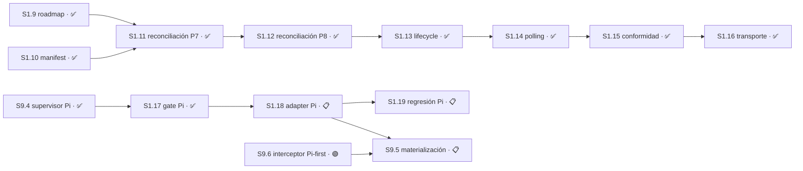

# Plan 1 — Sustrato mecánico

**Estado:** 🔵 EN CURSO
**Avance:** **89% (17/19 S)** — cuentan sólo las Sesiones ✅ COMPLETO o 📚 ARCHIVADO del registro canónico siguiente.
**Granularidad:** `Plan → Sesión → Módulo → Tarea`; no existe un quinto nivel.

## Autoridad vigente y cómputo canónico

Pi es el primer host de implementación. La cadena activa empieza en [`S9.4`](../plan-9/STATUS.md) y continúa por `S1.17 → S1.18 → S1.19`; `S1.18` converge con el interceptor [`S9.6`](../plan-9/STATUS.md) en `S9.5`, y la cadena de materialización y entrega sigue `S9.5 → S8.12 → S8.13` antes de `S7.1`. `S8.13` conserva además sus gates directos `S1.19` y `S4.12`. La base OpenCode `S1.11`–`S1.16` permanece cerrada y preservada, pero su continuación futura está diferida. Claude permanece como objetivo opt-in posterior en `P8/S8.5`. Ni OpenCode ni Claude bloquean la primera release Pi.

Este es el único registro de **estados vigentes** que define el numerador y el denominador de P1. Las tablas posteriores que describen estados anteriores son historia y no vuelven a enumerar Sesiones.

<!-- P1-SESSION-LEDGER:START -->
| ID | Sesión | Estado vigente | Dependencia vigente o cierre |
|---|---|---|---|
| S1.1 | Baseline y recovery legacy P6 | ✅ COMPLETO | PR #38 |
| S1.2 | Migration 005 pinning | ✅ COMPLETO | PR #39 |
| S1.3 | Fresh schema 4→5 migration | ✅ COMPLETO | PR #40 |
| S1.4 | Proof plane | ✅ COMPLETO | PR #41 |
| S1.5 | ON-mode dispositions | ✅ COMPLETO | PR #42 |
| S1.6 | Rollback plane | ✅ COMPLETO | PR #43 |
| S1.7 | Redelivery closure | ✅ COMPLETO | PR #44 |
| S1.8 | Closure claim-present correction | ✅ COMPLETO | PR #45 |
| S1.9 | Roadmap/catalog y enmiendas legacy P7/P8 | ✅ COMPLETO | `b96e4d9` |
| S1.10 | Plan Manifest revision 2 y ArtifactRefs | ✅ COMPLETO | `a1c75b3` |
| S1.11 | Reconciliación independiente legacy P7 | ✅ COMPLETO | `S1.9`, `S1.10` |
| S1.12 | Reconciliación independiente P8 | ✅ COMPLETO | `S1.11` |
| S1.13 | Root lifecycle e invalidación sincrónica | ✅ COMPLETO | `S1.12` |
| S1.14 | Polling y wake safety | ✅ COMPLETO | `S1.13` |
| S1.15 | Conformidad lifecycle OpenCode | ✅ COMPLETO | `S1.14` |
| S1.16 | Transporte reconciliado y composición wake | ✅ COMPLETO | `S1.15` |
| S1.17 | Gate y RED del adapter Pi | ✅ COMPLETO | `4248da9` |
| S1.18 | Adapter Pi/Intercom | 📋 PLANIFICADO | `S1.17` |
| S1.19 | Regresión integral Pi-first | 📋 PLANIFICADO | `S1.18` |
<!-- P1-SESSION-LEDGER:END -->

La cuenta es mecánica: 17 filas cerradas de 19 filas enumeradas. No hay crédito parcial ni trabajo pendiente de P1 fuera de este denominador.

## Resumen

| Campo | Detalle |
|---|---|
| Dependencias | La cadena legacy P7/P8 permanece como historia cerrada. La autoridad activa Pi-first empieza en `S9.4`; Change A no es dependencia de legacy P7/P8. |
| Outputs | Recovery/rollback fail-closed; controller host-neutral y base OpenCode cerrada; gate privado Pi cerrado en `S1.17`; adapter runtime y regresión Pi pendientes en `S1.18`–`S1.19`. Las responsabilidades legacy P9–P11 están reconciliadas más abajo con sus dueños actuales. |
| Roadmap | Ejecutar primero Pi. OpenCode y Claude siguen como objetivos futuros/diferidos y no son gates de la primera release Pi. |
| Referencias | [`autonomous-continuation-control-tower`](../../changes/autonomous-continuation-control-tower/), [`p7-host-neutral-loop-opencode-adapter`](../../changes/p7-host-neutral-loop-opencode-adapter/), [`p8-slice-planning`](../../changes/p8-slice-planning/), [cadena de release](../release-chain.md), [Plan Manifest](../sdd-tower-implementation/manifest.yaml). |

Legacy P6 se integró mediante PRs #38–#45 y cerró en `e16d94b`. Su [`apply-progress.md`](../../changes/autonomous-continuation-control-tower/apply-progress.md) es evidencia histórica y permanece sin reescritura. `S1.1`–`S1.8` son cierres anteriores al contrato moderno de cinco campos: no se fabrican retroactivamente `Área`, `Recurso`, `Decisiones`, Módulos o Tareas que esa fuente no declaró. `S1.9`–`S1.12` preservan su definición canónica en [`p7-p8-integrated-reconciliation/tasks.md`](../../changes/p7-p8-integrated-reconciliation/tasks.md); `S1.13`–`S1.19` conservan sus contratos detallados en este documento y en sus `tasks.md` enlazados.

## Evidencia histórica de S1.1–S1.10

| ID | Resultado | Estado | Evidencia |
|---|---|---|---|
| S1.1 | Baseline y recovery legacy P6 | ✅ COMPLETO | PR #38 |
| S1.2 | Migration 005 pinning | ✅ COMPLETO | PR #39 |
| S1.3 | Fresh schema 4→5 migration | ✅ COMPLETO | PR #40 |
| S1.4 | Proof plane | ✅ COMPLETO | PR #41 |
| S1.5 | ON-mode dispositions | ✅ COMPLETO | PR #42 |
| S1.6 | Rollback plane | ✅ COMPLETO | PR #43 |
| S1.7 | Redelivery closure | ✅ COMPLETO | PR #44 |
| S1.8 | Closure claim-present correction | ✅ COMPLETO | PR #45 |
| S1.9 | Roadmap/catalog y enmiendas legacy P7/P8 | ✅ COMPLETO | `b96e4d9` |
| S1.10 | Plan Manifest revision 2 y ArtifactRefs | ✅ COMPLETO | `a1c75b3` |

## Sesión S1.11 — Reconciliación independiente legacy P7

**Estado:** ✅ COMPLETO — las tres Tareas quedaron cerradas en `a1dce22`: existe el registro P7, los chequeos binarios están documentados y el gate acotado fue aprobado por el maintainer. El cierre está publicado en `origin/master@3db3c121d48a07d7696afe6a88de044f30ea4695`; `a1dce22` es ancestro de ese tip remoto.

**Depende de:** `S1.9` ✅, `S1.10` ✅
**Área:** `openspec/changes/p7-host-neutral-loop-opencode-adapter/reconciliation.md` y sus enmiendas de gate
**Recurso:** ninguno. Torre desarmada; sin estado de runtime.
**Ruta:** `direct` — el alcance está aprobado y sus tres Tareas son explícitas. **Autoridad:** [`p7-p8-integrated-reconciliation/tasks.md`](../../changes/p7-p8-integrated-reconciliation/tasks.md#sesión-111--p7-reconciliation-record).

**Decisiones:**

- `escala` — la aprobación del gate P7 (`T1.11.1.3`). **Clase:** seguridad y permisos. **RESUELTA por el maintainer:** el registro integrado en `a1dce22` queda `BOUNDED_APPLY_APPROVED`. Aprobar un gate es un acto de autoridad, no una derivación. **Contaminaba:** `S1.13`–`S1.16`; la cadena autorizada posterior conserva sus propias dependencias y criterios.

La definición canónica de esta Sesión, incluidos `M1.11.1` y `T1.11.1.1`–`T1.11.1.3`, vive en [`p7-p8-integrated-reconciliation/tasks.md`](../../changes/p7-p8-integrated-reconciliation/tasks.md#sesión-111--p7-reconciliation-record). Este `STATUS` no redefine sus Tareas.

## Sesión S1.12 — Reconciliación independiente P8

**Estado:** ✅ COMPLETO — integrada en `master@6bb7019c66cf60e9ac874f05a176f946f9bd4589` (tree `1d34341f394cbeced9495e8384252dd975f9cab4`) mediante `5823ed6`. Los cuatro blobs coinciden con el candidato congelado y pasaron los checks de recibo, `ArtifactRef` y hashes. El cierre está publicado: `6bb7019` es ancestro de `origin/master@a3d9e510bc47d3ebec65d2a874945431128f7c90`.

**Depende de:** `S1.11` ✅
**Área:** `openspec/changes/p8-slice-planning/reconciliation.md`, `STATUS` de P8 y el recibo de persistencia
**Recurso:** ninguno. Torre desarmada; sin comportamiento ejecutable.
**Ruta:** `direct` — seis Tareas explícitas con comando de validación y frontera de rollback declarados. **Autoridad:** [`p7-p8-integrated-reconciliation/tasks.md`](../../changes/p7-p8-integrated-reconciliation/tasks.md#sesión-112--p8-reconciliation-and-preservation).

**Decisiones:**

- `escala` — la aprobación del gate P8 (`T1.12.1.3`). **Clase:** seguridad y permisos. **RESUELTA en el candidato integrado y verificado:** los checks de recibo, `ArtifactRef` y hashes pasaron sobre los cuatro blobs congelados. El cierre de `S1.12` no destraba `S1.17`: esa Sesión conserva su bloqueo externo por `assignment_id`, `session_id` y capacidad runtime reales ausentes. **Consecuencia operativa: `S1.17` no es candidata a modo nocturno.**

La definición canónica de esta Sesión, incluidos `M1.12.1` y `T1.12.1.1`–`T1.12.1.7`, vive en [`p7-p8-integrated-reconciliation/tasks.md`](../../changes/p7-p8-integrated-reconciliation/tasks.md#sesión-112--p8-reconciliation-and-preservation). Este `STATUS` no redefine sus Tareas.

## Grafo de dependencias de P1

`S1.1`–`S1.8` no reciben aristas inventadas: sus cierres legacy permanecen probados por PR #38–#45 y el `apply-progress.md` histórico.

## Resumen contractual de S1.13–S1.16

| ID | Resultado | Estado | Depende de | Ref |
|---|---|---|---|---|
| S1.13 | Root lifecycle e invalidación sincrónica | ✅ COMPLETO | `S1.12` ✅ | [`tasks.md`](../../changes/p7-host-neutral-loop-opencode-adapter/tasks.md) |
| S1.14 | Polling y wake safety | ✅ COMPLETO | `S1.13` ✅ | [`tasks.md`](../../changes/p7-host-neutral-loop-opencode-adapter/tasks.md) |
| S1.15 | Conformidad lifecycle OpenCode | ✅ COMPLETO | `S1.14` ✅ | [`tasks.md`](../../changes/p7-host-neutral-loop-opencode-adapter/tasks.md) |
| S1.16 | Transporte reconciliado y composición wake | ✅ COMPLETO | `S1.15` ✅ | [`tasks.md`](../../changes/p7-host-neutral-loop-opencode-adapter/tasks.md) |

## Sesión S1.13 — Root lifecycle e invalidación sincrónica

**Estado:** ✅ COMPLETO — integrada y verificada en `master@794611f925f4fd2cb0de0b69cfdf2798d011543d`. La implementación está en `2bbeddb`; `794611f` corrige la compatibilidad del fixture del grafo de Plan 5 sobre la misma historia integrada. El cierre está publicado: `794611f` es ancestro de `origin/master@a3d9e510bc47d3ebec65d2a874945431128f7c90`.

**Depende de:** `S1.12` ✅
**Área:** `host/loop.mjs`, `test/polling.test.mjs`
**Recurso:** —. Scheduler/controller falso, determinista y local al proceso; sin adapter, DB, estado de Torre, runtime externo, token de release, proceso host compartido, host SDK, SQLite, `core.mjs` ni `mcp.mjs`.
**Ruta:** `direct` — contrato acotado y Tareas preexistentes, sin decisión de diseño abierta. **Autoridad:** [`tasks.md`](../../changes/p7-host-neutral-loop-opencode-adapter/tasks.md#sesión-113--root-lifecycle-and-synchronous-invalidation) y aprobación bounded de `S1.11`.

**Decisiones:** —. La frontera bounded ya había sido aprobada en `S1.11`; `S1.13` no abrió ni resolvió contrato público, autoridad, persistencia o composición de adapter.

### Módulo M1.13.1 — Controller lifecycle

`T1.13.1.1`–`T1.13.1.5` están completas en el [`tasks.md` canónico](../../changes/p7-host-neutral-loop-opencode-adapter/tasks.md#sesión-113--root-lifecycle-and-synchronous-invalidation), que preserva el orden RED → GREEN → TRIANGULATE → REFACTOR → verificación. Este `STATUS` registra el cierre sin redefinir las Tareas ni acreditar trabajo de `S1.14`.

**Evidencia exacta de cierre:**

- Focused: `bun test test/polling.test.mjs` — PASS, 10 pass, 0 fail, 73 expect calls.
- Sintaxis: `node --check host/loop.mjs` — PASS, exit 0 sin output.
- Suite completa después de la corrección de compatibilidad: `bun test` — PASS, 620 pass, 0 fail, 3.691 expect calls en 40 archivos.
- Receipt de implementación: 378 líneas authored — `host/loop.mjs` 164 adiciones y `test/polling.test.mjs` 214 adiciones.
- Runtime harness: `N/A` — fake clock, scheduler one-shot FIFO y deferred ports forman la frontera determinista local al proceso.
- Rollback: remover sólo los bloques de `S1.13` en `host/loop.mjs` y `test/polling.test.mjs`.

## Sesión S1.14 — Polling y wake safety

**Estado:** ✅ COMPLETO — integrada y verificada en `master@9886af9ee289d78a35b404b06351f930ecb43309`, cuyo padre es `fee4f5b`. El commit integra exactamente `host/loop.mjs`, `test/polling.test.mjs` y el [`tasks.md` canónico](../../changes/p7-host-neutral-loop-opencode-adapter/tasks.md#sesión-114--polling-and-wake-safety). El cierre está publicado: `9886af9` es ancestro de `origin/master@a3d9e510bc47d3ebec65d2a874945431128f7c90`.

**Depende de:** `S1.13` ✅
**Área:** `host/loop.mjs`, `test/polling.test.mjs`
**Recurso:** —. Clock, scheduler, `peek` y `wake` son puertos inyectados y deterministas, locales al proceso; sin adapter, DB, estado de Torre, runtime externo, token de release, proceso host compartido, host SDK, SQLite, `core.mjs` ni `mcp.mjs`.
**Ruta:** `direct` — contrato acotado y cinco Tareas preexistentes, sin decisión pública, de autoridad, persistencia o composición abierta. **Autoridad:** [`tasks.md`](../../changes/p7-host-neutral-loop-opencode-adapter/tasks.md#sesión-114--polling-and-wake-safety), `S1.11` y el lifecycle inerte integrado por `S1.13`.

**Decisiones:** —. La política de polling, serialización de wake, reintentos y preservación no consumidora ya estaba fijada por las Tareas aprobadas; el cierre no expandió `Área` ni autoridad.

### Módulo M1.14.1 — Polling y comportamiento de wake

`T1.14.1.1`–`T1.14.1.5` están completas en el [`tasks.md` canónico](../../changes/p7-host-neutral-loop-opencode-adapter/tasks.md#sesión-114--polling-and-wake-safety), que preserva RED → GREEN → TRIANGULATE → REFACTOR → verificación. El cambio registra 392 líneas authored de implementación y pruebas, dentro del presupuesto de 320–400; `S1.13` permanece revertible de forma independiente.

**Criterios de aceptación de S1.14** — todos pasaron:

- [x] El throttle se evalúa antes de cada `peek` y la ventana monotónica reabre exactamente cuando corresponde
- [x] Cada tick usa un `peek` fresco y no consumidor; un descriptor pendiente permanece sin consumir ni reclamar
- [x] Existe un solo `wake` en vuelo, el intento se contabiliza antes de invocarlo y los fallos sincrónicos o asincrónicos no rompen el controller
- [x] Los reintentos ocurren exactamente a 1000, 2000 y 4000 ms, reejecutan `peek` y el cuarto fallo agota la secuencia sin inventar trabajo
- [x] Un `wake` exitoso pausa en `AWAITING_SETTLE`; settle posterior conserva la ventana global y clock/scheduler inválidos pausan antes de acceder a storage
- [x] `bun test test/polling.test.mjs`, `node --check host/loop.mjs` y la suite integral pasan sobre los bytes finales
- [x] Runtime harness queda `N/A` porque los puertos inyectados deterministas son la frontera process-local
- [x] El diff de implementación no toca ningún path fuera de `Área` y el rollback remueve sólo bloques S1.14, preservando el lifecycle inerte de S1.13

**Evidencia exacta de cierre:**

- Focused: `bun test test/polling.test.mjs` — PASS, 18 pass, 0 fail, 175 expect calls.
- Sintaxis: `node --check host/loop.mjs` — PASS, exit 0 sin output.
- Suite completa: `bun test` — PASS, 628 pass, 0 fail, 3.793 expect calls en 40 archivos.
- Receipt de implementación: 392 líneas authored — `host/loop.mjs` +142/-38 y `test/polling.test.mjs` +207/-5.
- Runtime harness: `N/A` — clock, scheduler, `peek` y `wake` inyectados y deterministas forman la frontera local al proceso.
- Rollback: remover sólo los bloques de polling/wake de `S1.14`, conservando el lifecycle inerte de `S1.13`.
- Review lens: `UNAVAILABLE` tipado — el dispatch directo de `review-reliability` exigía lineage de candidato controlada por el controller mientras el lifecycle nativo de review estaba suspendido; no se creó lineage ni se fabricó veredicto.

## Sesión S1.15 — Conformidad lifecycle OpenCode

**Resultado:** el adapter OpenCode clasifica el lifecycle alrededor del controller mediante una harness de conformidad CT-R5 reutilizable, sin asumir transporte confiable ni composición production `promptAsync` de `S1.16`.

**Estado:** ✅ COMPLETO — integrada y verificada en `master@428b3ed012c9217c72342041a28c5622d945fe1e` (tree `388b4ca8a6fd27ff7c4c81a706959b07764eb465`), después del fixture `6c968e0`. El cierre está publicado: `428b3ed` y su documentación `e37a159` son ancestros de `origin/master@a3d9e510bc47d3ebec65d2a874945431128f7c90`. Este cierre no acredita una Sesión posterior.

**Depende de:** `S1.14` ✅ COMPLETO
**Área:** `plugin/tower-spike.js`, `test/helpers/host-adapter-conformance.mjs`, `test/host-adapters.test.mjs`
**Recurso:** —. Fixtures y harness de conformidad deterministas, aislados y locales al proceso; runtime harness `N/A`. Sin DB del adapter, estado de Torre, runtime externo o compartido, proceso host compartido ni token de entrega.
**Ruta:** `direct` — el alcance, Módulo y cinco Tareas ya están fijados en el [`tasks.md` canónico](../../changes/p7-host-neutral-loop-opencode-adapter/tasks.md#sesión-115--opencode-lifecycle-conformance), sin decisión pública, de autoridad, persistencia o composición abierta.

**Decisiones:** —. Si la implementación exige ampliar `Área`, consumir runtime compartido, abrir persistencia/autoridad o adelantar transporte confiable o composición production `promptAsync` de `S1.16`, se detiene antes del RED y la expansión se escala como alcance nuevo; no se deriva dentro de `S1.15`.

### Módulo M1.15.1 — Adapter OpenCode y harness compartida

`M1.15.1` y `T1.15.1.1`–`T1.15.1.5` están completas en el [`tasks.md` canónico](../../changes/p7-host-neutral-loop-opencode-adapter/tasks.md#sesión-115--opencode-lifecycle-conformance), que conserva RED → GREEN → TRIANGULATE → REFACTOR → verificación. Este `STATUS` registra el cierre sin redefinir Tareas ni acreditar trabajo downstream.

**Criterios de aceptación de S1.15** — todos pasaron:

- [x] La harness parametrizada y los casos OpenCode cubren `CT-R5-S1@OpenCode`–`CT-R5-S5@OpenCode`, incluidos no-op de creación/eliminación/idle de child, eliminación de root coincidente, disposición de plugin, metadata malformada e identidades en conflicto
- [x] `plugin/tower-spike.js` expone una factory testeable que clasifica sólo eventos reconciliados de root/child probado, liga una vez, reenvía settle/eliminación sólo para el root ligado e invalida sincrónicamente ante eliminación de ese root o disposición
- [x] Las variantes de orden e información incompleta prueban que un evento desconocido nunca se trata como root, limpiar cache de child no detiene polling y la helper genérica no filtra nombres de campos OpenCode
- [x] `host/loop.mjs` permanece host-neutral y `plugin/tower-spike.js` no incorpora SQLite, `core.mjs`, `mcp.mjs`, `receive` consumidor ni una ruta de `claim` de entrega
- [x] `bun test test/host-adapters.test.mjs`, la suite focused indicada en `T1.15.1.5` y `node --check plugin/tower-spike.js` pasan sobre los bytes finales; se registran receipt de líneas, escenarios CT-R5, runtime harness `N/A` y rollback exacto
- [x] El diff de implementación no toca ningún path fuera de `Área` y el rollback remueve sólo cambios de adapter/fixtures/conformidad de `S1.15`, conservando el controller sin usar

**Evidencia exacta de cierre:**

- Fixture Plan 5: PASS, 14 pass, 0 fail, 158 expect calls.
- Adapter focused: PASS, 15 pass, 0 fail, 25 expect calls.
- Conformidad `CT-R5-S1@OpenCode`–`CT-R5-S5@OpenCode`: PASS, 5 pass, 0 fail.
- Filtro suplementario de clasificación: PASS, 6 pass, 0 fail.
- Suite focused expandida: PASS, 41 pass, 0 fail, 270 expect calls.
- Sintaxis: PASS, 3/3 archivos.
- Suite completa: PASS, 643 pass, 0 fail, 3.818 expect calls en 41 archivos.
- Receipt técnico: 399 líneas authored — `plugin/tower-spike.js` +68/-151, `test/helpers/host-adapter-conformance.mjs` +35/-0 y `test/host-adapters.test.mjs` +145/-0.
- SHA-256 técnicos: `plugin/tower-spike.js` `8136c52579f509a1b1ddc6968599956de1e3074bef3da759f4ad0262178787be`; `test/helpers/host-adapter-conformance.mjs` `72380b51940bfc26c0773217fc4dad52df7c8dca03b3280ee8a56a43ee0bb8a9`; `test/host-adapters.test.mjs` `3f93275842f792f075bfc541c0d17a235f6c498a6cb9710753b68c6418b6f1b2`.
- Runtime harness: `N/A` — la harness CT-R5 determinista y local al proceso es la frontera declarada.
- Rollback: remover sólo los cambios de adapter/fixtures/conformidad de `S1.15`, conservando el controller host-neutral sin usar.
- Review tooling: `UNAVAILABLE` tipado por suspensión del lifecycle; no se creó lineage ni se fabricó veredicto.

**Prueba de no interferencia con `S5.11`/`S5.12`:** no existe arista de dependencia entre esas Sesiones y `S1.15`; los tres paths de `Área` no intersectan `workspace/**`, `schemas/**`, `contracts/**`, `test/workspace/**`, `test/contracts/**`, `test/fixtures/contracts/**`, `escalation/**`, `main-store/store.mjs`, `test/escalation/**` ni `test/main-store.test.mjs`. `S1.15` declara `Recurso: —` y no reclama productores de provenance, registro de contratos/fixtures, composición Main, ingress o transacción de parking. Por grafo, `Área` y `Recurso`, su ejecución puede ser paralela sin compartir runtime.

## Sesión S1.16 — Transporte reconciliado y composición wake

**Resultado:** el consumer OpenCode recibe una capability opaca constructor-bound, compara root y `binding_epoch` exactos, hace `peek` no consumidor y mapea cada wake al `promptAsync` genérico del root probado sin interpolar autoridad o contenido de dominio. La composición productiva del provider/injection de Change E sigue fuera de esta Sesión.

**Estado:** ✅ COMPLETO — integrada y verificada en `da4e3914830f87d028113dfe451fdbe101b7847a`, con parent `a3d9e510bc47d3ebec65d2a874945431128f7c90`. La entrega directa incluye esta implementación y su cierre documental. Evidencia congelada: Engram 8671; patch SHA-256 `5ea46314c9205300bcefca1c2e8d53aad9fa4a31f03fa5d667946e9b69717941`; revisión estática final `READY`, sin findings.

**Depende de:** `S1.15` ✅ COMPLETO

**Área:** `host/loop.mjs`, `plugin/tower-spike.js`, `test/host-adapters.test.mjs`, `test/polling.test.mjs`

**Recurso:** —. Capability y fixtures deterministas locales al proceso; sin DB, estado Tower, provider productivo de Change E, runtime compartido ni token de entrega.

**Ruta:** `design-tasks` — el seam consumidor fue reconciliado desde el contrato bounded aprobado, sin ampliar API pública, persistencia o autoridad. **Autoridad:** [`reconciliation.md`](../../changes/p7-host-neutral-loop-opencode-adapter/reconciliation.md), [`design.md`](../../changes/p7-host-neutral-loop-opencode-adapter/design.md) y [`tasks.md`](../../changes/p7-host-neutral-loop-opencode-adapter/tasks.md#sesión-116--reconciled-transport-and-wake-composition).

**Decisiones:** —. La condición de expansión no se disparó: el cierre no toca `core.mjs`, `mcp.mjs`, SQLite ni crea una segunda API de continuación. El provider/injection productivo de Change E permanece en `S4.2/M4.2.3` y no se acredita aquí.

### Módulo M1.16.1 — Transporte consumidor confiable y composición wake

`T1.16.1.1`–`T1.16.1.5` quedaron completas contra el contrato preexistente. Este `STATUS` registra la evidencia de cierre sin ampliar la frontera de provider o producción.

**Criterios de aceptación de S1.16** — todos pasaron:

- [x] La capability inyectada conserva `peek` no consumidor y falla cerrado cuando faltan o presentan drift el root confiable o `binding_epoch`
- [x] Cada wake llama exactamente una vez a `client.session.promptAsync` para el root probado con el envelope genérico fijado
- [x] El prompt no interpola descriptor, token, evidence, sender ni contenido de dominio y no fabrica autoridad del provider
- [x] Un wake rechazado conserva la entrega pendiente y sigue la política de retry sin consumir, reclamar ni reconocer trabajo
- [x] La ruta automática legacy permanece acotada, no consumidora y no-lossy; no degrada a manejo manual de cola
- [x] No existe una segunda API pública de continuación ni imports de `core.mjs`, `mcp.mjs` o SQLite
- [x] La verificación enfocada, expandida, runtime, sintaxis, diff y suite literal completa pasó sobre los bytes finales
- [x] El diff toca sólo `Área`; el rollback revierte únicamente la composición/seams de `S1.16`, sin rollback de schema

**Evidencia exacta de cierre:**

- Adapter: PASS, 22 pass, 0 fail, 56 expect calls.
- Polling: PASS, 19 pass, 0 fail, 178 expect calls.
- Suite enfocada expandida: PASS, 49 pass, 0 fail, 304 expect calls.
- Runtime harness: PASS, 4 pass, 0 fail, 22 expect calls.
- Suite literal completa: PASS, 671 pass, 0 fail, 4020 expect calls en 43 archivos.
- Sintaxis y `git diff --check`: PASS.
- Receipt técnico: 298 líneas authored — 293 adiciones y 5 eliminaciones en los cuatro paths de `Área`.
- Revisión estática final: `READY`, cero findings y cero severidad.
- Rollback: revertir sólo `da4e391` para retirar composición/seams de `S1.16`; no hay schema ni migración que revertir y `S1.15` queda intacta.

## Contrato histórico OpenCode-first/Pi-second de S1.17–S1.19

Bajo la autoridad anterior, estas mismas tres Sesiones estaban 🟡 DIFERIDO como alcance Pi posterior. Esta sección conserva historia; **no agrega filas al denominador ni reemplaza los estados vigentes del registro canónico**. **Autoridad histórica:** rebase del maintainer 2026-08-17. **Área histórica:** `adapters/pi/**`, `test/host-adapters.test.mjs`. **Recurso histórico:** runtime Pi/Intercom, separado de OpenCode. **Decisión histórica:** `derivable` — Intercom sólo transporta wake/comunicación y nunca autoriza; falsificador: un wake habilita despacho o entrega. **Criterio común histórico:** ningún cambio bloqueaba, relocalizaba o modificaba la ruta OpenCode. Las Tareas originales permanecen en [`tasks.md`](../../changes/p8-slice-planning/tasks.md).

## Rutas de ejecución históricas — reconciliadas el 2026-08-11

| ID | Estado | Ruta | Motivo |
|---|---|---|---|
| `S1.16` | ✅ COMPLETO | `design-tasks` | El seam consumidor reconciliado está integrado y verificado localmente en `da4e391`; el provider/injection productivo de Change E permanece en `S4.2/M4.2.3`. |
| `S1.17` | 🟡 DIFERIDO | `direct` al reactivar | Pi/Intercom posterior; no es prerequisito OpenCode. |
| `S1.18` | 🟡 DIFERIDO | `direct` | Depende de `S1.17` al reactivar. |
| `S1.19` | 🟡 DIFERIDO | `direct` | Depende de `S1.18` al reactivar. |

**Condición de parada de `S1.16`, no disparada:** la implementación cerró sin tocar `core.mjs` ni `mcp.mjs`, sin SQLite, API pública nueva o autoridad fabricada. La composición productiva del provider/injection sigue perteneciendo a `S4.2/M4.2.3`; el cierre consumidor no acredita readiness de producción.

### Cadena histórica de release — reconciliada

[`release-chain.md`](../release-chain.md) incorpora `S1.16`–`S1.19` y deja `S1.11`–`S1.15` fuera «hasta que una dependencia explícita los incorpore». **Esa dependencia explícita existe y está escrita:**

- `p7-host-neutral-loop-opencode-adapter/tasks.md:25` — «`S1.11` owns creation and approval of `reconciliation.md`; `S1.13`–`S1.16` consume and validate that approved record».
- `p8-slice-planning/tasks.md:31` — `S1.17` exige legacy P7 reconciliado e integrado **y** el registro propio de P8 aprobado, es decir `S1.11` y `S1.12`.
- El Roadmap de este Plan (fila `Roadmap` del resumen) — «Completar `S1.11` y `S1.12`; después ejecutar `S1.13`–`S1.19`».

Por lo tanto `S1.11`, `S1.12`, `S1.13`, `S1.14` y `S1.15` **entran en la cadena de release**: sin ellas, `S1.16` y `S1.17` no pueden arrancar, y sin ésas no hay `S4.2`–`S4.4` ni `S7.1`.

**Reconciliado el 2026-08-17:** `S1.11`–`S1.16` están ✅ COMPLETO. `S1.17`–`S1.19` quedan 🟡 DIFERIDO como trabajo Pi/Intercom posterior y no son dependencia de `S4.2`–`S4.4` ni `S7.1`.

## Reconciliación de responsabilidades legacy P9–P11

Esta reconciliación registra la autoridad específica del maintainer para P1. No crea una decisión global, no agrega Sesiones y no cambia estados, contratos, colas ni denominadores en los Planes de destino. Los nombres legacy P9–P11 identifican mecanismos históricos del [apéndice de migración](../plan-vocabulary-migration-appendix.md); no son los Planes posicionales actuales P9–P11.

| Responsabilidad legacy | Reconciliación vigente | Estado del remanente |
|---|---|---|
| **Legacy P9 — adapter Claude opt-in** | Se mapea a [`P8/S8.5`](../plan-8/STATUS.md), “Detección de hosts e integración opt-in”. No crea una Sesión en P1. | `S8.5` permanece 🟡 DIFERIDO. Claude se aborda sólo después de implementar la Torre para Pi y no bloquea la primera release Pi. |
| **Legacy P10 — runtime versionado y cutover verificado** | La traza histórica de lifecycle está en `P8/S8.2` y `P8/S8.8`; el lifecycle Tower-owned restante está enumerado en `P8/S8.12 → P8/S8.13`. | No se declara P10 totalmente ejecutado. Configurar o cortar OpenCode, Pi, Claude o assets Gentle AI quedó supersedido y fuera del alcance de Tower. Judgment Day y las obligaciones de proceso tampoco pertenecen a Tower. |
| **Legacy P11 — verificación y handoff CT-only** | Los dueños actuales de verificación son `P1/S1.19` para estabilidad Pi, [`P7/S7.1`](../plan-7/STATUS.md) para el piloto terminal Pi-first sobre candidato inmutable y `P8/S8.13` para instalación, activación, rollback y preflight. | El gate ómnibus de 64 IDs y tres hosts se retira como contrato de primera release. La auditoría residual legacy no fue ejecutada ni se acredita. La validación futura de OpenCode y Claude queda diferida por host; Judgment Day, Servi-Task-U y la ceremonia de calidad de proceso permanecen fuera de Tower. |

No queda ninguna responsabilidad de legacy P9–P11 pendiente y oculta en P1: sus remanentes de producto están trazados a `S1.17`–`S1.19`, `S7.1`, `S8.5`, `S9.5`, `S9.6`, `S8.12` y `S8.13`; lo supersedido o externo se nombra como tal y no consume el porcentaje de P1. Esta reconciliación no pretende inventariar ni reclasificar todo P8: `S8.6` continúa 🟡 DIFERIDO y `S8.11` continúa 🔴 BLOQUEADO bajo sus contratos propios en [`P8`](../plan-8/STATUS.md), sin cambio de estado, cola ni denominador. OpenCode y Claude no están retirados: son objetivos futuros/diferidos y no bloquean la primera release Pi.

## Reconciliación Pi-first de S1.17–S1.19 — 2026-08-27

El contrato OpenCode-first/Pi-second anterior queda preservado arriba como historia. La decisión 80 promueve estos mismos IDs; no elimina ni reescribe la evidencia OpenCode ya completada.

## Sesión S1.17 — Gate y RED del adapter Pi
**Estado:** ✅ COMPLETO — implementada y verificada en el commit exacto `4248da9d5c0be812b529b9bfa3d733f2fffba3b0`. El cambio suma 316 adiciones authored en exactamente los dos paths de `Área`, sin eliminaciones ni otros archivos.

**Depende de:** `S9.4` ✅ COMPLETO

**Área:** `adapters/pi/contract.mjs`, `test/adapters/pi/contract.test.mjs`

**Recurso:** broker por worktree y binding neutral.

**Decisiones:** decisiones 82–84 y 86 resueltas: el gate distingue la autoridad Tower-owned (`scope_id`, `endpoint_epoch`, rol y capabilities) de `incarnation_id`, que sólo identifica la encarnación neutral. El implementer conserva `bash`; los roles de lectura no reciben `bash|write|edit`; Intercom no concede autoridad. **Ruta:** `design-tasks` — contrato neutral y topología ya aprobados; se fijó el seam privado del adapter sin abrir runtime ni wire público.

**Criterios de aceptación** — todos pasaron:
- [x] RED falsifica identidad autodeclarada, takeover, cross-worktree y recibo stale.
- [x] Las capabilities respetan el rol aprobado e Intercom nunca concede autoridad.
- [x] El cambio no modifica Pi/Intercom ni toca fuera de `Área`.

### Módulo M1.17.1 — Gate falsificable Pi
- [x] Tarea T1.17.1.1 — RED: fijar fallos de identidad, epoch, scope, takeover y capability set.
- [x] Tarea T1.17.1.2 — GREEN: crear el seam mínimo contra `S9.4` y contrato neutral.
- [x] Tarea T1.17.1.3 — REFACTOR: eliminar conocimiento de wire format fuera del adapter.

**Evidencia exacta de cierre:**

- Strict TDD RED corregido: 2 pass, 8 fail; el focused final pasó 10 pass, 0 fail y 72 assertions en 162 ms.
- Suite integral sobre el candidato exacto: 1090 pass, 0 fail y 6141 assertions en 84 archivos durante 94,88 s; HEAD y hashes permanecieron estables.
- El takeover concurrente falla antes de invocar un segundo verifier; una verificación fallida limpia la reserva.
- Frontera: gate privado de fuente únicamente; sin runtime, wire, Pi, Intercom ni schema público.
- Presupuesto: 316 líneas authored, todas adiciones, dentro del máximo de 400.
- Rollback: revertir sólo `4248da9`; no hay schema, migración ni estado persistido que revertir.

## Sesión S1.18 — Adapter Pi/Intercom
**Estado:** 📋 PLANIFICADO · **Depende de:** `S1.17` · **Área:** `adapters/pi/runtime.mjs`, `test/adapters/pi/runtime.test.mjs` · **Recurso:** procesos Pi Tower-spawned y conexión del supervisor.
**Decisiones:** decisiones 80, 83, 84 y 86 resueltas; Intercom transporta y nunca autoriza. **Ruta:** `design-tasks` — implementa el seam ya cercado sin abrir API de producto nueva.
**Criterios de aceptación** — todos deben pasar:
- [ ] `launch/observe/health/stop/attach` implementan el puerto neutral.
- [ ] `/proc` cruza PID/cwd Tower-owned y nonce+endpointEpoch prueban attach.
- [ ] Los IDs son aleatorios; no adopta procesos ajenos ni toca fuera de `Área`.
### Módulo M1.18.1 — Implementación del adapter
- [ ] Tarea T1.18.1.1 — RED: cubrir proceso ajeno, `/proc` divergente, nonce/epoch stale y broker equivocado.
- [ ] Tarea T1.18.1.2 — GREEN: adaptar lifecycle Pi/Intercom al contrato neutral.
- [ ] Tarea T1.18.1.3 — REFACTOR: encapsular protocolo externo y normalizar evidencia.

## Sesión S1.19 — Regresión integral Pi-first
**Estado:** 📋 PLANIFICADO · **Depende de:** `S1.18` · **Área:** `test/integration/pi-first/**`, `test/host-adapters.test.mjs` · **Recurso:** hasta cinco clientes Pi aislados y brokers efímeros de prueba.
**Decisiones:** —; los límites no medidos son gates de validación, no decisiones derivables. **Ruta:** `direct` — triangulación integral de contratos ya definidos.
**Criterios de aceptación** — todos deben pasar:
- [ ] La cadena launch→attach→observe→stop pasa con 1 y 5 clientes.
- [ ] La corrida desatendida prolongada pasa.
- [ ] El crash del broker con tráfico demuestra reconexión y recuperación idempotente sin prometer mensajes en vuelo.
- [ ] Más de 5 clientes queda fuera del claim inicial hasta medirse y el cambio no toca fuera de `Área`.
### Módulo M1.19.1 — Evidencia de regresión y capacidad
- [ ] Tarea T1.19.1.1 — RED: capturar fallos de corrida larga, broker crash y quinto cliente.
- [ ] Tarea T1.19.1.2 — GREEN: estabilizar harness y producir evidencia atribuible al candidato.
- [ ] Tarea T1.19.1.3 — REFACTOR: aislar fixtures y documentar el claim máximo de cinco clientes.
