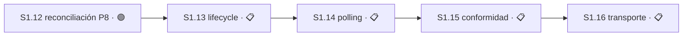

# Plan 1 — Sustrato mecánico

**Estado:** 🔵 EN CURSO

## Resumen

| Campo | Detalle |
|---|---|
| Dependencias | Legacy P7 depende sólo de legacy P6; P8 depende de legacy P7 reconciliado e integrado. Change A no es dependencia de ninguno. |
| Outputs | Recovery/rollback fail-closed; controller host-neutral y adapter OpenCode; adapter Pi; adapter Claude opt-in; runtime versionado; verificación CT-only. |
| Roadmap | `S1.11` está ✅ COMPLETO en el tip integrado local; `S1.12` queda 🟢 LISTO. Después sigue la cadena explícita `S1.12 → S1.13 → S1.14 → S1.15 → S1.16`; `S1.16` permanece 📋 PLANIFICADO. Legacy P9–P11 esperan límites de PR demostrables. |
| Referencias | [`autonomous-continuation-control-tower`](../../changes/autonomous-continuation-control-tower/), [`p7-host-neutral-loop-opencode-adapter`](../../changes/p7-host-neutral-loop-opencode-adapter/), [`p8-slice-planning`](../../changes/p8-slice-planning/), [Plan Manifest](../sdd-tower-implementation/manifest.yaml). |

Legacy P6 se integró mediante PRs #38–#45 y cerró en `e16d94b`. Su [`apply-progress.md`](../../changes/autonomous-continuation-control-tower/apply-progress.md) es evidencia histórica y permanece sin reescritura.

## Sesiones cerradas

| ID | Resultado | Estado | Evidencia |
|---|---|---|---|
| S1.1 | Baseline y recovery legacy P6 | ✅ COMPLETO | PR #38 |
| S1.2 | Migration 005 pinning | ✅ COMPLETO | PR #39 |
| S1.3 | Fresh schema 4→5 migration | ✅ COMPLETO | PR #40 |
| S1.4 | Proof plane | ✅ COMPLETO | PR #41 |
| S1.5 | ON-mode dispositions | ✅ COMPLETO | PR #42 |
| S1.6 | Rollback plane | ✅ COMPLETO | PR #43 |
| S1.7 | Redelivery closure | ✅ COMPLETO | PR #44 |
| S1.8 | Closure claim-present correction | ✅ COMPLETO | PR #45 |
| S1.9 | Roadmap/catalog y enmiendas legacy P7/P8 | ✅ COMPLETO | `b96e4d9` |
| S1.10 | Plan Manifest revision 2 y ArtifactRefs | ✅ COMPLETO | `a1c75b3` |

## Sesión 1.11 — Reconciliación independiente legacy P7

**Estado:** ✅ COMPLETO — las tres Tareas quedaron cerradas en `a1dce22`: existe el registro P7, los chequeos binarios están documentados y el gate acotado fue aprobado por el maintainer. El commit está integrado en el tip local `a1dce220dae594006bda0722d0bdb640cf4b9be7` (tree `061de580c92feb577033c4255ce629267cbc7d62`), pero todavía no hay prueba de entrega remota. Este cierre queda reconciliado como parte del mismo commit documental y push atómico futuro; no afirma que ese push ya ocurrió.

**Depende de:** `S1.9` ✅, `S1.10` ✅
**Área:** `openspec/changes/p7-host-neutral-loop-opencode-adapter/reconciliation.md` y sus enmiendas de gate
**Recurso:** ninguno. Torre desarmada; sin estado de runtime.
**Ruta:** `direct` — el alcance está aprobado y sus tres Tareas son explícitas. **Autoridad:** [`p7-p8-integrated-reconciliation/tasks.md`](../../changes/p7-p8-integrated-reconciliation/tasks.md#sesión-111--p7-reconciliation-record).

**Decisiones:**

- `escala` — la aprobación del gate P7 (`T1.11.1.3`). **Clase:** seguridad y permisos. **RESUELTA por el maintainer:** el registro integrado en `a1dce22` queda `BOUNDED_APPLY_APPROVED`. Aprobar un gate es un acto de autoridad, no una derivación. **Contaminaba:** `S1.13`–`S1.16`; la cadena autorizada posterior conserva sus propias dependencias y criterios.

La definición canónica de esta Sesión, incluidos `M1.11.1` y `T1.11.1.1`–`T1.11.1.3`, vive en [`p7-p8-integrated-reconciliation/tasks.md`](../../changes/p7-p8-integrated-reconciliation/tasks.md#sesión-111--p7-reconciliation-record). Este `STATUS` no redefine sus Tareas.

## Sesión 1.12 — Reconciliación independiente P8

**Estado:** 🟢 LISTO — `S1.11` está ✅ COMPLETO en el tip integrado local y no queda otro prerrequisito declarado. La habilitación y el cierre de `S1.11` se entregan juntos en el futuro push atómico; la entrega remota todavía no está probada.

**Depende de:** `S1.11` ✅
**Área:** `openspec/changes/p8-slice-planning/reconciliation.md`, `STATUS` de P8 y el recibo de persistencia
**Recurso:** ninguno. Torre desarmada; sin comportamiento ejecutable.
**Ruta:** `direct` — seis Tareas explícitas con comando de validación y frontera de rollback declarados. **Autoridad:** [`p7-p8-integrated-reconciliation/tasks.md`](../../changes/p7-p8-integrated-reconciliation/tasks.md#sesión-112--p8-reconciliation-and-preservation).

**Decisiones:**

- `escala` — la aprobación del gate P8 (`T1.12.1.3`). **Clase:** seguridad y permisos. Mismo razonamiento que `S1.11`. **Contamina:** `S1.17`. **Consecuencia operativa: no es candidata a modo nocturno.**

La definición canónica de esta Sesión, incluidos `M1.12.1` y `T1.12.1.1`–`T1.12.1.7`, vive en [`p7-p8-integrated-reconciliation/tasks.md`](../../changes/p7-p8-integrated-reconciliation/tasks.md#sesión-112--p8-reconciliation-and-preservation). Este `STATUS` no redefine sus Tareas.

## Grafo de dependencias P7

## Sesiones legacy P7

| ID | Resultado | Estado | Depende de | Ref |
|---|---|---|---|---|
| S1.13 | Root lifecycle e invalidación sincrónica | 📋 PLANIFICADO | `S1.12` | [`tasks.md`](../../changes/p7-host-neutral-loop-opencode-adapter/tasks.md) |
| S1.14 | Polling y wake safety | 📋 PLANIFICADO | `S1.13` | [`tasks.md`](../../changes/p7-host-neutral-loop-opencode-adapter/tasks.md) |
| S1.15 | Conformidad lifecycle OpenCode | 📋 PLANIFICADO | `S1.14` | [`tasks.md`](../../changes/p7-host-neutral-loop-opencode-adapter/tasks.md) |
| S1.16 | Transporte reconciliado y composición wake | 📋 PLANIFICADO | `S1.15` | [`tasks.md`](../../changes/p7-host-neutral-loop-opencode-adapter/tasks.md) |

## Sesiones P8

| ID | Resultado | Estado | Ref |
|---|---|---|---|
| S1.17 | Gate de reconciliación y pruebas RED | 🔴 BLOQUEADO | [`tasks.md`](../../changes/p8-slice-planning/tasks.md) |
| S1.18 | Pi adapter GREEN | 📋 PLANIFICADO | [`tasks.md`](../../changes/p8-slice-planning/tasks.md) |
| S1.19 | Refactor y regresión | 📋 PLANIFICADO | [`tasks.md`](../../changes/p8-slice-planning/tasks.md) |

## Rutas de ejecución — reconciliadas el 2026-08-11

| ID | Estado | Ruta | Motivo |
|---|---|---|---|
| `S1.16` | 📋 PLANIFICADO | `design-tasks` | El registro aprobado de `S1.11` ya existe, pero la cadena autorizada exige cerrar antes `S1.12 → S1.13 → S1.14 → S1.15`. Luego se elige el seam de transporte no consumidor desde ese registro, sin inventarlo. |
| `S1.17` | 🔴 BLOQUEADO | `direct` al destrabar | `p8-slice-planning/tasks.md:31` exige `S1.12` y legacy P7 reconciliado e integrado. Al destrabar sólo aterriza pruebas RED contra contratos ya aprobados. |
| `S1.18` | 📋 PLANIFICADO | `direct` | Depende de `S1.17`. Implementación GREEN con alcance exacto (`adapters/pi/`), comando `bun test test/host-adapters.test.mjs` y rollback declarados. |
| `S1.19` | 📋 PLANIFICADO | `direct` | Depende de `S1.18`. Refactor de seams y regresión compartida; verificación sólo por fixtures y rollback sin schema. |

**Decisión latente en `S1.16`, hoy no disparada:** su condición de parada dice que si la reconciliación exige tocar `core.mjs` o `mcp.mjs`, la Sesión **para antes del RED** y ese seam se planifica como Sesión aparte. **Clase:** expansión de alcance. **Contamina:** `S4.2`, `S4.3` y `S4.4`, que dependen de `S1.16`.

### 🔴 La cadena de release está incompleta

[`release-chain.md`](../release-chain.md) incorpora `S1.16`–`S1.19` y deja `S1.11`–`S1.15` fuera «hasta que una dependencia explícita los incorpore». **Esa dependencia explícita existe y está escrita:**

- `p7-host-neutral-loop-opencode-adapter/tasks.md:25` — «`S1.11` owns creation and approval of `reconciliation.md`; `S1.13`–`S1.16` consume and validate that approved record».
- `p8-slice-planning/tasks.md:31` — `S1.17` exige legacy P7 reconciliado e integrado **y** el registro propio de P8 aprobado, es decir `S1.11` y `S1.12`.
- El Roadmap de este Plan (fila `Roadmap` del resumen) — «Completar `S1.11` y `S1.12`; después ejecutar `S1.13`–`S1.19`».

Por lo tanto `S1.11`, `S1.12`, `S1.13`, `S1.14` y `S1.15` **entran en la cadena de release**: sin ellas, `S1.16` y `S1.17` no pueden arrancar, y sin ésas no hay `S4.2`–`S4.4` ni `S7.1`.

**Reconciliado el 2026-08-11:** `S1.11` queda ✅ COMPLETO en el tip integrado local y `S1.12` pasa a 🟢 LISTO. La cadena posterior queda formalizada como `S1.12 → S1.13 → S1.14 → S1.15 → S1.16`; por eso `S1.16` permanece 📋 PLANIFICADO. La entrega remota de este cierre todavía no está probada: los estados se publicarán junto con los commits integrados en el mismo push atómico futuro.

Legacy P9–P11 todavía no tienen límites de PR demostrables. Sus responsabilidades se preservan sin IDs en el [apéndice de migración](../plan-vocabulary-migration-appendix.md).
