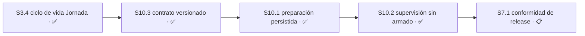

# Plan 10 — Ejecución y supervisión autónoma de Jornada

**Estado:** ✅ COMPLETO
**Avance:** 100% (3/3 S)

> El maintainer resolvió la ubicación provisional del 2026-08-11: las responsabilidades antes
> enumeradas como `S3.5`/`S3.6` forman un Plan nuevo y pasan a ser `S10.1`/`S10.2`. P3 permanece
> ✅ COMPLETO con `4/4 S`. P9 conserva su alcance separado de slots físicos de Jornada y caché
> externa de Bun; no se integra ni se modifica mediante esta decisión.

`S10.3` incorpora primero el contrato versionado como artefacto pasivo. Después, `S10.1`
valida, prepara y persiste bajo ownership exclusivo de Jornada, siempre sin efectos; `S10.2`
conserva la arquitectura productora de supervisión ya verificada y sus decisiones resueltas.

## Resumen auditable

| Campo | Contrato |
|---|---|
| Autoridad | Decisión explícita del maintainer: Plan nuevo P10 para las responsabilidades provisionales `S3.5`/`S3.6`, renumeradas `S10.1`/`S10.2`. |
| Estado | ✅ COMPLETO: `S10.3`, `S10.1` y `S10.2` están verificadas; `S10.2` está publicada en `origin/master@3ec8536`. |
| Orden | `S3.4 → S10.3 → S10.1 → S10.2 → S7.1`. |
| Capacidad derivada | P10 ya no aporta una Sesión ejecutable: sus 3/3 Sesiones están ✅ COMPLETO. La capacidad concurrente vigente conserva `S4.5` —decision-clean y ejecutable por sus tres Módulos en secuencia— y `S5.9`. |
| Avance | 100% (3/3 S). |
| Release | P10 forma parte del producto, roadmap y release únicos; sus tres Sesiones están cerradas. |
| Publicación | Comportamiento `44f23adbb80bed974246aa3761573a388e5761bf`, tree `d5343fda0373c5152ad94bc248db5a5d0ccf8031`, publicado en `origin/master@3ec8536`. |

La jerarquía canónica es `Plan → Sesión → Módulo → Tarea`; las tres Sesiones quedan enumeradas
abajo. Para `S10.2`, la decisión 26 y la elaboración técnica fijaron el `Área` exacta en
`supervision/state.mjs` y `test/supervision/state.test.mjs` antes de apply.

## Sesiones

| ID | Resultado | Estado | Ruta | Motivo | Autoridad | Depende de | Área | Recurso |
|---|---|---|---|---|---|---|---|---|
| `S10.3` | Contrato de ejecución versionado | ✅ COMPLETO | `direct` | Copia pasiva, exacta e indivisible con verificación estructural. | Decisión explícita del maintainer. | `S3.4` ✅ | `schemas/execution-contract-v1.schema.json` | — |
| `S10.1` | Preparación persistida de Jornada | ✅ COMPLETO | `design-tasks` | Owner pasivo y gate consumidor verificados, sin arquitectura productora ni efectos. | Decisión explícita del maintainer. | `S10.3` ✅ | `jornada/**`, `test/jornada/**` | —; sin token de entrega ni SQLite de la Torre. |
| `S10.2` | Supervisión sin armado local | ✅ COMPLETO | `design-tasks` | Estado externo fail-closed y seam real de `S10.1` verificados sin armar el repositorio. | Brecha 7 de [implementation-state](../implementation-state.md) y decisiones 26–27. | `S10.1` ✅ | `supervision/state.mjs`, `test/supervision/state.test.mjs` | Writer/lock exclusivo por proyecto en `~/.local/state/control-tower/supervision/<project-id>`; sin Main store, SQLite, token de entrega ni `ACTIVE` local. |

## Sesión 10.3 — Contrato de ejecución versionado

**Estado:** ✅ COMPLETO

**Depende de:** `S3.4` ✅

**Área:** `schemas/execution-contract-v1.schema.json`

**Recurso:** —

**Ruta:** `direct` — artefacto pasivo, sin runtime ni tests; sólo copia y readback estructural.

**Decisiones:**
- `escala` — **RESUELTA por el maintainer:** copia byte a byte desde `/home/emili/.agents/skills/unattended-implementation/assets/execution-contract.schema.json`; destino exacto de 17.297 bytes, 407 líneas y SHA-256 `2f4838aa244b30e280c5c558286b0e4d9fbb503a0ef1808ffc27501c1540fddc`. La excepción autoriza sólo este contrato activo indivisible, no otras líneas ni overflow de `S10.1`. **Clase:** expansión de alcance; contrato visible del producto. **Contaminaba:** `S10.3`, `S10.1`, `S10.2`, `S7.1`.

**Criterios de aceptación** — todos deben pasar para cerrar:
- [x] El destino es byte-idéntico al origen y coincide en bytes, líneas y SHA-256
- [x] No se normaliza, genera ni modifica ningún otro archivo de runtime, schema o test
- [x] Ningún runtime lee `~/.claude/`; la fuente se consulta sólo durante la copia estructural
- [x] La excepción de tamaño se atribuye exclusivamente a este artefacto indivisible

### Módulo 10.3.1 — Copia estructural del contrato
- [x] `T10.3.1.1` **RED:** origen confirmado en 17.297 bytes, 407 líneas y SHA-256 `2f4838aa244b30e280c5c558286b0e4d9fbb503a0ef1808ffc27501c1540fddc`; destino ausente y worktree limpio en `cdd0d09bcdd4d2104e54a7265d1dc3742ceea2e7`.
- [x] `T10.3.1.2` **GREEN:** copia byte-idéntica creada únicamente en `schemas/execution-contract-v1.schema.json`, sin transformación.
- [x] `T10.3.1.3` **REFACTOR:** `cmp` confirmó identidad; readback confirmó 17.297 bytes, 407 líneas, SHA-256 esperado y modo Git `100644`. JSON parseó y conservó Draft 2020-12, `$id`, `type: object`, `additionalProperties: false`, 17 propiedades requeridas y `$defs` estructuralmente presentes. Runtime harness: N/A, artefacto pasivo sin frontera ejecutable.

## Sesión 10.1 — Preparación persistida de Jornada

**Estado:** ✅ COMPLETO

**Depende de:** `S10.3` ✅

**Área:** `jornada/**`, `test/jornada/**`

**Prohibido:** `core.mjs`, `mcp.mjs`, `main-store/store.mjs`, `escalation/**`, `delivery/**`, `contracts/**`, todo `schemas/**`; Main store y SQLite.

**Recurso:** —.

**Ruta:** `design-tasks` — elaboración compacta del owner pasivo y gate consumidor; sin proposal/spec ni diseño productor de `S10.2`.

**Decisiones:**
- `derivable` — contrato vencido falla cerrado por `expires_at` y nunca se renueva solo. **Autoridad:** schema versionado. **Falsificador:** aceptar una preparación posterior al vencimiento.
- `escala` — **RESUELTA por el maintainer:** una única capability/root inyectada, pasiva y owner-only bajo `jornada/**` persiste antes de declarar `prepared`; no Main store, SQLite ni writer alternativo. **Clase:** seguridad y permisos; API pública. **Contaminaba:** `S10.1`, `S10.2`, `S7.1`.
- `escala` — **RESUELTA por el maintainer:** `S10.1` consume evidencia opaca de supervisión sólo como gate y permanece incapaz de efectos; `S10.2` conserva arquitectura y producción de evidencia. **Clase:** operaciones irreversibles. **Contaminaba:** `S10.1`, `S10.2`, `S7.1`.

**Criterios de aceptación** — todos deben pasar para cerrar:
- [x] JSON canónico, digest, `expires_at`, repositorio, worktree, rama, `base_sha` y `sesion_id` exactos se validan antes de persistir o declarar `prepared`
- [x] Contrato inválido, divergente o vencido falla cerrado, con cero llamadas de persistencia y sin estado `prepared`
- [x] Evidencia opaca de supervisión válida, vigente y coincidente se verifica después del contrato/contexto y antes de persistir; si está ausente, inválida, divergente o vencida hay cero llamadas de persistencia y no existe estado `prepared`
- [x] Sólo después de validar contrato, contexto y supervisión, una única llamada a la capability/root owner-only persiste pasivamente bajo `jornada/**`; únicamente su éxito permite devolver `prepared`
- [x] `S10.1` no diseña ni produce evidencia de supervisión
- [x] No existe executor ni acceso a subprocess, Git, remoto, Main store o SQLite; ningún camino produce efectos
- [x] El diff no toca ninguna ruta fuera de `Área` ni ninguna ruta del `Prohibido`

### Módulo 10.1.1 — Validación canónica de contrato y contexto
- [x] `T10.1.1.1` **RED:** rechazo de JSON/digest/expiry e identidad exacta divergentes con cero persistencia y sin `prepared`.
- [x] `T10.1.1.2` **GREEN:** contrato y contexto validados en una representación prevalidada, sin persistir ni declarar `prepared`.
- [x] `T10.1.1.3` **REFACTOR:** invariantes centralizadas; cero acceso a executor, subprocess, Git o remoto.

### Módulo 10.1.2 — Gate consumidor de supervisión
- [x] `T10.1.2.1` **RED:** evidencia opaca ausente, inválida, divergente o vencida deja cero persistencia y ningún `prepared`.
- [x] `T10.1.2.2` **GREEN:** evidencia válida, vigente y coincidente se verifica sólo después del contrato/contexto.
- [x] `T10.1.2.3` **REFACTOR:** frontera effect-incapable y ausencia de diseño productor de `S10.2` verificadas.

### Módulo 10.1.3 — Persistencia pasiva owner-only
- [x] `T10.1.3.1` **RED:** root/capability ausente, ajena o fallida prohíbe `prepared` prematuro.
- [x] `T10.1.3.2` **GREEN:** tras validar contrato, contexto y supervisión, una sola persistencia owner-only permite devolver `prepared`.
- [x] `T10.1.3.3` **REFACTOR:** readback/errores aislados sin Main store, SQLite ni writer alternativo.

**Evidencia de cierre:** implementación `6b9bd64adc4456dccdd2fe758d24ed23fb2cc3de13e3b267877ec34ec90e3390`, tests `961e7ccd1b8e4a26a4bc80e144722389c4fb0a9405080c25cd9260e7e70211e1`, patch `d6d8871213c5fca46f81652016eac9868f3366f37aeabbf632be917c26d6c0b0`; 306 líneas ejecutables authored. Focused Bun: 8/0, 144 assertions; full: 679/0, 4164 assertions, 44 archivos. Todos los criterios y las 9 Tareas pasan; la frontera sólo valida, consume evidencia opaca y persiste una vez por capability Jornada inyectada, sin subprocess, Git, remoto, Main store, SQLite ni productor de supervisión. Verificación estructural/integral: PASS; lens consultivo no disponible por exigir lineage mientras RDD/4R está suspendido, sin implicar fallo ni aprobación del candidato.

## Sesión 10.2 — Supervisión sin armado local

**Estado:** ✅ COMPLETO — las decisiones 26 y 27 fijaron la arquitectura y el `Área`; la implementación
`44f23adbb80bed974246aa3761573a388e5761bf` entrega el estado externo fail-closed y el seam real
de `S10.1`, publicada en `origin/master@3ec8536`.

**Depende de:** `S10.1` ✅. La dependencia conserva el orden aprobado; `S10.1` puede construirse
effect-incapable, pero ningún efecto se habilita antes de que esta Sesión entregue supervisión
válida y vigente.

**Área:** `supervision/state.mjs`, `test/supervision/state.test.mjs`

**Recurso:** namespace exclusivo de writer/lock por proyecto bajo
`~/.local/state/control-tower/supervision/<project-id>`; sin writer, lock o transacción del Main store,
sin SQLite, token de entrega ni `ACTIVE` dentro del repositorio supervisado.

**Ruta:** `design-tasks` — cambia la semántica visible de supervisión, pero la arquitectura ya está
elegida por la decisión 26 y la frontera con `remote-control` por la 27, así que lo que falta es
elaboración técnica sobre un contrato ya fijado y no un contrato de producto nuevo. **Autoridad:**
brecha 7 de [implementation-state](../implementation-state.md) y las decisiones 26 y 27.

Resuelve la brecha 7: el sellado desatendido exige la Torre armada, y los dos repositorios en uso
tienen una razón de diseño para exigirla apagada. `control-tower` aborta sus dos tests P0 con
`ACTIVE` presente (`test/helpers/restore-fixture.mjs:90`) y `remote-control` congela su relay
(`src/tower-guard.js:226`, `allowed = remote && off`). Hoy no existe estado que satisfaga ambos.

**Decisiones:**

- `escala` — **RESUELTA por el maintainer el 2026-08-14 (decisión 26): centinela separado fuera del
  repositorio supervisado**, bajo `~/.local/state/control-tower/supervision/<project-id>`.
  **Pregunta que resolvía:** ¿la supervisión sin armar el repositorio supervisado se expresa como un
  modo nuevo del centinela, un centinela separado o supervisión externa al repositorio?
  **Clase:** contrato visible del producto; seguridad y permisos. **Evidencia:** los dos tests P0
  de `control-tower` abortan con `ACTIVE`, mientras el sellado exige supervisión viva.
  **Por qué se descartaron las otras dos:** un modo nuevo de `ACTIVE` seguiría escribiendo el
  marcador dentro del repositorio supervisado, que es exactamente lo que aborta los dos tests P0 y
  congela el relay; la supervisión externa resuelve la brecha al precio de la arquitectura más grande
  de las tres. El centinela afuera satisface «supervisar sin armar» con la superficie mínima, y tiene
  precedente en `~/.local/state/control-tower/night/`. **Efecto:** fija el `Área` que faltaba y saca a
  `S10.2` de la exclusión de capacidad. **Falsificable:** cualquier ruta de supervisión que escriba un
  marcador dentro del repositorio supervisado. **Contaminaba:** toda `S10.2`, `S10.1`,
  `remote-control` y los dos tests P0 de `test/migration.test.mjs`.
- `escala` — **RESUELTA por el maintainer el 2026-08-14 (decisión 27): el interlock se conserva
  intacto.** **Pregunta que resolvía:** ¿`remote-control` conserva intacto su interlock o se autoriza
  un cambio explícito para reconocer la nueva supervisión? **Clase:** dependencias o evidencia
  contradictorias; contrato visible del producto; seguridad y permisos. **Evidencia:**
  `src/tower-guard.js:226` define `allowed = remote && off`, y la decisión aceptada del 2026-08-08
  dice que el interlock no se retira; atravesarlo contradice esa autoridad. **Resolución:** con el
  centinela fuera del repositorio nada lo arma, así que la condición sigue dando verdadero sin cambio
  alguno. Cero líneas de `remote-control`, la decisión de complementariedad queda entera y no se
  arriesga la única superficie ya validada en vivo. Es consecuencia directa de la decisión 26.
  **Falsificable:** cualquier diff de esta Sesión que toque `remote-control`. **Contaminaba:** toda
  `S10.2` y la decisión de complementariedad aceptada.

**Criterios de aceptación** — todos deben pasar para cerrar:

- [x] La Torre supervisa una ejecución sellada en un repositorio sin que ese repositorio quede armado
- [x] El productor, lector y validador externos atan exactamente proyecto, repositorio, worktree, `base_sha`, `sesion_id`, digest del contrato y vencimiento
- [x] Estado malformado, inseguro, enlazado simbólicamente, ajeno o divergente también falla cerrado
- [x] El seam consumidor real inyectado por `S10.1` acepta sólo supervisión válida, vigente y coincidente
- [x] No se crea `.git/control-tower/ACTIVE` ni se usa writer, lock o transacción del Main store, SQLite o token de entrega
- [x] `bun test` pasa completo durante una supervisión activa sobre este mismo repositorio
- [x] `relayEligibility` de `remote-control` sigue devolviendo `frozen` cuando la Torre está armada en su repositorio
- [x] `remote-control` queda sin cambios
- [x] Una supervisión ausente o vencida falla cerrado; no se degrada a ejecución sin supervisar
- [x] El diff no toca ninguna ruta fuera del `Área` que fije la elaboración técnica

### Módulo 10.2.1 — Estado externo de supervisión
- [x] `T10.2.1.1` **RED:** la prueba de comportamiento observó el fallo esperado antes de existir `supervision/state.mjs`; cubre productor, lector, validador, seam real de `S10.1` y rechazos ausente, malformado, inseguro, enlazado simbólicamente, ajeno, vencido o divergente.
- [x] `T10.2.1.2` **GREEN:** `supervision/state.mjs` publica y lee fail-closed con binding exacto, vencimiento y writer/lock exclusivo por proyecto, sin crear `ACTIVE` ni acceder a Main store, SQLite, token de entrega o `remote-control`.
- [x] `T10.2.1.3` **REFACTOR:** validación y errores quedaron consolidados dentro del `Área`; focused 4/0/22, full 721/0/4361 en 52 archivos durante supervisión externa válida y verificación `remote-control` 2/0/14, con centinela limpiado.

**Previsión de carga:** 260–360 líneas authored en un único commit independientemente verificable y
revertible, por debajo de 400. **Regla de parada:** si la implementación alcanza 400 líneas authored,
detenerse antes de continuar y separar por comportamiento en commits independientemente verificables
y revertibles; no crear otra Sesión ni otro nivel.

## Grafo del Plan 10

**Evidencia de cierre:** comportamiento `44f23adbb80bed974246aa3761573a388e5761bf`, parent `8377803752228966fb8d50efae4ae5dd01a090e6`, tree `d5343fda0373c5152ad94bc248db5a5d0ccf8031`. Focused `bun test test/supervision/state.test.mjs`: 4/0/22; suite completa durante supervisión externa válida: 721/0/4361 en 52 archivos; `remote-control` enfocado: 2/0/14 y limpio en `6e81d3c`. `ACTIVE` estuvo ausente y el centinela externo se limpió. Los 10 criterios y las 3 Tareas pasan. `review-reliability` quedó tipado como no disponible/procedural por la suspensión del lifecycle; no es PASS ni se reintentó.

**Avance derivado:** 100% (3/3 S). P10 está ✅ COMPLETO y ya no aporta capacidad ejecutable.
