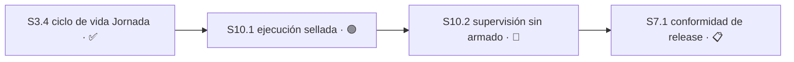

# Plan 10 — Ejecución y supervisión autónoma de Jornada

**Estado:** 🟢 LISTO
**Avance:** 0% (0/2 S)

> El maintainer resolvió la ubicación provisional del 2026-08-11: las responsabilidades antes
> enumeradas como `S3.5`/`S3.6` forman un Plan nuevo y pasan a ser `S10.1`/`S10.2`. P3 permanece
> ✅ COMPLETO con `4/4 S`. P9 conserva su alcance separado de slots físicos de Jornada y caché
> externa de Bun; no se integra ni se modifica mediante esta decisión.

`S10.1` puede avanzar por `design-tasks` bajo una restricción aprobada: puede construirse antes
de `S10.2` sólo mientras sea incapaz de producir efectos. Ningún efecto autónomo puede ejecutarse
hasta que `S10.2` aporte supervisión válida y vigente. `S10.2` sigue bloqueada y su arquitectura
no se deriva ni se anticipa desde `S10.1`.

## Resumen auditable

| Campo | Contrato |
|---|---|
| Autoridad | Decisión explícita del maintainer: Plan nuevo P10 para las responsabilidades provisionales `S3.5`/`S3.6`, renumeradas `S10.1`/`S10.2`. |
| Estado | 🟢 LISTO: `S10.1` puede iniciar elaboración técnica; `S10.2` permanece 🔴 BLOQUEADO. |
| Orden | `S3.4 → S10.1 → S10.2 → S7.1`; ningún efecto atraviesa `S10.1` sin supervisión válida y vigente. |
| Capacidad derivada | `S10.1` es elegible para `design-tasks`; `S10.2` no tiene `Área` definida y se excluye de capacidad. |
| Avance | 0% (0/2 S): ninguna Sesión está ✅ COMPLETO ni 📚 ARCHIVADO. |
| Release | P10 forma parte del producto, roadmap y release únicos; aporta 0/2 al denominador. |

La jerarquía canónica es `Plan → Sesión → Módulo → Tarea`. `S10.1` puede elaborar sus Módulos y
Tareas mediante `design-tasks`; `S10.2` se detiene en Sesión mientras sus decisiones impiden fijar
archivos. La elaboración sólo puede usar `M10.x.y` y `T10.x.y.z`, sin crear un quinto nivel.

## Sesiones

| ID | Resultado | Estado | Ruta | Motivo | Autoridad | Depende de | Área | Recurso |
|---|---|---|---|---|---|---|---|---|
| `S10.1` | Ejecución del contrato sellado de Jornada | 🟢 LISTO | `design-tasks` | Puede construirse primero sólo effect-incapable; la elaboración define gate, interfaz y prueba binaria sin decidir la arquitectura de `S10.2`. | Decisión explícita del maintainer del 2026-08-13. | `S3.4` ✅ | `jornada/**`, `test/jornada/**`, `schemas/execution-contract-v1.schema.json` | —; sin token de entrega ni SQLite de la Torre. |
| `S10.2` | Supervisión sin armado local | 🔴 BLOQUEADO | `blocked` | Están abiertas la arquitectura visible/de seguridad y la contradicción del interlock de `remote-control`; `Área` sigue sin definir. | Brecha 7 de [implementation-state](../implementation-state.md). | `S10.1` | **Sin definir**; debe fijarse después de resolver las decisiones escaladas. | Centinela `ACTIVE` del repositorio supervisado. |

## Sesión 10.1 — Ejecución del contrato sellado de Jornada

**Estado:** 🟢 LISTO

**Depende de:** `S3.4` ✅

**Área:** `jornada/**`, `test/jornada/**`, `schemas/execution-contract-v1.schema.json`

**Prohibido:** `core.mjs`, `mcp.mjs`, `main-store/store.mjs`, `escalation/**`, `delivery/**`, `contracts/**`, `schemas/**` excepto exclusivamente `schemas/execution-contract-v1.schema.json`

**Recurso:** —. No reclama el token de entrega ni escribe en el SQLite de la Torre.

**Ruta:** `design-tasks` — `session-plan` debe definir el gate/interfaz effect-incapable y su
prueba binaria antes de implementación, sin proposal/spec y sin prejuzgar la arquitectura de
`S10.2`. **Autoridad:** opción 1 aprobada explícitamente por el maintainer el 2026-08-13, además
de las decisiones previas de ubicación y contrato.

El contrato externo ya existe: `execution-contract.schema.json` de
`unattended-implementation`, con 407 líneas en uso real. `jornada/` tiene hoy 23 líneas y
`policy/jornada.mjs` es un resolvedor puro que recibe la Jornada como argumento. Sellar el
contrato ya lo hace la skill; la responsabilidad pendiente es ejecutarlo.

**Decisiones:**

- **RESUELTA por el maintainer** — la copia versionada del `execution-contract.schema.json` externo
  vive exactamente en `schemas/execution-contract-v1.schema.json`, siguiendo la convención
  `<contrato>-v1.schema.json` ya establecida en `schemas/`. Sólo ese archivo se incorpora al `Área`;
  ningún otro path de `schemas/**` queda permitido. **Criterio falsificable:** falla si el runtime lee
  `~/.claude/`, si la copia vive bajo otro nombre o ruta, o si el diff modifica cualquier otro schema.
  **Autoridad:** decisión explícita del maintainer para la corrección final del contrato de `S10.1`.
- `derivable` — qué hace un contrato vencido. **Criterio:** falla cerrado por `expires_at`; no
  se ejecuta ni se renueva solo. Falsificable: una ejecución posterior a `expires_at`.
  **Autoridad:** el propio schema.
- `escala` — **RESUELTA por el maintainer:** `S10.1` puede construirse antes de `S10.2` sólo
  mientras sea incapaz de producir efectos; ningún efecto autónomo puede ejecutarse hasta recibir
  supervisión válida y vigente. La clase sigue siendo **operaciones irreversibles**; no se deriva la
  decisión de producto. **Criterio falsificable:** cualquier camino que produzca un efecto sin
  evidencia actual y válida de supervisión viola el contrato. **Autoridad:** opción 1 aprobada
  explícitamente por el maintainer el 2026-08-13. Con esa autoridad, la forma técnica del gate,
  interfaz y prueba binaria es `derivable`; la arquitectura de `S10.2` no lo es.

**Criterios de aceptación** — todos deben pasar para cerrar:

- [ ] Un contrato válido se lee, valida contra el schema versionado y persiste antes de ejecutar
- [ ] Un contrato con digest que no coincide se rechaza y no ejecuta nada
- [ ] Un contrato vencido por `expires_at` falla cerrado
- [ ] Sin evidencia válida y vigente de supervisión, todo camino es incapaz de producir efectos
- [ ] La ejecución respeta repositorio, worktree, rama, `base_sha` y `sesion_id` exactos del contrato
- [ ] Ninguna ruta lee `~/.claude/` en runtime
- [ ] El diff no toca ninguna ruta del `Prohibido`

## Sesión 10.2 — Supervisión sin armado local

**Estado:** 🔴 BLOQUEADO

**Depende de:** `S10.1`. La dependencia conserva el orden aprobado; `S10.1` puede construirse
effect-incapable, pero ningún efecto se habilita antes de que esta Sesión entregue supervisión
válida y vigente.

**Área:** **sin definir**. La resolución de arquitectura debe fijarla explícitamente antes de
elaborar o ejecutar la Sesión. No se adivina y, mientras falte, `S10.2` queda excluida de capacidad.

**Recurso:** centinela `ACTIVE` del repositorio supervisado.

**Ruta:** `blocked` — cambia la semántica visible de supervisión y la frontera de autoridad de la
Torre, toca seguridad y permisos, y parte de evidencia contradictoria. Sólo después de resolver
las decisiones puede clasificarse la elaboración posterior. **Autoridad:** brecha 7 de
[implementation-state](../implementation-state.md).

Resuelve la brecha 7: el sellado desatendido exige la Torre armada, y los dos repositorios en uso
tienen una razón de diseño para exigirla apagada. `control-tower` aborta sus dos tests P0 con
`ACTIVE` presente (`test/helpers/restore-fixture.mjs:90`) y `remote-control` congela su relay
(`src/tower-guard.js:226`, `allowed = remote && off`). Hoy no existe estado que satisfaga ambos.

**Decisiones:**

- `escala` — **Pregunta exacta:** ¿la supervisión sin armar el repositorio supervisado se expresa
  como un modo nuevo del centinela, un centinela separado o supervisión externa al repositorio?
  **Clase:** contrato visible del producto; seguridad y permisos. **Evidencia:** los dos tests P0
  de `control-tower` abortan con `ACTIVE`, mientras el sellado exige supervisión viva.
  **Opciones y consecuencias:** (1) modo nuevo de `ACTIVE`, que cambia su contrato visible y sus
  consumidores; (2) centinela separado, que agrega una segunda señal y exige definir autoridad y
  precedencia; (3) supervisión externa, que evita armar el repositorio pero exige fijar identidad,
  vigencia y prueba de liveness fuera de él. **Origen:** `S10.2`.
  **Checkpoint:** antes de proposal, spec, design, definición de `Área` o implementación.
  **Contamina:** toda `S10.2`, `S10.1`, `remote-control` y los dos tests P0 de
  `test/migration.test.mjs`.
- `escala` — **Pregunta exacta:** ¿`remote-control` conserva intacto su interlock o se autoriza un
  cambio explícito para reconocer la nueva supervisión? **Clase:** dependencias o evidencia
  contradictorias; contrato visible del producto; seguridad y permisos. **Evidencia:**
  `src/tower-guard.js:226` define `allowed = remote && off`, y la decisión aceptada del 2026-08-08
  dice que el interlock no se retira; atravesarlo contradice esa autoridad.
  **Opciones y consecuencias:** (1) conservarlo intacto, lo que obliga a que la supervisión sea
  externa o invisible para ese interlock; (2) autorizar un cambio acotado de contrato, que exige
  nueva autoridad de producto y seguridad antes de tocar `remote-control`. **Origen:** `S10.2`.
  **Checkpoint:** antes de proposal, spec, design, definición de `Área` o implementación.
  **Contamina:** toda `S10.2` y la decisión de complementariedad aceptada.

**Criterios de aceptación** — todos deben pasar para cerrar:

- [ ] La Torre supervisa una ejecución sellada en un repositorio sin que ese repositorio quede armado
- [ ] `bun test` pasa completo durante una supervisión activa sobre este mismo repositorio
- [ ] `relayEligibility` de `remote-control` sigue devolviendo `frozen` cuando la Torre está armada en su repositorio
- [ ] Una supervisión ausente o vencida falla cerrado; no se degrada a ejecución sin supervisar
- [ ] El diff no toca ninguna ruta fuera del `Área` que fije la elaboración técnica

## Grafo del Plan 10

**Avance derivado:** 0% (0/2 S). **Capacidad derivada:** `S10.1` es elegible para
`design-tasks`; `S10.2` permanece 🔴 BLOQUEADO, carece de `Área` y no recibe crédito.
