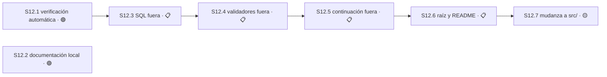

# Plan 12 — Orden estructural del repositorio

**Estado:** 📋 PLANIFICADO · **Avance:** 0% (0/7 S)

**Autoridad:** las cuatro decisiones del maintainer del 2026-08-30, opción A en las cuatro,
sobre la auditoría de solo lectura de `master@7e718d6` publicada como
[Orden de la Torre](https://claude.ai/code/artifact/ee496341-94f2-47ef-957a-18fc94b7bfbd).
El plan enumerado vive también como
[Plan 12 — Orden Estructural](https://claude.ai/code/artifact/f7ec19ef-8857-47c5-9724-1c26ae7e74f7).

**Las cuatro decisiones que lo autorizan:**

| # | Decisión | Qué habilita |
|---|---|---|
| 1 | Prender la verificación automática **antes** de mover una sola línea | `S12.1` va primera y es prerequisito de la cadena de `core.mjs` |
| 2 | Partir `core.mjs` en Sesiones dedicadas, con el archivo como barril re-exportador | `S12.3`, `S12.4` y `S12.5` |
| 3 | Reescribir la definición de producto: la Torre corre local, punto. VPS, Hermes y Telegram salen | `S12.2` |
| 4 | Diferir la mudanza a `src/`; hacer ahora sólo la fusión `host/` → `hosts/` | `S12.6` ahora, `S12.7` 🟡 DIFERIDO |

## Por qué este Plan existe

`core.mjs` tiene 4.646 líneas y **330 de ellas son la Torre**: `locate`, `open`, `register`,
`setState`, `send`, `receive`, `acquire`, `release`, `transfer`, `status` (`core.mjs:4318-4646`).
Las otras 4.310 son tres capas con ritmos de cambio distintos apiladas en el mismo archivo: el
SQL de las migraciones, los validadores de persistencia y el protocolo de continuación. No es un
god-object: es un colapso de capas, y **las carpetas destino ya existen** —`continuation/` tiene
tres archivos chicos mientras 2.035 líneas de su protocolo viven en `core.mjs`.

En paralelo, la documentación de alcance vigente sigue describiendo un producto con VPS, Hermes y
Telegram, que el maintainer retiró. El código ya está limpio —sólo tres archivos de prueba los
mencionan—; los papeles no.

## Evidencia base, medida el 2026-08-30 contra `master@7e718d6`

| Medición | Valor |
|---|---|
| `core.mjs` | 4.646 líneas · 37% de las 12.644 de producto |
| Reparto | continuación 2.035 · validadores 1.000 · SQL 675 · arranque 515 · **Torre 330** · vocabulario 91 |
| Importadores de `core.mjs` | 22 — 8 de producto, 14 de prueba |
| Ramas vivas que tocan `core.mjs` | **0 de 6**, verificado con `git diff --name-only master...<rama>` |
| Rama viva que toca `continuation/` | `feat/plan-2/s2-8-opaque-binding-inputs` → `continuation/integrated-base.mjs` |
| VPS/Hermes/Telegram en código | 3 archivos de prueba |
| VPS/Hermes/Telegram en documentación | `ROADMAP.md` 17 · `openspec/rfc/` 24 · `plan-8/STATUS.md` 14 · `openspec/prd/` 9 · requisitos 8 · más P0, P5, `decision-register`, `scope-comparison` |
| Verificación automática | **no existe**: sin `.github/`, sin bloque `scripts` en `package.json` |
| Suite | 19.781 líneas · 1026 pass / 0 fail · comando declarado sólo en `radiografia.json:9` |

**La ventana está abierta ahora.** Ninguna rama viva toca `core.mjs`. En cuanto una lo haga, la
mudanza deja de ser mecánica y pasa a ser conflicto de merge. Esa es la urgencia real del Plan.

## El invariante que hace segura toda la mudanza

`core.mjs` se conserva como **barril re-exportador** durante `S12.3`, `S12.4` y `S12.5`. Los 22
archivos que lo importan no cambian una línea, la suite no se toca, y ningún estado intermedio
queda roto. Los imports se corrigen después, de a uno, fuera de este Plan.

## Grafo

`S12.2` no tiene aristas: es documentación pura, no depende de nada y no bloquea nada.

## Capacidad

**Dos asientos el primer día, uno después.** `S12.1` y `S12.2` son independientes en grafo, en
`Área` y en `Recurso`. Desde `S12.3` la cadena se serializa: las tres Sesiones reclaman `core.mjs`
en exclusiva y no admiten un segundo agente. El asiento libre en esa etapa debe tomar `S1.17`, no
un pedazo de P12.

---

## Sesión 12.1 — Verificación automática en cada rama

**Estado:** 🟢 LISTO · **Ruta:** `direct` · est: 2h

**Depende de:** —
**Área:** `.github/workflows/**`, `package.json`
**Recurso:** —

**Resultado:** ningún commit llega a `master` sin que la suite haya corrido sola. Va primera
porque es la red que hace seguras las tres mudanzas de `core.mjs`; sin ella cada paso es a ciegas.
**Autoridad:** decisión 1 del maintainer, 2026-08-30.

**Decisiones:**

- `derivable` — versión de bun del runner. **Criterio:** la que ya usa el repositorio; hay
  `bun.lock` y `radiografia.json:9` declara `["bun","test"]`. **Falsificable:** la suite se
  comporta distinto bajo esa versión. **Autoridad:** el estado del repositorio.
- `derivable` — el workflow gatilla por push, no por pull request. **Criterio:** `AGENTS.md:112`
  — «este repo no usa PRs ni PRs encadenados», así que un gatillo por PR no cubriría ninguna
  entrega real. **Falsificable:** aparece un flujo de entrega por PR. **Autoridad:** `AGENTS.md`.

**Criterios de aceptación** — todos deben pasar para cerrar:
- [ ] `bun run test` existe y corre la suite completa
- [ ] Un push con la suite rota produce un run en rojo, verificable en GitHub
- [ ] Un push con la suite sana produce un run en verde
- [ ] El diff no toca ninguna ruta fuera de `Área`

### Módulo M12.1.1 — `package.json`: declarar `scripts.test` · ~8 líneas
- [ ] Tarea T12.1.1.1 — RED: `bun run test` falla hoy; no existe el bloque `scripts`.
- [ ] Tarea T12.1.1.2 — GREEN: agregar `"test": "bun test"`.
- [ ] Tarea T12.1.1.3 — REFACTOR: confirmar que `bun run test` y `bun test` dan idéntico resultado.

### Módulo M12.1.2 — `.github/workflows/test.yml` · ~40 líneas
- [ ] Tarea T12.1.2.1 — RED: rama con un test roto a propósito; el run debe salir en rojo.
- [ ] Tarea T12.1.2.2 — GREEN: el workflow corre la suite en push y reporta estado.
- [ ] Tarea T12.1.2.3 — REFACTOR: quitar el test roto, confirmar verde, registrar el número de run.

---

## Sesión 12.2 — La Torre corre local: la documentación deja de vender la VPS

**Estado:** 🟢 LISTO · **Ruta:** `direct` · est: 4h

**Depende de:** —
**Área:** `ROADMAP.md`, `openspec/prd/**`, `openspec/rfc/**`,
`openspec/specs/sdd-tower-implementation-v1-requirements.md`,
`openspec/plans/plan-{0,5,8}/STATUS.md`, `openspec/plans/decision-register.md`,
`openspec/plans/scope-comparison.md`, `openspec/changes/sdd-tower-telegram-delivery/**`,
`test/migration.test.mjs`
**Prohibido:** `openspec/changes/archive/**`
**Recurso:** `openspec/plans/master-index.md`, sólo al cerrar

**Resultado:** ningún documento de alcance vigente menciona VPS, Hermes o Telegram como parte del
producto; el cambio de Telegram queda archivado; el archivo histórico conserva su traza intacta.
**Autoridad:** decisión 3 del maintainer, 2026-08-30.

**Decisiones:**

- `derivable` — el archivo histórico no se toca. **Criterio:** la convención §6 define ARCHIVADO
  como «cerrado, conservado para trazabilidad». **Falsificable:** una purga borra historia
  archivada. **Autoridad:** `_shared/plan-naming-convention.md` §6.
- `derivable` — `ROADMAP.md` se **reescribe**, no se borra. **Criterio:**
  `test/migration.test.mjs:47-59` lo exige como ruta trackeada. **Falsificable:** el test deja de
  exigirlo. **Autoridad:** la suite vigente.
- `escala` — ¿la definición de producto vigente, *La Torre Terminada*
  (artifact `323b83bd-f1cd-4cee-a5c7-945f8c7d6173`), menciona VPS, Hermes o Telegram? **Clase:**
  contrato visible del producto. **Contamina:** `M12.2.4` solamente. **No verificado**: es un
  artifact publicado, no un archivo del repositorio.

**Criterios de aceptación** — todos deben pasar para cerrar:
- [ ] `rg -ci 'vps|hermes|telegram'` sobre `Área` devuelve cero menciones como alcance vigente
- [ ] `openspec/changes/archive/**` no cambió ni un byte
- [ ] `sdd-tower-telegram-delivery` está bajo `openspec/changes/archive/`
- [ ] `core.mjs.bak.20260721-161315` ya no está trackeado y `expectedTrackedPaths` ya no lo exige
- [ ] `ROADMAP.md` existe y ya no se declara «no versionado»
- [ ] La suite completa sigue en verde
- [ ] El diff no toca ninguna ruta fuera de `Área`

### Módulo M12.2.1 — `ROADMAP.md` + `test/migration.test.mjs` + retiro del respaldo · ~180 líneas

**Precisión medida, para que la Tarea no tenga que redescubrirla:** `expectedTrackedPaths`
(`test/migration.test.mjs:48-59`) es una lista fija de 12 rutas, y la aserción en la línea 2268-2269
es doble — `toHaveLength(12)` y `toEqual(expectedTrackedPaths)` — más `contentMatches` y
`modeMatches` por entrada. Retirar el respaldo obliga a bajar el conteo a **11** en el mismo commit.
`ROADMAP.md` también está en esa lista: por eso se reescribe y no se borra.

- [ ] Tarea T12.2.1.1 — RED: borrar `core.mjs.bak.20260721-161315` rompe la suite hoy; reproducir el fallo exacto.
- [ ] Tarea T12.2.1.2 — GREEN: sacarlo de `expectedTrackedPaths`, bajar el conteo a 11, borrar el archivo, reescribir el ROADMAP sin VPS.
- [ ] Tarea T12.2.1.3 — REFACTOR: el ROADMAP ya no se declara «no versionado»; suite verde.

### Módulo M12.2.2 — PRD, RFC y requisitos · ~200 líneas
- [ ] Tarea T12.2.2.1 — RED: enumerar las 41 menciones vivas en los tres documentos.
- [ ] Tarea T12.2.2.2 — GREEN: reescribir el alcance como producto local.
- [ ] Tarea T12.2.2.3 — REFACTOR: `rg -ci` devuelve cero como alcance vigente.

### Módulo M12.2.3 — STATUS de P0/P5/P8, `decision-register`, `scope-comparison` · ~150 líneas
- [ ] Tarea T12.2.3.1 — RED: separar qué menciones son alcance y cuáles registro histórico.
- [ ] Tarea T12.2.3.2 — GREEN: corregir el alcance; marcar el registro como histórico en su lugar.
- [ ] Tarea T12.2.3.3 — REFACTOR: ninguna Sesión viva del grafo depende de la VPS.

### Módulo M12.2.4 🔴 — Archivar `sdd-tower-telegram-delivery` y reconciliar *La Torre Terminada* · ~60 líneas
Parado hasta resolver la decisión que escala arriba. El resto de la Sesión avanza sin esto.
- [ ] Tarea T12.2.4.1 — RED: leer el artifact y registrar si nombra VPS, Hermes o Telegram.
- [ ] Tarea T12.2.4.2 — GREEN: mover el cambio a `changes/archive/` y reconciliar la definición.
- [ ] Tarea T12.2.4.3 — REFACTOR: la cola activa de `openspec/changes/` no contiene alcance retirado.
