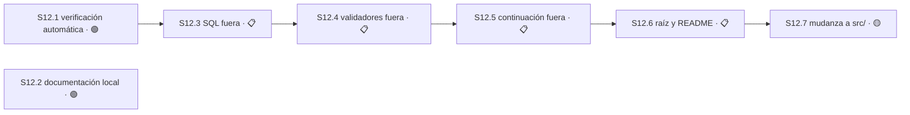

# Plan 12 — Orden estructural del repositorio

**Estado:** 🔵 EN CURSO · **Avance:** 0% (0/8 S)

**Autoridad:** las cuatro decisiones del maintainer del 2026-08-30, opción A en las cuatro,
sobre la auditoría de solo lectura de `master@7e718d6` publicada como
[Orden de la Torre](https://claude.ai/code/artifact/ee496341-94f2-47ef-957a-18fc94b7bfbd).
El plan enumerado vive también como
[Plan 12 — Orden Estructural](https://claude.ai/code/artifact/f7ec19ef-8857-47c5-9724-1c26ae7e74f7).

**Las cuatro decisiones que lo autorizan:**

| # | Decisión | Qué habilita |
|---|---|---|
| 1 | Prender la verificación automática **antes** de mover una sola línea | `S12.1` va primera y es prerequisito de la cadena de `core.mjs` |
| 2 | Partir `core.mjs` en Sesiones dedicadas, con el archivo como barril re-exportador | `S12.3`, `S12.4` y `S12.5` |
| 3 | Reescribir la definición de producto: la Torre corre local, punto. VPS, Hermes y Telegram salen | `S12.2` |
| 4 | Diferir la mudanza a `src/`; hacer ahora sólo la fusión `host/` → `hosts/` | `S12.6` ahora, `S12.7` 🟡 DIFERIDO |

## Por qué este Plan existe

`core.mjs` tiene 4.646 líneas y **330 de ellas son la Torre**: `locate`, `open`, `register`,
`setState`, `send`, `receive`, `acquire`, `release`, `transfer`, `status` (`core.mjs:4318-4646`).
Las otras 4.310 son tres capas con ritmos de cambio distintos apiladas en el mismo archivo: el
SQL de las migraciones, los validadores de persistencia y el protocolo de continuación. No es un
god-object: es un colapso de capas, y **las carpetas destino ya existen** —`continuation/` tiene
tres archivos chicos mientras 2.035 líneas de su protocolo viven en `core.mjs`.

En paralelo, la documentación de alcance vigente sigue describiendo un producto con VPS, Hermes y
Telegram, que el maintainer retiró. El código ya está limpio —sólo tres archivos de prueba los
mencionan—; los papeles no.

## Evidencia base, medida el 2026-08-30 contra `master@7e718d6`

| Medición | Valor |
|---|---|
| `core.mjs` | 4.646 líneas · 37% de las 12.644 de producto |
| Reparto | continuación 2.035 · validadores 1.000 · SQL 675 · arranque 515 · **Torre 330** · vocabulario 91 |
| Importadores de `core.mjs` | 22 — 8 de producto, 14 de prueba |
| Ramas vivas que tocan `core.mjs` | **0 de 6**, verificado con `git diff --name-only master...<rama>` |
| Rama viva que toca `continuation/` | `feat/plan-2/s2-8-opaque-binding-inputs` → `continuation/integrated-base.mjs` |
| VPS/Hermes/Telegram en código | 3 archivos de prueba |
| VPS/Hermes/Telegram en documentación | `ROADMAP.md` 17 · `openspec/rfc/` 24 · `plan-8/STATUS.md` 14 · `openspec/prd/` 9 · requisitos 8 · más P0, P5, `decision-register`, `scope-comparison` |
| Verificación automática | **no existe**: sin `.github/`, sin bloque `scripts` en `package.json` |
| Suite | 19.781 líneas · 1026 pass / 0 fail · comando declarado sólo en `radiografia.json:9` |

**La ventana está abierta ahora.** Ninguna rama viva toca `core.mjs`. En cuanto una lo haga, la
mudanza deja de ser mecánica y pasa a ser conflicto de merge. Esa es la urgencia real del Plan.

## El invariante que hace segura toda la mudanza

`core.mjs` se conserva como **barril re-exportador** durante `S12.3`, `S12.4` y `S12.5`. Los 22
archivos que lo importan no cambian una línea, la suite no se toca, y ningún estado intermedio
queda roto. Los imports se corrigen después, de a uno, fuera de este Plan.

## Grafo

`S12.2` no tiene aristas: es documentación pura, no depende de nada y no bloquea nada.

## Capacidad

**Dos asientos el primer día, uno después.** `S12.1` y `S12.2` son independientes en grafo, en
`Área` y en `Recurso`. Desde `S12.3` la cadena se serializa: las tres Sesiones reclaman `core.mjs`
en exclusiva y no admiten un segundo agente. El asiento libre en esa etapa debe tomar `S1.17`, no
un pedazo de P12.

---

## Sesión 12.1 — Verificación automática antes de entregar

**Estado:** 📋 PLANIFICADO · **Ruta:** `direct` · est: 2h

**Depende de:** `S12.8`
**Área:** `.githooks/**`, `package.json`
**Recurso:** —

**Dos correcciones del maintainer durante la ejecución, 2026-08-30.**

1. **El gate es local, no GitHub Actions.** Este repositorio es privado, así que sus runs
   facturan minutos, y ese presupuesto está asignado a otro proyecto. El workflow llegó a
   implementarse y probarse; se retiró con sus dos runs borrados. **Clase de la decisión:**
   dinero, precios o cuotas.
2. **La Sesión pasa a depender de `S12.8`.** Su implementación descubrió que correr la suite
   desde un hook de git **corrompe el repositorio real** (ver `S12.8`). Un gate que puede romper
   lo que cuida es peor que no tener gate, así que primero se cierra el aislamiento.

El trabajo ya hecho queda estacionado en la rama local `parked/s12.1-gate`: `.githooks/pre-push`
con el gate compuesto delante del informe, y `package.json` con `scripts.test` y `scripts.hooks`.
Se retoma sobre `S12.8` cerrada, no se rehace.

**Resultado:** ningún commit llega a `master` sin que la suite haya corrido sola. Va primera
porque es la red que hace seguras las tres mudanzas de `core.mjs`; sin ella cada paso es a ciegas.
**Autoridad:** decisión 1 del maintainer, 2026-08-30.

**Decisiones:**

- `derivable` — versión de bun del runner. **Criterio:** la que ya usa el repositorio; hay
  `bun.lock` y `radiografia.json:9` declara `["bun","test"]`. **Falsificable:** la suite se
  comporta distinto bajo esa versión. **Autoridad:** el estado del repositorio.
- `derivable` — el workflow gatilla por push, no por pull request. **Criterio:** `AGENTS.md:112`
  — «este repo no usa PRs ni PRs encadenados», así que un gatillo por PR no cubriría ninguna
  entrega real. **Falsificable:** aparece un flujo de entrega por PR. **Autoridad:** `AGENTS.md`.

**Criterios de aceptación** — todos deben pasar para cerrar:
- [ ] `bun run test` existe y corre la suite completa
- [ ] Un push con la suite rota produce un run en rojo, verificable en GitHub
- [ ] Un push con la suite sana produce un run en verde
- [ ] El diff no toca ninguna ruta fuera de `Área`

### Módulo M12.1.1 — `package.json`: declarar `scripts.test` · ~8 líneas
- [ ] Tarea T12.1.1.1 — RED: `bun run test` falla hoy; no existe el bloque `scripts`.
- [ ] Tarea T12.1.1.2 — GREEN: agregar `"test": "bun test"`.
- [ ] Tarea T12.1.1.3 — REFACTOR: confirmar que `bun run test` y `bun test` dan idéntico resultado.

### Módulo M12.1.2 — `.github/workflows/test.yml` · ~40 líneas
- [ ] Tarea T12.1.2.1 — RED: rama con un test roto a propósito; el run debe salir en rojo.
- [ ] Tarea T12.1.2.2 — GREEN: el workflow corre la suite en push y reporta estado.
- [ ] Tarea T12.1.2.3 — REFACTOR: quitar el test roto, confirmar verde, registrar el número de run.

---

## Sesión 12.2 — La Torre corre local: la documentación deja de vender la VPS

**Estado:** 🟢 LISTO · **Ruta:** `direct` · est: 4h

**Depende de:** —
**Área:** `ROADMAP.md`, `openspec/prd/**`, `openspec/rfc/**`,
`openspec/specs/sdd-tower-implementation-v1-requirements.md`,
`openspec/plans/plan-{0,5,8}/STATUS.md`, `openspec/plans/decision-register.md`,
`openspec/plans/scope-comparison.md`, `openspec/changes/sdd-tower-telegram-delivery/**`,
`test/migration.test.mjs`
**Prohibido:** `openspec/changes/archive/**`
**Recurso:** `openspec/plans/master-index.md`, sólo al cerrar

**Resultado:** ningún documento de alcance vigente menciona VPS, Hermes o Telegram como parte del
producto; el cambio de Telegram queda archivado; el archivo histórico conserva su traza intacta.
**Autoridad:** decisión 3 del maintainer, 2026-08-30.

**Decisiones:**

- `derivable` — el archivo histórico no se toca. **Criterio:** la convención §6 define ARCHIVADO
  como «cerrado, conservado para trazabilidad». **Falsificable:** una purga borra historia
  archivada. **Autoridad:** `_shared/plan-naming-convention.md` §6.
- `derivable` — `ROADMAP.md` se **reescribe**, no se borra. **Criterio:** es el ancla documental
  que se lee por ruta absoluta, así que conserva su ruta y cambia su contenido. **Falsificable:**
  algo depende de su texto actual. **Autoridad:** decisión 3 del maintainer.

  **Corrección de una premisa falsa que este plan traía escrita.** Decía que
  `test/migration.test.mjs:47-59` exigía `ROADMAP.md` y `core.mjs.bak.20260721-161315` como rutas
  trackeadas, y que borrarlos rompería la suite. **Es falso, y se midió:** `expectedTrackedPaths`
  pertenece a un test que restaura *snapshots congelados* de `f583df7` y `71ab571` dentro de una
  raíz aislada; la lista describe lo que había en esos commits históricos, no lo que hay en el
  árbol vivo. Con `core.mjs.bak.20260721-161315` borrado la suite da **1026 pass / 0 fail**. El
  desorden nunca fue carga estructural: se puede limpiar sin tocar un solo test.
- `escala` — ¿la definición de producto vigente, *La Torre Terminada*
  (artifact `323b83bd-f1cd-4cee-a5c7-945f8c7d6173`), menciona VPS, Hermes o Telegram? **Clase:**
  contrato visible del producto. **Contamina:** `M12.2.4` solamente. **No verificado**: es un
  artifact publicado, no un archivo del repositorio.

**Criterios de aceptación** — todos deben pasar para cerrar:
- [ ] `rg -ci 'vps|hermes|telegram'` sobre `Área` devuelve cero menciones como alcance vigente
- [ ] `openspec/changes/archive/**` no cambió ni un byte
- [ ] `sdd-tower-telegram-delivery` está bajo `openspec/changes/archive/`
- [x] `core.mjs.bak.20260721-161315` ya no está trackeado — suite verde sin tocar ningún test
- [ ] `ROADMAP.md` existe y ya no se declara «no versionado»
- [ ] La suite completa sigue en verde
- [ ] El diff no toca ninguna ruta fuera de `Área`

### Módulo M12.2.1 — `ROADMAP.md` + `test/migration.test.mjs` + retiro del respaldo · ~180 líneas

**Precisión medida, para que la Tarea no tenga que redescubrirla:** `expectedTrackedPaths`
(`test/migration.test.mjs:48-59`) es una lista fija de 12 rutas, y la aserción en la línea 2268-2269
es doble — `toHaveLength(12)` y `toEqual(expectedTrackedPaths)` — más `contentMatches` y
`modeMatches` por entrada. Retirar el respaldo obliga a bajar el conteo a **11** en el mismo commit.
`ROADMAP.md` también está en esa lista: por eso se reescribe y no se borra.

- [ ] Tarea T12.2.1.1 — RED: borrar `core.mjs.bak.20260721-161315` rompe la suite hoy; reproducir el fallo exacto.
- [ ] Tarea T12.2.1.2 — GREEN: sacarlo de `expectedTrackedPaths`, bajar el conteo a 11, borrar el archivo, reescribir el ROADMAP sin VPS.
- [ ] Tarea T12.2.1.3 — REFACTOR: el ROADMAP ya no se declara «no versionado»; suite verde.

### Módulo M12.2.2 — PRD, RFC y requisitos · ~200 líneas
- [ ] Tarea T12.2.2.1 — RED: enumerar las 41 menciones vivas en los tres documentos.
- [ ] Tarea T12.2.2.2 — GREEN: reescribir el alcance como producto local.
- [ ] Tarea T12.2.2.3 — REFACTOR: `rg -ci` devuelve cero como alcance vigente.

### Módulo M12.2.3 — STATUS de P0/P5/P8, `decision-register`, `scope-comparison` · ~150 líneas
- [ ] Tarea T12.2.3.1 — RED: separar qué menciones son alcance y cuáles registro histórico.
- [ ] Tarea T12.2.3.2 — GREEN: corregir el alcance; marcar el registro como histórico en su lugar.
- [ ] Tarea T12.2.3.3 — REFACTOR: ninguna Sesión viva del grafo depende de la VPS.

### Módulo M12.2.4 🔴 — Archivar `sdd-tower-telegram-delivery` y reconciliar *La Torre Terminada* · ~60 líneas
Parado hasta resolver la decisión que escala arriba. El resto de la Sesión avanza sin esto.
- [ ] Tarea T12.2.4.1 — RED: leer el artifact y registrar si nombra VPS, Hermes o Telegram.
- [ ] Tarea T12.2.4.2 — GREEN: mover el cambio a `changes/archive/` y reconciliar la definición.
- [ ] Tarea T12.2.4.3 — REFACTOR: la cola activa de `openspec/changes/` no contiene alcance retirado.

---

## Sesión 12.3 — El SQL de las migraciones sale de `core.mjs`

**Estado:** 📋 PLANIFICADO · **Ruta:** `direct` · est: 6h

**Depende de:** `S12.1`
**Área:** `core.mjs`, `db/**`, `test/db/**`
**Recurso:** **`core.mjs` en exclusiva** — ninguna otra Sesión puede tocarlo mientras corre

**Resultado:** las cinco migraciones y sus manifiestos viven en `db/migrations/` y
`db/manifests.mjs`; `core.mjs` los re-exporta; ningún import cambia; las firmas SHA-256 dan
idénticas. Es el corte más barato de verificar del Plan.
**Autoridad:** decisión 2 del maintainer, 2026-08-30.

**Decisiones:**

- `derivable` — destino `db/` en la raíz, no `src/adapters/db/`. **Criterio:** la decisión 4
  difiere la mudanza a `src/`; `db/` sigue la convención plana que ya usan `registry/`,
  `main-store/` y `contracts/`. **Falsificable:** se revierte la decisión 4. **Autoridad:**
  decisión 4 del maintainer.
- `escala` — **el presupuesto de 400 líneas contra movimientos puros.** Ver la decisión
  estacionada al final de este Plan. **Clase:** dependencias o evidencia contradictorias.
  **Contamina:** `M12.3.4`, `M12.3.5`, `M12.4.2` y los Módulos de `S12.5` que muevan más de 200
  líneas.

**Criterios de aceptación** — todos deben pasar para cerrar:
- [ ] `MIGRATION_001..005_CHECKSUM` dan exactamente los mismos SHA-256 que en `7e718d6`
- [ ] Ninguno de los 22 archivos que importan de `core.mjs` cambió
- [ ] La suite completa pasa: 1026 o más, 0 fallos
- [ ] `core.mjs` bajó de 4.646 a ≤3.900 líneas
- [ ] El diff no toca ninguna ruta fuera de `Área`

Cada Módulo lleva sus tres Tareas en el mismo orden: **RED** congela la firma SHA-256 actual como
aserción, **GREEN** mueve el bloque, **REFACTOR** prueba que la firma no se movió y que la suite
sigue verde. El forecast authored es 2× las líneas movidas, porque una extracción borra y agrega.

### Módulo M12.3.1 — `db/migrations/001.mjs` · 26 movidas · forecast ~55
- [ ] Tarea T12.3.1.1 — RED · [ ] T12.3.1.2 — GREEN · [ ] T12.3.1.3 — REFACTOR

### Módulo M12.3.2 — `db/migrations/002.mjs` y `003.mjs` · 115 movidas · forecast ~235
- [ ] Tarea T12.3.2.1 — RED · [ ] T12.3.2.2 — GREEN · [ ] T12.3.2.3 — REFACTOR

### Módulo M12.3.3 — `db/manifests.mjs` · 79 movidas · forecast ~165
- [ ] Tarea T12.3.3.1 — RED · [ ] T12.3.3.2 — GREEN · [ ] T12.3.3.3 — REFACTOR

### Módulo M12.3.4 🔴 — `db/migrations/004.mjs` · 216 movidas · forecast ~435
- [ ] Tarea T12.3.4.1 — RED · [ ] T12.3.4.2 — GREEN · [ ] T12.3.4.3 — REFACTOR

### Módulo M12.3.5 🔴 — `db/migrations/005.mjs` · 232 movidas · forecast ~465
- [ ] Tarea T12.3.5.1 — RED · [ ] T12.3.5.2 — GREEN · [ ] T12.3.5.3 — REFACTOR

### Módulo M12.3.6 — `core.mjs` como barril y verificación de importadores · forecast ~40
- [ ] Tarea T12.3.6.1 — RED: aserción de que los 22 importadores resuelven igual.
- [ ] Tarea T12.3.6.2 — GREEN: dejar las re-exportaciones.
- [ ] Tarea T12.3.6.3 — REFACTOR: confirmar el conteo de líneas y la suite.

---

## Sesión 12.4 — Los validadores de persistencia salen de `core.mjs`

**Estado:** 📋 PLANIFICADO · **Ruta:** `direct` · est: 8h

**Depende de:** `S12.3`
**Área:** `core.mjs`, `db/validators/**`, `test/db/**`
**Recurso:** **`core.mjs` en exclusiva**

**Resultado:** las mil líneas que verifican que lo guardado en SQLite sea coherente con la versión
del esquema viven en `db/validators/`. Son funciones puras con mucha prueba encima: se mueven
enteras, sin partirlas.
**Autoridad:** decisión 2 del maintainer, 2026-08-30.

**Decisiones:**

- `escala` — heredada de `S12.3`: el presupuesto de 400 contra movimientos puros. Acá el choque es
  el peor del Plan: `validateSchema4Persistence` (`core.mjs:1484-2142`) son **659 líneas en una
  sola función**, ~1.320 authored para moverla. **Contamina:** `M12.4.2`.

**Criterios de aceptación** — todos deben pasar para cerrar:
- [ ] La suite completa pasa: 1026 o más, 0 fallos
- [ ] Ninguno de los archivos que importan de `core.mjs` cambió
- [ ] `core.mjs` bajó a ≤2.900 líneas
- [ ] Ninguna función de validación cambió su cuerpo: cada diff es un movimiento byte a byte
- [ ] El diff no toca ninguna ruta fuera de `Área`

### Módulo M12.4.1 — `validateSchema3Persistence` · 145 movidas · forecast ~295
- [ ] Tarea T12.4.1.1 — RED · [ ] T12.4.1.2 — GREEN · [ ] T12.4.1.3 — REFACTOR

### Módulo M12.4.2 🔴 — `validateSchema4Persistence` · 659 movidas · forecast ~1.320
- [ ] Tarea T12.4.2.1 — RED · [ ] T12.4.2.2 — GREEN · [ ] T12.4.2.3 — REFACTOR

### Módulo M12.4.3 — helpers de compensación y rollback · 63 movidas · forecast ~130
- [ ] Tarea T12.4.3.1 — RED · [ ] T12.4.3.2 — GREEN · [ ] T12.4.3.3 — REFACTOR

### Módulo M12.4.4 — envelopes de bootstrap v4 y v5 · 133 movidas · forecast ~270
- [ ] Tarea T12.4.4.1 — RED · [ ] T12.4.4.2 — GREEN · [ ] T12.4.4.3 — REFACTOR

### Módulo M12.4.5 — barril y verificación de importadores · forecast ~40
- [ ] Tarea T12.4.5.1 — RED · [ ] T12.4.5.2 — GREEN · [ ] T12.4.5.3 — REFACTOR

---

## Sesión 12.5 — El protocolo de continuación sale de `core.mjs`

**Estado:** 📋 PLANIFICADO · **Ruta:** `design-tasks` · est: 12h

**Depende de:** `S12.4`
**Área:** `core.mjs`, `continuation/**`, `test/continuation/**`
**Recurso:** **`core.mjs` en exclusiva**; además `continuation/integrated-base.mjs`

**Resultado:** las 24 funciones `continuation*` —2.035 líneas— viven bajo `continuation/`, que hoy
tiene tres archivos chicos esperándolas. `core.mjs` queda en ≤450 líneas.
**Autoridad:** decisión 2 del maintainer, 2026-08-30.

**Por qué `design-tasks` y no `direct`:** el resultado está fijo —comportamiento idéntico,
`core.mjs` en ~400 líneas— pero **el corte de las 24 funciones necesita elaboración técnica
acotada**: por etapa del traspaso o por tabla de la base. Los Módulos y Tareas los escribe
`session-plan` en su elaboración; este Plan fija el contrato y los criterios y **no debe duplicar
esa descomposición**.

**Choque de rama viva, a resolver antes de arrancar:** `continuation/integrated-base.mjs` lo está
tocando `feat/plan-2/s2-8-opaque-binding-inputs`, en el asiento `diagnostic-launch-timeout`. Esa
rama tiene que estar integrada o abandonada antes de abrir `S12.5`, o los dos trabajos colisionan
en el merge, después de que ambas implementaciones existan.

**Decisiones:**

- `derivable` — el criterio de corte de las 24 funciones. **Criterio:** lo resuelve la elaboración
  técnica de `session-plan` leyendo las funciones, dentro de la autoridad ya aprobada.
  **Falsificable:** el corte elegido obliga a cambiar el cuerpo de alguna función. **Autoridad:**
  decisión 2 del maintainer, más la ruta `design-tasks` de esta Sesión.
- `escala` — heredada: el presupuesto de 400 contra movimientos puros. **Contamina:** cada Módulo
  que mueva más de 200 líneas.

**Criterios de aceptación** — todos deben pasar para cerrar:
- [ ] Las 24 funciones `continuation*` viven bajo `continuation/`
- [ ] `core.mjs` quedó en ≤450 líneas y contiene sólo el vocabulario y las primitivas de la Torre
- [ ] La suite completa pasa: 1026 o más, 0 fallos
- [ ] Ninguno de los archivos que importan de `core.mjs` cambió
- [ ] Ninguna función cambió su cuerpo: cada movimiento es byte a byte
- [ ] El diff no toca ninguna ruta fuera de `Área`

**Módulos:** los define `session-plan`. Forecast: ~10 unidades de commit.

---

## Sesión 12.6 — La raíz se ordena y el README describe el producto real

**Estado:** 📋 PLANIFICADO · **Ruta:** `direct` · est: 4h

**Depende de:** `S12.5`
**Área:** `host/**`, `hosts/**`, `README.md`, y los archivos que importen `host/loop.mjs`
**Recurso:** —

**Resultado:** el directorio `host/` —una carpeta con un solo archivo, a una letra de `hosts/`—
deja de existir, y el README describe las carpetas que hay, no las cinco de julio. Va **después**
del split a propósito: escribirlo antes obligaría a reescribirlo dos veces.
**Autoridad:** decisión 4 del maintainer, opción B combinada, 2026-08-30.

**Decisiones:**

- `derivable` — se mueve `host/loop.mjs` a `hosts/`, no al revés. **Criterio:** `hosts/` tiene 14
  archivos y `host/` uno; se mueve el chico. **Falsificable:** algún contrato publicado nombra la
  ruta `host/`. **Autoridad:** el árbol del repositorio.

**Criterios de aceptación** — todos deben pasar para cerrar:
- [ ] El directorio `host/` no existe
- [ ] Cada carpeta que el README nombra existe, y cada carpeta de primer nivel aparece en el README
- [ ] La suite completa pasa: 1026 o más, 0 fallos
- [ ] El diff no toca ninguna ruta fuera de `Área`

### Módulo M12.6.1 — fusionar `host/` en `hosts/` y corregir importadores · forecast ~90
- [ ] Tarea T12.6.1.1 — RED · [ ] T12.6.1.2 — GREEN · [ ] T12.6.1.3 — REFACTOR

### Módulo M12.6.2 — `README.md` reescrito con la estructura post-split · forecast ~140
- [ ] Tarea T12.6.2.1 — RED: enumerar las carpetas que el README omite.
- [ ] Tarea T12.6.2.2 — GREEN: reescribir la tabla de piezas contra el árbol real.
- [ ] Tarea T12.6.2.3 — REFACTOR: contrastar cada ruta nombrada contra el árbol.

### Módulo M12.6.3 — verificación cruzada README ↔ árbol · forecast ~20
- [ ] Tarea T12.6.3.1 — RED · [ ] T12.6.3.2 — GREEN · [ ] T12.6.3.3 — REFACTOR

---

## Sesión 12.7 — La mudanza a `src/`

**Estado:** 🟡 DIFERIDO · **Ruta:** `design-tasks` · est: 8h

**Depende de:** `S12.6`
**Área:** `src/**` y todo el árbol de primer nivel
**Recurso:** el repositorio entero
**Diferida por:** decisión 4 del maintainer, opción A, 2026-08-30

**Resultado cuando se retome:** las 26 carpetas planas pasan a `src/domain/`, `src/app/`,
`src/adapters/` y `src/contracts/`, con la regla que lo sostiene escrita y verificable:
**`domain/` y `app/` no importan de `adapters/`, nunca**. Hoy `core.mjs` rompe esa regla adentro
de sí mismo —el SQL de la base y las decisiones de coordinación conviven en el mismo archivo— y
eso es exactamente por qué llegó a 4.646 líneas.

**Por qué está diferida:** es el cambio que más ordena a la vista y el que menos valor entrega por
sí solo, y toca cientos de imports de una vez. Una revisión de cientos de archivos movidos no se
puede leer. Cuando llegue su turno, los pedazos ya van a estar en carpetas correctas y mover el
conjunto es casi trivial.

**Decisiones:** las define `session-plan` al desparquear. **Módulos:** ídem.

Se enumera aunque esté diferida por la regla del denominador (convención §8.7): trabajo pendiente
sin ID de Sesión invalida el porcentaje del Plan. 🟡 DIFERIDO es «elegimos no hacerlo todavía»,
no «no se puede».

---

## Sesión 12.8 — La suite deja de poder escribir en el repositorio real

**Estado:** 🟢 LISTO · **Ruta:** `direct` · est: 6h

**Depende de:** —
**Área:** `test/**`
**Prohibido:** `core.mjs`, `.githooks/**`, `openspec/**`, `bin/torre`
**Recurso:** `test/**` en exclusiva

**Resultado:** correr la suite con variables de entorno de git puestas no puede escribir nada en
el repositorio real. Hoy sí puede, y ya pasó.
**Autoridad:** incidente del 2026-08-30 durante `M12.1.2`, y la decisión del maintainer de cerrar
el aislamiento antes de instalar el gate.

**El incidente, medido.** Git exporta `GIT_DIR` y compañía a sus hooks, y git obedece esa variable
antes que el directorio donde está parado. 15 archivos de test invocan git en ~18 lugares, cada
uno con su propio ayudante local, y ninguno limpia el entorno heredado. Corrida desde el hook, la
suite dio **758 pass / 268 fail** contra 1026 / 0 a mano — y además **escribió**: commits `fixture`
sobre la rama viva, tres worktrees fantasma de `/tmp` registrados en el repo real, y
`core.bare=true` en la config compartida, que rompe `git status` en los ocho worktrees. Todo
reparado a mano el mismo día; la causa sigue abierta.

**Por qué importa más allá del gate:** el defecto ya existía sin que hubiera ningún gate. Cualquier
herramienta que git invoque y corra la suite pisa la misma mina.

**Decisiones:**

- `derivable` — el saneamiento vive en un ayudante compartido, no repetido en 15 archivos.
  **Criterio:** ya existe `test/helpers/` como casa de los ayudantes de prueba.
  **Falsificable:** queda un `git()` local que no lo use. **Autoridad:** el árbol de `test/`.
- `derivable` — la prueba del aislamiento usa un repositorio señuelo, no una aserción de código.
  **Criterio:** el defecto es de comportamiento observable; sólo un señuelo intacto lo demuestra.
  **Falsificable:** la prueba pasa sin ejercitar una llamada real a git. **Autoridad:** el incidente.

**Criterios de aceptación** — todos deben pasar para cerrar:
- [ ] Un ayudante `git()` compartido en `test/helpers/` limpia `GIT_DIR`, `GIT_WORK_TREE`,
      `GIT_INDEX_FILE`, `GIT_PREFIX`, `GIT_COMMON_DIR`, `GIT_OBJECT_DIRECTORY`,
      `GIT_ALTERNATE_OBJECT_DIRECTORIES` y `GIT_QUARANTINE_PATH`, y los 15 archivos lo usan
- [ ] Una prueba corre la suite con un `GIT_DIR` señuelo y verifica que el señuelo quedó intacto:
      sin commits nuevos, sin worktrees registrados y sin cambios de config
- [ ] La suite da idéntico resultado con esas variables puestas y sin ellas: 1026 pass / 0 fail
- [ ] `git config --local core.bare` sigue en `false` y `git worktree list` muestra ocho entradas
- [ ] El diff no toca ninguna ruta fuera de `Área`

### Módulo M12.8.1 — ayudante compartido en `test/helpers/`
- [ ] Tarea T12.8.1.1 — RED · [ ] T12.8.1.2 — GREEN · [ ] T12.8.1.3 — REFACTOR

### Módulo M12.8.2 — los 15 archivos consumen el ayudante
- [ ] Tarea T12.8.2.1 — RED · [ ] T12.8.2.2 — GREEN · [ ] T12.8.2.3 — REFACTOR

### Módulo M12.8.3 — la prueba del señuelo
- [ ] Tarea T12.8.3.1 — RED · [ ] T12.8.3.2 — GREEN · [ ] T12.8.3.3 — REFACTOR

**Nota operativa:** la Torre queda **apagada** mientras se implementa sobre ella (decisión del
maintainer, 2026-08-30). Dos tests de `test/migration.test.mjs` exigen que
`.git/control-tower/ACTIVE` no exista; con la Torre encendida fallan por motivos ajenos al código.

---

## Decisión estacionada — el presupuesto de 400 líneas contra los movimientos puros

**Clase:** dependencias o evidencia contradictorias. **Origen:** `S12.3` / `M12.3.4`.
**Contamina:** `M12.3.4`, `M12.3.5`, `M12.4.2` y los Módulos de `S12.5` que muevan más de 200
líneas — **cinco de veintiséis**. Ninguna Sesión queda 🔴 BLOQUEADO por esto.

**La pregunta exacta:** ¿un commit cuyo diff es exclusivamente un movimiento de bytes idénticos
—borrar de `core.mjs`, agregar sin cambios en el archivo nuevo— cuenta contra el presupuesto de
400 líneas authored?

**La evidencia:**

- `AGENTS.md:108-113` — «máximo **400 líneas authored** —adiciones más eliminaciones— por unidad
  de commit… **No hay excepciones de tamaño silenciosas**… este repo no usa PRs ni PRs encadenados.»
- `core.mjs:1484-2142` — `validateSchema4Persistence`: 659 líneas en una sola función. Moverla
  cuesta ~1.318 authored, tres veces el presupuesto, **sin cambiar una coma de comportamiento**.
- `core.mjs:231-447` y `448-680` — `MIGRATION_004` (216 líneas) y `MIGRATION_005` (232): ~435 y
  ~465 authored.

**Las opciones:**

| | Opción | Consecuencia |
|---|---|---|
| **A** | Excepción acotada y escrita para movimientos puros, verificada por identidad de bytes | El Plan corre completo y la garantía de revisión se **refuerza**: un diff byte-idéntico es más verificable que 400 líneas nuevas, porque una máquina lo puede probar y una persona no. Costo: una política que hoy presume no tener excepciones pasa a tener una, y hay que redactarla para que nadie la estire. |
| **B** | Partir la función de 659 líneas antes de moverla | Cero excepciones, todo entra en presupuesto. Pero deja de ser una mudanza: partir una función es refactor real, con riesgo de comportamiento, justo sobre el validador que protege la coherencia de la base. Cambia un problema de contabilidad por un riesgo técnico. |
| **C** | Dejar los bloques grandes donde están | Cero riesgo, cero excepción. `core.mjs` termina en ~1.500 líneas en vez de ~400: mejor que 4.646, pero la decisión 2 queda cumplida a medias. |

**Resolución del maintainer, 2026-08-30: opción A.** La excepción se redacta en `AGENTS.md` como
parte de `S12.3`, acotada a diffs donde los bytes movidos son idénticos y verificable
automáticamente. **Falsificable:** un commit invoca la excepción y sus bytes movidos no son
idénticos a los borrados.

**Checkpoint:** el Plan está escrito completo. `S12.1`, `S12.2`, `M12.3.1`, `M12.3.2` y `M12.3.3`
se ejecutan sin depender de esta redacción.

---

## Alcance declarado NO enumerado

Tres responsabilidades quedan fuera de P12 a propósito. Se escriben para que no reaparezcan en un
mes como trabajo que nadie recordaba que se debía.

| Qué queda fuera | Por qué |
|---|---|
| Los **13 cambios abiertos restantes** en `openspec/changes/`, además del de Telegram | Sólo se midió su última fecha de commit, no su vigencia. Decidir cuáles siguen vivos es revisión de contenido, no de orden, y merece su propia Sesión. |
| El trabajo de **schema-v6** que el mantenimiento del 2026-08-05 dejó pendiente de enumerar | Toca `core.mjs` y por eso choca con el `Recurso` exclusivo de `S12.3`–`S12.5`, pero es alcance de producto, no de orden. Debe enumerarse **después** de que P12 cierre, sobre el `core.mjs` ya partido. Ver `openspec/maintenance/2026-08-05-s5-1-core-scope-investigation.md`, punto 5 de la decisión del maintainer. |
| Los **archivos de prueba grandes**: `test/migration.test.mjs` (2.366), `test/identity.test.mjs` (1.893), `test/main-store.test.mjs` (1.326) | La auditoría los midió pero no los reportó como hallazgo. Si se atacan, es un Plan aparte. |

## Artefactos de la convención

Ninguno omitido: grafo, capacidad derivada, `%` con su fracción y tres Tareas por Módulo están
todos presentes. Las únicas descomposiciones ausentes son las de `S12.5` y `S12.7`, que por ruta
`design-tasks` las escribe `session-plan` y este Plan no debe duplicar (convención §7).
