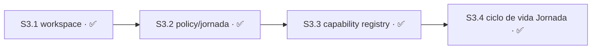

# Plan 3 — Workspace y orquestación

**Estado:** ✅ COMPLETO

> **Plan 3 cerrado el 2026-08-04. `S3.1` en `d8924a6`, `S3.2` en `22c43ae`, `S3.3` en `4621d3f`
> y `S3.4` en `b6dda84`.** La cadena entrega workspace checkpoint, Policy/Jornada con resolución
> fail-closed de delivery policy, el Agent Capability Registry, y la persistencia y el ciclo de
> vida de Jornada. `S3.4` cerró el hueco de revocación temprana que `S3.3` había aceptado a
> propósito, y lo hizo **de forma pasiva**: una Jornada terminada invalida por drift de revisión
> sin que nadie toque el registry.
>
> **`S3.2` cambió de contrato antes de empezar.** El corte política/seguridad de `d232fdf` le suma
> `M3.2.3` (resolución de la política de entrega declarada, con fail-closed al valor más
> restrictivo) y le sube el forecast a 310–410 líneas. Detalle en
> [`autonomous-v2-role-routed-continuation`](../../changes/autonomous-v2-role-routed-continuation/).
> El prerrequisito de `authorization-v1` que colgaba de `S5.1` quedó ✅ resuelto en `6d37642`.

## Resumen

| Campo | Detalle |
|---|---|
| Dependencias | Para Autonomous V2, `S3.1` partió de `master@33c2c6e` y quedó implementada en `d8924a6`, con `S2.4`/project registry verificada y cerrada; `S3.2` dependió de `S3.1` y `S3.3` depende de `S3.2` ✅. |
| Outputs | C: `inspect`, `create`, `retire`, receipts y wrapper legacy de `jornada.sh`. D: Main routing, Support briefs, Policy Reports, presets, snapshots, budgets y assignments. Más el Agent Capability Registry de `S3.3`. |
| Roadmap | **Las cuatro Sesiones están cerradas; el Plan no tiene trabajo pendiente.** Su única decisión `escala` —revocación activa al terminar una Jornada— quedó RESUELTA el 2026-08-04 a favor de la invalidación pasiva. El trabajo posterior no enumerado de Change B no fue dependencia de `S3.1`; las responsabilidades legacy sin límite de un PR permanecen sin ID en el [apéndice de migración](../plan-vocabulary-migration-appendix.md). |
| Referencias | [`autonomous-v2-checkpointed-delivery`](../../changes/autonomous-v2-checkpointed-delivery/). Los proposals `sdd-tower-workspace-manager` y `sdd-tower-main-policy-jornada` fueron eliminados en `613a45d` por ser cáscaras sin avance; su intención vive en este STATUS. |

## Sesión 3.1 — Change C Workspace checkpoint

**Estado:** ✅ COMPLETO

**Depende de:** `S2.4` ✅. Autoridad de base: `master@33c2c6e`; resultado: `d8924a6`. No tuvo predecesora dentro de la cadena aprobada.

**Área:** `workspace/checkpoint.mjs`, `test/workspace/checkpoint.test.mjs`

**Recurso:** —

Captura canónica de repositorio, base y resultado sin efectos remotos. Los artefactos de
`autonomous-v2-checkpointed-delivery` son referencia histórica; este `STATUS` es el contrato
ejecutable por la decisión documental vigente.

### Módulo M3.1.1 — Checkpoint

- [x] Tarea T3.1.1.1 — RED: selección Git por argv fijo y raíz canónica; rechazar `git -C`
  inyectado, relativo que escapa y raíz absoluta que no coincide.
- [x] Tarea T3.1.1.2 — RED: archivos y árbol explícitos; prohibir `commit -a`; rechazar drift
  en staging e índice vacío.
- [x] Tarea T3.1.1.3 — GREEN: implementar la captura.
- [x] Tarea T3.1.1.4 — REFACTOR: evidencia por bytes y modo.

**Decisiones:**

- `derivable` — cómo se selecciona Git y la raíz canónica. **Criterio:** toda invocación usa
  `execFileSync("git", argv, { cwd })` con argv de sólo lectura y la raíz devuelta por
  `rev-parse --show-toplevel` debe ser absoluta, normalizada y coincidir exactamente con la
  raíz validada; se rechazan `-C`, relativos que escapan y absolutos distintos. Falsificable:
  cualquiera de esos tres inputs llega a Git o produce una captura. **Autoridad:**
  `validateEnrollmentLayout`/`defaultGit` en `enroll/index.mjs` y la matriz Git del diseño C.
- `derivable` — qué referencias forman `base` y `result`. **Criterio:** cada una queda como OID
  completo de commit y su OID de árbol resuelto explícitamente; nunca como nombre de rama ni
  como estado implícito del índice. Falsificable: una rama, un OID abreviado o un árbol distinto
  de `<commit>^{tree}` produce una captura aceptada. **Autoridad:** matriz Commit/Git de
  `autonomous-v2-checkpointed-delivery/design.md` y el contrato de candidato que liga base,
  resultado y tree.
- `derivable` — cuándo rechazar el estado local antes de capturar. **Criterio:** staging no
  vacío o distinto del árbol esperado se rechaza; no se emite `commit -a` ni otro argv mutante.
  Falsificable: un recorder de Git observa un argv mutante, o un fixture con índice vacío/drift
  devuelve una captura en vez de fallar cerrado. **Autoridad:** T3.1.1.2 aprobada y el patrón de
  recorder de argv de `test/enroll/enroll.test.mjs`.
- `derivable` — cómo se prueba la evidencia de bytes y modo. **Criterio:** los bytes de evidencia
  usan `digestArtifact(bytes, "raw-bytes")` y la estructura de captura usa
  `digestArtifact(value, "rfc8785-jcs")`; una modificación de bytes o del modo esperado cambia
  el digest o falla la validación. Falsificable: dos entradas que difieren en bytes/modo conservan
  el mismo digest válido. **Autoridad:** `canonicalize` y `digestArtifact` en
  `contracts/canonicalize.mjs`.

**Criterios de aceptación de S3.1** — todos pasaron para cerrar:

- [x] Un fixture Git válido produce una captura inmutable con raíz canónica y OIDs completos de
  commit y árbol para `base` y `result`.
- [x] `git -C` inyectado, un relativo que escapa y una raíz absoluta distinta fallan cerrados sin
  crear commit, modificar refs ni ejecutar un argv Git mutante.
- [x] Un índice vacío, staging drift y cualquier intento de `commit -a` fallan cerrados; la
  captura sólo acepta archivos y árboles identificados explícitamente.
- [x] La evidencia de bytes `raw-bytes` y la estructura `rfc8785-jcs` producen digests SHA-256
  verificables y cambian ante la alteración correspondiente.
- [x] La captura no invoca red, push, fetch, PR ni escribe fuera del fixture Git.
- [x] `bun test test/workspace/checkpoint.test.mjs` pasó 11/0/23 y `bun test` pasó 476/0/2779.
- [x] El diff de M3.1.1 no toca ninguna ruta fuera de `workspace/checkpoint.mjs` y
  `test/workspace/checkpoint.test.mjs`.

**Evidencia de cierre:** implementación `d8924a6` (`feat(workspace): add canonical checkpoint
capture`); la corrección que liga evidencia a la captura quedó `CORROBORATED_FIXED`. La Torre
permaneció OFF y no hubo efectos remotos de runtime.

## Sesión 3.2 — Change D Global/project Policy/Jornada

**Estado:** ✅ COMPLETO

**Depende de:** `S3.1` ✅.

**Área:** `schemas/{reconciled-checkpoint-v1,support-proposal-v1,policy-report-v2,assignment-v2,recovery-proof-v1,delivery-policy-v1}.schema.json`, `policy/**`, `contracts/{validate,schema-registry}.mjs`, `main-store/store.mjs`, `test/{contracts,policy}/**`, `test/main-store.test.mjs`

**Prohibido:** `core.mjs`, `mcp.mjs`, `registry/**`, `continuation/**`, `capabilities/**`, `workspace/**`, `openspec/plans/**`, `openspec/specs/**`. Los tres últimos son un **acote** sobre lo que declaraba el `tasks.md`: `workspace/**` acaba de cerrar con `S3.1`, `capabilities/**` es el `Área` de `S3.3`, y `openspec/specs/**` está byte-pinned (ver la trampa más abajo).

**Recurso:** Main / ninguno. Sin migraciones de SQLite, sin `db-writer`, sin token de entrega. Las escrituras van por CAS de filesystem en `main-store/store.mjs` (root `0700`), nunca por el SQLite de la Torre. **Corregido el 2026-08-04:** esta línea decía que el `db-writer` aparecía en `S5.2`. Ya no — al sellar `S5.2` el maintainer resolvió que su registro de entrega es propio y append-only en `delivery/**`, sin migraciones y sin escribir en el SQLite de la Torre. Hoy ninguna Sesión enumerada introduce un `db-writer`.

**Entrega:** commit directo a `master` + push, sin PR ([`AGENTS.md`](../../../AGENTS.md)). **Dos commits**, como hizo `S3.1`: uno de implementación que respeta el `Prohibido`, y uno de cierre que toca `openspec/plans/**`. Es la única forma de que el diff de implementación no viole su propio `Prohibido` y el Documentation Close Gate quede satisfecho igual.

Define floors globales, herencia, snapshots Policy/Jornada, excepciones acotadas y auditoría.

**Son tres Módulos, no uno:** `M3.2.1` Authority/contracts, `M3.2.2` Policy/Jornada y
`M3.2.3` Delivery-policy resolution. Su definición vive en el
[`tasks.md` de `role-routed-continuation`](../../changes/autonomous-v2-role-routed-continuation/tasks.md),
que es el que incorpora el corte de `d232fdf`. **Colisión de IDs — leela antes de ejecutar:** el
[`tasks.md` de `checkpointed-delivery`](../../changes/autonomous-v2-checkpointed-delivery/tasks.md)
usa `T3.2.1.1`–`T3.2.1.3` para contenido distinto (`RED floors/inheritance/exception` en vez de
`Git -C/escape/foreign-root`). Es referencia histórica y **no gobierna esta Sesión**.

**Trampa conocida en el Área — no la "arregles".** `schemas/plan-manifest-v1.schema.json` declara
`delivery_automation`, pero el bloque de ejemplo de
[REQUIREMENTS](../../specs/sdd-tower-implementation-v1-requirements.md) todavía dice
`delivery_policy`. La divergencia es **deliberada**: ese archivo está byte-pinned como input
histórico por la revisión congelada 1
([`autonomous-v2/revisions/1/manifest.yaml:39-43`](../autonomous-v2/revisions/1/manifest.yaml)) y
`test/provenance/provenance.test.mjs:80-88` falla cerrado ante cualquier drift. Editarlo rompe la
suite. Corregir el ejemplo exige **publicar una revisión nueva del manifest**, que es trabajo de
otra Sesión, no de esta.

**Decisiones:**

- `derivable` — qué valor toma un campo de política ausente. **Criterio:** el más restrictivo; un repositorio sin bloque `delivery-policy` se comporta exactamente igual que antes de que el bloque existiera. Falsificable: si un campo ausente habilitara algo que el bloque explícito no habilita, el default estaba mal. **Autoridad:** el corte política/seguridad de `d232fdf` y el bloque `delivery-policy` de [`AGENTS.md`](../../../AGENTS.md).
- `derivable` — dónde vive la política declarada de un proyecto. **Criterio:** el bloque `delivery-policy` del `AGENTS.md` de ese proyecto, un solo lugar y legible por máquina. Falsificable: dos fuentes en el árbol que respondan la misma pregunta de política. **Autoridad:** [`AGENTS.md`](../../../AGENTS.md).
- `derivable` — qué gana cuando la política global y la del proyecto difieren. **Criterio:** el valor más restrictivo de los dos, no el más específico. La herencia acota, nunca amplía. Falsificable: un proyecto que declare una política más permisiva que la global y termine ejecutando la permisiva. **Autoridad:** los floors de seguridad de `d232fdf`.
- `escala` — si una excepción acotada puede relajar un floor de seguridad. **Clase:** seguridad y permisos. **RESUELTA el 2026-08-04 por el maintainer: no, ninguno de los cinco.** Los floors —sin mutación temprana, inmutabilidad del candidato congelado, ledger append-only, autoridad única de Main, sin autoasignación del worker— quedan fuera del alcance tanto de la configuración como de toda excepción. Dos de los cinco no admiten una excepción *acotada* ni siquiera técnicamente: el ledger se aplica por triggers DDL (`core.mjs:346-363`), así que relajarlo exige una migración y **una migración no vence**; y una excepción sobre la autoridad de Main tendría que ser otorgada por Main (`main-store/store.mjs:89-94`), o sea autoelevación circular. La excepción conserva alcance real y no queda decorativa: `effective_limits`, `delivery.shape`, `planning.horizon_ceiling`, `allowed_operations` y `allowed_hosts` — que es donde hace falta, porque la herencia sólo acota y sin excepción un proyecto sobre-restringido no puede volver al valor global. Falsificable: cualquier ruta en la que una excepción registrada habilite una operación que el floor prohíbe. **Autoridad:** decisión del maintainer del 2026-08-04, en [master-index](../master-index.md). **Contaminaba:** `S5.1`, `S5.2` y `S7.1`, las tres destrabadas — sus criterios de aceptación siguen siendo del tipo "no existe ninguna ruta", falsificables por ausencia.
- `escala` — qué queda registrado en la auditoría de una excepción. **Clase:** seguridad y permisos. **RESUELTA el 2026-08-04 por el maintainer.** El registro es un evento de autoridad §15.3 de [REQUIREMENTS](../../specs/sdd-tower-implementation-v1-requirements.md), no un género nuevo, y reutiliza los `$defs` de `artifact-ref-v1` más la forma ya probada de `authorization-v1`. Mínimo: identidad (`exception_id`, `project_id`, `registry_revision`, `plan_id`, `jornada_id/revision`), objetivo (`policy_revision` + `policy_digest`, `candidate_ref`), `excepted_rule` como enum cerrado, `declared_scope` verificable por máquina, `granted_by`, `authorization_ref`, `created_at`/`expires_at`, `resulting_action`/`final_outcome`, y `previous_entry_digest`/`entry_digest`. Tres definiciones que la acompañan: la justificación se persiste **sólo como digest más puntero externo** —nunca texto libre, que es por donde se filtra un secreto que `assertCredentialFree` no ve y que además haría irreconciliable el borrado de §22 con el append-only—; la excepción la otorga **sólo un humano y vence con la Jornada**, deliberadamente distinto de la autorización de merge (una hora); y la cadena de hash es **por entrega, no por proyecto**, para no serializar la punta contra CAS. Falsificable: un registro que no permita reconstruir quién la otorgó y contra qué revisión de política. **Autoridad:** §15.3 y §22 de REQUIREMENTS, más la decisión del maintainer del 2026-08-04. **Contaminaba:** `S7.1`, destrabada.
- `derivable` — qué reglas pueden figurar en `excepted_rule`. **Criterio:** exactamente la superficie configurable, que es la que queda al excluir los cinco floors: `effective_limits`, `delivery.shape`, `delivery.target_branch`, `planning.horizon_ceiling`, `documentation_close.*`, `allowed_operations` y `allowed_hosts`. Dejó de ser `escala` al resolverse la decisión de floors: sin floors exceptuables, el enum ya no es una elección. Falsificable: un valor del enum que nombre un floor. **Autoridad:** la decisión de floors de arriba.

### Módulo M3.2.1 — Authority/contracts

**Estado:** ✅ COMPLETO

- [x] Tarea T3.2.1.1 — RED: extender `test/contracts/schema.test.mjs` con el drift de rol, proyecto
  y schema, y `test/main-store.test.mjs` con que **un registro de autoridad persistido sin
  identidad de actor falle cerrado**. Hoy `main-store/store.mjs:104,107` hace `actor: undefined` y
  `delete next.actor` antes de escribir, así que ningún registro contesta quién lo otorgó —
  contra §15.3 de [REQUIREMENTS](../../specs/sdd-tower-implementation-v1-requirements.md), que
  exige identidad de actor en **todo** efecto de autoridad.
- [x] Tarea T3.2.1.2 — GREEN: implementar los cinco schemas `reconciled-checkpoint-v1`,
  `support-proposal-v1`, `policy-report-v2`, `assignment-v2` y `recovery-proof-v1`; registrarlos en
  `contracts/schema-registry.mjs`; escritura CAS ejercida sólo por Main; los códigos `CT_*`
  deterministas del diseño (`CT_ROLE_FORBIDDEN`, `CT_REPORT_STALE`, `CT_NO_EXECUTABLE_SCOPE`,
  `CT_POLICY_DENIED`, `CT_HORIZON_EXCEEDED`, `CT_POLICY_UNRESOLVED`, `CT_CLAIM_MISMATCH`,
  `CT_HOST_CAPABILITY_MISSING`); y la persistencia de la identidad de quien otorga.
- [x] Tarea T3.2.1.3 — REFACTOR: preservar los bytes de los contratos V1 ya aceptados y dejar el
  audit por digest con los campos de §15.3 completos. `bun test test/contracts test/main-store.test.mjs`.

### Módulo M3.2.2 — Policy/Jornada

**Estado:** ✅ COMPLETO

- [x] Tarea T3.2.2.1 — RED: agregar `test/policy/jornada.test.mjs` para Jornada inactiva y
  **vencida** —incluido que `consumeAuthorization` rechace una autorización pasada su `expires_at`,
  que hoy **no chequea en ningún punto** (`main-store/store.mjs:134-152`), dejando sin aplicación
  tanto la regla de una hora como la de "vence con la Jornada"—, más techo de horizonte resuelto,
  denegación, expansión, excepción y acciones irreversibles.
- [x] Tarea T3.2.2.2 — GREEN: implementar `policy/jornada.mjs` sobre `main-store/store.mjs`, con
  **elegibilidad únicamente**: resuelve si algo puede ocurrir, nunca a quién se le asigna ni por
  dónde se despacha. El `tasks.md` decía "extender `policy/delivery-policy.mjs`"; ese archivo
  **no existe**, así que esta Tarea lo crea junto al directorio.
- [x] Tarea T3.2.2.3 — REFACTOR: preservar los Policy Reports V1 legibles junto a
  `policy-report-v2`. `bun test test/policy`.

### Módulo M3.2.3 — Delivery-policy resolution

**Estado:** ✅ COMPLETO

- [x] Tarea T3.2.3.1 — RED: `test/policy/delivery-policy.test.mjs` para fuente ausente, no
  parseable, con valor desconocido, sin ligar, y por symlink / que escapa / de raíz ajena. **Cada
  campo sin resolver alcanza su valor más restrictivo y el motivo queda nombrado** con
  `CT_POLICY_UNRESOLVED`.
- [x] Tarea T3.2.3.2 — RED: ningún valor de política **ni excepción** alcanza un floor; se rechaza
  **nombrando el floor** en los cinco casos: mutación remota temprana, reescritura del candidato
  congelado, borrado del ledger, autoasignación del worker y dispatch no-Main.
- [x] Tarea T3.2.3.3 — GREEN: implementar `schemas/delivery-policy-v1.schema.json` y
  `policy/delivery-policy.mjs`, con lectura por digest desde la raíz canónica y el campo de binding
  de revisión. **No liga contra `candidate_revision`:** ese contrato es de `S5.1` y todavía no
  existe. Acá se define la forma; allá se liga. El `tasks.md` dice "revision binding into
  `candidate_revision`" y es una dependencia hacia adelante, no trabajo de esta Sesión.
- [x] Tarea T3.2.3.4 — REFACTOR: un repositorio sin el bloque se comporta exactamente igual que
  antes de que el bloque existiera. `bun test test/policy`.

**Criterios de aceptación de S3.2** — todos deben pasar para cerrar:

- [x] Un campo de política ausente resuelve al valor más restrictivo y el motivo queda nombrado con `CT_POLICY_UNRESOLVED`
- [x] Un bloque no parseable, con valor desconocido, o no ligado, falla cerrado sin default permisivo
- [x] Una fuente de política por symlink, que escapa de la raíz, o de raíz ajena, se rechaza sin leerla
- [x] Una política de proyecto más permisiva que la global resuelve al valor global
- [x] Un repositorio sin bloque `delivery-policy` se comporta exactamente igual que antes de que el bloque existiera
- [x] Ningún valor de política ni excepción alcanza un floor: los cinco casos se rechazan nombrando el floor violado
- [x] Un registro de autoridad persistido sin identidad de actor falla cerrado, y esa identidad sobrevive al commit
- [x] Una autorización consumida pasado su `expires_at` se rechaza
- [x] Los seis schemas validan contra sus fixtures y están registrados en `contracts/schema-registry.mjs`
- [x] Los bytes de los contratos V1 aceptados no cambian y `test/provenance/provenance.test.mjs` sigue verde
- [x] Policy resuelve elegibilidad y nunca ruteo: ninguna ruta de `policy/**` crea ni modifica un assignment
- [x] `bun test test/contracts test/main-store.test.mjs test/policy` pasa completo
- [x] `bun test` no introduce fallos nuevos sobre la línea base de `S3.1` — 476/0/2779, con la Torre desarmada
- [x] El diff de implementación no toca ninguna ruta del `Prohibido`

**Evidencia de cierre:** implementación `22c43ae` (`feat(policy): implement S3.2 policy and
Jornada`) sobre `origin/master@3362b3b6aa51c1498970552ba59d8813b4274b8c`: exactamente 15
archivos dentro de `Área`, 360 adiciones y 3 eliminaciones; ninguna ruta de `Prohibido` ni
`openspec/plans/**` fue tocada. La validación enfocada final
`bun test test/contracts test/main-store.test.mjs test/policy` pasó con 80 pass, 0 fail y 263
expects; `bun test` pasó con 493 pass, 0 fail y 2842 expects, con la Torre OFF. La validación
fresca del candidato fue `CORROBORATED_FIXED`: los 14 criterios pasaron. El SHA-256 de
`REQUIREMENTS` permaneció exactamente
`277129f30b47c1b6fda0a6c81f6d8943d737a7b5ff5750455e2b41dce6e1e5a0`.

## Sesión 3.3 — Agent Capability Registry

**Estado:** ✅ COMPLETO
**Depende de:** `S3.2` ✅
**Área:** `capabilities/registry.mjs`, `schemas/agent-capability-registry-v1.schema.json`, `contracts/{schema-registry,validate}.mjs`, `test/capabilities/**`, `test/contracts/schema.test.mjs`, `test/fixtures/contracts/schema-cases-v1.json`
**Prohibido:** `continuation/**`, `core.mjs`, `mcp.mjs`, `registry/**`, `main-store/store.mjs`, `policy/**`, `workspace/**`, `openspec/plans/**`, `openspec/specs/**`
**Recurso:** ninguno. Escritura sólo por Main vía CAS, sin migraciones de DB, sin token de entrega.
**Entrega:** commit directo a `master` + push, sin PR. **Dos commits**, igual que `S3.1` y `S3.2`.

**Por qué el `Área` incluye `contracts/**`:** un schema fuera del mapa `schemaFiles` de
`contracts/schema-registry.mjs` **no tiene validador** —`validatorFor` devuelve `null` y
`validate` tira `Unknown schema`—, y la unicidad de entradas es un invariante cross-field que
vive en el mapa `invariants` de `contracts/validate.mjs`, igual que `projectRegistry`.

**Por qué el `Prohibido` se acota:** `main-store/store.mjs` y `policy/**` son el `Área` de
`S3.2`, ya cerrada — se importan, nunca se editan. `registry/**` queda prohibido por la decisión
de escritura atómica de más abajo. `openspec/specs/**` está byte-pinned.

Registro versionado y con alcance de proyecto de **qué puede hacer cada agente**. Es lo que
permite que Main resuelva una capability por rol en vez de asumirla: `Main → capability
Support → SupportProposal` y `Main → capability Policy → PolicyReport ALLOW/DENY`
([`design.md`](../../changes/autonomous-v2-role-routed-continuation/design.md)). Ese `DENY`
es el punto donde nace un escalamiento, así que sin registry el ruteo por rol no tiene
de dónde resolver quién contesta.

**Límite duro:** el registry otorga **visibilidad y compatibilidad de invocación, nunca
autoridad**. Un agente no puede registrarse a sí mismo; una entrada vencida no habilita
nada. La autoridad sigue siendo exclusiva de Main.

La entrada declara identidad de proyecto y de Main, revisión de registro y de entrada,
identidad y rol de quien llama, la capability, los IDs de schema de entrada y salida, ref y
digest de origen, y ventana de disponibilidad con expiración. **Un update por CAS invalida
todos los bindings anteriores.**

**Decisiones:**

- `derivable` — la forma de una entrada del registro. **Criterio:** `schemas/agent-capability-registry-v1.schema.json`, que está en el `Área` de esta Sesión y enumera los campos: identidad de proyecto y de Main, revisión de registro y de entrada, identidad y rol de quien llama, capability, IDs de schema de entrada y salida, ref y digest de origen, y ventana de disponibilidad. Falsificable: un campo que el código exija y el schema no declare. **Autoridad:** el schema del `Área`.
- `derivable` — qué hace una entrada vencida. **Criterio:** no resuelve, y el rechazo es explícito en vez de silencioso. Un rechazo silencioso es indistinguible de una capability ausente y manda al llamador a improvisar. Falsificable por el criterio de aceptación ya escrito. **Autoridad:** los criterios de aceptación de `S3.3`.
- `derivable` — si el registry puede otorgar autoridad. **Criterio:** no. Otorga visibilidad y compatibilidad de invocación; la autoridad sigue siendo exclusiva de Main, y un agente no puede registrarse a sí mismo. Falsificable: cualquier ruta en la que una entrada del registro habilite una operación que Main no autorizó. **Autoridad:** el **Límite duro** declarado arriba en esta misma Sesión.
- `derivable` — qué pasa con los bindings previos ante un update. **Criterio:** un update por CAS lleva el registro de `R1` a `R2` e invalida **todos** los bindings de `R1`. Falsificable: un binding de `R1` que siga resolviendo después de la transición. **Autoridad:** el alcance declarado de `S3.3`.
- `escala` — cuánto dura por defecto la ventana de disponibilidad de una entrada. **Clase:** seguridad y permisos. **RESUELTA el 2026-08-04 por el maintainer: expira con su Jornada, materializando `expires_at` al emitir la entrada.** **Criterio:** la entrada liga `jornada_id`, `jornada_revision` y el `expires_at` copiado de su Jornada, y la resolución falla cerrada ante binding ausente, `jornada_revision` que no coincide, o reloj pasado `expires_at`. Falsificable: una entrada que resuelva después de su `expires_at`, o sin binding de Jornada. La expiración por Jornada es la **segunda** capa de invalidación; el cambio de revisión por CAS `R1 → R2` sigue invalidando todos los bindings y no queda reemplazado. **Autoridad:** decisión del maintainer del 2026-08-04.
  **Hueco aceptado explícitamente, y por qué:** una Jornada revocada **antes** de su `expires_at` deja la entrada resolviendo hasta que el reloj la alcance, porque no existe persistencia de Jornada a la que preguntarle —`policy/jornada.mjs` de `S3.2` es un resolvedor puro que recibe la Jornada como argumento, no un store—. Se acepta porque el registry otorga **visibilidad, nunca autoridad** (el **Límite duro** de arriba): una entrada zombi deja ver una capability que ya no corresponde, pero **no habilita ninguna operación sin autorización de Main**. El hueco es de visibilidad, no de permisos. **Lo cierra `S3.4`**, cuyo incremento de `jornada_revision` en toda transición hace que una Jornada terminada produzca drift y el binding falle cerrado, sin que el registry lea estado vivo. La garantía fuerte —"una entrada no resuelve después de un estado terminal"— es criterio de aceptación de `S3.4`, no de `S3.3`. **Contaminaba:** `S5.1` y `S5.4`, ambas destrabadas.
- `escala` — de dónde sale la maquinaria de escritura atómica del registry. **Clase:** seguridad y permisos. **RESUELTA el 2026-08-04 por el maintainer: implementación propia dentro de `capabilities/registry.mjs`.** Se evaluó parametrizar `registry/store.mjs` —que ya resuelve lock, `fsync`, rename atómico, rollback y revisión de entrada por contenido canonicalizado (`:88-104`)— y se descartó para **no tocar un componente en producción con tests propios**. El costo aceptado es una segunda implementación de escritura atómica; a cambio `registry/**` entra al `Prohibido` y `S3.3` no puede romper el registro de proyectos. **Mitigación obligatoria:** las dos implementaciones rechazan idénticamente los cinco casos de seguridad, verificado por criterio de aceptación y no por lectura. Falsificable: un caso que una implementación rechace y la otra acepte. **Autoridad:** decisión del maintainer del 2026-08-04.
- `derivable` — de dónde sale la autoridad de Main para escribir el registry. **Criterio:** `bindMainAuthority(...).assert(capability, expected)` de `main-store/authority.mjs`, importado **sin modificar**: capability infalsificable por `WeakSet`, de un solo uso al arranque, con binding rederivado y comparado. No se construye una segunda noción de "esto es Main". Falsificable: cualquier ruta que acepte un Main sin pasar por `assert`. **Autoridad:** `main-store/authority.mjs:15-36`.

### Módulo 3.3.1 — Registry

- [x] Tarea 3.3.1.1 — RED: agregar `test/capabilities/registry.test.mjs` para resolución por rol
  y proyecto (un lookup en dos proyectos no cruza entradas), rechazo por expiración —**incluido
  binding de Jornada ausente, `jornada_revision` que no coincide y reloj pasado `expires_at`**—,
  rechazo por drift de schema declarado contra invocado, transición `R1 → R2` que invalida
  **todos** los bindings de `R1`, rechazo del auto-registro, y **la paridad de seguridad de la
  escritura atómica contra `registry/store.mjs`**: symlink, modos distintos de `0700`/`0600`,
  dueño ajeno, lock ocupado y revisión desactualizada. Agregar el caso de contrato del schema
  nuevo a `test/contracts/schema.test.mjs` y su fixture.
- [x] Tarea 3.3.1.2 — GREEN: implementar `schemas/agent-capability-registry-v1.schema.json`
  —identidad de proyecto y de Main, `registry_revision` y `registry_entry_revision`, identidad y
  rol de quien llama, capability, IDs de schema de entrada y salida, ref y digest de origen,
  `jornada_id`/`jornada_revision` y `expires_at`—, registrarlo en `contracts/schema-registry.mjs`,
  sumar su invariante de unicidad en `contracts/validate.mjs`, y escribir `capabilities/registry.mjs`
  con su propia escritura atómica CAS y la autoridad de Main asertada vía `main-store/authority.mjs`.
- [x] Tarea 3.3.1.3 — REFACTOR: eliminar toda autoridad sombra y cualquier visibilidad
  todos-contra-todos; dejar documentado en `capabilities/registry.mjs` que su escritura atómica es
  deliberadamente un gemelo de `registry/store.mjs` y qué garantías debe conservar.
  `bun test test/capabilities test/contracts test/registry`.

**Criterios de aceptación de S3.3** — todos deben pasar para cerrar:

- [x] Una capability se resuelve por rol y por proyecto; un lookup en dos proyectos no cruza entradas
- [x] Una entrada vencida no resuelve, y el rechazo es explícito en vez de silencioso
- [x] Una entrada sin binding de Jornada, o con `jornada_revision` que no coincide, falla cerrada
- [x] Un update por CAS lleva el registro de `R1` a `R2` e invalida todos los bindings de `R1`
- [x] Una entrada nueva arranca en `registry_entry_revision: 1`, y su revisión sólo sube cuando el contenido canonicalizado cambia
- [x] Un agente que intenta registrarse a sí mismo falla cerrado
- [x] El drift entre el schema declarado y el invocado falla cerrado
- [x] Una escritura sin la capability de Main asertada falla cerrada
- [x] **Paridad de escritura atómica:** symlink, modos distintos de `0700`/`0600`, dueño ajeno, lock ocupado y revisión desactualizada se rechazan igual en `capabilities/registry.mjs` que en `registry/store.mjs`
- [x] El registry no crea, valida ni consume autoridad, y no habilita ninguna ruta Support → Worker
- [x] `agent-capability-registry-v1` está registrado en `contracts/schema-registry.mjs` y tiene su caso en el fixture de contratos
- [x] `bun test test/capabilities test/contracts test/registry` pasa completo
- [x] `bun test` no introduce fallos nuevos sobre la línea base de `S3.2` — 493/0/2842, con la Torre desarmada
- [x] El diff de implementación no toca ninguna ruta del `Prohibido`

**Evidencia de cierre:** implementación `4621d3f333c4d523b66a7595a33e8abcd7642700`
(`feat(capabilities): add agent capability registry`) sobre `origin/master@7c1c323`: exactamente
7 archivos, los 7 dentro del `Área`, 374 adiciones y 0 eliminaciones; ninguna ruta de
`Prohibido` ni `openspec/plans/**` fue tocada. La validación enfocada final
`bun test test/capabilities test/contracts test/registry` pasó con 86 pass, 0 fail y 367
expects; `bun test` pasó con 503 pass, 0 fail y 2880 expects, con la Torre OFF — la línea base
de `S3.2` era 493/0/2842, así que la Sesión suma 10 tests y 38 expects sin introducir un solo
fallo. Los 14 criterios pasaron con verificación fresca del planner contra el SHA integrado, no
contra el reporte del implementador. El SHA-256 de `REQUIREMENTS` permaneció exactamente
`277129f30b47c1b6fda0a6c81f6d8943d737a7b5ff5750455e2b41dce6e1e5a0`.

**Dos observaciones de la verificación, ninguna bloqueante:**

1. **La invalidación `R1 → R2` es de registro, no de entrada.** `capabilities/registry.mjs:134`
   compara `binding.registry_revision` contra la revisión del documento, así que invalida
   **todos** los bindings estructuralmente. El test ejerce un único binding; la garantía de
   "todos" descansa en el mecanismo, que es del nivel correcto, no en la enumeración de casos.
2. **El criterio "no habilita ninguna ruta Support → Worker" tiene evidencia estructural más
   fuerte que su test.** El test asserta que el objeto resuelto no contiene las cadenas
   `authority` ni `WORKER` (`test/capabilities/registry.test.mjs:140-141`), lo cual es una
   prueba débil. La garantía real es el schema: el enum de `agent_role` es exactamente
   `["SUPPORT", "POLICY"]` (`schemas/agent-capability-registry-v1.schema.json`), con
   `additionalProperties: false`. Un rol `WORKER` **no puede existir** en el documento; la ruta
   no está cerrada por convención sino por contrato.

## Sesión 3.4 — Persistencia y ciclo de vida de Jornada

**Estado:** ✅ COMPLETO
**Depende de:** `S3.2` ✅, `S3.3` ✅
**Área:** `main-store/store.mjs`, `jornada/lifecycle.mjs`, `test/jornada/**`, `test/main-store.test.mjs`
**Prohibido:** `core.mjs`, `mcp.mjs`, `registry/**`, `capabilities/**`, `continuation/**`, `policy/**`, `contracts/**`, `schemas/**`, `workspace/**`, `openspec/plans/**`, `openspec/specs/**`
**Recurso:** Main / ninguno. CAS de filesystem, sin migraciones de DB, sin token de entrega.
**Entrega:** commit directo a `master` + push, sin PR. Dos commits, igual que `S3.1`–`S3.3`.

Enumerada el 2026-08-04 por decisión del maintainer. `schemas/jornada-v1.schema.json` existe
como contrato **sin implementación**: nada crea, lee ni termina una Jornada. `jornada.sh` es el
gestor legacy de worktrees, sin relación, y `core.mjs` la menciona una sola vez en un comentario
(`:4329`). `policy/jornada.mjs`, que entregó `S3.2`, es un **resolvedor puro** — recibe la Jornada
como argumento y no la persiste.

**Por qué depende también de `S3.3`:** el criterio "una entrada de capability de una Jornada
terminada deja de resolver" **no es verificable sin el registry**.

**Por qué `schemas/**` y `contracts/**` están prohibidos:** `jornada-v1` ya está completo para
persistir y ya está registrado en `contracts/schema-registry.mjs:11`. Esta Sesión **no necesita
tocar ningún contrato**.

**Alcance pasivo, sin revocación activa.** Terminar una Jornada invalida por drift de revisión;
no dispara una cascada de revocación sobre capabilities ni autorizaciones vivas.

**Revalidada el 2026-08-04 contra `origin/master@4621d3f`, ya con `S3.3` integrada.** Tres
comprobaciones, las tres pasaron. (1) El diff de `S3.3` tocó `capabilities/**`, `contracts/**`,
`schemas/**`, `test/capabilities/**`, `test/contracts/**` y `test/fixtures/**`: **ninguna
intersección** con el `Área` de esta Sesión. (2) El criterio que cierra el hueco es alcanzable
sin violar el `Prohibido`: `resolve` recibe la Jornada **como argumento** y compara
`jornada_id`/`jornada_revision` contra la entrada (`capabilities/registry.mjs:143`), así que
`test/jornada/lifecycle.test.mjs` —que sí está en el `Área`— importa el registry y le pasa la
Jornada terminada, sin editar una sola línea de `capabilities/**`. Es el mismo patrón con el que
`S3.3` consumió `main-store/authority.mjs`. (3) `test/capabilities` aparece en el comando de
`T3.4.2.3` sólo para **ejecutarse**; correr un test no es editarlo, y ese path sigue fuera del
`Área`.

**Decisiones:**

- `derivable` — dónde viven los registros de Jornada. **Criterio:** `main-store/store.mjs`, siguiendo exactamente la forma de `createAuthorization`/`consumeAuthorization` (`:122-152`): validación contra el schema en vez de una lista escrita a mano, CAS con `expected_revision`, y `assertMain` como única puerta de escritura. Una Jornada es el mismo género de registro que una autorización. Falsificable: un segundo store de registros propiedad de Main en el árbol. **Autoridad:** `main-store/store.mjs`.
- `derivable` — qué transiciones de estado son legales. **Criterio:** el enum `state` de `jornada-v1`, con los cuatro terminales —`REJECTED`, `EXPIRED`, `REVOKED`, `COMPLETED`— irreversibles, como `TERMINAL_STATES` y el gate `CT_AUTH_TERMINAL` de `main-store/store.mjs`. Falsificable: un estado terminal que vuelva a uno no terminal. **Autoridad:** `schemas/jornada-v1.schema.json` y el precedente de autorizaciones.
- `derivable` — qué pasa con `jornada_revision` en una transición. **Criterio:** sube en **toda** transición, sin excepción. Es lo que cierra el hueco que `S3.3` aceptó: su entrada liga `jornada_revision`, así que una Jornada terminada produce drift y el binding falla cerrado sin que el registry lea estado vivo. Falsificable: una Jornada que cambie de estado sin cambiar de revisión. **Autoridad:** la decisión de disponibilidad de `S3.3`.
- `derivable` — qué se hace con una Jornada vencida por reloj que nunca transicionó. **Criterio:** la lectura la reporta vencida sin necesitar una transición previa; no hay proceso de barrido, y su ausencia nunca es lo que mantiene viva una Jornada. Falsificable: una lectura que devuelva `ACTIVE` con el reloj pasado `expires_at`. **Autoridad:** el piso fail-closed del proyecto.
- `escala` — si terminar una Jornada debe **además** revocar activamente las capabilities y autorizaciones vivas, en vez de sólo invalidarlas por drift. **Clase:** expansión de alcance, y seguridad y permisos. **RESUELTA el 2026-08-04 por el maintainer: no. La invalidación queda pasiva.** Terminar una Jornada incrementa `jornada_revision` y nada más; las capabilities y autorizaciones anteriores quedan inutilizables **al revalidar**, no al terminar. Quien las quiera usar revalida y falla cerrado por drift. La poda de capabilities discontinuadas queda **fuera de alcance**: no se construye garbage collector. Falsificable: cualquier ruta que mute una capability o una autorización como efecto de terminar una Jornada. **Autoridad:** decisión del maintainer del 2026-08-04. **Contaminaba:** `S5.1`, **destrabada** — era su última decisión `escala` abierta, y su contrato quedó sellado el mismo día. Nunca contaminó a `S3.4`, cuyos criterios no asumían la respuesta.

### Módulo 3.4.1 — Jornada store

- [x] Tarea 3.4.1.1 — RED: extender `test/main-store.test.mjs` con persistencia de una Jornada que
  valida contra `jornada-v1`, rechazo de una que no lo satisface, rechazo de todo actor que no sea
  `MAIN`, rechazo por proyecto ajeno, y colisión de CAS con `expected_revision` desactualizado.
- [x] Tarea 3.4.1.2 — GREEN: agregar `createJornada`, `readJornada` y `transitionJornada` a
  `main-store/store.mjs`, reusando `commit`, `assertMain` y la validación contra schema que ya usa
  `createAuthorization`; sin abrir una segunda ruta de escritura.
- [x] Tarea 3.4.1.3 — REFACTOR: confirmar que no quedó ninguna lista de campos escrita a mano al
  lado del schema — la causa raíz del drift de `authorization-v1` reconciliado en `6d37642`.
  `bun test test/main-store.test.mjs`.

### Módulo 3.4.2 — Ciclo de vida

- [x] Tarea 3.4.2.1 — RED: agregar `test/jornada/lifecycle.test.mjs` para transiciones legales
  contra el enum de `jornada-v1`, irreversibilidad de los cuatro estados terminales, incremento de
  `jornada_revision` en **toda** transición, lectura vencida por reloj sin transición previa, y
  —el criterio que cierra el hueco— que una entrada de capability ligada a una Jornada terminada
  deje de resolver.
- [x] Tarea 3.4.2.2 — GREEN: implementar `jornada/lifecycle.mjs` sobre el store de `M3.4.1`, con la
  máquina de estados y el incremento de revisión.
- [x] Tarea 3.4.2.3 — REFACTOR: dejar el vencimiento por reloj y el vencimiento por transición
  resolviendo por el mismo camino, para que no puedan divergir.
  `bun test test/jornada test/main-store.test.mjs test/capabilities`.

**Criterios de aceptación de S3.4** — todos deben pasar para cerrar:

- [x] Una Jornada se persiste validando contra `jornada-v1` y falla cerrada si no lo satisface
- [x] Una escritura por un actor que no es Main falla cerrada
- [x] Una escritura sobre un proyecto ajeno falla cerrada
- [x] Una transición a `REJECTED`, `EXPIRED`, `REVOKED` o `COMPLETED` es irreversible
- [x] Toda transición incrementa `jornada_revision`
- [x] Una lectura con el reloj pasado `expires_at` reporta la Jornada vencida sin transición previa
- [x] **Una entrada de capability ligada a una Jornada terminada deja de resolver** — el hueco que aceptó `S3.3` queda cerrado
- [x] No queda ninguna lista de campos escrita a mano al lado del schema
- [x] `bun test test/jornada test/main-store.test.mjs test/capabilities` pasa completo
- [x] `bun test` no introduce fallos nuevos sobre la línea base que dejó `S3.3` — 503/0/2880, con la Torre desarmada
- [x] El diff de implementación no toca ninguna ruta del `Prohibido`

**Evidencia de cierre:** implementación `b6dda84888e654466851bbd771920cf1c971b05a`
(`feat(jornada): persist lifecycle transitions`) sobre `origin/master@c2d116c`: exactamente
4 archivos, los 4 dentro del `Área`, 247 adiciones y 0 eliminaciones; ninguna ruta de
`Prohibido` ni `openspec/plans/**` fue tocada. Las dos validaciones enfocadas dieron
`bun test test/main-store.test.mjs` 21/0/84 y
`bun test test/jornada test/main-store.test.mjs test/capabilities` 35/0/153; `bun test` pasó con
512 pass, 0 fail y 2931 expects, con la Torre OFF — la línea base de `S3.3` era 503/0/2880, así
que la Sesión suma 9 tests y 51 expects sin introducir un solo fallo. Los 11 criterios pasaron
con verificación fresca del planner contra el SHA integrado.

**El hueco que aceptó `S3.3` quedó cerrado, y la prueba lo demuestra pasivo.**
`test/jornada/lifecycle.test.mjs:111` —"passively invalidates a capability by Jornada revision
drift **without changing its registry**"— resuelve una capability con la Jornada `ACTIVE`, la
transiciona a `REVOKED`, y la misma capability pasa a fallar con
`CT_CAPABILITY_JORNADA_MISMATCH` **sin que el registry se haya tocado**. Es exactamente la
decisión del maintainer del 2026-08-04 materializada en test: invalidación por drift de revisión,
nunca cascada. El test de `:130` cierra la otra mitad: una Jornada vencida por reloj **no**
inventa una revisión sintética al leerse —`expired.jornada_revision === created.jornada_revision`—
y la capability falla por `CT_CAPABILITY_EXPIRED`, de modo que la lectura nunca muta.

**Una observación de la verificación, no bloqueante:** `createJornada` no llama a `assertMain`
directamente, sino a través de `commit` (`main-store/store.mjs:97`), que es el mismo camino que
usa `createAuthorization`. Es lo correcto —`T3.4.1.2` pedía explícitamente reusar `commit` y
`assertMain` sin abrir una segunda ruta de escritura— pero se lee como un hueco hasta que uno
sigue la llamada. Queda anotado para que la próxima lectura no repita la sospecha.

## Grafo del Plan 3

**Plan 3 cerrado: las cuatro Sesiones están ✅ COMPLETO.** Fue **una sola cadena** de principio a
fin, con capacidad derivada de **1 agente**: `S3.4` compartía `main-store/store.mjs` con `S3.2` y
dependía de `S3.3`, así que nunca admitió paralelismo interno.

Las responsabilidades legacy de Workspace Manager y Main/Policy que aún no tienen límite de un PR permanecen sin IDs en el [apéndice de migración](../plan-vocabulary-migration-appendix.md).

## Nota histórica de ubicación — resuelta el 2026-08-12

El 2026-08-11 se enumeraron provisionalmente dos responsabilidades como `S3.5` y `S3.6`
mientras se escalaba su ubicación. El maintainer resolvió abrir un Plan nuevo: esos contratos
migraron a [`P10`, como `S10.1` y `S10.2`](../plan-10/STATUS.md). La ubicación provisional no
reabre este Plan ni altera su historia de cierre: **P3 permanece ✅ COMPLETO · 100% (4/4 S)**.
