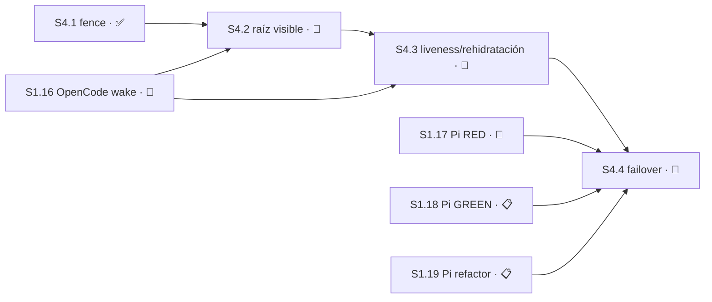

# Plan 4 — Hosts y línea exclusiva

**Estado:** 🔵 EN CURSO

## Resumen

| Campo | Detalle |
|---|---|
| Dependencias | Las dependencias legacy de Change E se conservan. Para Autonomous V2, `S4.1` dependió de `S3.1`, `S3.2` y `S5.1`; su predecesora inmediata fue `S5.1`. |
| Outputs | Adapter contract, launcher Pi/OpenCode, health, stop proof, host epoch y fallback exclusivo. |
| Roadmap | `S4.1` está ✅ COMPLETO. `S4.2`–`S4.4` enumeran ahora toda la responsabilidad restante de Change E: lanzamiento visible, observabilidad/rehidratación y failover exclusivo. P4 queda con denominador cerrado de 4 Sesiones. |
| Referencias | [`autonomous-v2-checkpointed-delivery`](../../changes/autonomous-v2-checkpointed-delivery/), [`autonomous-v2-role-routed-continuation`](../../changes/autonomous-v2-role-routed-continuation/), [Plan Manifest](../sdd-tower-implementation/manifest.yaml). El proposal `sdd-tower-host-launcher` fue eliminado en `613a45d` por ser cáscara sin avance; su intención vive en este STATUS. |

## Sesión 4.1 — Change E single-host candidate fence

**Estado:** ✅ COMPLETO — contrato `design-tasks` re-sellado el 2026-08-09 sobre `origin/master@76655f4ba55a5a651185d995c097510331bf5d68`. La corrección final `1f5fea76549bbc3123e28916874643a8d0f8cddd` fue verificada y se integró localmente mediante el rebase autorizado sobre `master` y fast-forward. El candidato predecesor `25b86175a39c2ddf53699789611bcebe98c3f82b` permanece **NOT READY** como límite de rollback.

**Depende de:** `S3.1` ✅, `S3.2` ✅, `S5.1` ✅; predecesora inmediata `S5.1`.

**Área:** `hosts/**`, `test/hosts/**`

**Prohibido:** `core.mjs`, `mcp.mjs`, `continuation/**`, `main-store/**`, `plugin/**`, `delivery/**`, `escalation/**`, `capabilities/**`, `policy/**`, `jornada/**`, `registry/**`, `workspace/**`, `contracts/**`, `schemas/**`, `openspec/plans/**`, `openspec/specs/**`

**Recurso:** **línea exclusiva** — es el recurso que esta Sesión existe para proteger. Journal owner-only propio en `hosts/**`, sin SQLite ni un segundo canal de autoridad.

**Ruta:** `design-tasks` — el fence requería endurecer el seam técnico de proof, decisión humana y journal antes de implementar. **Autoridad:** REQUIREMENTS §14.4, Change E y re-sellado del maintainer del 2026-08-09.

**Entrega:** commit directo a `master` + push, sin PR ([`AGENTS.md`](../../../AGENTS.md)). El re-sellado autoriza **un único commit sucesor** de `25b8617`, no amend. Forecast revisado: **700–950 líneas authored contra la base** y **350–550 líneas cambiadas en la corrección**; riesgo de revisión **High (>400)**. Por decisión explícita del maintainer permanece una sola unidad de revisión bajo la política `direct-push`; no se cargan `branch-pr` ni `chained-pr`.

**Por qué `contracts/**` y `schemas/**` siguen prohibidos:** `recovery-proof-v1` ya existe —lo entregó `S3.2`— y `S4.1` consume sólo una referencia que un puerto confiable resuelve. Esta Sesión no modifica ni duplica ese contrato. La autorización humana también llega por un puerto confiable; el fence no crea, valida ni consume autoridad.

Implementa host epoch, prueba canónica de detención y fencing fail-closed para un único host activo.

### Evidencia que obligó el re-sellado

El candidato predecesor tiene tree `6c730ac74939206bd7390a544353a21a383315e4` y agrega 642 líneas (`hosts/candidate-fence.mjs`: 306; `test/hosts/candidate-fence.test.mjs`: 336), 2.92 veces el máximo del forecast anterior de 150–220.

| Hallazgo verificado en `25b8617` | Raíz técnica | Corrección exigida |
|---|---|---|
| Caller-fabricated proof | `hosts/candidate-fence.mjs:78-88` valida un envelope `recovery-proof` entregado por el caller, pero no demuestra procedencia canónica. | El caller entrega sólo `terminationProofRef`; un puerto constructor-bound resuelve la prueba canónica y el fence verifica sus bindings exactos. |
| Caller-fabricated maintainer | `hosts/candidate-fence.mjs:280-295` confía en `actor: "MAINTAINER"` y en una referencia sin autorización comprobada. | El caller entrega sólo `maintainerDecisionRef`; un puerto constructor-bound autoriza la decisión humana exacta. No existe parámetro operacional `actor`. |
| Epoch reutilizable por rollback | `hosts/candidate-fence.mjs:95-129,212-253` reescribe un ledger JSON completo; una vista reemplazada por un prefijo válido vuelve a ofrecer un epoch ya usado. | Journal de eventos inmutables por epoch, encadenados por digest y publicados sin reemplazo. Toda vista es derivada y no autoritativa. |
| Frontera filesystem incompleta | `hosts/candidate-fence.mjs:139-210` no cierra ancestros symlink, hardlinks, links de lock ni todos los checks de owner/mode/descriptores. | Validación completa de ancestros y archivos con `O_NOFOLLOW`, `fstat`, `nlink === 1`, owner/mode exactos y lock owner-only. |

Los tests verdes del predecesor no prueban estas propiedades. Por eso `25b8617` es evidencia y límite de rollback, no candidato integrable.

### Patrones reutilizables verificados

| Patrón | Evidencia | Uso en S4.1 |
|---|---|---|
| Capacidad constructor-owned | `core.mjs:3459-3464` deriva prueba desde `processObserver` y estado persistido, nunca desde campos del caller. | Los puertos de proof y decisión se inyectan una sola vez al crear el store; ninguna operación puede sustituirlos. |
| Main bound al constructor | `main-store/store.mjs:50-52` exige authority/capability ligadas al root antes de exponer operaciones. | El composition root/Main canónico posee los puertos; el fence recibe resultados canónicos y verifica bindings, pero no adquiere autoridad. |
| Descriptor seguro y creación exclusiva | `registry/store.mjs:77-80,110-113,132-134` usa `O_NOFOLLOW`, `O_EXCL`, `fstat`, modos owner-only y locks exclusivos. | Se reutiliza la disciplina de descriptores y lock. No se reutiliza el rollback de un documento mutable después de publicar un epoch. |

## Contrato técnico falsificable

### 1. Superficie operacional y puertos confiables

`createCandidateFenceStore` sigue siendo el único export público. El constructor recibe el root absoluto owner-only, filesystem inyectable para tests, timeout de lock y dos puertos obligatorios controlados por el composition root/Main canónico:

| Operación | Input del caller | Puerto constructor-bound | Resultado exigido |
|---|---|---|---|
| `admit` | candidate, predecessor, `terminationProofRef`, `expectedRevision` | resolver de termination proof | Prueba canónica positiva ligada exactamente a project, predecessor, base, runtime, role y assignment. |
| `forceTakeover` | candidate, predecessor, `maintainerDecisionRef`, `expectedRevision` | autorizador de decisión humana | Decisión humana aprobada y vigente, ligada exactamente a project, predecessor, candidate objetivo, base, runtime, role y assignment. |

Reglas binarias:

- El caller **no** puede pasar un proof envelope, una función resolver, una autoridad ni `actor: "MAINTAINER"` en una operación.
- Puerto ausente, throw, resultado ambiguo, ref desconocida, decisión no aprobada o cualquier binding desigual falla cerrado antes de publicar un evento.
- Los tests pueden usar fakes, pero esos fakes se fijan en el constructor. Pasar objetos o campos fabricados en la operación nunca sustituye un resultado del puerto.
- El fence compara los resultados de los puertos contra el estado canónico que acaba de derivar del journal y contra el candidato exacto; no confía en que el puerto haya hecho esa comparación por él.
- La toma forzada conserva la decisión ya aprobada: sólo humana, epoch incrementado, `TAKEOVER_FORCED` legible y trabajo anterior `FROZEN` en el mismo evento.

**Límite de integración:** `S4.1` define y prueba el seam fail-closed; el cableado productivo del composition root pertenece a `S4.2/M4.2.3`. Hasta que esa Sesión cierre, no existe una ruta productiva habilitada: sin ambos puertos, el constructor u operación rechaza antes de journal mutation. `S4.1` no abre rutas prohibidas para simular ese cableado.

### 2. Journal append-only y epoch anti-reuse

El root runtime contiene un directorio de eventos; no existe un ledger JSON mutable con autoridad. Cada activación publica un archivo final owner-only cuyo nombre contiene el epoch decimal de ancho fijo y el SHA-256 de sus bytes canónicos.

Cada evento contiene el epoch, el digest del evento anterior —`null` sólo en epoch 1—, el candidate exacto, predecessor y una de dos evidencias: termination proof ref canónica o maintainer decision ref más frozen work.

La lectura:

1. valida root, todos sus ancestros y cada entrada física antes de interpretar bytes;
2. agrupa por epoch y exige exactamente un evento por número;
3. exige secuencia `1..N` sin gaps;
4. recompone el SHA-256 de cada archivo y lo compara con el nombre;
5. verifica el encadenamiento `previous_event_digest` y todos los bindings;
6. deriva la vista y el siguiente epoch exclusivamente de esos eventos.

Por lo tanto:

- dos archivos para el mismo epoch son `duplicate`, aunque uno forme una cadena válida;
- falta de un epoch intermedio es `gap`;
- bytes, nombre o digest previo alterados son `tampering`;
- reemplazar o retroceder cualquier cache/vista a un prefijo válido no cambia `N` ni permite volver a publicar un epoch existente;
- publicar el path final usa `O_CREAT | O_EXCL | O_NOFOLLOW` o un no-replace equivalente; nunca `rename` que pueda reemplazar un evento existente.

### 3. Filesystem, concurrencia y crash semantics

- El trusted root constructor-bound debe existir, pertenecer al uid actual, tener modo `0700` y resolver sin ningún componente symlink. Desde esa frontera hacia event/lock, cada ancestro debe ser owner-only y seguro. Un root ausente o inseguro se rechaza; el fence no lo normaliza con `chmod`.
- Eventos y lock son archivos regulares del owner, modo `0600`, abiertos con `O_NOFOLLOW`, verificados con `fstat` y `nlink === 1`.
- Cada descriptor se cierra en success, rechazo y throw. Lock y residuos propios pre-publicación se limpian; un lock ajeno o inseguro nunca se elimina.
- El lock owner-only cubre scan → derivación → revalidación → publish. Dos procesos reales contra el mismo expected epoch producen un solo evento; el perdedor relee y devuelve el error tipado aplicable sin reutilizar epoch.
- Toda prueba y autorización se resuelve antes de publicar. Tras crear el path final, el epoch se considera publicado o quemado: ninguna compensación lo borra.
- Write, close, file-fsync o directory-fsync ambiguos después de crear el evento devuelven `CT_FENCE_DURABILITY_UNKNOWN` y obligan readback. El retry automático está prohibido.
- Un readback exacto puede confirmar el evento ya publicado; un evento parcial, gap, duplicate o digest inválido bloquea toda activación posterior. La reparación de journal no pertenece a `S4.1`.

### 4. Errores y evidencia ejecutada

Los tests deben distinguir, como mínimo, procedencia de proof, autorización humana, ownership/drift, CAS/concurrencia, filesystem inseguro, journal gap/duplicate/tampering, busy y durability unknown. Un error genérico de write no puede ocultar que la persistencia quedó ambigua.

La evidencia de persistencia debe ejecutar —no sólo inspeccionar— estas ramas:

- parent o ancestro symlink; directorio owner/mode inseguro;
- event o lock symlink/hardlink y `nlink !== 1`;
- proof envelope y `actor` fabricados por el caller;
- fake constructor-owned válido frente a ref desconocida, mismatch y throw;
- rollback de vista a prefijo, gap, duplicate epoch y tampering de bytes/cadena;
- dos writers en procesos reales y timeout de lock;
- fallos inyectados antes de create y después de create en write/fsync/close/directory-fsync;
- readback después de `CT_FENCE_DURABILITY_UNKNOWN`;
- cleanup de lock/descriptores/residuos y cero bytes de journal en todo rechazo pre-publicación.

## Decisiones

- `derivable` — hacia dónde falla el fence ante la duda. **Criterio:** cerrado. Si no se puede probar que el host anterior se detuvo, no hay host activo nuevo. Falsificable: cualquier camino ambiguo que publique un evento de admisión. **Autoridad:** alcance fail-closed aprobado de `S4.1`.
- `derivable` — qué constituye prueba de detención. **Criterio:** resultado positivo del puerto constructor-owned, con ref y bindings exactos; ausencia de señal o envelope del caller no es prueba. Falsificable: un caller fabrica un objeto schema-valid y logra admisión sin que el puerto lo resuelva. **Autoridad:** requisito de línea exclusiva de Change E y re-sellado del maintainer del 2026-08-09.
- `derivable` — cómo avanza el host epoch. **Criterio:** máximo derivado del journal inmutable más uno, comparable sin reloj y publicado no-replace. Falsificable: dos activaciones comparten epoch o una vista retrocedida habilita reuse. **Autoridad:** Outputs de este Plan y re-sellado del 2026-08-09.
- `escala` — si un operador puede forzar la toma sin prueba de detención. **Clase:** operaciones irreversibles. **RESUELTA el 2026-08-04 y endurecida el 2026-08-09:** sí, pero sólo cuando el puerto confiable autoriza la decisión humana exacta; un string `actor` nunca basta. El evento avanza epoch, marca `TAKEOVER_FORCED` y congela el trabajo previo. **Contaminaba:** `S5.2` y `S7.1`, cubiertas por el grafo y la marca legible.
- `escala` — qué pasa con el trabajo en vuelo del host desalojado. **Clase:** migraciones o pérdida de datos. **RESUELTA el 2026-08-04:** se congela y se escala; no se descarta ni se adopta. Falsificable: takeover publicado sin `FROZEN` exacto o base contaminada aceptada. **Contaminaba:** `S5.3`, cubierta por dependencia.
- `escala` — si el caller podía seguir entregando proof/actor y si un ledger reescribible podía conservar autoridad. **Clase:** seguridad y permisos; expansión de alcance. **RESUELTA por el maintainer el 2026-08-09:** no. Caller sólo refs, puertos constructor-bound y journal inmutable anti-reuse. **Contamina:** `S4.1`; `S5.2` y `S7.1` permanecen cercadas por el grafo hasta su cierre.

No quedan decisiones `escala` abiertas propias de `S4.1`.

### Módulo M4.1.1 — Fence

- [x] Tarea T4.1.1.1 — **RED:** demostrar que fallan los ataques de procedencia y autoridad fabricadas, rollback de vista a prefijo, gap/duplicate/tampering, ancestros symlink, event/lock symlink o hardlink, owner/mode inseguros, writers multiproceso, timeout y fallos de persistencia antes/después de publish. Los tests quedaron rojos contra `25b8617` por la razón esperada.
- [x] Tarea T4.1.1.2 — **GREEN:** reemplazar inputs proof/actor por refs más puertos constructor-owned; verificar bindings exactos; sustituir el ledger mutable por eventos per-epoch encadenados por digest y publicados no-replace; preservar takeover humano, freeze y base rejection en el mismo evento.
- [x] Tarea T4.1.1.3 — **REFACTOR:** preservar errores tipados, garantizar cero mutación durable antes de publish, prohibir rollback que borre un epoch publicado y exigir readback tras `DURABILITY_UNKNOWN`; ejecutar evidencia de todas las ramas y cleanup. `bun test test/hosts` y luego `bun test` pasaron una vez post-GREEN.

## Criterios de aceptación de S4.1

Todos deben pasar para cerrar:

- [x] Un host sin prueba canónica positiva del anterior no se admite; silencio, ausencia o ambigüedad nunca cuentan como proof.
- [x] El caller operacional pasa sólo `terminationProofRef` o `maintainerDecisionRef`; proof envelopes, autoridades y `actor: "MAINTAINER"` son rechazados.
- [x] Los puertos de proof y decisión se fijan en el constructor y son controlados por composition root/Main; inputs caller-fabricados no pueden sustituirlos.
- [x] Project, predecessor, base, runtime, role y assignment coinciden exactamente entre journal, candidate y resultado del puerto, o falla cerrado.
- [x] El fence no crea, valida, consume ni delega autoridad.
- [x] El host epoch es monótono, nunca se reutiliza, no depende del reloj y dos activaciones distintas jamás comparten epoch.
- [x] El estado se deriva de eventos inmutables encadenados por digest; no existe un ledger mutable autoritativo ni migración SQLite.
- [x] Gap, duplicate epoch, bytes alterados, digest previo inválido o vista retrocedida fallan cerrado; una vista a prefijo nunca habilita epoch reuse.
- [x] La publicación final es no-replace/O_EXCL equivalente y un evento publicado nunca se borra como rollback.
- [x] La toma forzada sólo ocurre con decisión humana autorizada por puerto; avanza epoch y expone `TAKEOVER_FORCED`.
- [x] El trabajo desalojado queda `FROZEN` en el mismo evento y ninguna ruta lo adopta o descarta automáticamente.
- [x] Una base que arrastra trabajo congelado sin resolver se rechaza.
- [x] El path del trusted root no contiene componentes symlink; root y directorios descendientes verifican owner/mode; event y lock se abren con `O_NOFOLLOW`, se validan por `fstat` y exigen `nlink === 1`.
- [x] El lock owner-only serializa dos procesos reales; hay un único winner y ningún lock/residuo/descriptores abiertos al terminar.
- [x] Todo rechazo pre-publicación deja cero mutación durable y conserva bytes existentes.
- [x] Todo fallo ambiguo post-create devuelve `CT_FENCE_DURABILITY_UNKNOWN`, no borra el epoch y obliga readback sin retry automático.
- [x] Los tests de persistencia ejecutan success, rechazo, concurrencia, cleanup y cada failpoint declarado.
- [x] `bun test test/hosts` pasó 16/16 y `bun test` pasó 553/553 (553 pass / 0 fail; 3196 expectations, 35 files) sobre la base integrada.
- [x] La corrección final se conservó sin amend durante el rebase autorizado: `03ecb5d` (predecesor) y `1f5fea7` (candidato de implementación verificado). El diff toca sólo `Área` y ninguna ruta de `Prohibido`.

## Sesión 4.2 — Lanzamiento visible de raíz OpenCode

**Estado:** 🔴 BLOQUEADO

**Depende de:** `S4.1` ✅, `S1.16` 🔴.

**Área:** `hosts/launcher.mjs`, `hosts/opencode-launcher.mjs`, `hosts/herdr.mjs`, `plugin/tower-spike.js`, `.opencode/plugins/tower-spike.js`, `test/hosts/launcher.test.mjs`, `test/hosts/opencode-launcher.test.mjs`, `test/hosts/herdr.test.mjs`, `test/plugin/tower-spike.test.mjs`

**Recurso:** panel Herdr y una línea de host por `project_id`; sin DB, migraciones ni token de entrega.

**Ruta:** `design-tasks` — la autoridad de producto está resuelta, pero el contrato técnico entre Herdr y el adapter OpenCode debe investigarse sin inventar comandos. **Autoridad:** decisión del maintainer de 2026-08-10 y [Remote Control and Control Tower Complementarity](../../../../../remote-control/openspec/decisions/remote-control-and-control-tower.md) §Decision/§Consequences.

Después de aprobar un brief, Host Launcher crea un panel Herdr **nuevo y visible** en el worktree asignado, inicia allí una sesión OpenCode raíz con `gentle-orchestrator`, entrega el brief aprobado y publica su estado de raíz en Herdr. Los subagentes nativos de OpenCode siguen siendo internos: no sustituyen ni sobrescriben la identidad, el panel ni el estado de esa sesión raíz.

**Decisiones:**
- `derivable` — qué entidad representa la ejecución visible. **Criterio:** una sesión OpenCode raíz y un panel Herdr nuevos por lanzamiento aprobado; un subagente nativo no puede ocupar ni mutar ese estado. Falsificable: un lanzamiento aprobado queda representado sólo por un hijo nativo o reutiliza un panel raíz existente. **Autoridad:** decisión del maintainer de 2026-08-10.
- `derivable` — qué recibe la sesión al nacer. **Criterio:** sólo el brief ya aprobado y las referencias de asignación; el launcher no crea autoridad ni amplía scope. Falsificable: un lanzamiento con brief no aprobado, o con contenido que habilite autoridad bearer, llega a ejecutar. **Autoridad:** REQUIREMENTS §14.1 y decisión del maintainer de 2026-08-10.

**Criterios de aceptación** — todos deben pasar para cerrar:
- [ ] Un brief aprobado crea exactamente un panel Herdr visible y una sesión OpenCode raíz nueva en el worktree asignado
- [ ] La sesión raíz usa `gentle-orchestrator`, recibe el brief aprobado y expone su estado raíz en Herdr
- [ ] Un subagente nativo no puede reemplazar, reutilizar ni modificar el panel, identidad o estado de la sesión raíz
- [ ] Brief ausente/no aprobado, worktree no asignado o evidencia de host/epoch no vigente falla cerrado sin crear panel ni sesión
- [ ] El único composition root productivo liga una vez los puertos de stop proof y decisión humana de `S4.1`; provider ausente, inválido o sustituible falla cerrado antes de lanzar o mutar journal
- [ ] El diff no toca rutas fuera de `Área`

### Módulo M4.2.1 — Lanzador raíz OpenCode

**Paths:** `hosts/launcher.mjs`, `hosts/opencode-launcher.mjs`, `test/hosts/launcher.test.mjs`, `test/hosts/opencode-launcher.test.mjs`

- [ ] Tarea T4.2.1.1 — RED: demostrar que un brief no aprobado, un worktree distinto del asignado o un epoch no vigente no inicia una sesión
- [ ] Tarea T4.2.1.2 — GREEN: definir, tras `session-plan`, la creación de sesión raíz OpenCode ligada al brief, worktree, assignment y host epoch ya validados
- [ ] Tarea T4.2.1.3 — REFACTOR: normalizar evidencia de creación y rechazos, preservando que ningún input del launcher otorga autoridad

### Módulo M4.2.2 — Proyección visible Herdr

**Paths:** `hosts/herdr.mjs`, `test/hosts/herdr.test.mjs`

- [ ] Tarea T4.2.2.1 — RED: demostrar que un lanzamiento no crea/reutiliza el panel visible correcto, o que un hijo nativo puede clobber su estado
- [ ] Tarea T4.2.2.2 — GREEN: definir, tras `session-plan`, la creación de panel nuevo y la proyección del estado de sesión raíz exclusivamente
- [ ] Tarea T4.2.2.3 — REFACTOR: consolidar cleanup y errores tipados para que un fallo parcial no deje una identidad visible falsa

### Módulo M4.2.3 — Cableado productivo del fence

**Paths:** `plugin/tower-spike.js`, `.opencode/plugins/tower-spike.js`, `test/plugin/tower-spike.test.mjs`

- [ ] Tarea T4.2.3.1 — RED: demostrar que provider de stop proof o decisión humana ausente, inválido o sustituible impide lanzar y publicar journal
- [ ] Tarea T4.2.3.2 — GREEN: ligar una sola vez los puertos constructor-bound de `S4.1` desde el composition root productivo, sin exponerlos a inputs del launcher
- [ ] Tarea T4.2.3.3 — REFACTOR: mantener la inyección separada de la autoridad de Main y verificar que no aparece una segunda ruta de wiring

## Sesión 4.3 — Inspección, liveness y rehidratación segura

**Estado:** 🔴 BLOQUEADO

**Depende de:** `S4.2` 🔴, `S1.16` 🔴.

**Área:** `hosts/inspect.mjs`, `hosts/health.mjs`, `hosts/stop-proof.mjs`, `hosts/rehydration.mjs`, `test/hosts/inspect.test.mjs`, `test/hosts/health.test.mjs`, `test/hosts/stop-proof.test.mjs`, `test/hosts/rehydration.test.mjs`

**Recurso:** evidencia de proceso y panel Herdr; sin DB, migraciones ni token de entrega.

**Ruta:** `design-tasks` — REQUIREMENTS fija la semántica de liveness y stop proof, pero el adapter y la evidencia real de Herdr/OpenCode todavía no tienen interfaz integrada. **Autoridad:** REQUIREMENTS §14.1–§14.4 y escenarios CT-V1-06 a CT-V1-10.

Inspecciona sólo la sesión raíz declarada, aplica heartbeat de 15 segundos y sus estados `SUSPECTED`/`UNAVAILABLE`, obtiene stop proof canónico y rehidrata una proyección visible únicamente cuando identidad, assignment y epoch siguen coincidiendo.

**Decisiones:**
- `derivable` — cómo clasificar liveness. **Criterio:** 3 heartbeats ausentes producen `SUSPECTED`; 60 segundos sin heartbeat más health probe fallido producen `UNAVAILABLE`. Falsificable: cualquiera de los dos umbrales produce otro estado. **Autoridad:** REQUIREMENTS §14.3.
- `derivable` — cuándo rehidratar el estado visible. **Criterio:** sólo con sesión raíz, assignment y host epoch exactos; datos ambiguos se rechazan. Falsificable: un estado de otro root/epoch reaparece como activo. **Autoridad:** REQUIREMENTS §14.4 y `S4.1`.

**Criterios de aceptación** — todos deben pasar para cerrar:
- [ ] `inspect`, `health` y heartbeat observan únicamente la sesión raíz ligada al assignment vigente
- [ ] Tres heartbeats ausentes producen `SUSPECTED`; 60 segundos más health probe fallido producen `UNAVAILABLE`
- [ ] Stop proof canónico se conserva con bindings exactos y una prueba ausente/ambigua falla cerrado
- [ ] La rehidratación sólo restaura la proyección Herdr de la misma sesión raíz, assignment y host epoch
- [ ] El diff no toca rutas fuera de `Área`

### Módulo M4.3.1 — Inspección y liveness

**Paths:** `hosts/inspect.mjs`, `hosts/health.mjs`, `test/hosts/inspect.test.mjs`, `test/hosts/health.test.mjs`

- [ ] Tarea T4.3.1.1 — RED: cubrir root/session/assignment ajenos, tres heartbeats ausentes y health probe fallido al umbral de 60 segundos
- [ ] Tarea T4.3.1.2 — GREEN: implementar inspección y clasificación usando sólo las referencias validadas por el launcher
- [ ] Tarea T4.3.1.3 — REFACTOR: consolidar la evidencia de heartbeat y los errores de estado ambiguo

### Módulo M4.3.2 — Stop proof y rehidratación

**Paths:** `hosts/stop-proof.mjs`, `hosts/rehydration.mjs`, `test/hosts/stop-proof.test.mjs`, `test/hosts/rehydration.test.mjs`

- [ ] Tarea T4.3.2.1 — RED: cubrir proof ausente/ambiguo y estado Herdr de root, assignment o epoch distintos
- [ ] Tarea T4.3.2.2 — GREEN: enlazar la evidencia canónica de stop y rehidratar sólo la proyección cuya identidad coincide exactamente
- [ ] Tarea T4.3.2.3 — REFACTOR: preservar readback y cleanup sin convertir la rehidratación en una nueva fuente de autoridad

## Sesión 4.4 — Enforzamiento de epoch y failover exclusivo

**Estado:** 🔴 BLOQUEADO

**Depende de:** `S4.3` 🔴, `S1.17` 🔴, `S1.18` 📋, `S1.19` 📋.

**Área:** `hosts/failover.mjs`, `hosts/epoch-enforcement.mjs`, `hosts/opencode-host.mjs`, `hosts/pi-host.mjs`, `test/hosts/failover.test.mjs`, `test/hosts/epoch-enforcement.test.mjs`, `test/hosts/opencode-host.test.mjs`, `test/hosts/pi-host.test.mjs`

**Recurso:** línea exclusiva `host_epoch` emitida/fenced por Main; sin DB, migraciones ni token de entrega.

**Ruta:** `full-sdd` — el contrato de producto está aprobado, pero la integración multi-host de recuperación, pruebas de proceso y rechazo de efectos stale necesita diseño técnico y modelo de amenazas propio. **Autoridad:** REQUIREMENTS §14.2–§14.4, CT-V1-05 a CT-V1-08, `S4.1` y la decisión del maintainer de 2026-08-10.

Enforce el `host_epoch` emitido por Main y permite failover OpenCode → Pi sólo tras stop proof, expiración/cierre de claims y leases, inspección de worktree/Git/efectos y preservación de estado dirty. Nunca vuelve a usar el worktree cuando no puede probar que el writer anterior terminó.

**Decisiones:**
- `derivable` — cuándo permite fallback. **Criterio:** host fallback permitido/distinto, proof canónico positivo, claims/leases cerrados y evidencia de inspección íntegra; cualquier ausencia bloquea. Falsificable: Pi inicia sobre el mismo worktree sin todas esas pruebas. **Autoridad:** REQUIREMENTS §14.2–§14.4 y CT-V1-06/07.
- `derivable` — cómo trata un mensaje o claim viejo. **Criterio:** todo binding con epoch distinto del vigente devuelve `CT_ASSIGNMENT_STALE`. Falsificable: un efecto de epoch anterior llega a persistir o ejecutar. **Autoridad:** CT-V1-08 y `S4.1`.

**Criterios de aceptación** — todos deben pasar para cerrar:
- [ ] Una jornada mantiene exactamente un execution host activo; Pi no tiene writer mientras OpenCode conserva el epoch vigente
- [ ] Fallover OpenCode → Pi exige stop proof, cierre/expiración de claims y leases, inspección de worktree/Git/efectos y preservación de dirty state
- [ ] Failover sin stop proof devuelve `CT_FAILOVER_UNSAFE` y no inicia Pi sobre el worktree existente
- [ ] El failover incrementa el host epoch y todo claim, mensaje o efecto anterior devuelve `CT_ASSIGNMENT_STALE`
- [ ] Main conserva emisión y fencing de epoch; Host Launcher sólo lo enforce
- [ ] El diff no toca rutas fuera de `Área`

### Módulo M4.4.1 — Enforzamiento de epoch

**Paths:** `hosts/epoch-enforcement.mjs`, `hosts/opencode-host.mjs`, `hosts/pi-host.mjs`, `test/hosts/epoch-enforcement.test.mjs`, `test/hosts/opencode-host.test.mjs`, `test/hosts/pi-host.test.mjs`

- [ ] Tarea T4.4.1.1 — RED: demostrar que dos hosts activos, un host no permitido o un claim/mensaje de epoch viejo fallan cerrados
- [ ] Tarea T4.4.1.2 — GREEN: adaptar los contracts lifecycle de OpenCode/Pi sin asumir autoridad de launcher en `S1.16`–`S1.19`
- [ ] Tarea T4.4.1.3 — REFACTOR: unificar validación de epoch y preservar la separación entre `binding_epoch`, `host_epoch` y generation local

### Módulo M4.4.2 — Failover exclusivo

**Paths:** `hosts/failover.mjs`, `test/hosts/failover.test.mjs`

- [ ] Tarea T4.4.2.1 — RED: cubrir stop proof ausente, claims/leases vivos, worktree dirty y evidencia externa ambigua
- [ ] Tarea T4.4.2.2 — GREEN: implementar la secuencia aprobada de stop, inspección, incremento de epoch y creación de attempts sólo en el fallback permitido
- [ ] Tarea T4.4.2.3 — REFACTOR: verificar que no se reutiliza worktree ni se acepta efecto stale después de un failover o de un rechazo

## Grafo de dependencias

No queda responsabilidad pendiente de Change E sin Sesión enumerada.
