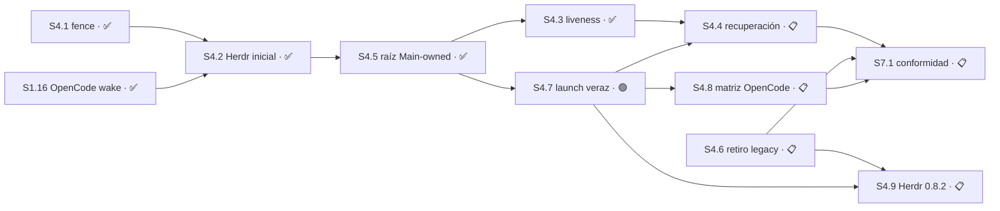

# Plan 4 — Hosts y línea exclusiva

**Estado:** 🔵 EN CURSO

## Resumen

| Campo | Detalle |
|---|---|
| Dependencias | Las dependencias legacy de Change E se conservan. Para Autonomous V2, `S4.1` dependió de `S3.1`, `S3.2` y `S5.1`; su predecesora inmediata fue `S5.1`. |
| Outputs | Raíz primaria Main-owned con TUI adjunta no autoritativa, inspección/liveness por proceso/sesión y recuperación same-host WSL. |
| Roadmap | `S4.1`, `S1.16`, `S4.2`, `S4.5` y `S4.3` están ✅ COMPLETO. `S4.7` queda 🟢 LISTO tras la decisión 67. `S4.4`, `S4.6`, `S4.8` y `S4.9` están 📋 PLANIFICADO. P4 alcanza 4/9 S (44%). |
| Referencias | [Main-Owned Visible Root spec](../../specs/main-owned-visible-root/spec.md), decisiones 37–42 / Engram 9040/9042/9043/9044/9079, [`autonomous-v2-checkpointed-delivery`](../../changes/autonomous-v2-checkpointed-delivery/), [Plan Manifest](../sdd-tower-implementation/manifest.yaml). REQUIREMENTS §14 permanece byte-pinned como base histórica; esta spec enmienda el lifecycle futuro. |

## Sesión 4.1 — Change E single-host candidate fence

**Estado:** ✅ COMPLETO — contrato `design-tasks` re-sellado el 2026-08-09 sobre `origin/master@76655f4ba55a5a651185d995c097510331bf5d68`. La corrección final `1f5fea76549bbc3123e28916874643a8d0f8cddd` fue verificada y se integró localmente mediante el rebase autorizado sobre `master` y fast-forward. El candidato predecesor `25b86175a39c2ddf53699789611bcebe98c3f82b` permanece **NOT READY** como límite de rollback.

**Depende de:** `S3.1` ✅, `S3.2` ✅, `S5.1` ✅; predecesora inmediata `S5.1`.

**Área:** `hosts/**`, `test/hosts/**`

**Prohibido:** `core.mjs`, `mcp.mjs`, `continuation/**`, `main-store/**`, `plugin/**`, `delivery/**`, `escalation/**`, `capabilities/**`, `policy/**`, `jornada/**`, `registry/**`, `workspace/**`, `contracts/**`, `schemas/**`, `openspec/plans/**`, `openspec/specs/**`

**Recurso:** **línea exclusiva** — es el recurso que esta Sesión existe para proteger. Journal owner-only propio en `hosts/**`, sin SQLite ni un segundo canal de autoridad.

**Ruta:** `design-tasks` — el fence requería endurecer el seam técnico de proof, decisión humana y journal antes de implementar. **Autoridad:** REQUIREMENTS §14.4, Change E y re-sellado del maintainer del 2026-08-09.

**Entrega:** commit directo a `master` + push, sin PR ([`AGENTS.md`](../../../AGENTS.md)). El re-sellado autoriza **un único commit sucesor** de `25b8617`, no amend. Forecast revisado: **700–950 líneas authored contra la base** y **350–550 líneas cambiadas en la corrección**; riesgo de revisión **High (>400)**. Por decisión explícita del maintainer permanece una sola unidad de revisión bajo la política `direct-push`; no se cargan `branch-pr` ni `chained-pr`.

**Por qué `contracts/**` y `schemas/**` siguen prohibidos:** `recovery-proof-v1` ya existe —lo entregó `S3.2`— y `S4.1` consume sólo una referencia que un puerto confiable resuelve. Esta Sesión no modifica ni duplica ese contrato. La autorización humana también llega por un puerto confiable; el fence no crea, valida ni consume autoridad.

Implementa host epoch, prueba canónica de detención y fencing fail-closed para un único host activo.

### Evidencia que obligó el re-sellado

El candidato predecesor tiene tree `6c730ac74939206bd7390a544353a21a383315e4` y agrega 642 líneas (`hosts/candidate-fence.mjs`: 306; `test/hosts/candidate-fence.test.mjs`: 336), 2.92 veces el máximo del forecast anterior de 150–220.

| Hallazgo verificado en `25b8617` | Raíz técnica | Corrección exigida |
|---|---|---|
| Caller-fabricated proof | `hosts/candidate-fence.mjs:78-88` valida un envelope `recovery-proof` entregado por el caller, pero no demuestra procedencia canónica. | El caller entrega sólo `terminationProofRef`; un puerto constructor-bound resuelve la prueba canónica y el fence verifica sus bindings exactos. |
| Caller-fabricated maintainer | `hosts/candidate-fence.mjs:280-295` confía en `actor: "MAINTAINER"` y en una referencia sin autorización comprobada. | El caller entrega sólo `maintainerDecisionRef`; un puerto constructor-bound autoriza la decisión humana exacta. No existe parámetro operacional `actor`. |
| Epoch reutilizable por rollback | `hosts/candidate-fence.mjs:95-129,212-253` reescribe un ledger JSON completo; una vista reemplazada por un prefijo válido vuelve a ofrecer un epoch ya usado. | Journal de eventos inmutables por epoch, encadenados por digest y publicados sin reemplazo. Toda vista es derivada y no autoritativa. |
| Frontera filesystem incompleta | `hosts/candidate-fence.mjs:139-210` no cierra ancestros symlink, hardlinks, links de lock ni todos los checks de owner/mode/descriptores. | Validación completa de ancestros y archivos con `O_NOFOLLOW`, `fstat`, `nlink === 1`, owner/mode exactos y lock owner-only. |

Los tests verdes del predecesor no prueban estas propiedades. Por eso `25b8617` es evidencia y límite de rollback, no candidato integrable.

### Patrones reutilizables verificados

| Patrón | Evidencia | Uso en S4.1 |
|---|---|---|
| Capacidad constructor-owned | `core.mjs:3459-3464` deriva prueba desde `processObserver` y estado persistido, nunca desde campos del caller. | Los puertos de proof y decisión se inyectan una sola vez al crear el store; ninguna operación puede sustituirlos. |
| Main bound al constructor | `main-store/store.mjs:50-52` exige authority/capability ligadas al root antes de exponer operaciones. | El composition root/Main canónico posee los puertos; el fence recibe resultados canónicos y verifica bindings, pero no adquiere autoridad. |
| Descriptor seguro y creación exclusiva | `registry/store.mjs:77-80,110-113,132-134` usa `O_NOFOLLOW`, `O_EXCL`, `fstat`, modos owner-only y locks exclusivos. | Se reutiliza la disciplina de descriptores y lock. No se reutiliza el rollback de un documento mutable después de publicar un epoch. |

## Contrato técnico falsificable

### 1. Superficie operacional y puertos confiables

`createCandidateFenceStore` sigue siendo el único export público. El constructor recibe el root absoluto owner-only, filesystem inyectable para tests, timeout de lock y dos puertos obligatorios controlados por el composition root/Main canónico:

| Operación | Input del caller | Puerto constructor-bound | Resultado exigido |
|---|---|---|---|
| `admit` | candidate, predecessor, `terminationProofRef`, `expectedRevision` | resolver de termination proof | Prueba canónica positiva ligada exactamente a project, predecessor, base, runtime, role y assignment. |
| `forceTakeover` | candidate, predecessor, `maintainerDecisionRef`, `expectedRevision` | autorizador de decisión humana | Decisión humana aprobada y vigente, ligada exactamente a project, predecessor, candidate objetivo, base, runtime, role y assignment. |

Reglas binarias:

- El caller **no** puede pasar un proof envelope, una función resolver, una autoridad ni `actor: "MAINTAINER"` en una operación.
- Puerto ausente, throw, resultado ambiguo, ref desconocida, decisión no aprobada o cualquier binding desigual falla cerrado antes de publicar un evento.
- Los tests pueden usar fakes, pero esos fakes se fijan en el constructor. Pasar objetos o campos fabricados en la operación nunca sustituye un resultado del puerto.
- El fence compara los resultados de los puertos contra el estado canónico que acaba de derivar del journal y contra el candidato exacto; no confía en que el puerto haya hecho esa comparación por él.
- La toma forzada conserva la decisión ya aprobada: sólo humana, epoch incrementado, `TAKEOVER_FORCED` legible y trabajo anterior `FROZEN` en el mismo evento.

**Límite de integración:** `S4.1` define y prueba el seam fail-closed; el cableado productivo del composition root pertenece a `S4.2/M4.2.3`. Hasta que esa Sesión cierre, no existe una ruta productiva habilitada: sin ambos puertos, el constructor u operación rechaza antes de journal mutation. `S4.1` no abre rutas prohibidas para simular ese cableado.

### 2. Journal append-only y epoch anti-reuse

El root runtime contiene un directorio de eventos; no existe un ledger JSON mutable con autoridad. Cada activación publica un archivo final owner-only cuyo nombre contiene el epoch decimal de ancho fijo y el SHA-256 de sus bytes canónicos.

Cada evento contiene el epoch, el digest del evento anterior —`null` sólo en epoch 1—, el candidate exacto, predecessor y una de dos evidencias: termination proof ref canónica o maintainer decision ref más frozen work.

La lectura:

1. valida root, todos sus ancestros y cada entrada física antes de interpretar bytes;
2. agrupa por epoch y exige exactamente un evento por número;
3. exige secuencia `1..N` sin gaps;
4. recompone el SHA-256 de cada archivo y lo compara con el nombre;
5. verifica el encadenamiento `previous_event_digest` y todos los bindings;
6. deriva la vista y el siguiente epoch exclusivamente de esos eventos.

Por lo tanto:

- dos archivos para el mismo epoch son `duplicate`, aunque uno forme una cadena válida;
- falta de un epoch intermedio es `gap`;
- bytes, nombre o digest previo alterados son `tampering`;
- reemplazar o retroceder cualquier cache/vista a un prefijo válido no cambia `N` ni permite volver a publicar un epoch existente;
- publicar el path final usa `O_CREAT | O_EXCL | O_NOFOLLOW` o un no-replace equivalente; nunca `rename` que pueda reemplazar un evento existente.

### 3. Filesystem, concurrencia y crash semantics

- El trusted root constructor-bound debe existir, pertenecer al uid actual, tener modo `0700` y resolver sin ningún componente symlink. Desde esa frontera hacia event/lock, cada ancestro debe ser owner-only y seguro. Un root ausente o inseguro se rechaza; el fence no lo normaliza con `chmod`.
- Eventos y lock son archivos regulares del owner, modo `0600`, abiertos con `O_NOFOLLOW`, verificados con `fstat` y `nlink === 1`.
- Cada descriptor se cierra en success, rechazo y throw. Lock y residuos propios pre-publicación se limpian; un lock ajeno o inseguro nunca se elimina.
- El lock owner-only cubre scan → derivación → revalidación → publish. Dos procesos reales contra el mismo expected epoch producen un solo evento; el perdedor relee y devuelve el error tipado aplicable sin reutilizar epoch.
- Toda prueba y autorización se resuelve antes de publicar. Tras crear el path final, el epoch se considera publicado o quemado: ninguna compensación lo borra.
- Write, close, file-fsync o directory-fsync ambiguos después de crear el evento devuelven `CT_FENCE_DURABILITY_UNKNOWN` y obligan readback. El retry automático está prohibido.
- Un readback exacto puede confirmar el evento ya publicado; un evento parcial, gap, duplicate o digest inválido bloquea toda activación posterior. La reparación de journal no pertenece a `S4.1`.

### 4. Errores y evidencia ejecutada

Los tests deben distinguir, como mínimo, procedencia de proof, autorización humana, ownership/drift, CAS/concurrencia, filesystem inseguro, journal gap/duplicate/tampering, busy y durability unknown. Un error genérico de write no puede ocultar que la persistencia quedó ambigua.

La evidencia de persistencia debe ejecutar —no sólo inspeccionar— estas ramas:

- parent o ancestro symlink; directorio owner/mode inseguro;
- event o lock symlink/hardlink y `nlink !== 1`;
- proof envelope y `actor` fabricados por el caller;
- fake constructor-owned válido frente a ref desconocida, mismatch y throw;
- rollback de vista a prefijo, gap, duplicate epoch y tampering de bytes/cadena;
- dos writers en procesos reales y timeout de lock;
- fallos inyectados antes de create y después de create en write/fsync/close/directory-fsync;
- readback después de `CT_FENCE_DURABILITY_UNKNOWN`;
- cleanup de lock/descriptores/residuos y cero bytes de journal en todo rechazo pre-publicación.

## Decisiones

- `derivable` — hacia dónde falla el fence ante la duda. **Criterio:** cerrado. Si no se puede probar que el host anterior se detuvo, no hay host activo nuevo. Falsificable: cualquier camino ambiguo que publique un evento de admisión. **Autoridad:** alcance fail-closed aprobado de `S4.1`.
- `derivable` — qué constituye prueba de detención. **Criterio:** resultado positivo del puerto constructor-owned, con ref y bindings exactos; ausencia de señal o envelope del caller no es prueba. Falsificable: un caller fabrica un objeto schema-valid y logra admisión sin que el puerto lo resuelva. **Autoridad:** requisito de línea exclusiva de Change E y re-sellado del maintainer del 2026-08-09.
- `derivable` — cómo avanza el host epoch. **Criterio:** máximo derivado del journal inmutable más uno, comparable sin reloj y publicado no-replace. Falsificable: dos activaciones comparten epoch o una vista retrocedida habilita reuse. **Autoridad:** Outputs de este Plan y re-sellado del 2026-08-09.
- `escala` — si un operador puede forzar la toma sin prueba de detención. **Clase:** operaciones irreversibles. **RESUELTA el 2026-08-04 y endurecida el 2026-08-09:** sí, pero sólo cuando el puerto confiable autoriza la decisión humana exacta; un string `actor` nunca basta. El evento avanza epoch, marca `TAKEOVER_FORCED` y congela el trabajo previo. **Contaminaba:** `S5.2` y `S7.1`, cubiertas por el grafo y la marca legible.
- `escala` — qué pasa con el trabajo en vuelo del host desalojado. **Clase:** migraciones o pérdida de datos. **RESUELTA el 2026-08-04:** se congela y se escala; no se descarta ni se adopta. Falsificable: takeover publicado sin `FROZEN` exacto o base contaminada aceptada. **Contaminaba:** `S5.3`, cubierta por dependencia.
- `escala` — si el caller podía seguir entregando proof/actor y si un ledger reescribible podía conservar autoridad. **Clase:** seguridad y permisos; expansión de alcance. **RESUELTA por el maintainer el 2026-08-09:** no. Caller sólo refs, puertos constructor-bound y journal inmutable anti-reuse. **Contamina:** `S4.1`; `S5.2` y `S7.1` permanecen cercadas por el grafo hasta su cierre.

No quedan decisiones `escala` abiertas propias de `S4.1`.

### Módulo M4.1.1 — Fence

- [x] Tarea T4.1.1.1 — **RED:** demostrar que fallan los ataques de procedencia y autoridad fabricadas, rollback de vista a prefijo, gap/duplicate/tampering, ancestros symlink, event/lock symlink o hardlink, owner/mode inseguros, writers multiproceso, timeout y fallos de persistencia antes/después de publish. Los tests quedaron rojos contra `25b8617` por la razón esperada.
- [x] Tarea T4.1.1.2 — **GREEN:** reemplazar inputs proof/actor por refs más puertos constructor-owned; verificar bindings exactos; sustituir el ledger mutable por eventos per-epoch encadenados por digest y publicados no-replace; preservar takeover humano, freeze y base rejection en el mismo evento.
- [x] Tarea T4.1.1.3 — **REFACTOR:** preservar errores tipados, garantizar cero mutación durable antes de publish, prohibir rollback que borre un epoch publicado y exigir readback tras `DURABILITY_UNKNOWN`; ejecutar evidencia de todas las ramas y cleanup. `bun test test/hosts` y luego `bun test` pasaron una vez post-GREEN.

## Criterios de aceptación de S4.1

Todos deben pasar para cerrar:

- [x] Un host sin prueba canónica positiva del anterior no se admite; silencio, ausencia o ambigüedad nunca cuentan como proof.
- [x] El caller operacional pasa sólo `terminationProofRef` o `maintainerDecisionRef`; proof envelopes, autoridades y `actor: "MAINTAINER"` son rechazados.
- [x] Los puertos de proof y decisión se fijan en el constructor y son controlados por composition root/Main; inputs caller-fabricados no pueden sustituirlos.
- [x] Project, predecessor, base, runtime, role y assignment coinciden exactamente entre journal, candidate y resultado del puerto, o falla cerrado.
- [x] El fence no crea, valida, consume ni delega autoridad.
- [x] El host epoch es monótono, nunca se reutiliza, no depende del reloj y dos activaciones distintas jamás comparten epoch.
- [x] El estado se deriva de eventos inmutables encadenados por digest; no existe un ledger mutable autoritativo ni migración SQLite.
- [x] Gap, duplicate epoch, bytes alterados, digest previo inválido o vista retrocedida fallan cerrado; una vista a prefijo nunca habilita epoch reuse.
- [x] La publicación final es no-replace/O_EXCL equivalente y un evento publicado nunca se borra como rollback.
- [x] La toma forzada sólo ocurre con decisión humana autorizada por puerto; avanza epoch y expone `TAKEOVER_FORCED`.
- [x] El trabajo desalojado queda `FROZEN` en el mismo evento y ninguna ruta lo adopta o descarta automáticamente.
- [x] Una base que arrastra trabajo congelado sin resolver se rechaza.
- [x] El path del trusted root no contiene componentes symlink; root y directorios descendientes verifican owner/mode; event y lock se abren con `O_NOFOLLOW`, se validan por `fstat` y exigen `nlink === 1`.
- [x] El lock owner-only serializa dos procesos reales; hay un único winner y ningún lock/residuo/descriptores abiertos al terminar.
- [x] Todo rechazo pre-publicación deja cero mutación durable y conserva bytes existentes.
- [x] Todo fallo ambiguo post-create devuelve `CT_FENCE_DURABILITY_UNKNOWN`, no borra el epoch y obliga readback sin retry automático.
- [x] Los tests de persistencia ejecutan success, rechazo, concurrencia, cleanup y cada failpoint declarado.
- [x] `bun test test/hosts` pasó 16/16 y `bun test` pasó 553/553 (553 pass / 0 fail; 3196 expectations, 35 files) sobre la base integrada.
- [x] La corrección final se conservó sin amend durante el rebase autorizado: `03ecb5d` (predecesor) y `1f5fea7` (candidato de implementación verificado). El diff toca sólo `Área` y ninguna ruta de `Prohibido`.

## Sesión 4.2 — Lanzamiento visible de raíz OpenCode

**Estado:** ✅ COMPLETO — entregada en `61a5aa2be1759811435d8696a4428251341704b3`: focused 128/128 y full 723/723. Preserva como historia el lanzamiento/custodia inicial Main → Herdr 0.8 → raíz OpenCode; la decisión 37 no reescribe esos bytes y asigna la arquitectura futura a `S4.5`.

**Depende de:** `S4.1` ✅, `S1.16` ✅.

**Área:** `main-store/store.mjs`, `main-store/launch-consumer.mjs`, `bin/torre`, `hosts/launcher.mjs`, `hosts/opencode-launcher.mjs`, `hosts/herdr.mjs`, `hosts/launch-worker.mjs`, `hosts/launch-worker-cli.mjs`, `hosts/production-provider.mjs`, `jornada/lifecycle.mjs`, `install/runtime-payload.mjs`, `install/lifecycle.mjs`, `plugin/tower-spike.js`, `.opencode/plugins/tower-spike.js`, `test/main-store.test.mjs`, `test/hosts/launcher.test.mjs`, `test/hosts/opencode-launcher.test.mjs`, `test/hosts/herdr.test.mjs`, `test/hosts/launch-worker.test.mjs`, `test/hosts/production-provider.test.mjs`, `test/install/launch-worker-cli.test.mjs`, `test/install/runtime-payload.test.mjs`, `test/install/lifecycle.test.mjs`, `test/install/entrypoint-resolution.test.mjs`, `test/plugin/tower-spike.test.mjs`

**Recurso:** panel Herdr interno y una línea OpenCode por `project_id`; sin DB, migraciones ni token de entrega.

**Ruta:** `design-tasks`. **Autoridad:** decisión de rebase del maintainer 2026-08-17: Main → Herdr interno → raíz OpenCode, con Moshi sólo humano-visible.

Después del brief aprobado, Main despacha un root OpenCode en el worktree asignado. Herdr crea/posee el panel local y supervisa ese root; los subagentes siguen internos y no sustituyen la identidad raíz. Moshi no despacha ni autoriza.

**Límite histórico:** esta sección describe los bytes entregados; toda contaminación futura Herdr/pane queda supersedida por la decisión 37 y se ejecuta en `S4.5`.

**Decisiones:**
- `escala` — límite empaquetado de `torre`. **Clase:** seguridad y permisos. **RESUELTA por el maintainer:** el launcher productivo corre sólo el runtime instalado de `torre`; inputs del caller no seleccionan core, lifecycle ni ejecutable. **Contamina:** `S4.2`, `S4.3`.
- `escala` — registro dedicado de launch binding. **Clase:** seguridad y permisos. **RESUELTA por el maintainer:** Main emite un registro dedicado y opaco para cada lanzamiento; el consumer no acepta identidad, epoch o ubicación fabricados por el caller. **Contamina:** `S4.2`, `S4.3`.
- `escala` — provider empaquetado. **Clase:** seguridad y permisos. **RESUELTA por el maintainer:** el provider Herdr/OpenCode es determinista, va empaquetado con `torre` y se resuelve sólo desde el runtime instalado; `--request-ref` permanece opaco. **Contamina:** `S4.2`.
- `escala` — registro de assignment-location. **Clase:** seguridad y permisos. **RESUELTA por el maintainer:** Main persiste y valida el worktree y fence path canónicos de la asignación antes de emitir o consumir una binding. **Contamina:** `S4.2`, `S4.3`.
- `escala` — registros de epoch y puntero current. **Clase:** seguridad y permisos. **RESUELTA por el maintainer:** Main publica epochs secuenciados y un puntero vigente; emisión y consumo revalidan el epoch activo contra ese estado. **Contamina:** `S4.2`, `S4.3`, `S4.4`.
- `escala` — identidad ejecutable versionada generada por installer. **Clase:** seguridad y permisos. **RESUELTA por el maintainer:** install lifecycle genera la identidad absoluta y versionada del ejecutable; no se deriva de entorno, `PATH` ni argumento del caller. **Contamina:** `S4.2`.
- `escala` — bootstrap absoluto atendido. **Clase:** seguridad y permisos. **RESUELTA por el maintainer:** el lanzamiento atendido usa el bootstrap absoluto instalado y conserva la identidad OpenCode raíz; subagentes no la reemplazan. **Contamina:** `S4.2`, `S4.3`.
- `escala` — IDs explícitos de Herdr v1. **Clase:** dependencias o evidencia contradictorias. **RESUELTA el 2026-08-17 y SUPERSEDIDA por la decisión 36:** el comando v1 no existe en Herdr 0.8.0; la custodia se prueba con identidad ejecutable fijada y respuestas 0.8 estrictas. **Contaminaba:** `S4.2`, `S4.3`.
- `escala` — confianza same-user. **Clase:** seguridad y permisos. **RESUELTA por el maintainer:** sólo el mismo usuario local puede operar el panel y proceso asociados; cualquier identidad distinta falla cerrado. **Contamina:** `S4.2`, `S4.3`.
- `escala` — selección TUI atómica y secuenciada. **Clase:** seguridad y permisos. **RESUELTA el 2026-08-17 y SUPERSEDIDA por la decisión 36:** `S4.2` no deriva autoridad de selección ni lineage; valida la custodia que Herdr 0.8 reporta para el proceso recién lanzado. **Contaminaba:** `S4.2`, `S4.3`.
- `escala` — **RESUELTA por el maintainer el 2026-08-18 (decisión 36): `S4.2` posee sólo lanzamiento y custodia inicial con Herdr 0.8.0.** Pregunta original: ¿`S4.2` debía cerrar con custodia inicial, agregar reattach o absorber recuperación/Herdr v1? **Clase:** dependencias o evidencia contradictorias; seguridad y permisos. **Evidencia:** el provider exigía un comando v1 ausente y la reapertura ya pertenecía a `S4.4`. **Resolución:** custodia inicial con versión, ejecutables y respuestas estrictamente validados; reattach perdió por duplicar `S4.3`/`S4.4` y recuperación/v1 por expandir alcance. **Falsificable:** aceptar un `session_id` no canónico, exigir el comando v1 o ejecutar inspección/recuperación desde `S4.2`. **Contaminaba:** `S4.2`, `S4.3`, `S4.4`.

**Criterios de aceptación** — todos pasan bajo el límite aprobado por la decisión 36:
- [x] Main consume una binding canónica y crea un panel Herdr con una raíz OpenCode nueva en el worktree asignado
- [x] La raíz usa `gentle-orchestrator`, recibe el brief aprobado y expone custodia exacta de pane, terminal y `session_id`
- [x] Un subagente nativo no puede reemplazar, reutilizar ni modificar el panel, identidad o estado de la raíz; el bootstrap plugin fue removido
- [x] Binding/epoch/runtime inválidos, respuestas Herdr ambiguas o ajenas, IDs option-shaped y `session_id` fuera de `^ses_[A-Za-z0-9]{26}$` fallan cerrado
- [x] El composition root productivo liga una vez los puertos de `S4.1`; provider ausente, inválido o sustituible falla antes de lanzar o mutar journal
- [x] Installer/payload fijan Herdr 0.8.0 y OpenCode por identidad/hash/stat; el preflight Linux/WSL ejecuta descriptores `/proc/self/fd/3` con ambiente, tiempo y salida acotados, sin exigir `contract agent-root-observation`
- [x] El candidato y sus pruebas tocan sólo `Área`; `S4.3` y `S4.4` conservan sus paths y comportamiento

**WARNING asesor resuelto:** el root `session_id` se valida con gramática canónica antes de prompt o proyección y ya no puede interpretarse como opción CLI.

### Módulo M4.2.1 — Lanzador raíz OpenCode

**Paths:** `hosts/launcher.mjs`, `hosts/opencode-launcher.mjs`, `test/hosts/launcher.test.mjs`, `test/hosts/opencode-launcher.test.mjs`

- [x] Tarea T4.2.1.1 — RED: se demostró que brief no aprobado, worktree distinto, assignment-location inválido o epoch no vigente no inician una sesión
- [x] Tarea T4.2.1.2 — GREEN: la sesión raíz OpenCode queda ligada al brief, worktree, assignment y host epoch canónicos
- [x] Tarea T4.2.1.3 — REFACTOR: se normalizó evidencia de creación y rechazos sin que inputs del launcher otorguen autoridad

### Módulo M4.2.2 — Custodia visible Herdr

**Paths:** `hosts/herdr.mjs`, `test/hosts/herdr.test.mjs`

- [x] Tarea T4.2.2.1 — RED: se demostró rechazo de pane, terminal, cwd, agente o sesión incorrectos, ambiguos y option-shaped
- [x] Tarea T4.2.2.2 — GREEN: se proyectó sólo la custodia 0.8 validada de la raíz recién lanzada
- [x] Tarea T4.2.2.3 — REFACTOR: se normalizó una observación interna exacta sin atribuir lineage, liveness o recuperación a `S4.2`

### Módulo M4.2.3 — Cableado productivo del fence

**Paths:** `hosts/production-provider.mjs`, `install/lifecycle.mjs`, `test/hosts/production-provider.test.mjs`, `test/install/lifecycle.test.mjs`, `test/install/launch-worker-cli.test.mjs`, `plugin/tower-spike.js`, `.opencode/plugins/tower-spike.js`, `test/plugin/tower-spike.test.mjs`

- [x] Tarea T4.2.3.1 — RED: Herdr 0.8 sin comando v1 y `session_id` no canónico reprodujeron el rechazo o la aceptación insegura exactos
- [x] Tarea T4.2.3.2 — GREEN: Main conserva binding/provider empaquetados y valida versión más respuestas `agent_started`/`agent_info` antes de proyectar
- [x] Tarea T4.2.3.3 — REFACTOR: registros nuevos declaran compatibilidad 0.8, los v1 legados siguen fail-closed y no existe segunda ruta de wiring

## Sesión 4.5 — Raíz primaria Main-owned con vista adjunta

**Estado:** ✅ COMPLETO — los tres Módulos se entregaron en `dc06cdf`, `ff680f4`, `529b273` y `a3e35ca`; `8fac8b3` corrigió los dos bloqueos del primer 4R y endureció las fallas parciales. La revisión scoped final no encontró bloqueantes. Strict TDD: RED 3 pass / 2 fallos esperados; GREEN enfocado 14 pass / 0 fail / 88 expectations; suite completa 776 pass / 0 fail / 4.793 expectations; harness instalado pasó `herdr pane run ... opencode attach <loopback-url> --session <root-id>`. La elaboración técnica del 2026-08-18 (Engram 9064) fijó tres Módulos y cuatro commits directos revertibles.

**Depende de:** `S4.2` ✅.

**Área:** `hosts/root-binding.mjs`, `hosts/opencode-server.mjs`, `hosts/root-identity.mjs`, `hosts/opencode-view.mjs`, `hosts/herdr.mjs`, `hosts/production-provider.mjs`, `main-store/launch-consumer.mjs`, `install/lifecycle.mjs`, `install/runtime-payload.mjs`, `test/hosts/root-binding.test.mjs`, `test/hosts/opencode-server.test.mjs`, `test/hosts/root-identity.test.mjs`, `test/hosts/opencode-view.test.mjs`, `test/hosts/herdr.test.mjs`, `test/hosts/production-provider.test.mjs`, `test/install/lifecycle.test.mjs`, `test/install/runtime-payload.test.mjs`, `test/install/entrypoint-resolution.test.mjs`, `test/install/launch-worker-cli.test.mjs`

**Recurso:** namespace owner-only de backend/proceso/puerto loopback/secreto/binding de raíz por worktree asignado y una vista TUI local; sin Main store, DB, migraciones ni token de entrega.

**Ruta:** `design-tasks` — compactar el contrato interno per-worktree y el adapter Herdr view-only temporal de los tres Módulos antes de ejecutar. **Autoridad:** decisiones 37–39, Engram 9040/9042/9043.

**Entrega:** commit directo a `master`, sin PR; cada unidad debe ser independientemente verificable/revertible y ≤400 líneas authored.

**Decisiones:**
- `escala` — decisión 37 **RESUELTA**: Main posee backend/raíz y la TUI adjunta no autoriza ni condiciona lifecycle. **Clase:** contrato visible del producto; seguridad y permisos; expansión de alcance; dependencias o evidencia contradictorias. **Contaminaba:** `S4.5`, `S4.3`, `S4.4`, `S7.1`.
- `derivable` — prueba primary/child. **Criterio:** sólo `gentle-orchestrator` sin `parentID` ocupa el binding raíz; hijos allowlisted pueden ejecutar pero nunca reemplazarlo. Falsificable: un child ID pasa readback como raíz. **Autoridad:** decisión 37.
- `derivable` — independencia de vista. **Criterio:** attach usa el root ID persistido; input TUI es steering y cierre/fallo no altera backend, root ni epoch. Falsificable: la vista concede autoridad o su muerte detiene la raíz. **Autoridad:** decisión 37.
- `escala` — **RESUELTA por el maintainer el 2026-08-18 (decisión 38): un backend Main-owned aislado por worktree asignado.** Pregunta original: ¿backend por worktree o compartido entre worktrees? **Clase:** contrato visible del producto; seguridad y permisos. **Evidencia:** Engram 9040 no elegía topología; 9035/9037 recomendaban aislamiento. **Resolución:** cada backend tiene proceso, puerto loopback, secreto, root binding y evidencia propios; se descarta compartir por fencing y blast radius cross-worktree. **Falsificable:** dos worktrees comparten cualquiera de esas identidades o un fallo afecta al otro. **Contaminaba:** `M4.5.2`, `S4.5`, `S4.3`, `S4.4`, `S7.1`.
- `escala` — **RESUELTA por el maintainer el 2026-08-18 (decisión 39): Herdr queda temporalmente sólo como launcher reemplazable de una vista `opencode attach`.** Pregunta original: ¿launcher directo Main-owned o Herdr temporal view-only? **Clase:** contrato visible del producto; seguridad y permisos; dependencias o evidencia contradictorias. **Evidencia:** 9040 permitía ambas políticas sin elegir. **Resolución:** Main crea primero backend/raíz; Herdr después abre el pane sobre el root exacto, sin autoridad ni efecto de lifecycle, con attach manual obligatorio. Se difiere el launcher directo como mejora reemplazable. **Falsificable:** el pane es raíz/transporte, Intercom integra el camino, una entrada autoriza Main, close/fallo altera backend/root/epoch o falta fallback manual. **Contaminaba:** `M4.5.3`, `S4.5`, `S7.1`.
- `escala` — **RESUELTA por el maintainer el 2026-08-18 (decisión 42 / Engram 9079):** ampliar retroactivamente y exclusivamente el Área a `test/install/entrypoint-resolution.test.mjs` y `test/install/launch-worker-cli.test.mjs`, fixtures obligatorios del payload/runtime instalado. **Clase:** expansión de alcance; dependencias o evidencia contradictorias. **Contaminaba:** sólo `S4.5` y sus dependientes `S4.3`, `S4.4`, `S7.1`. No autoriza otros paths ni relaja un floor de seguridad.

**Criterios de aceptación** — todos deben pasar para cerrar:
- [x] Main persiste exactamente una raíz primaria `gentle-orchestrator` por assignment/worktree, ligada a backend, proceso, sesión y epoch exactos
- [x] Cada worktree asignado usa un backend Main-owned aislado con proceso, puerto loopback, secreto, root binding y evidencia propios; ninguna identidad se comparte entre worktrees
- [x] Hijos nativos allowlisted conservan delegación pero ningún child ID reemplaza el root binding
- [x] Main abre automáticamente, después de crear backend/raíz, un pane Herdr que ejecuta `opencode attach` sobre el root ID exacto
- [x] Steering TUI no autoriza despacho, entrega, seguridad, identidad ni transición Main; el pane no es la raíz e Intercom no es transporte
- [x] Cerrar/fallar Herdr o la TUI no detiene, reemplaza ni invalida backend, raíz o epoch
- [x] El operador siempre puede adjuntar manualmente `opencode attach` al root exacto cuando falla el launcher visible
- [x] Herdr no integra el launch de backend/root ni health, stop, rehidratación o recovery críticos; el launcher directo Main-owned queda diferido como reemplazo compatible
- [x] Binding ausente/ambiguo/ajeno falla cerrado y el diff no toca paths fuera de `Área`, ampliada exclusivamente por la decisión 42 a los dos fixtures de payload/runtime instalado

**Forecast de revisión:** aun con las decisiones 38/39 resueltas, falta `session-plan` para garantizar una sola unidad ≤400. Se permite una unidad sólo si el forecast integral queda ≤400; si lo supera, `M4.5.1`–`M4.5.2` y `M4.5.3` deben ser commits secuenciales verificables, o una Sesión nueva si no pueden quedar independientemente revertibles. Nunca se agrega un quinto nivel ni excepción silenciosa.

### Módulo M4.5.1 — Binding durable de raíz primaria
**Paths:** `hosts/root-binding.mjs`, `hosts/root-identity.mjs`, `test/hosts/root-binding.test.mjs`, `test/hosts/root-identity.test.mjs`
- [x] Tarea T4.5.1.1 — RED: rechazar binding ambiguo/ajeno, rol no primary y child ID como raíz
- [x] Tarea T4.5.1.2 — GREEN: persistir/readback exacto de assignment, worktree, backend, proceso, root session, agente y epoch
- [x] Tarea T4.5.1.3 — REFACTOR: aislar validación primary/child y cleanup owner-only sin autoridad caller

**Entregado el 2026-08-18 en `dc06cdf`** — `feat(hosts): bind a proven Main-owned primary root`. **348 líneas authored** (`hosts/root-binding.mjs` 92, `hosts/root-identity.mjs` 35, sus dos tests 221), bajo el límite de 400 y por encima del forecast de 240–340 de la elaboración técnica. Suite completa **751 pass / 0 fail** contra un baseline de 731/0.

**Hallazgo de diseño de este Módulo.** Un `session_id` hijo satisface **exactamente la misma gramática** `^ses_[A-Za-z0-9]{26}$` que uno raíz, así que validar la forma no distingue primary de child. La primera implementación aceptaba cualquier id bien formado y era vulnerable a que un caller atara un hijo como raíz. El REFACTOR lo cerró con dos mecanismos:

1. `parseRootIdentity` exige que `parentID` **esté presente y sea explícitamente `null`**. Un campo ausente no puede distinguir «no tiene padre» de «el padre no fue reportado», así que la ausencia se rechaza.
2. La identidad probada se acuña con un **campo privado de clase infalsificable**, siguiendo el patrón ya establecido en `workspace/checkpoint.mjs:93`. `bind` sólo acepta esa identidad: una copia, un `structuredClone`, un round-trip por JSON o un objeto armado a mano fallan cerrado con `CT_ROOT_IDENTITY_INVALID`.

Esto satisface por construcción el criterio «ningún child ID reemplaza el root binding», sin depender de que un llamador se comporte bien.

**Frontera del store:** directorios `0700`, archivos `0600`, lecturas `O_NOFOLLOW` con revalidación `dev`/`ino`, y sellado `O_EXCL` — un segundo `bind` para el mismo assignment falla cerrado incluso byte-idéntico, garantizando «exactamente una raíz primaria por assignment/worktree». Un registro inválido no deja rastro: ni siquiera crea el directorio. `release` valida el registro antes de borrar y recibe un ref, nunca un path del caller.

### Módulo M4.5.2 — Backend OpenCode Main-owned por worktree · ✅ COMPLETO

- [x] Tarea T4.5.2.1 — RED: rechazar proceso, puerto, secreto o root binding compartidos/ajenos y probar que la muerte de una vista no mata el backend
- [x] Tarea T4.5.2.2 — GREEN: lanzar desde Main un backend por worktree con loopback, secreto, evidencia y raíz primary exactos
- [x] Tarea T4.5.2.3 — REFACTOR: aislar lifecycle/cleanup por worktree y separar backend/root de cualquier launcher visible

**Entregado en dos unidades secuenciales:** `ff680f4` (host aislado, 232 líneas) y `529b273` (cableado bajo la decisión 41-bis, 252 líneas). Suite completa **767 pass / 0 fail**. Total 484 líneas en dos unidades independientemente revertibles, tal como exigía el forecast de 300–480 al superar el límite de una sola.

**Decisión A del maintainer (2026-08-18) — la paternidad de la raíz se prueba por construcción.** La verificación contra OpenCode 1.18.18 estableció que una sesión raíz **nunca reporta `parentID`**: el campo es opcional en `Session`, `GlobalSession` y `SessionV2Info`; `POST /api/session` no puede pedir un padre (`additionalProperties: false`, sin campo de padre); y ni siquiera un `fork` lo reporta. La ausencia es la codificación de «sin padre», así que la respuesta no puede probarlo — pero Main sí, porque Main hace la llamada.

**Se descartaron** debilitar `parseRootIdentity` para aceptar la ausencia, porque volvería aceptable esa inferencia desde cualquier origen y fallaría en silencio; y probar la paternidad positivamente, porque **no existe el mecanismo**: `GET /session/{id}/children` responde hacia abajo, no hacia arriba, y enumerar todas las sesiones sería `O(n)`, con ventana de carrera y apoyado igual en una ausencia.

**Los tres candados que separan la decisión A de una afirmación pelada:**

1. **Identidad sólo para lo recién creado.** `parseCreatedRoot` recibe el id que esa misma llamada creó; una sesión meramente consultada no puede lavarse como raíz.
2. **El schema se reasserta contra el backend vivo antes de cada creación.** Si una versión futura de OpenCode acepta un padre, `assertParentlessSessionCreation` rompe ruidoso en vez de etiquetar mal a un hijo.
3. **El agente se verifica por readback** de esa sesión exacta, nunca se afirma — es la mitad que la API sí reporta.

**Frontera de transporte:** el backend corre como proceso detached de larga vida en su propio puerto loopback con secreto de 32 bytes, y **anuncia su propia dirección**; el caller nunca la suministra. Un demonio no puede usar el `spawnSync` acotado existente —1s de timeout— así que `serve` conserva el mismo descriptor pinneado sin ese límite.

**Bug de empaquetado que este cableado destapó:** el payload instalado tampoco cargaba `hosts/root-binding.mjs` ni `hosts/root-identity.mjs` de `M4.5.1`. La brecha estaba latente porque nada los importaba todavía; un `torre` instalado habría fallado al resolver el provider.

**Alcance ampliado por decisión 42 / Engram 9079:** `test/install/entrypoint-resolution.test.mjs` y `test/install/launch-worker-cli.test.mjs` asertan la lista del payload y fabrican un runtime instalado. Ampliar el payload los deja rojos **por fixture, no por comportamiento**; la autoridad agrega exclusivamente esos dos paths y no normaliza ningún otro drift.

**Hallazgo de seguridad verificado:** `opencode serve` arranca **sin autenticación** si falta `OPENCODE_SERVER_PASSWORD` — avisa `server is unsecured` y `GET /session` responde `200` sin credenciales. El secreto por worktree de la decisión 38 es obligatorio, no un endurecimiento opcional.

### Módulo M4.5.2 — registro histórico del bloqueo (resuelto)

**Primera unidad entregada el 2026-08-18 en `ff680f4`** — `feat(hosts): own an isolated OpenCode backend per worktree`. `hosts/opencode-server.mjs` (59) más su test (173) = **232 líneas authored**; suite completa **763 pass / 0 fail**. El módulo aísla proceso, puerto loopback, secreto y raíz por worktree, con puertos inyectados y sin implementación propia de proceso, cripto ni transporte. Es aditivo: todavía no está cableado en producción.

**El cableado productivo está BLOQUEADO.** La verificación contra el runtime instalado (OpenCode 1.18.18) encontró una contradicción entre el contrato de `M4.5.1` y la API real:

- `POST /api/session` devuelve un objeto cuyas claves son exactamente `cost`, `id`, `location`, `projectID`, `time`, `title`, `tokens`. **No incluye `parentID` ni `agent`.**
- El request body declara `additionalProperties: false` y acepta sólo `id`, `agent`, `model`, `location`. **No acepta `parentID`**: se verificó empíricamente que enviarlo no crea un hijo, crea otra sesión raíz.
- `parseRootIdentity` (entregado en `dc06cdf`) exige `parentID` **presente y explícitamente `null`**, precisamente para no inferir la paternidad desde una ausencia.

Por lo tanto la respuesta real del servidor **no puede alimentar `parseRootIdentity` tal como está**. Resolver esto es decisión del maintainer, no derivable. **Clase:** contrato visible del producto; seguridad y permisos. **Contamina:** el cableado de `M4.5.2`, `M4.5.3` y el contrato ya entregado de `M4.5.1`. **Checkpoint exacto de retoma:** el cableado de `hosts/production-provider.mjs`, sobre `ff680f4`, sin tocar el módulo ya entregado.

**Hallazgo de seguridad colateral, ya verificado:** `opencode serve` arranca **sin autenticación** si falta `OPENCODE_SERVER_PASSWORD`, emitiendo `Warning: OPENCODE_SERVER_PASSWORD is not set; server is unsecured`, y `GET /session` responde `200` sin credenciales. El secreto por worktree de la decisión 38 no es un endurecimiento opcional: sin él, cualquier proceso local del mismo usuario alcanza el backend. El módulo entregado ya lo exige antes de spawnear.
**Paths:** `hosts/opencode-server.mjs`, `hosts/production-provider.mjs`, `main-store/launch-consumer.mjs`, `test/hosts/opencode-server.test.mjs`, `test/hosts/production-provider.test.mjs`
**Checkpoint resuelto:** decisión 38 / Engram 9042 elige un backend aislado por worktree; se retoma antes de RED `T4.5.2.1` sobre el candidato reconciliado.
- [ ] Tarea T4.5.2.1 — RED: rechazar proceso, puerto, secreto o root binding compartidos/ajenos y probar que la muerte de una vista no mata el backend
- [ ] Tarea T4.5.2.2 — GREEN: lanzar desde Main un backend por worktree con loopback, secreto, evidencia y raíz primary exactos
- [ ] Tarea T4.5.2.3 — REFACTOR: aislar lifecycle/cleanup por worktree y separar backend/root de cualquier launcher visible

### Módulo M4.5.3 — Herdr temporal como vista TUI no autoritativa · ✅ COMPLETO
**Paths:** `hosts/opencode-view.mjs`, `hosts/herdr.mjs`, `install/lifecycle.mjs`, `install/runtime-payload.mjs`, `test/hosts/opencode-view.test.mjs`, `test/hosts/herdr.test.mjs`, `test/install/lifecycle.test.mjs`, `test/install/runtime-payload.test.mjs`
**Checkpoint resuelto:** decisión 39 / Engram 9043 elige Herdr view-only temporal; se retoma antes de RED `T4.5.3.1` sobre el candidato reconciliado.
- [x] Tarea T4.5.3.1 — RED: rechazar pane/root ajeno, autoridad desde view o Intercom, lifecycle acoplado y ausencia de fallback manual
- [x] Tarea T4.5.3.2 — GREEN: tras backend/root Main-owned, abrir Herdr con `opencode attach` al root exacto y exponer el comando manual equivalente
- [x] Tarea T4.5.3.3 — REFACTOR: aislar el adapter Herdr reemplazable fuera de launch/health/stop/rehidratación/recovery críticos

**Entregado el 2026-08-18 en `a3e35ca`** — `feat(hosts): demote Herdr to a non-authoritative view`. **159 líneas authored**; suite completa **774 pass / 0 fail**.

**La vista no tiene superficie de autoridad, y eso es estructural, no una prohibición.** `hosts/opencode-view.mjs` conserva un handle únicamente al pane que abrió: no guarda backend, raíz ni epoch, así que no puede arrancarlos, detenerlos, promptearlos, bindearlos ni reasignarles epoch. Cerrar recibe un pane id propio; una URL de backend, un `root_session_id` o un worktree **no son handles** y se rechazan con `CT_VIEW_REJECTED`.

**Herdr entra por `herdr pane run`**, que ejecuta un comando en un pane **sin involucrar su maquinaria de agent custody** (`herdr agent start`/`get`/`report-agent`). Por eso la raíz visible nunca se vuelve un agente de Herdr y el pane nunca se vuelve la raíz. El adapter queda fuera de launch, health, stop, rehidratación y recovery críticos: sólo abre y cierra un pane.

**`opencode attach <url> --session <id>`** apunta a la sesión **exacta**, no a la que el servidor considere actual. Sin ese flag la decisión 39 habría sido una aspiración; con él es una llamada.

**El fallback manual se deriva del target, no del resultado del lanzamiento**, así que existe funcione o no el launcher. Una vista que no abre queda **degradada, no fatal**: falla con `CT_VIEW_UNAVAILABLE` y devuelve en el error el comando exacto que el operador puede correr a mano.

## Cierre de S4.5 — verificado

El 4R inicial encontró dos bloqueos deterministas: producción todavía usaba el lanzamiento legacy Herdr-owned y el parser de creación exigía un `agent` imposible en la respuesta `POST`. `8fac8b3` los corrigió: producción ejecuta `backend.start` → `rootBinding.bind` durable → `view.attach` no autoritativo; creación puede omitir `agent`, pero conserva ID creado exacto, schema vivo parentless y readback exacto del agente. Si falla el binding, detiene best-effort el backend no ligado; si falla la vista, conserva el binding y expone únicamente el attach manual exacto.

El validator scoped final no encontró bloqueantes. Su único warning —un `release?.()` de preflight que podría ocultar un error tipado— es preexistente en la base y queda fuera de S4.5; no se atribuye a esta Sesión. Los nueve criterios pasan, incluido el noveno tras la ampliación exclusiva autorizada por la decisión 42. S4.5 queda ✅ COMPLETO.

## Deuda de hosts cerrada fuera de Sesión

**Piso de puerto loopback, `1bc14d6` (decisión 46, 2026-08-19).** Los predicados que prueban que un origen es el backend de esta máquina aceptaban puertos de 1 a 99999. 65535 es el último que existe, así que el control admitía direcciones en las que ningún backend puede estar escuchando. Alcanzaba a **cinco** copias —`root-binding`, `opencode-server`, `opencode-view`, `health` y `loopbackOrigin` en `production-provider`—, todas ahora acotadas numéricamente y cada una con un test de borde que antes no existía: 65535 se acepta, 65536 no. Autorizado como arreglo puntual fuera de toda Sesión porque no cae en el `Área` de ninguna viva; no altera el alcance ni el cómputo de P4.

### Corrección operativa de aislamiento hermético de tests · ✅ COMPLETA

Esta corrección aprobada por el maintainer **no es una Sesión**, no fue solicitada por ningún nodo existente del Plan y no cambia estado, denominador ni porcentaje. El commit de comportamiento inicial `dae9478` aportó **44 líneas authored** y la corrección final `ab5e968` agregó **9**, para **53 líneas authored acumuladas**, siempre únicamente en `test/hosts/production-provider.test.mjs`; la fuente y API de producción permanecen intactas.

- **RED enfocado sobre la base entregada limpia `e629ff0`:** `bun test test/hosts/production-provider.test.mjs` → 8 pass, 1 fail, 69 expect. El Main store canónico real hizo que el primer test devolviera un provider en vez de rechazar con `Main launch store is unavailable`.
- **Comportamiento e aislamiento conservados:** el primer test usa un repositorio Git temporal independiente y un child Bun acotado que importa el módulo productivo por URL absoluta; no hace `chdir` global y siempre limpia en `finally`. Sigue probando `createProductionProvider.length === 0` y el rechazo de autoridad de lanzamiento suministrada por el caller.
- **Corrección final por verificación independiente:** Git declara 15 variables locales canónicas mediante `git rev-parse --local-env-vars`; faltaban `GIT_CONFIG`, `GIT_CONFIG_PARAMETERS`, `GIT_CONFIG_COUNT`, `GIT_IMPLICIT_WORK_TREE`, `GIT_GRAFT_FILE` y `GIT_NO_REPLACE_OBJECTS`. `ab5e968` sanea esas seis, conserva deliberadamente los extras peligrosos y agrega una aserción diferencial sobre cada línea no vacía del comando canónico, para que futuras incorporaciones de Git fallen ruidosamente. Las mecánicas de aislamiento existentes no cambian.
- **GREEN enfocado final:** 9 pass, 0 fail, 72 expect. **Suite final única sobre el candidato corregido:** 898 pass, 0 fail, 5311 expect, 68 files, sobre el ejecutable SHA-256 `211f9e6735d657d95b7f84c416097a9e88a254ae545d22e363d7233dc15aa76f`.
- **Asesoría:** `review-resilience` quedó tipada como no disponible porque el controller no tenía lineage del candidato actual mientras RDD estaba OFF; no se usó actor alternativo. La verificación independiente suministró el hallazgo corregido.

## Sesión 4.3 — Inspección, liveness y rehidratación segura

**Estado:** ✅ COMPLETO — entregada en `555acbe` el 2026-08-19. Cuatro commits directos: `c14b65a` (M4.3.1, 335 líneas), `920639d` (M4.3.2, 282), `1a0e23a` (correcciones 4R, +194/−84) y `555acbe` (decisión 43, +27/−6). Suite 822 pass / 0 fail / 5.043 expectations, desde una base de 776.

**Depende de:** `S4.5`.

**Área:** `hosts/inspect.mjs`, `hosts/health.mjs`, `hosts/stop-proof.mjs`, `hosts/rehydration.mjs`, `test/hosts/inspect.test.mjs`, `test/hosts/health.test.mjs`, `test/hosts/stop-proof.test.mjs`, `test/hosts/rehydration.test.mjs`; ampliada por la decisión 43 a `schemas/recovery-proof-v1.schema.json`, `test/contracts/s3-2-schemas.test.mjs` y `test/hosts/candidate-fence.test.mjs`

**Recurso:** evidencia backend/proceso/root-session; sin DB, migraciones ni token de entrega.

**Ruta:** `design-tasks` — liveness y rehidratación consumen sólo el binding Main-owned de `S4.5`. **Autoridad:** decisión 37, REQUIREMENTS §14.3–§14.4.

**Decisiones:**
- `derivable` — 3 heartbeats ausentes ⇒ `SUSPECTED`; 60 segundos + health probe fallido ⇒ `UNAVAILABLE`. Falsificable: otro umbral. **Autoridad:** REQUIREMENTS §14.3.
- `derivable` — rehidratar sólo la proyección de backend/proceso/root/assignment/epoch exactos. Falsificable: estado ajeno reaparece activo. **Autoridad:** decisión 37 y `S4.1`.
- `escala` — **RESUELTA por el maintainer el 2026-08-19 (decisión 43): extender `recovery-proof-v1` con un `host_epoch` requerido.** Pregunta original: la prueba canónica cruzaba sólo proyecto, assignment y workspace, y los tres sobreviven a un `release`, así que una prueba del predecesor ligaba al host vivo y afirmaba que el backend en ejecución se había detenido. **Clase:** API pública; dependencias o evidencia contradictorias. **Evidencia:** R4 probó la alcanzabilidad — `root-binding.release` borra el archivo, el mismo `assignment_ref` se re-liga con `host_epoch` nuevo, y la decisión 40 pone el sucesor en el mismo worktree. `recovery-proof-v1` y el root binding no compartían ningún campo de frescura; `generation` y `host_epoch` son contadores de dominios distintos y equipararlos habría sido incorrecto, no conservador. **Resolución:** el campo es requerido, lo que hoy es seguro porque **ningún productor emite `recovery-proof`** — el contrato se define antes de su primer emisor, no se migra bajo uno. Descartadas: achicar el record (dejaba a `S4.4` sin cómo cumplir §14.4 paso 3) y frescura aserida por el llamador (prohibida en toda la base). **Falsificable:** una prueba de otro epoch liga, o una sin `host_epoch` valida. **Contamina:** `S4.3`, `S4.4`, `S7.1`.

**Criterios de aceptación:**
- [x] `inspect`, `health` y heartbeat observan sólo backend, proceso y raíz ligados al assignment vigente
- [x] Los umbrales `SUSPECTED`/`UNAVAILABLE` y stop proof canónico pasan con bindings exactos
- [x] Rehidratación restaura una proyección, nunca crea/reemplaza raíz ni depende de pane/TUI/Herdr
- [x] Vista ausente no cambia health y el diff queda dentro de `Área` (ampliada por la decisión 43)

### Módulo M4.3.1 — Inspección y liveness
**Paths:** `hosts/inspect.mjs`, `hosts/health.mjs`, `test/hosts/inspect.test.mjs`, `test/hosts/health.test.mjs`
- [x] Tarea T4.3.1.1 — RED: cubrir backend/proceso/root/assignment ajenos y ambos umbrales
- [x] Tarea T4.3.1.2 — GREEN: clasificar desde proceso y root-session validados
- [x] Tarea T4.3.1.3 — REFACTOR: consolidar heartbeat y errores ambiguos sin observar la vista

### Módulo M4.3.2 — Stop proof y rehidratación
**Paths:** `hosts/stop-proof.mjs`, `hosts/rehydration.mjs`, `test/hosts/stop-proof.test.mjs`, `test/hosts/rehydration.test.mjs`
- [x] Tarea T4.3.2.1 — RED: cubrir proof ausente/ambiguo y backend/root/epoch distintos
- [x] Tarea T4.3.2.2 — GREEN: ligar stop proof y rehidratar sólo la proyección exacta
- [x] Tarea T4.3.2.3 — REFACTOR: preservar readback/cleanup sin crear autoridad ni raíz

## Sesión 4.4 — Recuperación lógica same-host con raíz sucesora

**Estado:** 📋 PLANIFICADO — decision-clean y dependency-blocked por `S4.7`.

**Depende de:** `S4.3` ✅, `S4.7`. La dependencia nueva exige que recuperación reutilice el launch veraz y el helper autenticado, no el camino legacy.

**Área:** `hosts/recovery.mjs`, `hosts/epoch-enforcement.mjs`, `test/hosts/recovery.test.mjs`, `test/hosts/epoch-enforcement.test.mjs`

**Recurso:** binding Main-owned de backend/proceso/raíz, `host_epoch`, lineage del predecesor y checkpoint durable; sin DB, migraciones ni token de entrega.

**Ruta:** `design-tasks` — una sola transición determinista same-host/worktree/checkpoint: raíz viva ⇒ reconectar vista; backend/raíz muertos ⇒ raíz sucesora. **Autoridad:** decisiones 37–40, Engram 9040/9044 y REQUIREMENTS §14.4.

**Decisiones:**
- `escala` — **RESUELTA por el maintainer el 2026-08-19 (decisión 45): `recovery_epoch` y `host_epoch` son el mismo contador; el plan se alinea a `host_epoch`.** Pregunta original: la decisión 40, sus restatements y esta Sesión decían `recovery_epoch`, un identificador ausente del código y de `openspec/specs/sdd-tower-implementation-v1-requirements.md`, cuyo §14.4 paso 7 dice *incrementar `host_epoch`* — el campo que el root binding Main-owned de `S4.5` sí persiste. **Clase:** dependencias o evidencia contradictorias; contrato visible del producto. **Evidencia:** el nombre existía además en `openspec/specs/main-owned-visible-root/spec.md`, en dos cláusulas MUST, de modo que el drift era entre dos specs y no una invención del plan. **Resolución:** un solo contador, `host_epoch`; no se crea un segundo registro ni se amplía el `Área`, y esta Sesión no gana alcance. **Falsificable:** aparece un `recovery_epoch` con dueño y persistencia propios, o algún criterio de `S4.4` deja de satisfacerse al nombrar `host_epoch`. **Contamina:** `S4.4`, `S7.1`.
- `derivable` — recuperar sólo mismo host WSL, worktree/checkpoint y stop proof positivo. Falsificable: otro host/worktree inicia. **Autoridad:** REQUIREMENTS §14.4.
- `derivable` — epoch distinto ⇒ `CT_ASSIGNMENT_STALE`. Falsificable: un efecto viejo persiste. **Autoridad:** CT-V1-08 y `S4.1`.
- `escala` — decisión 40 **RESUELTA por el maintainer el 2026-08-18 (Engram 9044):** pérdida sólo de vista reconecta `opencode attach` a la misma raíz viva sin cambiar epoch; muerte probada de backend/raíz marca el predecesor terminal/stale, incrementa `host_epoch` —nombrado `recovery_epoch` en la redacción original, alineado por la decisión 45— y crea backend/raíz/TUI sucesores nuevos en el mismo worktree/checkpoint. El mismo `root_session_id` no se resucita. No se recuperan subagentes ni memoria in-flight; el contexto se reconstruye desde autoridad durable. **Clase:** contrato visible del producto; seguridad y permisos; dependencias o evidencia contradictorias. **Contaminaba:** `M4.4.2`, `S4.4`, `S7.1`.

**Readiness técnica, medida el 2026-08-19.** Los cuatro archivos del `Área` no existen: `S4.4` es greenfield sobre piezas ya entregadas. Consume de `S4.3` el binder de stop proof —que desde la **decisión 43** exige que la prueba canónica declare el `host_epoch` que detuvo, y rechaza cualquier otro—, más `inspect`/`health` para distinguir vista perdida de muerte, y `rehydration` para la proyección durable. Consume de `S4.5` al owner de creación: `backend.start`, `rootBinding.bind` y `view.attach`. Nota para `M4.4.1`: `rootBinding` aplica `O_EXCL`, o sea un binding por assignment, así que la raíz sucesora exige `release` antes de `bind` — ésa es la mutación irreversible que el fencing de epoch tiene que cubrir. Falta medir el forecast de líneas antes de RED; con la decisión 45 tomada ya es medible.

**Orden de autoridad del brief de recuperación:**
1. binding Main-owned y epoch vigente;
2. evidencia Git/worktree/candidato pendiente;
3. OpenSpec canónico (`master-index`, `STATUS`, criterios y decisiones);
4. contexto Engram seleccionado;
5. checkpoint durable más reciente con pruebas, evidencia y próximo comando.

Engram aporta contexto y nunca decide por sí solo; Notion no es autoridad runtime. Una contradicción entre fuentes falla cerrado y vuelve a Main.

**Criterios de aceptación:**
- [ ] Si backend y raíz siguen vivos, perder Herdr/TUI sólo vuelve a adjuntar la vista al mismo root y conserva `host_epoch`
- [ ] Recovery por muerte exige stop proof canónico, mismo host/worktree/checkpoint y lineage del predecesor terminal; cualquier drift falla `CT_RECOVERY_UNSAFE` sin iniciar nada
- [ ] Main incrementa `host_epoch`, crea backend aislado y raíz primaria nuevos mediante el owner de `S4.5`, persiste un `root_session_id` distinto y abre automáticamente la nueva TUI adjunta
- [ ] El brief respeta el orden de autoridad declarado; Engram no sustituye Git/OpenSpec/checkpoint y Notion no participa
- [ ] Todo claim, mensaje o efecto del epoch previo devuelve `CT_ASSIGNMENT_STALE`; el root anterior nunca se reutiliza ni resucita
- [ ] No se reconstruye memoria de proceso/subagentes, no se relocaliza multi-host y el diff queda dentro de `Área`

**Ahorro y forecast:** la decisión 40 elimina la rama de resurrección del mismo ID, su experimento de persistencia/ownership, la recuperación de memoria/subagentes y un segundo owner de creación de raíz. Quedan dos Módulos y una sola transición de crash. No se atribuye un ahorro de líneas sin diseño: `session-plan` debe medir el forecast antes de RED. `S4.3` y `S4.4` permanecen separadas porque liveness/readback y la mutación irreversible de epoch/raíz tienen criterios, paths y unidad de revert distintos; no existe evidencia para fusionarlas.

### Módulo M4.4.1 — Fencing de epoch y lineage terminal
**Paths:** `hosts/epoch-enforcement.mjs`, `test/hosts/epoch-enforcement.test.mjs`
- [ ] Tarea T4.4.1.1 — RED: rechazar dos roots activos, predecesor no terminal, lineage roto y todo efecto de epoch previo
- [ ] Tarea T4.4.1.2 — GREEN: fencear epoch y registrar la relación predecessor→successor bajo binding Main-owned
- [ ] Tarea T4.4.1.3 — REFACTOR: separar validación de lineage/epoch de creación de backend, raíz o vista

### Módulo M4.4.2 — Reconexión de vista o recuperación con raíz sucesora · 🟢 LISTO tras M4.4.1
**Paths:** `hosts/recovery.mjs`, `test/hosts/recovery.test.mjs`
**Checkpoint resuelto:** decisión 40 / Engram 9044; retomar antes de RED `T4.4.2.1` sobre el candidato reconciliado.
- [ ] Tarea T4.4.2.1 — RED: distinguir vista perdida con raíz viva de muerte probada; cubrir stop proof ausente, drift, brief incompleto, ID reutilizado y efecto stale
- [ ] Tarea T4.4.2.2 — GREEN: reconectar la misma raíz viva o, tras muerte, componer el brief ordenado y solicitar al owner de `S4.5` backend/raíz/TUI sucesores nuevos
- [ ] Tarea T4.4.2.3 — REFACTOR: mantener recovery como coordinador lógico sin memoria de subagentes, ownership duplicado ni ruta de resurrección

## Grafo de dependencias

No queda responsabilidad activa de hosts sin Sesión enumerada. `S4.3` está ✅ COMPLETO; `S4.7` está 🟢 LISTO; `S4.4`, `S4.6`, `S4.8`, `S4.9` y `S7.1` están 📋 por el grafo, no por decisiones de producto abiertas.

## Insumo para la auditoría exclusiva de P4 — pregunta de entrada nueva (2026-08-21)

La Fase 1 del plan de depuración, entregada en `master@5bbe87c` bajo la [decisión 58](../decision-register.md), cambió cuál es la pregunta más grande de este Plan.

**La auditoría exclusiva de P4 iba a preguntar «cómo se abre una sesión y de qué depende».** Sigue valiendo, pero el [inventario de producto](../inventario-de-producto.md) encontró una pregunta anterior y más grande: **quién le puede dar una orden a quién.**

**Evidencia.** `core.mjs:4418` define `setState({ db, place }, { state, task, note, prUrl })`. El sujeto es `place` —la identidad derivada del directorio de trabajo— y **no existe un parámetro `agent`**. Un agente sólo puede cambiar su propio estado. Las ocho primitivas que expone `mcp.mjs` son todas agent-facing: un agente se une, reporta, manda mensajes y toma locks. En cambio `CV_ASSIGN`, `CV_PAUSE` y `CV_RESUME` del vocabulario son el operador actuando **sobre otro** agente: la dirección de autoridad inversa, que hoy no existe en el producto.

**Por qué le pertenece a P4.** Este Plan es dueño de la línea exclusiva y del lanzamiento de hosts, es decir de quién posee qué proceso y bajo qué autoridad. La dirección de autoridad es exactamente esa materia. Ninguna otra Sesión enumerada la reclama.

**Consecuencia sobre el alcance de la auditoría.** Se suman dos preguntas al mandato, sin cambiar el estado de ninguna Sesión:

1. Si Main puede actuar sobre el estado de un agente que no es él, y por qué ruta autenticada.
2. Si esa capacidad pertenece a `S4.4` o exige una Sesión nueva de P4.

**Insumo adicional del inventario.** `hosts/{rehydration,stop-proof}.mjs` (89 líneas) quedaron en el **cajón D — necesita decisión del maintainer**, precisamente porque su destino depende de esta auditoría: los entregó `S4.3` y los consume la recuperación de `S4.4`; si la recuperación se simplifica, cambian o salen. `hosts/{inspect,health}.mjs` (133 líneas) quedaron en el **cajón A**, reclamados por `CV_INSPECT`, y `hosts/launcher.mjs` (30) en el **cajón D** porque `S8.9` ya lo declaró inalcanzable por contrato.

Ninguna Sesión de P4 cambia de estado por este registro. `S4.4` sigue 🔴 BLOQUEADO esperando la integración de `S8.10`, y P4 permanece en 80% (4/5 S).

## Auditoría exclusiva de P4 — resultado (2026-08-21)

Medida sobre `master@e1a157b`. Alcance completo, con la dirección de autoridad como punto de entrada.

### Hallazgo 1 — la autoridad de operador ya existe, en el almacén equivocado

**Hay dos almacenes con dos modelos de autoridad y nunca se unieron.** `main-store/store.mjs:152` hace `if (input?.actor !== "MAIN") fail("CT_AUTH_INVALID", "Only Main may mutate the store")`, y ese guard protege `issueLaunchBinding`, `registerAssignmentLocation`, `parkDecision`, `createAuthorization` y `bindCompletedWork`. **Main comanda esas operaciones hoy.** Pero el estado de un agente vive en `core.mjs`, cuya **única** escritura —`UPDATE agent SET`, línea 4425— entra por `setState({ db, place }, …)`, y `place` sale de `locate(cwd)`: el path del worktree de quien llama.

**Main puede crear un agente, pero no puede conducirlo.** Y la consecuencia práctica es la mejor noticia de esta auditoría: **el verbo faltante de la [decisión 60](../decision-register.md) no se diseña desde cero.** Se le aplica a la tabla `agent` el patrón que `main-store` ya implementa y tiene probado. El precedente está en el repositorio.

Dato adicional: **`main-store/store.mjs` no viaja en el instalable**; sólo lo hace `main-store/launch-consumer.mjs`. El almacén que tiene el modelo de autoridad no se instala.

### Hallazgo 2 — quedaron dos caminos de lanzamiento vivos

`hosts/production-provider.mjs:280` devuelve en un mismo objeto congelado `consumeBinding, assertCurrentHost, backend, herdr, opencode, rootBinding, view`. `backend` + `view` + `rootBinding` son la arquitectura de `S4.5` —Main dueño del backend y de la raíz, vista adjunta no autoritativa—; `herdr` es el adaptador de custodia de `S4.2`, y su `projectRoot` **todavía puede tumbar un lanzamiento** con `CT_LAUNCH_REJECTED` (línea 196).

Cuando `S4.5` reemplazó la arquitectura de `S4.2`, **no retiró la anterior**: la decisión 37 declaró explícitamente que no reescribía esos bytes. Nadie decidió que convivan; quedaron. Es la misma clase de deuda que la brecha de cableado — nadie es dueño del conjunto.

### Hallazgo 3 — dependencias externas clasificadas

| Dependencia | Cómo se exige | Veredicto |
|---|---|---|
| Herdr 0.8.0 como runtime | `install/lifecycle.mjs:56` — comparación de string exacta contra `"herdr 0.8.0\n"` | **evitable** |
| Herdr como custodia de lanzamiento | `production-provider.mjs:196` — emite `CT_LAUNCH_REJECTED` | **evitable** (camino de `S4.2`) |
| Herdr como panel de vista | `opencode-view.mjs` — degradable con fallback manual | **se soporta** |
| OpenCode fijado por bytes | `production-provider.mjs:152` | **se soporta** — es garantía de seguridad, no lock de versión |

**El instalador se rompe con Herdr 0.8.1.** No es un mínimo ni un rango: es la salida literal de `herdr --version`, y `install/lifecycle.mjs` sí viaja en el instalable. El fijado de OpenCode **no** es lo mismo y no se toca: verifica que los bytes comprobados son los ejecutados, que es la misma razón por la que la Torre no corre en macOS.

### La cadena, eslabón por eslabón

`issueLaunchBinding` bajo `assertMain` → `launch-consumer.consumeBinding` → `createPinnedHostRuntime` (preflight por bytes vía `/proc/self/fd/3`) → backend loopback aislado por worktree que anuncia su dirección → `POST /api/session` sin parent, raíz probada **por construcción** → `root-binding.bind` con `O_EXCL`, una sola raíz primaria por asignación → vista degradable con `opencode attach` manual → **`core.register({ db, place })`, y acá se pierde la autoridad de Main**.

**Los eslabones 1 a 7 son Main-owned, verificados y con fallo cerrado. La autoridad se corta exactamente en el 8.**

### Veredictos

- **`S4.4` se confirma pero baja de prioridad.** Su maquinaria de linaje y épocas es coherente con la cadena mapeada y `hosts/epoch-enforcement.mjs` ya está en el payload. Pero resuelve *qué pasa cuando un agente muere*, y todavía no se puede *conducir a un agente vivo*: ése es el problema anterior. Sigue 🔴 esperando `S8.10`; no conviene destrabarla antes que el eslabón cero.
- **`hosts/{rehydration,stop-proof}.mjs` salen del cajón D y pasan al B** del [inventario](../inventario-de-producto.md). No dependen de que `S4.4` se simplifique: `stop-proof` es lo que vuelve falsificable la diferencia entre «perdí la vista» y «el agente murió», que es la distinción exacta que fija la decisión 40.
- **Trabajo nuevo sin dueño, que P4 le devuelve al plan:** retirar el camino de lanzamiento de `S4.2` y el fijado exacto de Herdr 0.8.0 del instalable. No pertenece a `S4.4` ni a `S4.5`, ambas cerradas. **Hoy es la única dependencia externa del producto que puede romperse sola.**

Ninguna Sesión de P4 cambia de estado por esta auditoría. P4 permanece en 80% (4/5 S).

### Corrección del hallazgo 1 — resuelto por la decisión 61 el 2026-08-21

**El marco de esta auditoría era equivocado y el maintainer lo corrigió.** El informe concluyó que había que «replicar `assertMain` en `core.mjs`» para que Main pudiera gobernar un agente vivo, y de ahí derivó un conflicto de dos escritores sobre la misma fila. **Comandar no es escribir el estado del otro.**

**El canal correcto ya existe, ya se instala y conserva el escritor único:** `core.mjs:4445` `send({ db, place }, { to, text })` acepta cualquier destinatario registrado y rechaza los desconocidos; `core.mjs:4464` `receive({ db, place })` sólo entrega lo dirigido a quien llama; `mcp.mjs` ya expone `tower_send` y `tower_receive`. **Main manda la directiva y el agente se la aplica a sí mismo.** El problema de los dos escritores era autoinfligido por el marco y desaparece.

**Consecuencias sobre esta auditoría:**

- **El eslabón cero deja de ser trabajo.** No hay que darle a `core.mjs` una fuente de autoridad nueva; el punto 1 de la [decisión 60](../decision-register.md) queda superado. Sólo restan el ejecutor y la superficie.
- **`CV_PAUSE` promete «le pedí que pare», no «garantizo que paró»**, y alcanza porque el agente ya se autolimita bajo gentle-ai — se detiene y escala tras un número acotado de iteraciones sin avance. Garantizarlo desde la Torre sería reimplementar lo que el stack provee, contra la decisión 59.
- **No se construye cierre ni muerte forzada.** `CV_STOP`/`CV_KILL` no están en el vocabulario y no se agregan; con Moshi el maintainer lo hace a mano.
- **`hosts/stop-proof.mjs` conserva su consumidor original** —la recuperación de `S4.4` ante muerte probada— y **no** pasa a ser insumo de `CV_PAUSE`. Sigue en el cajón B.

**Precisión sobre el hallazgo 2, también corregida.** El adaptador legado de `S4.2` está construido y devuelto por `production-provider.mjs:280` pero **nadie lo invoca**, ni dentro del archivo ni fuera. Es código dormido, no un fallo activo. Se retira porque es una trampa esperando, no porque esté cancelando lanzamientos.

**Los hallazgos 2 y 3 son un solo trabajo.** `install/lifecycle.mjs:20` declara capacidades `["agent_start", "agent_get", "report_agent_session"]` que son exactamente las del adaptador de `S4.2`, mientras que lo que la vista usa —`pane split`, `pane run`, `pane close`— el instalador no lo verifica. Retirar el adaptador y soltar la comparación literal contra `"herdr 0.8.0\n"` tocan la misma declaración. **Es seguro:** `hosts/opencode-view.mjs` ya degrada ante ausencia de Herdr y devuelve el `opencode attach` manual.

## Sesión 4.6 — Retiro del camino de lanzamiento de `S4.2` y del fijado de Herdr

**Estado:** 📋 PLANIFICADO — nace el 2026-08-21 de la [decisión 63](../decision-register.md), en la reconciliación de Planes.

**Por qué pertenece a P4.** El propósito de este Plan es que se pueda abrir una sesión y saber de qué depende. Ese trabajo es exactamente sacar una dependencia externa del camino y retirar un adaptador superado. Ningún otro Plan lo cubre.

**Depende de:** nada. `S4.2` y `S4.5` están cerradas y este retiro no las reabre.

**Área:** `hosts/production-provider.mjs`, `hosts/herdr.mjs`, `install/lifecycle.mjs`, `install/runtime-payload.mjs`, `test/hosts/herdr.test.mjs`, `test/hosts/production-provider.test.mjs`, `test/install/lifecycle.test.mjs`.

**Prohibido:** `core.mjs`, `main-store/**`, `console/**`, `hosts/{opencode-server,opencode-view,root-binding,root-identity}.mjs` — la arquitectura de `S4.5` no se toca.

**Recurso:** contrato `RUNTIME_PAYLOAD_FILES`; sin DB ni migraciones.

**Ruta:** `design-tasks`.

**Resultado, y es uno solo:** Herdr deja de ser prerrequisito bloqueante de la instalación y deja de participar del camino crítico de lanzamiento. Sobrevive únicamente como launcher reemplazable del panel de vista, que ya degrada solo.

### Evidencia que justifica la Sesión

- **`install/lifecycle.mjs:56`** compara `result.stdout !== "herdr 0.8.0\n"` — **string literal, no rango**. Cualquier versión nueva de Herdr rompe la instalación, y ese archivo sí viaja en el payload.
- **`install/lifecycle.mjs:20`** declara `HERDR_RUNTIME` con capacidades `["agent_start", "agent_get", "report_agent_session"]`, que son **exactamente las del adaptador de custodia de `S4.2`**. Y lo que la vista realmente usa —`pane split`, `pane run`, `pane close`— **el instalador no lo verifica en absoluto**.
- **`hosts/production-provider.mjs:280`** devuelve `herdr` junto a `backend`, `view` y `rootBinding`. El adaptador legado **está construido y devuelto, pero nadie lo invoca** — ni dentro del archivo ni fuera. Es código dormido, no un fallo activo: se retira porque es una trampa, no porque esté rompiendo algo.
- **`hosts/opencode-view.mjs`** ya degrada ante ausencia de Herdr: `try { pane = await openPane(...) } catch { pane = null }` y devuelve `CT_VIEW_UNAVAILABLE` con el comando `opencode attach` manual. **Por eso soltar el bloqueo del instalador es seguro.**

**Los dos retiros son un solo trabajo** porque tocan la misma declaración de capacidades.

### Decisiones

- `derivable` — **qué reemplaza a la comparación de versión.** **Criterio:** nada bloqueante. Herdr pasa a dependencia opcional y degradable; su ausencia produce una vista no disponible con fallback manual, nunca una instalación fallida. **Autoridad:** decisión 39 y el criterio del maintainer del 2026-08-21 — depender lo menos posible, y si no se puede, soportar. **Falsificable:** una instalación que falle por la versión o la ausencia de Herdr.
- `derivable` — **qué pasa con `hosts/herdr.mjs`.** **Criterio:** conserva sólo lo que usa la vista. Si al retirar la custodia de `S4.2` el archivo queda sin superficie propia, se retira y sus puertos se pliegan en `opencode-view.mjs`. Se decide midiendo, no por adelantado. **Falsificable:** dejar en el payload un archivo sin llamador.
- `derivable` — **el fijado de OpenCode por bytes NO se toca.** **Criterio:** `production-provider.mjs:152` garantiza que los bytes verificados sean los ejecutados, vía un descriptor ya abierto. Es seguridad, no un lock de versión, y la auditoría de P8 lo confirmó legítimo. **Falsificable:** cualquier diff que debilite esa verificación.

### Criterios de aceptación

- [ ] Una instalación con Herdr ausente, o con una versión distinta de 0.8.0, **completa** y deja la vista degradada con su comando manual
- [ ] El adaptador de custodia de `S4.2` no existe en el árbol, y ninguna ruta puede emitir `CT_LAUNCH_REJECTED` por custodia de Herdr
- [ ] `HERDR_RUNTIME` deja de declarar capacidades que el producto no usa
- [ ] El fijado por bytes de OpenCode permanece intacto y verificado por su test
- [ ] `RUNTIME_PAYLOAD_FILES` queda consistente: ningún miembro sin llamador
- [ ] `bun test` no introduce fallos nuevos; el diff no toca el `Prohibido`

**Versión:** Herdr permanece en `0.8.0` hasta cerrar esta Sesión. `S4.6` retira el pin duro y la custodia legacy, pero no adopta `0.8.2`; esa adopción guardada pertenece a `S4.9`.

**Forecast:** 260–380 líneas authored.

### Módulo M4.6.1 — Retiro del adaptador legacy · forecast 120–190
- [ ] Tarea T4.6.1.1 — RED: probar que la custodia legacy todavía se construye o exporta
- [ ] Tarea T4.6.1.2 — GREEN: retirar la custodia legacy del provider
- [ ] Tarea T4.6.1.3 — REFACTOR: retirar `hosts/herdr.mjs` sólo si queda sin caller y reconciliar tests/payload

### Módulo M4.6.2 — Instalación opcional de Herdr · forecast 140–190
- [ ] Tarea T4.6.2.1 — RED: probar que Herdr ausente o distinto de `0.8.0` bloquea hoy, mientras el pin OpenCode pasa
- [ ] Tarea T4.6.2.2 — GREEN: retirar el chequeo bloqueante y capacidades sin uso
- [ ] Tarea T4.6.2.3 — REFACTOR: matriz ausente/`0.8.0`/`0.8.2`, sin adoptar `0.8.2`

**Orden:** `S8.10` ya cerró. `S4.6` queda detrás de `S5.13` y no corre junto con `S4.7` por solapamiento en provider/instalación.

## Sesión 4.7 — Launch Main-owned veraz y vista autenticada

**Estado:** 🟢 LISTO — la decisión 67 resolvió condicionalmente el timeout preexistente.

**Depende de:** `S4.5` ✅. **Ruta:** `design-tasks`. **Autoridad:** decisiones 65–68 del maintainer, 2026-08-25.

**Área:** `hosts/launch-worker.mjs`, `hosts/opencode-server.mjs`, `hosts/opencode-view.mjs`, `hosts/production-provider.mjs`, nuevos `hosts/opencode-credential-channel.mjs` y `hosts/opencode-attach-helper.mjs`, `install/runtime-payload.mjs`, `test/hosts/{launch-worker,opencode-server,opencode-view,production-provider,opencode-credential-channel,opencode-attach-helper}.test.mjs`, `test/install/{runtime-payload,entrypoint-resolution,launch-worker-cli}.test.mjs`.

**Prohibido:** `bin/torre`, `console/**`, `core.mjs`, `main-store/**`, `mcp.mjs`, `plugin/**`, `.opencode/**`, `package.json`, `bun.lock`, `hosts/{root-binding,root-identity,recovery,rehydration,health,inspect,stop-proof,epoch-enforcement}.mjs`, schemas nuevos y runtime vivo DB/Tower.

**Recurso:** namespace efímero owner-only por backend para credencial/ref/proof; proceso, puerto loopback, root y pane exactos del worktree. Sin DB, migraciones ni token de entrega.

**Resultado:** la raíz Main-owned exacta admite los bytes exactos del brief antes de éxito; la vista automática/manual nunca recibe secretos por argv o texto y sólo declara `ATTACHED` con prueba autenticada positiva. Falla de vista preserva la raíz admitida y devuelve `DEGRADED` más helper seguro privado.

**Decisiones:**
- `escala` — decisiones 65–66 **RESUELTAS**: admisión exacta sin esperar token; canal efímero owner-only, cero exposición y attach con prueba positiva. **Clase:** contrato visible del producto; seguridad y permisos. **Contaminaban:** los tres Módulos, `S4.4`, `S7.1`.
- `derivable` — degradación. **Criterio:** sin prueba se preserva la raíz y se devuelve sólo `DEGRADED` más helper seguro. Falsificable: root invalidado o `ATTACHED` ambiguo. **Autoridad:** decisión 66.
- `escala` — decisión 67 **RESUELTA**: reproducir `test/install/launch-worker-cli.test.mjs:51`; corregir sólo si es el mismo launch path, o detenerse con evidencia para owner separado. **Clase:** expansión de alcance; dependencias o evidencia contradictorias.

**Criterios de aceptación:**
- [ ] `root_session_id` y bytes del brief exactos quedan admitidos; 4xx/5xx/timeout/envelope ambiguo o root/brief distinto fallan cerrado
- [ ] Éxito no espera completion, output ni primer token del modelo
- [ ] Ningún secreto aparece en argv, comando de proceso, log, JSON, mensaje, fallback, binding, copy/paste ni fuera del namespace owner-only
- [ ] `ATTACHED` exige prueba autenticada ligada a backend/root/worktree/pane exactos
- [ ] Falla de vista devuelve `DEGRADED` más helper seguro y preserva la raíz
- [ ] El helper prueba conexión, rechaza ref stale/foreign/replay y revoca al detener
- [ ] OpenCode/package/lock permanecen sin cambios; focused y suite completa pasan sobre baseline reconciliada

**Forecast:** High, 660–970 líneas authored en tres commits directos secuenciales ≤400, verificables y revertibles; una sola Sesión, sin quinto nivel. Auth/security requiere 4R advisory tras implementar; RDD sigue OFF.

### Módulo M4.7.1 — Admisión del brief · forecast 180–280
- [ ] Tarea T4.7.1.1 — RED: falso éxito, drift, fallas y espera indebida de token
- [ ] Tarea T4.7.1.2 — GREEN: transportar brief/ref exactos al owner y admitir asíncronamente
- [ ] Tarea T4.7.1.3 — REFACTOR: falla tipada, cleanup, binding/epoch y cero espera de output

### Módulo M4.7.2 — Canal owner-only y helper seguro · forecast 260–390
- [ ] Tarea T4.7.2.1 — RED: leakage, cross-worktree, stale/replay, mode, symlink y lifecycle
- [ ] Tarea T4.7.2.2 — GREEN: ref opaco por backend; secreto sólo dentro del canal/helper
- [ ] Tarea T4.7.2.3 — REFACTOR: cleanup, revocación y helper privado sin autoridad `bin/torre`

### Módulo M4.7.3 — Prueba positiva y degradación · forecast 220–300
- [ ] Tarea T4.7.3.1 — RED: pane o auth fallidos nunca pueden declarar `ATTACHED`
- [ ] Tarea T4.7.3.2 — GREEN: correlacionar prueba autenticada y producir `ATTACHED`/`DEGRADED`
- [ ] Tarea T4.7.3.3 — REFACTOR: fallback instalado, raíz preservada y cero comando inseguro

## Sesión 4.8 — Matriz real OpenCode 1.18.23 y alineación condicional

**Estado:** 📋 PLANIFICADO. **Depende de:** `S4.7`. **Ruta:** `design-tasks`.

**Área:** nuevos `scripts/host-compatibility/opencode.mjs`, `test/compat/opencode-runtime.test.mjs`, `test/plugin/tower-spike.test.mjs`, `package.json`, `bun.lock`.

**Prohibido:** `hosts/**`, `plugin/tower-spike.js`, `.opencode/**`, `install/**`, `bin/torre`, schemas, contratos y runtime/DB vivos. **Recurso:** CLI `1.18.23` exacta; subprocess/puerto/HOME temporal aislados y lock/cache Bun.

**Resultado:** probar CLI real `1.18.23` contra backend/root/brief/view y plugin+SDK `1.18.13`; sólo con matriz verde alinear juntos plugin y SDK a `1.18.23`.

**Decisiones:** `escala` — decisión 68 **RESUELTA**: mantener versiones hasta evidencia real verde, alinear ambos paquetes atómicamente y dejar cero drift en rojo. **Clase:** dependencias o evidencia contradictorias; seguridad y permisos. `derivable` — verde exige todos los contratos usados, no `--version`. **Autoridad:** decisión 68.

**Criterios de aceptación:**
- [ ] Binario real con versión/digest, aislamiento y cleanup; serve/auth/announcement, `/doc` parentless, root create/read, brief async exacto y helper attach autenticado pasan
- [ ] Plugin/SDK `1.18.13` prueban registro, child `parentID`, `prompt`/`promptAsync` y shapes event/status
- [ ] Antes de verde ambos pins siguen `1.18.13`; después ambos quedan `1.18.23`, o sin cambio alguno en rojo
- [ ] El pin por bytes y paths fuera de `Área` permanecen intactos

**Forecast:** 280–460 líneas, dos commits.

### Módulo M4.8.1 — Harness real · forecast 240–360
- [ ] Tarea T4.8.1.1 — RED: cada contrato roto vuelve roja la matriz que los mocks no prueban
- [ ] Tarea T4.8.1.2 — GREEN: matriz aislada completa sobre binario real
- [ ] Tarea T4.8.1.3 — REFACTOR: timeout/output/proceso/puerto/evidencia acotados

### Módulo M4.8.2 — Alineación atómica · forecast 40–100
- [ ] Tarea T4.8.2.1 — RED: rechazar mismatch o update previo a evidencia
- [ ] Tarea T4.8.2.2 — GREEN: actualizar ambos pins y lock sólo tras verde
- [ ] Tarea T4.8.2.3 — REFACTOR: lock reproducible, cero drift y focused/full repetidos

## Sesión 4.9 — Probe y adopción guardada de Herdr 0.8.2

**Estado:** 📋 PLANIFICADO — bloqueada por dependencias. **Depende de:** `S4.6`, `S4.7`; no depende de `S4.8`. **Ruta:** `design-tasks`.

**Área:** nuevos `scripts/host-compatibility/herdr.mjs`, `test/compat/herdr-runtime.test.mjs`.

**Prohibido:** `hosts/**`, `install/**`, `package.json`, `bun.lock`, `bin/torre`, DB/Tower vivos durante el probe; una adaptación productiva exige otra Sesión. **Recurso:** HOME/config/panes aislados de `0.8.2` digest-pinned; durante adopción, path global Herdr exclusivo y rollback `0.8.0`.

**Resultado:** tras `S4.6`, probar `0.8.2` aislado end-to-end como launcher view-only y adoptar el binario local sólo con verde y rollback probado.

**Decisiones:** `escala` — decisión 68 **RESUELTA**: conservar `0.8.0` hasta `S4.6` y probe verde; rojo preserva `0.8.0`. **Clase:** dependencias o evidencia contradictorias; seguridad y permisos. `derivable` — verde exige pane JSON, helper autenticado y restore root-vs-child sin autoridad Herdr. **Autoridad:** decisiones 66 y 68.

**Criterios de aceptación:**
- [ ] `0.8.0` permanece hasta cerrar `S4.6` y obtener verde; `0.8.2` se prueba por versión/digest exactos en aislamiento
- [ ] Pane split/run/auth proof/close producen IDs JSON y cwd exactos; root/child/restart no crea duplicado standalone
- [ ] Toda falla conserva `0.8.0` e identidades; verde permite adopción local reversible sin cambio crítico de fuente

**Forecast:** 220–360 líneas más una operación local reversible.

### Módulo M4.9.1 — Matriz aislada · forecast 180–280
- [ ] Tarea T4.9.1.1 — RED: JSON/pane/auth/readiness/restore/root-child/duplicate fallan visiblemente
- [ ] Tarea T4.9.1.2 — GREEN: ejecutar `0.8.2` aislado con helper de `S4.7`
- [ ] Tarea T4.9.1.3 — REFACTOR: cleanup, evidencia acotada y cero secreto

### Módulo M4.9.2 — Adopción local reversible · forecast 40–80
- [ ] Tarea T4.9.2.1 — RED: bloquear reemplazo antes de verde y exigir rollback
- [ ] Tarea T4.9.2.2 — GREEN: adoptar tras verde y verificar path/version/integración
- [ ] Tarea T4.9.2.3 — REFACTOR: rollback, readback y cleanup

**Unknowns explícitos:** señal machine-readable de attach en OpenCode `1.18.23` (resolver en `M4.7.3` o bloqueo técnico); compatibilidad real plugin/SDK `1.18.13` (`S4.8`); JSON/readiness/restore root-child reales de Herdr `0.8.2` (`S4.9`). El runtime instalado legacy no prueba ninguna; los probes exigen aislamiento fresco.

## Historia de `S4.4` — desbloqueo de `S8.10` (2026-08-21)

`S8.10` cerró e integró en `master@7b58ad8`, así que su puerta semántica dejó de aplicar. **Estado vigente:** 📋 PLANIFICADO detrás de `S4.7`, que ahora aporta launch veraz y helper autenticado; este párrafo preserva el desbloqueo histórico, no el estado actual.

**Su alcance no cambió**, y la auditoría exclusiva de P4 lo confirmó: la maquinaria de linaje y épocas es coherente con la cadena de lanzamiento mapeada, y `hosts/epoch-enforcement.mjs` ya viaja en el payload. **Lo que sí conviene tener presente al retomarla** es lo que la verificación final de `S8.10` encontró: `assertCurrentHost` construía la identidad de época por exclusión y `inspectIdentity` la rechazaba. Ese contrato exacto de cuatro campos —`project_id`, `assignment_ref`, `candidate_revision`, `host_epoch`— es el mismo que `S4.4` va a ejercer al publicar una raíz sucesora.

**Prioridad vigente.** `S4.7` entrega primero launch veraz y helper autenticado; `S11.1` puede correr en paralelo. `S4.4` queda tercero porque depende de `S4.7`.
