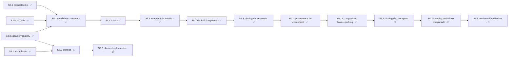

# Plan 5 — Entrega y continuación

**Estado:** 🔵 EN CURSO

> **Enmienda de contrato del 2026-08-03 (`d232fdf`) — ninguna Sesión cambió de estado.**
> Los gates se partieron en pisos de seguridad (no configurables) y política declarada
> por proyecto. Para este Plan eso significa: la **forma de entrega** y la **autorización
> de merge** dejan de estar fijas y se resuelven del bloque `delivery-policy` de
> [`AGENTS.md`](../../../AGENTS.md), con default fail-closed a humano; el **techo de
> planificación** de `S5.3` se resuelve igual, con default 2. `S5.1` suma dos Módulos
> nuevos —`M5.1.2` derivación del siguiente Módulo y comparación del claim del worker,
> `M5.1.3` frontera del subagente Support— y su forecast pasó a 380–500 líneas, en el
> borde de encadenado de 400: se decide en apply.
> Contrato completo en [`autonomous-v2-role-routed-continuation`](../../changes/autonomous-v2-role-routed-continuation/).

## Resumen

| Campo | Detalle |
|---|---|
| Dependencias | Las dependencias legacy de Changes F/G se conservan. `S5.1` depende de `S3.2` ✅, `S3.3` ✅ y **`S3.4`** —esta última se sumó el 2026-08-04 al sellar `S5.1`: revalidar la Jornada antes de un efecto irreversible exige `readJornada`, que entrega `S3.4`—; `S5.2` de `S4.1` y `S3.3` ✅, `S5.3` de `S5.2`, `S5.4` de `S5.1`, y la cadena contractual `S5.4 → S5.6 → S5.7 → S5.8 → S5.11 → S5.12 → S5.9 → S5.10 → S5.5`. |
| Outputs | Entrega idempotente por política `direct-push`, checkpoints durables y loop planner N+1 / implementer N. Main conserva la autoridad; Moshi sólo muestra escalamiento. |
| Roadmap | `S5.1`, `S5.4`, `S5.6`–`S5.8`, `S5.11` y `S5.12` están ✅ COMPLETO. `S5.9` está 🔵 EN CURSO: entregada en `master` (`3c3040d`, `754c698`, `8d4b28a`) con 7/8 criterios verificados, pendiente sólo de la enmienda del maintainer a la cláusula de preservación del criterio 2; no aporta crédito hasta cerrar. `S5.2` conserva corrección técnica pendiente bajo push directo; `S5.3` y `S5.5` quedan detrás de sus dependencias como continuación planner/implementer y park/resume acotado. |
| Referencias | [`sdd-tower-telegram-delivery`](../../changes/sdd-tower-telegram-delivery/), [`autonomous-v2-checkpointed-delivery`](../../changes/autonomous-v2-checkpointed-delivery/), [`autonomous-v2-role-routed-continuation`](../../changes/autonomous-v2-role-routed-continuation/). El proposal `sdd-tower-continuous-slice-loop` fue eliminado en `613a45d` por ser cáscara sin avance; su mecanismo quedó superseded por la continuación role-routed y su intención vive en este STATUS. |

## Grafo de dependencias

## Sesión 5.1 — Change F candidate contracts

**Estado:** ✅ COMPLETO — cierre técnico verificado el 2026-08-08 sobre `c7c247227f6bc888f9ff7ed48094a7aa92f9cc4c` (tree `17f24c6d3738973ccbf6dedecebf4ec455f74184`). Los 27/27 criterios pasan; la decisión abierta sobre quién origina `trustedBindingProvider` en producción no pertenece a esta Sesión y sigue bloqueando la declaración de release, no el contrato receptor ya verificado.

**Depende de:** `S3.2` ✅, `S3.3` ✅ integrada en `4621d3f`, `S3.4` ✅ integrada en `b6dda84`.

**Por qué depende también de `S3.4` — lo produjo la decisión del maintainer, y ya está satisfecho.** Exigir Jornada `ACTIVE` y `jornada_revision` actual antes de todo efecto irreversible obliga a **leer una Jornada persistida**. `policy/jornada.mjs`, que entregó `S3.2`, es un resolvedor puro que recibe la Jornada como argumento y no la persiste; `readJornada` la entrega `S3.4` en `T3.4.1.2`. Sin esa función el criterio de revalidación no era implementable ni verificable. Ahora lo es.

**Área:** `contracts/candidate-revision.mjs`, `schemas/candidate-revision-v1.schema.json`, `contracts/{schema-registry,validate}.mjs`, `main-store/store.mjs`, `continuation/{derivation,support}.mjs`, `plugin/tower-spike.js`, `.opencode/agent/support-agent.md`, `test/continuation/**`, `test/plugin/tower-spike.test.mjs`, `test/main-store.test.mjs`, `test/contracts/schema.test.mjs`, `test/fixtures/contracts/schema-cases-v1.json`, `package.json`, `bun.lock`, `.opencode/plugins/tower-spike.js`

**Prohibido:** `core.mjs`, `test/recovery.test.mjs`, `mcp.mjs`, `delivery/**`, `jornada/**`, `capabilities/**`, `policy/**`, `registry/**`, `workspace/**`, `escalation/**`, `hosts/**`, `openspec/plans/**`, `openspec/specs/**`

**Ampliación del `Área` del 2026-08-04 — tres paths, y sólo tres.** `plugin/tower-spike.js`, `.opencode/agent/support-agent.md` y `test/plugin/tower-spike.test.mjs` entraron al re-sellar `M5.1.3`. `continuation/support.mjs`, `test/continuation/support.test.mjs` y `test/main-store.test.mjs` **ya estaban** cubiertos por `continuation/{derivation,support}.mjs`, `test/continuation/**` y su propia entrada. `capabilities/**` y `registry/**` **siguen prohibidos**: la autoridad no se otorga por registry.

**Ampliación del `Área` del 2026-08-05 — exactamente tres paths, y ningún otro:** `package.json`, `bun.lock` y `.opencode/plugins/tower-spike.js`. Las dependencias directas de OpenCode y su lock acompañan a `plugin/tower-spike.js`; el entrypoint sólo lo expone al runtime. **S5.1 no posee compatibilidad schema-v6.** El mapa acotado concluyó que la implementación corregida no la necesita y no probó una Sesión adicional; schema-v6 no bloquea esta cadena.

**`core.mjs` y `test/recovery.test.mjs` siguen prohibidos, explícitamente.** El contrato aprobado no permite que `M5.1.3` fabrique ni lea por su cuenta el binding canónico: `TowerSpikePlugin` **recibe `trustedBindingProvider` al inicializarse** y sólo puede obtener el binding a través de ese parámetro. No puede conservar `readValidatedMainStoreBinding` ni ningún reader nuevo en `core.mjs`. La investigación del 2026-08-05 demostró por qué este límite es material: el candidato rechazado `9e7bb43` llamó al reader de `core.mjs`, mientras su test lo reemplazó por un mock. El candidato cerrado eliminó esa dependencia y probó la inyección real.

**Por qué el `Área` incluye `contracts/**`:** misma razón verificada en `S3.3`. Un schema fuera del mapa `schemaFiles` de `contracts/schema-registry.mjs` **no tiene validador** —`validatorFor` devuelve `null` y `validate` tira `Unknown schema`—, así que `candidate-revision-v1` no sirve de nada hasta quedar registrado, con su invariante cross-field en `contracts/validate.mjs` y su caso en el fixture.

**Por qué `jornada/**` está prohibido pese a ser central:** `S5.1` **lee** la Jornada, nunca la escribe ni la transiciona. `jornada/lifecycle.mjs` es el `Área` de `S3.4` y se importa sin modificar, igual que `S3.3` consumió `main-store/authority.mjs`. Una segunda ruta de transición de Jornada sería una segunda noción de estado vivo.

**Colisión resuelta con `S3.4` sobre `main-store/store.mjs`.** Las dos Sesiones tenían ese archivo en su `Área`: `S3.4` agregó `createJornada`/`readJornada`/`transitionJornada`, y `S5.1` tomó posesión del authorization store que ya vivía ahí. La implementación se serializó y `S3.4` quedó integrada en `b6dda84` antes de ejecutar `S5.1`.

**Recurso:** Main / ninguno. Escritura por CAS de filesystem en `main-store/store.mjs` bajo `assertMain`, sin migraciones de SQLite, sin `db-writer` y sin token de entrega. La lectura del ledger para derivación es **sólo lectura** y nunca pasa por `core.mjs`, que queda opaco al plan.

**Entrega:** commit directo a `master` + push, sin PR ([`AGENTS.md`](../../../AGENTS.md)). Forecast **380–500 líneas**, en el borde de encadenado de 400: se entrega **encadenada por Módulo** —`M5.1.1`, `M5.1.2`, `M5.1.3`, cada uno con su commit— más el commit documental de cierre, que es del planner.

**Ownership del authorization store — explícito.** `S5.1` es su **único** dueño. `createAuthorization` y `consumeAuthorization` (`main-store/store.mjs:187` y `:200` en el candidato cerrado) sólo se modifican dentro de esta Sesión; cualquier otra los importa. `S3.4` toca el mismo archivo pero **no** esas funciones: agrega el género Jornada al lado, reusando `commit` y `assertMain`.

Define identidad y freeze de `candidate_revision`, invalidación, sucesores, compatibilidad e idempotencia, más la derivación del siguiente Módulo y la frontera del subagente Support.

**Colisión de IDs — resuelta el 2026-08-04 por el maintainer.** `M5.1.1` estaba definido dos veces con contenido incompatible: `Candidate` en el [`tasks.md` de `checkpointed-delivery`](../../changes/autonomous-v2-checkpointed-delivery/tasks.md#s51-change-f-contracts--m511-candidate) (2026-07-30) y `Dry-run reports` en el [`tasks.md` de `role-routed-continuation`](../../changes/autonomous-v2-role-routed-continuation/tasks.md) (2026-08-03). **Gobierna `Candidate`**, por tres señales del propio plan: el header dice que `d232fdf` *"suma dos Módulos nuevos"* —o sea `M5.1.1` no cambió—, la prosa de esta Sesión describe identidad y freeze, y sus tres decisiones `derivable` son todas sobre identidad de candidato. **Consecuencia:** el contenido de dry-run —`NO_SCOPE`, denegación, drift de horizonte, `reconcile→Support→Policy`— **sale del alcance de `S5.1`** y queda sin ID asignado; su destino natural es `S5.3`, pero moverlo es expansión de alcance y necesita decisión del maintainer.

> **Prerrequisito ✅ RESUELTO el 2026-08-03 (`6d37642`).** `S5.1` toma posesión del authorization
> store, y ese store arrancaba con un contrato roto: `schemas/authorization-v1.schema.json` y
> `main-store/store.mjs` divergían en **seis** puntos, no en los dos que registraba
> [release-chain](../release-chain.md). El peor: el store persistía `APPROVED`, un valor que el
> enum canónico rechaza. Se reconcilió fuera del freno de ejecución por ser contrato, no trabajo
> nuevo. `action` pasó a `MERGE`, el binding `pr` a `delivery` con `shape`, y los estados a
> `PENDING|APPROVED|REJECTED|EXPIRED|REVOKED`. De paso se sumó `REJECTED` —el store no podía
> registrar un rechazo— y `createAuthorization` ahora valida contra el schema en vez de contra un
> array escrito a mano, que era la causa raíz del drift.
>
> **Evidencia completa — verificada el 2026-08-03 con la Torre desarmada: `bun test` → 450 pass / 0
> fail.** Durante la implementación la suite quedó en 446/2 porque `migration.test.mjs` → *P0 frozen
> snapshot restore* se niega a correr mientras exista `.git/control-tower/ACTIVE`. Esos dos tests son
> los que verifican **restore aislado sobre bytes trackeados**, así que hasta correrlos la
> reconciliación estaba verificada a nivel contrato y unidad pero no a nivel restore. Ya corrieron y
> pasan: el cambio no afecta el runtime. El total subió a 450 porque `M8.8.5` sumó dos tests de
> `diagnose`.

**Decisiones:**

- `derivable` — la forma del registro de autorización. **Criterio:** `schemas/authorization-v1.schema.json`, y el store valida **contra el schema**, nunca contra una lista escrita a mano. Escribir la lista dos veces fue la causa raíz de las seis divergencias que este prerrequisito acaba de reconciliar. Falsificable: cualquier enum o campo duplicado entre `main-store/store.mjs` y el schema. **Autoridad:** el schema, y la reconciliación `6d37642`.
- `derivable` — qué vuelve inválido a un candidato congelado. **Criterio:** cualquier cambio en los bytes que produjeron su identidad. Un candidato cuya identidad sobrevive a una modificación de contenido no es un freeze. Falsificable: dos contenidos distintos que resuelvan a la misma `candidate_revision`. **Autoridad:** los floors de seguridad de `d232fdf` — inmutabilidad del candidato congelado.
- `derivable` — cómo se comporta una operación repetida sobre el mismo candidato. **Criterio:** idempotente por identidad de candidato; repetir no produce un segundo efecto. Falsificable: dos invocaciones idénticas que generen dos efectos remotos. **Autoridad:** el alcance declarado de `S5.1`.
- `escala` — cuánto vive una autorización antes de expirar. **Clase:** seguridad y permisos. **RESUELTA el 2026-08-03 por el maintainer: una hora.** Cubre el caso real —aprobar desde el celular y que el agente ejecute en minutos— sin dejar una aprobación armada toda la noche. La expiración por tiempo es la **segunda** capa: la primera es la invalidación por contenido, que el candidato congelado ya provee. Falsificable: una autorización consumida más de una hora después de emitida. **Contaminaba:** `S5.2` y `S5.5`, ambas destrabadas.
- `escala` — si un sucesor hereda la autorización de su predecesor. **Clase:** seguridad y permisos. **RESUELTA el 2026-08-03 por el maintainer, con una condición que la vuelve verificable: hereda hasta el horizonte declarado (`planning.horizon_ceiling`, hoy `2`) si y sólo si, en el momento de la aprobación, todas las Sesiones dentro de ese horizonte están selladas — cero decisiones `escala` abiertas.** Si alguna tiene una abierta, el horizonte **colapsa** ahí y la herencia se corta en la Sesión anterior. El razonamiento es que horizonte y sello son garantías distintas: el horizonte acota **hasta dónde** llega la aprobación, el sello garantiza que **lo que alcanza ya está determinado**. Sin el sello, heredar equivale a autorizar contenido que se define después de aprobado. Falsificable: un sucesor con una decisión `escala` abierta que ejecute bajo autorización heredada. **Contaminaba:** `S5.3` y `S8.7`, ambas destrabadas.
- `escala` — si terminar una Jornada debe revocar activamente las capabilities y autorizaciones vivas. **Clase:** expansión de alcance, y seguridad y permisos. **RESUELTA el 2026-08-04 por el maintainer: no. La invalidación es pasiva.** Terminar una Jornada **incrementa `jornada_revision`** y nada más; no dispara cascada. Las capabilities y autorizaciones anteriores quedan inutilizables **al revalidar**, no al terminar: el que las quiera usar revalida contra la Jornada y falla cerrado por drift de revisión. `S5.1` exige Jornada `ACTIVE` y `jornada_revision` actual **antes de todo efecto irreversible**. Una capability equivalente se reemplaza naturalmente por `agent_role` + `capability`, sin ID nuevo. **La poda de capabilities discontinuadas queda fuera de alcance: no se construye garbage collector.** Falsificable: cualquier ruta que mute una capability o una autorización como efecto de terminar una Jornada, o cualquier efecto irreversible que se ejecute sin revalidar la Jornada. **Autoridad:** decisión del maintainer del 2026-08-04. **Contaminaba:** `S5.1`, destrabada — era la única decisión `escala` abierta que le quedaba.
- `escala` — **quién prueba la autoridad canónica de Main.** **Clase:** seguridad y permisos. **RESUELTA el 2026-08-04 por el maintainer y acotada el 2026-08-05: `plugin/tower-spike.js` es el único composition root que lo hace.** La plugin recibe `trustedBindingProvider` al inicializarse, liga y verifica `main_session_id` mediante `main-store/authority.mjs`, y **sólo después** de esa verificación obtiene el store y la capability protegidos. El provider entra por inyección: la plugin no lo fabrica, no lo reemplaza por `readValidatedMainStoreBinding` y no retiene ningún reader nuevo en `core.mjs`. Rechaza todo `context.sessionID` distinto del Main ligado, y ante provider o binding ausente, inválido o de otra sesión falla cerrado **antes** de cualquier spawn o persistencia. Support **nunca** recibe `main_store`, `capability` ni autoridad. **No se crea un adaptador Main separado** —una segunda noción de "esto es Main" es exactamente la clase de bug que `main-store/authority.mjs` existe para hacer imposible— **y no se usa el capability registry para otorgar autoridad**, porque el registry otorga visibilidad y compatibilidad de invocación, nunca autoridad (límite duro de `S3.3`). Falsificable: una inicialización sin `trustedBindingProvider` que llegue a spawn o persistencia; cualquier ruta que lea el binding desde `core.mjs`, obtenga store o capability antes de la verificación, acepte un `sessionID` ajeno, entregue autoridad a Support o derive autoridad de una entrada del registry. Un test que sólo mockea `core.mjs` sin observar la inyección **no satisface** este criterio. **Autoridad:** decisiones del maintainer del 2026-08-04 y 2026-08-05, y `main-store/authority.mjs:15-36`.
  **Por qué esto bloqueó `S5.1` en pleno vuelo.** El sello del 2026-08-04 en `c2d116c` describía `M5.1.3` como "frontera del subagente Support" y enumeraba qué **no** podía ver Support, pero **no decía quién probaba que Main era Main**. Aislamiento y wiring son dos preguntas distintas, y el contrato sólo respondía la primera. Agent 1 llegó a `M5.1.3` con los dos Módulos anteriores entregados y sin respuesta para la segunda. Es un hueco de contrato, no un error de implementación.

### Módulo M5.1.1 — Candidate

- [x] Tarea T5.1.1.1 — RED: verificación de commit/árbol final, freeze de identidad y `host_epoch`,
  separación del ledger, invalidación, sucesor e idempotencia. Incluye **dos contenidos distintos que
  no pueden resolver a la misma `candidate_revision`** y **una operación repetida sobre el mismo
  candidato que no produce un segundo efecto**.
- [x] Tarea T5.1.1.2 — GREEN: implementar `schemas/candidate-revision-v1.schema.json` y
  `contracts/candidate-revision.mjs`, registrar el schema en `contracts/schema-registry.mjs`, sumar su
  invariante en `contracts/validate.mjs` y su caso al fixture de contratos, respetando la frontera del
  ledger.
- [x] Tarea T5.1.1.3 — REFACTOR: unificar los digests de identidad y de evidencia por un solo camino,
  para que no puedan divergir. `bun test test/contracts test/main-store.test.mjs`.

### Módulo M5.1.2 — Derivación del siguiente Módulo y claim del Worker

- [x] Tarea T5.1.2.1 — RED: la derivación avanza sólo si el documento de plan no cambió desde el cierre
  anterior; enumeración por digest y cumplimiento leído de `ct_delivery`/`ct_claim` en **sólo lectura**.
- [x] Tarea T5.1.2.2 — RED: memoria narrativa que declara un Módulo completo **sin** cumplimiento en el
  ledger **no** avanza la derivación.
- [x] Tarea T5.1.2.3 — RED: un claim del Worker que coincide registra evidencia y **no otorga ningún
  privilegio**; uno que no coincide produce `CT_CLAIM_MISMATCH`, sin assignment, nombrando los dos valores.
- [x] Tarea T5.1.2.4 — GREEN: traducción `handoff_id` → coordenada de plan **sólo** en registros
  propiedad de Main; `core.mjs` queda opaco al plan. Toda operación de esta ruta revalida la Jornada
  antes de cualquier efecto irreversible. `bun test test/continuation`.

### Módulo M5.1.3 — Frontera del subagente Support

**Re-sellado el 2026-08-05 y verificado en el cierre del 2026-08-08. El Módulo tiene dos mitades, y confundirlas fue lo que bloqueó la Sesión.** No son dos Módulos: son dos preguntas distintas que el contrato anterior mezclaba.

1. **Aislamiento de Support** — qué *no* puede ser ni ver Support. Subagente **frío**, read-only,
   sin board, sin locks, sin Worker, sin entrada de registry, y **sin ruta de sustituto en línea**.
2. **Wiring de Main** — quién *prueba* que Main es Main. Es `plugin/tower-spike.js`, y sólo esa.

- [x] Tarea T5.1.3.1 — RED: **aislamiento de Support.** No aparece **ni** en el board de la Torre
  **ni** en la tabla de locks, ninguna transferencia de lock puede nombrarlo, y no recibe `main_store`,
  `capability` ni autoridad de ningún tipo. Verificado además con testigos de bytes: correr Support no
  muta board, locks, Worker ni registry.
- [x] Tarea T5.1.3.2 — RED: **ausencia de sustituto.** Un host sin delegación a subagente de contexto
  aislado rechaza la continuación autónoma con `CT_HOST_CAPABILITY_MISSING`; **no existe ninguna ruta
  de fallback en línea** que ejecute Support dentro del contexto de Main.
- [x] Tarea T5.1.3.3 — RED/GREEN: **wiring de Main en `plugin/tower-spike.js`, el único composition
  root que prueba la autoridad canónica de Main.** La plugin recibe `trustedBindingProvider` al
  inicializarse, liga y verifica `main_session_id` mediante `main-store/authority.mjs` importado sin
  modificar, y **recién después** de esa verificación obtiene el store y la capability. Rechaza todo
  `context.sessionID` distinto del Main ligado. Ante provider o binding **ausente, inválido o de otra
  sesión** falla cerrado **antes** de cualquier spawn o persistencia. El RED debe fallar si la plugin
  fabrica el provider, llama a `readValidatedMainStoreBinding` o a cualquier reader de `core.mjs`, o
  si el test sólo reemplaza `core.mjs` por un mock sin observar la inyección. Valida la respuesta de
  Support contra `support-proposal-v1` y persiste ella misma; el subagente no tiene entrada propia en
  el registry. **No se crea un adaptador Main separado y no se usa el capability registry para otorgar
  autoridad.** `bun test test/plugin test/continuation test/main-store.test.mjs`.

**Evidencia de cierre.** El candidato verificado es `c7c247227f6bc888f9ff7ed48094a7aa92f9cc4c` (tree `17f24c6d3738973ccbf6dedecebf4ec455f74184`). La implementación y sus dos correcciones quedaron en `938f932`, `a5f43e2`, `3f7f81f`, `14f3681` y `c7c2472`. Los 25 criterios originalmente limpios se conservaron; los criterios 6 y 21 pasaron el recheck dirigido. Verificación exacta: `test/main-store.test.mjs` 30/0/127, `test/plugin/tower-spike.test.mjs` 6/0/60, focused 92/0/313 y suite completa 537/0/3061. El diff final mantiene `core.mjs`, `test/recovery.test.mjs` y todos los paths del `Prohibido` intactos.

**Criterios de aceptación de S5.1** — todos deben pasar para cerrar:

- [x] Dos contenidos distintos nunca resuelven a la misma `candidate_revision`
- [x] Un candidato cuya identidad cambió no se consume bajo la autorización previa
- [x] Una operación repetida sobre el mismo candidato no produce un segundo efecto remoto
- [x] El authorization store valida contra `authorization-v1` y no contra ninguna lista de campos escrita a mano
- [x] Una autorización consumida más de una hora después de emitida se rechaza
- [x] **Todo efecto irreversible exige Jornada `ACTIVE` y `jornada_revision` actual**, y falla cerrado ante Jornada terminal, revisión desactualizada o Jornada ausente
- [x] Una autorización emitida bajo una `jornada_revision` anterior no se consume después de una transición de Jornada
- [x] **No existe revocación activa en cascada:** terminar una Jornada no muta ninguna capability ni ninguna autorización
- [x] **No existe garbage collector ni poda** de capabilities discontinuadas en ninguna ruta
- [x] Una capability equivalente se reemplaza por `agent_role` + `capability`, sin acuñar un ID nuevo
- [x] La derivación no avanza con memoria narrativa: sin cumplimiento en el ledger no hay avance
- [x] Un claim del Worker en desacuerdo produce `CT_CLAIM_MISMATCH`, sin assignment y nombrando ambos valores
- [x] Un claim del Worker que coincide registra evidencia y no otorga ningún privilegio
- [x] Support no figura en el board ni en la tabla de locks, y ninguna transferencia de lock puede nombrarlo
- [x] Un host sin delegación a subagente aislado rechaza la continuación con `CT_HOST_CAPABILITY_MISSING`, sin sustituto en línea
- [x] **`plugin/tower-spike.js` es el único composition root que prueba la autoridad de Main y recibe `trustedBindingProvider` al inicializarse:** omitir la inyección falla antes de spawn o persistencia; la plugin no fabrica el provider ni llama a `readValidatedMainStoreBinding` o a otro reader de `core.mjs`, y un test que sólo mockea `core.mjs` no satisface el criterio
- [x] **Un `context.sessionID` distinto del Main ligado se rechaza**, y el rechazo nombra la sesión rechazada
- [x] **Binding ausente, inválido o de otra sesión falla cerrado ANTES de cualquier spawn o persistencia** — no después
- [x] **Un `main_store` simulado o construido por fuera de la verificación se rechaza:** el store y la capability sólo se obtienen después de que `main-store/authority.mjs` verifique el binding
- [x] **Support no recibe `main_store`, `capability` ni autoridad por ninguna ruta**, y su respuesta se valida contra `support-proposal-v1` antes de persistirse
- [x] **Correr Support no muta board, locks, Worker ni registry**, verificado por testigos de bytes en éxito y en rechazo
- [x] La autoridad no se deriva de ninguna entrada del capability registry
- [x] `core.mjs` sigue opaco al plan: ninguna coordenada de plan se resuelve fuera de registros propiedad de Main
- [x] `candidate-revision-v1` está registrado en `contracts/schema-registry.mjs` y tiene su caso en el fixture de contratos
- [x] `bun test test/continuation test/main-store.test.mjs test/contracts` pasa completo
- [x] `bun test` no introduce fallos nuevos sobre la línea base que deje `S3.4`
- [x] El diff de implementación no toca ninguna ruta del `Prohibido`

## Sesión 5.2 — Change F delivery adapters/reconciliation

**Estado:** 🔴 BLOQUEADO — el contrato sigue sellado, y `S4.1` ya está ✅ COMPLETO, pero el recheck dirigido 8193 dejó abiertos los hallazgos 1, 3 y 5: recuperación de lock tras crash, TOCTOU de directorio padre y estado `delivered` prematuro para PR recién creado. La decisión 8195 estacionó el candidato congelado en `Worktrees/s5-1` como NOT READY; no hay una segunda corrección autorizada.

**Depende de:** `S4.1`, `S3.3` ✅.

**Ruta:** `blocked` — la decisión 8195 estacionó el candidato como NOT READY y no existe una segunda corrección autorizada; los hallazgos 1, 3 y 5 del recheck 8193 siguen abiertos. Una decisión de operaciones irreversibles abierta es `blocked` antes de SDD o implementación. **Ruta proyectada al destrabar: `direct`** — el alcance está aprobado y completo: `Área`, `Recurso`, seis `Decisiones` todas resueltas, quince criterios binarios y `T5.2.1.1`–`T5.2.1.4` en orden RED → GREEN. No queda decisión de diseño técnico que elegir, así que no corresponde `design-tasks` ni `full-sdd`. **Autoridad:** decisión 8195 y el alcance declarado de esta Sesión. *(Clasificada el 2026-08-11.)*

**Área:** `delivery/**`, `schemas/delivery-record-v1.schema.json`, `contracts/{schema-registry,validate}.mjs`, `test/delivery/**`, `test/contracts/schema.test.mjs`, `test/fixtures/contracts/schema-cases-v1.json`

**Prohibido:** `core.mjs`, `mcp.mjs`, `main-store/store.mjs`, `continuation/**`, `escalation/**`, `hosts/**`, `capabilities/**`, `policy/**`, `jornada/**`, `registry/**`, `workspace/**`, `openspec/plans/**`, `openspec/specs/**`

**Recurso:** Main / ninguno. Registro append-only propio por CAS de filesystem en `delivery/**`. **Sin migraciones de SQLite y sin `db-writer`** — ver la decisión de ledger más abajo.

**Entrega:** commit directo a `master` + push, sin PR ([`AGENTS.md`](../../../AGENTS.md)). Cada commit debe permanecer independientemente verificable/revertible y dentro de 400 líneas authored; si el forecast excede, se separa en commits secuenciales.

Implementa commit y push idempotentes a `master`, checks, autorización exacta y reconciliación de resultados desconocidos; no crea ni depende de PR.

**Colisión de IDs en `M5.2.1` — resuelta como `derivable`, no escalada.** Igual que `M5.1.1`, está definido dos veces: `Adapters/reconciliation` en el [`tasks.md` de `checkpointed-delivery`](../../changes/autonomous-v2-checkpointed-delivery/tasks.md#s52-change-f-delivery--m521-adaptersreconciliation) con **cuatro** Tareas, y `Main dispatch` en el [`tasks.md` de `role-routed-continuation`](../../changes/autonomous-v2-role-routed-continuation/tasks.md) con **tres**. **Gobierna `Adapters/reconciliation`,** y acá no hizo falta escalarlo porque la evidencia es decisiva: la prosa de esta Sesión cita el rango `T5.2.1.1`–`T5.2.1.4`, y **sólo `checkpointed` tiene cuatro Tareas**. Lo confirman las tres decisiones `derivable` de abajo, todas de entrega y reconciliación, ninguna de despacho, más el precedente que el maintainer fijó en `M5.1.1`. **Consecuencia:** el contenido de Main dispatch —`continuation/coordinator.mjs`, `assignment-v2`, despacho Support/Worker— **sale del alcance de `S5.2`** y cae en el mismo bucket huérfano que el dry-run desplazado de `S5.1`, sin ID asignado.

**Decisiones:**

- `derivable` — la forma de la entrega de cada proyecto. **Criterio:** el bloque `delivery-policy` de su `AGENTS.md`, con `shape` en `direct-push` o `pull-request`, y default fail-closed al valor más restrictivo cuando el bloque falta. Falsificable: un repositorio sin bloque que termine entregando por el camino más permisivo. **Autoridad:** [`AGENTS.md`](../../../AGENTS.md) y el corte de `d232fdf`.
- `derivable` — qué hace la reconciliación ante un resultado desconocido. **Criterio:** consulta el estado remoto real antes de reintentar; nunca asume que el efecto no ocurrió. Un timeout no distingue "no llegó" de "llegó y la respuesta se perdió", y asumir lo primero es exactamente cómo se duplica una entrega. Falsificable: un test donde el efecto ocurrió, la respuesta se perdió, y el reintento produce un segundo efecto. **Autoridad:** el alcance declarado de `S5.2`.
- `derivable` — qué identifica una entrega para efectos de idempotencia. **Criterio:** la `candidate_revision` congelada, no un identificador generado en el momento del intento. Falsificable: dos intentos sobre el mismo candidato que se consideren entregas distintas. **Autoridad:** `S5.1`.
- `escala` — cuántas veces se reintenta antes de parar. **Clase:** operaciones irreversibles. **RESUELTA el 2026-08-04 por el maintainer: tres intentos, con reconciliación obligatoria antes de cada reintento.** Agotados los tres, para y escala. **El tope no es lo que evita la duplicación** —eso ya lo cierran las dos decisiones `derivable` de arriba: la reconciliación consulta el estado remoto real antes de reintentar y nunca asume que el efecto no ocurrió, y la identidad de idempotencia es la `candidate_revision` congelada, no un ID por intento—. El tope sólo acota **cuánto insiste** antes de rendirse. Si la reconciliación determina que el efecto **sí** ocurrió, se marca entregada y **no** se reintenta, sin importar el contador. Falsificable: un cuarto intento, o cualquier reintento emitido sin reconciliar antes. **Autoridad:** decisión del maintainer del 2026-08-04. **Contaminaba:** `S5.3` y `S7.1`, ambas destrabadas — su piloto de "cero efectos remotos duplicados" ahora tiene un número concreto que medir.
- `escala` — qué se hace ante una entrega parcial que no se puede reconciliar. **Clase:** operaciones irreversibles. **RESUELTA el 2026-08-04 por el maintainer: frena esa entrega, no la Torre.** La entrega pasa a un estado terminal explícito `CT_DELIVERY_UNRECONCILED`, el candidato queda congelado, el ledger registra el estado, y **no se emite ninguna mutación remota adicional** — ni siquiera un revert, porque "no se puede reconciliar" significa que no se sabe qué ocurrió, y revertir a ciegas es una segunda mutación sobre estado desconocido. La decisión queda **estacionada** para el maintainer, con pregunta exacta y evidencia. **La Torre continúa con trabajo que no dependa de esa entrega.** Falsificable: cualquier efecto remoto emitido después de entrar en el estado terminal, o una Torre que se detenga entera ante una entrega irreconciliable de un solo proyecto. **Autoridad:** decisión del maintainer del 2026-08-04, y el floor de "sin mutación remota prematura". **Contaminaba:** `S5.3`, cuya base integrada asume un estado remoto conocido y por lo tanto debe **rechazar** una base marcada `CT_DELIVERY_UNRECONCILED`, y `S5.5`, que es donde vive la decisión estacionada. Ambas destrabadas.
- `escala` — dónde vive el registro de entrega de git, y en particular el estado terminal `UNRECONCILED`. **Clase:** migraciones o pérdida de datos. **RESUELTA el 2026-08-04 por el maintainer: registro propio y append-only en `delivery/**`; `ct_delivery` no se toca y no hay migración.** El disparador fue concreto: `ct_delivery.delivery_state` tiene un `CHECK` duro a `PENDING|CLAIMED|CLOSED` (`core.mjs:333`), así que el estado nuevo no cabía sin migrar. **La razón de fondo es que son dos géneros distintos que comparten la palabra "delivery":** `ct_delivery` modela **handoffs de worker** —`handoff_id`, `generation`, `purpose WORK/ATTESTATION_REDELIVERY`, `claim_id`—, mientras que lo que `S5.2` entrega es commit, push y PR. El registro de `S5.2` liga `candidate_revision` —la identidad congelada de `S5.1`—, `shape`, el contador de intentos y `authorization_ref`. Falsificable: cualquier diff de `S5.2` que toque `core.mjs`, agregue una migración de SQLite o escriba en `ct_delivery`. **Autoridad:** decisión del maintainer del 2026-08-04, y el registro de que una migración no vence.
  **Costo aceptado:** conviven dos ledgers append-only en el árbol. Se acepta porque modelan cosas distintas y ninguno es fuente de verdad del otro; el precio de unificarlos era una migración irreversible sobre una tabla en producción. **Corrige un dato del plan:** `plan-3/STATUS.md` decía que el `db-writer` aparecía en `S5.2`. Ya no: `S5.2` no escribe en el SQLite de la Torre.

### Módulo M5.2.1 — Adapters y reconciliación

- [ ] Tarea T5.2.1.1 — RED: remoto, refspec y head **explícitos**; ignorar la rama de tracking,
  reconciliar antes del primer push, y bloquear cualquier destino que no coincida con el declarado.
- [ ] Tarea T5.2.1.2 — RED: repositorio, head y base explícitos por argv, con entorno separado;
  rechazar composición de comandos, prefijo de entorno y `--head` ausente.
- [ ] Tarea T5.2.1.3 — RED: clasificación de resultados. Cuota o facturación → `quota_exhausted`;
  caída, 5xx o timeout sondeado → `provider_unavailable`; checks incompletos → `checks_pending`;
  ambiguo → `unknown` bloqueado. **Más los dos casos que resolvió el maintainer:** el tercer
  reintento fallido para y escala, y un resultado ambiguo que no se puede reconciliar entra en
  `UNRECONCILED` sin emitir ninguna mutación remota adicional.
- [ ] Tarea T5.2.1.4 — GREEN/REFACTOR: la secuencia `commit → verificar commit/árbol → freeze →
  push directo a master`, con el registro append-only propio de `delivery/**` y el binding a la autorización de
  `S5.1`, importada sin modificar. Registrar `delivery-record-v1` en `contracts/schema-registry.mjs`,
  sumar su invariante en `contracts/validate.mjs` y su caso al fixture.
  `bun test test/delivery test/contracts`.

**Criterios de aceptación de S5.2** — todos deben pasar para cerrar:

- [ ] La forma de entrega sale del bloque `delivery-policy` del proyecto, y un repositorio sin bloque resuelve al valor más restrictivo
- [ ] Remoto, refspec y head son explícitos; la rama de tracking nunca decide el destino
- [ ] Un destino que no coincide con el declarado se bloquea antes de emitir nada
- [ ] Composición de comandos, prefijo de entorno y `--head` ausente se rechazan
- [ ] Dos intentos sobre el mismo candidato se consideran la **misma** entrega: la identidad es la `candidate_revision` congelada, nunca un ID por intento
- [ ] **Se reintenta como máximo tres veces, y cada reintento va precedido de reconciliación** contra el remoto real
- [ ] **Si la reconciliación determina que el efecto sí ocurrió, se marca entregada y no se reintenta**, sin importar el contador
- [ ] Un efecto que ocurrió con la respuesta perdida **no** produce un segundo efecto al reintentar
- [ ] Cuota, caída, checks incompletos y ambigüedad se clasifican en `quota_exhausted`, `provider_unavailable`, `checks_pending` y `unknown` bloqueado
- [ ] **Una entrega irreconciliable entra en `UNRECONCILED`, congela el candidato y no emite ninguna mutación remota adicional** — tampoco un revert
- [ ] **La Torre continúa con trabajo independiente** después de una entrega `UNRECONCILED`; no se detiene entera
- [ ] El registro de entrega es append-only y vive en `delivery/**`: **ninguna ruta escribe en `ct_delivery` ni requiere migración de SQLite**
- [ ] La autorización se consume por el store de `S5.1`, importado sin modificar; `S5.2` no abre una segunda ruta de escritura ni crea autoridad
- [ ] `delivery-record-v1` está registrado en `contracts/schema-registry.mjs` y tiene su caso en el fixture de contratos
- [ ] `bun test test/delivery test/contracts` pasa completo y `bun test` no introduce fallos nuevos sobre la línea base que deje `S4.1`
- [ ] El diff no toca ninguna ruta del `Prohibido` — en particular `core.mjs`

## Sesión 5.3 — Continuación planner/implementer

**Estado:** 📋 PLANIFICADO — espera `S5.2` integrada; no tiene decisión propia abierta.

**Depende de:** `S5.2`.

**Área:** `continuation/**`, `test/continuation/**`.

**Recurso:** autoridad de despacho Main; sin DB, migraciones ni token de entrega.

**Ruta:** `design-tasks` al destrabar — el planner prepara sólo N+1 hasta Tareas y el implementer ejecuta N mediante apply/tests/verify. **Autoridad:** rebase del maintainer 2026-08-17 y política `planning.horizon_ceiling: 2`.

Prepara N+1 desde la base integrada y evidencia fresca; el implementer conserva N hasta verificarlo. Main es el único despachador y ningún wake otorga autorización. La definición histórica de tareas queda preservada como evidencia.

**Decisiones:**

- `derivable` — cuántas Sesiones se planifican por delante. **Criterio:** `planning.horizon_ceiling` del bloque `delivery-policy`, hoy `2` en este repositorio. Es configuración declarada, no criterio del agente. Falsificable: una planificación que exceda el techo declarado. **Autoridad:** [`AGENTS.md`](../../../AGENTS.md).
- `derivable` — de dónde se deriva el siguiente Módulo. **Criterio:** la enumeración del plan por digest más el ledger inmutable `ct_delivery`/`ct_claim`, **nunca** engram. Engram hace upsert por `topic_key` y no está atado al contenido del repositorio, así que un cierre de Módulo que no toca documentación lo deja mintiendo. Falsificable: una derivación que cambie de respuesta sin que cambie ni el plan ni el ledger. **Autoridad:** el delta de `d232fdf`.
- `derivable` — qué es evidencia fresca. **Criterio:** evidencia producida contra la base ya integrada, no contra la que existía cuando el sucesor se planificó. Falsificable: un sucesor habilitado por evidencia anterior a la integración de su predecesor. **Autoridad:** el alcance declarado de `S5.3`.
- `escala` — **RESUELTA por el maintainer el 2026-08-14 (decisión 29): preservar el sucesor, marcarlo `UNRECONCILED` y escalar.** Qué pasa cuando la base integrada divergió de la que el sucesor asumía. **Clase:** dependencias o evidencia contradictorias. Rebasar el sucesor cambia su contenido después de haber sido planificado; descartarlo tira trabajo hecho. **Resolución:** ninguna de las dos automáticamente. Es derivable de las reglas de negocio 9 y 10 del PRD —drift material o ambiguo requiere decisión humana, y el estado parcial se preserva y bloquea en vez de limpiarse para aparentar progreso—. **Falsificable:** cualquier ruta que rebase o descarte un sucesor divergente sin decisión humana. **Contaminaba:** `S7.1`, cuyo piloto de rechazo de candidatos stale mide precisamente este caso.
- `escala` — **RESUELTA por el maintainer el 2026-08-14 (decisión 28): el contenido de dry-run huérfano de `S5.1` se absorbe en esta Sesión.** `NO_SCOPE`, denegación, drift de horizonte y `reconcile→Support→Policy` quedaron sin dueño al resolver `M5.1.1` a favor de `Candidate`, y `S5.3` ya era su destino natural. **Clase:** expansión de alcance. **Efecto:** no se enumera Sesión nueva, así que el denominador de P5 no cambia; la elaboración técnica de `S5.3` debe incorporar esas cuatro responsabilidades a sus Tareas. **Contaminaba:** `S5.3`.

**Criterios de aceptación** — todos deben pasar para cerrar:
- [ ] El planner deja N+1 especificado hasta Tareas sobre la base integrada y el implementer ejecuta sólo N
- [ ] Main es el único despachador; ningún wake, agente o interfaz humana concede autorización
- [ ] Una base divergente preserva el sucesor y escala, sin rebase o descarte automático
- [ ] El diff no toca rutas fuera del Área que fije la elaboración técnica

## Sesión 5.4 — Ruteo de escalamiento fuera/en casa

**Estado:** ✅ COMPLETO — cierre técnico verificado y publicado el 2026-08-10. Los commits de comportamiento son `976b8d02bfda2d3ec9993e92a7b2f919ebc2d302` y `75549a781cd6ac19afc3e09e7466f7772f678fb7` (tree de comportamiento `835ed3e1d69540efae89b258813b194a0c555526`); el cierre documental es `f9f2869` y la reconciliación final está en `origin/master@d114677`.
**Depende de:** `S5.1` ✅
**Área:** `escalation/**`, `test/escalation/**`
**Prohibido:** `main-store/store.mjs`, `core.mjs`, `mcp.mjs`, `delivery/**`, `continuation/**`, `capabilities/**`, `policy/**`, `jornada/**`, `registry/**`, `contracts/**`, `schemas/**`, `openspec/plans/**`, `openspec/specs/**`
**Recurso:** estado de ruteo persistido, propiedad de `escalation/**`. Sin migraciones de DB, sin `db-writer`, sin token de entrega.
**Entrega:** commit directo a `master` + push, sin PR ([`AGENTS.md`](../../../AGENTS.md)). El forecast derivado de 200–280 líneas quedó superado: el resultado de comportamiento tiene **578 líneas añadidas** en cuatro paths. El maintainer aceptó la excepción y preservó dos commits de comportamiento con provenance —uno base y una corrección acotada posterior al review— en lugar de reescribir historia. El tercer commit es exclusivamente documental: existe porque la historia aceptada ya era inmutable y el Documentation Close Gate exige reconciliar el cierre técnico. La secuencia está publicada y reconciliada en `origin/master@d114677`.

**Por qué `main-store/store.mjs` está en el `Prohibido` aunque `S5.4` escriba ahí.** La solicitud emitida se persiste en el authorization store, que es **propiedad exclusiva de `S5.1`**. `S5.4` lo **llama**, nunca lo edita — es exactamente lo que exige la decisión `derivable` de más abajo: sin abrir una segunda ruta de escritura. Dos rutas al mismo estado es la causa raíz que `6d37642` reparó en este mismo Plan.

**Por qué `schemas/**` y `contracts/**` están prohibidos.** El modo de ruteo es **estado interno de `escalation/**`, no un contrato entre agentes**: nadie fuera de ese módulo lo lee. La solicitud emitida sí es un contrato, pero su forma la define `S5.1` en el authorization store, no esta Sesión. `S5.4` no necesita registrar ningún schema nuevo.

`S5.4` conserva el registro local de solicitud de decisión. En la ruta activa, Main presenta el escalamiento a Moshi; Telegram/Hermes y sus callbacks quedan archivados y no son una dependencia.

La evidencia histórica del seam remoto permanece en el historial de S5.4, pero no gobierna la ruta activa. Main conserva creación, validación y consumo de cualquier decisión; Moshi no agrega autorización.

El modo es explícito y de dos valores: `local` cuando el maintainer está frente a la máquina, `remoto` cuando no. Ante estado ausente, ilegible o ambiguo el modo resuelve a `local`: no escalar es un inconveniente, escalar por un canal que no debía estar abierto es una fuga.

`S5.4` produce y rutea la solicitud local. **No la autoriza**: creación, validación y consumo siguen en `S5.1`; la ruta activa la presenta Moshi sin conceder autoridad.

**Decisiones:**

- `derivable` — a qué resuelve el modo ante estado ausente, ilegible o ambiguo. **Criterio:** `local`. No escalar es un inconveniente; escalar por un canal que no debía estar abierto es una fuga, y los dos costos no son comparables. Falsificable por un fixture con estado corrupto que emita hacia un transporte remoto. **Autoridad:** el alcance declarado de `S5.4`.
- `derivable` — qué vuelve emitible a una solicitud. **Criterio:** objetivo exacto, origen y expiración; sin objetivo exacto falla cerrado. Una solicitud sin objetivo exacto se responde "depende" y cuesta un viaje completo. Falsificable por el criterio de aceptación ya escrito. **Autoridad:** los criterios de aceptación de `S5.4`.
- `derivable` — dónde se persiste la solicitud emitida. **Criterio:** el authorization store de `S5.1`, sin abrir una segunda ruta de escritura. Dos rutas de escritura al mismo estado es la causa raíz que `6d37642` acaba de reparar en este mismo Plan. Falsificable: cualquier escritura de solicitudes fuera del store. **Autoridad:** `T5.4.1.2`.
- `derivable` — qué pasa con la solicitud si el transporte remoto falla. **Criterio:** queda pendiente y recuperable localmente; el fallo de transporte **nunca** la consume ni la descarta. Falsificable por el caso de `M5.4.3`. **Autoridad:** los criterios de aceptación de `S5.4`.
- `escala` — quién puede conmutar el modo de ruteo. **Clase:** seguridad y permisos. **RESUELTA el 2026-08-04 por el maintainer: sólo el maintainer, por dos vías autenticadas, y ningún agente.** Las dos vías son (1) **CLI local autenticada** y (2) **callback remoto autenticado** desde el teléfono. **Main y los agentes no pueden conmutarlo automáticamente por ninguna ruta** — el conmutador decide si las preguntas salen de la máquina, y un agente que pudiera ponerlo en `remoto` se abriría su propio canal. Ante identidad **ausente, inválida o ambigua** la resolución es `local`, igual que ante estado corrupto: los dos costos no son comparables. Falsificable: cualquier ruta en la que Main, un agente o una identidad no verificada cambie el modo, o en la que una identidad dudosa termine emitiendo hacia un transporte remoto. **Autoridad:** decisión del maintainer del 2026-08-04. **Contaminaba:** `S8.7` y `S5.5`, ambas destrabadas.
  **La vía remota/callback es evidencia histórica archivada.** `S5.4` conserva su frontera local; Moshi puede hacer visible la solicitud pero no concede autorización. La ruta activa sigue `S5.1 → S5.4 → S5.5`.

### Módulo 5.4.1 — Emisión de solicitud de decisión

- [x] Tarea 5.4.1.1 — RED: agregar `test/escalation/request.test.mjs` para que un punto de decisión produzca una solicitud con objetivo exacto, origen y expiración, y para que una solicitud sin objetivo exacto falle cerrado.
- [x] Tarea 5.4.1.2 — GREEN: implementar la emisión reutilizando el authorization store de `S5.1`, sin abrir una segunda ruta de escritura.
- [x] Tarea 5.4.1.3 — REFACTOR: normalizar códigos de error estables y volver a correr `bun test test/escalation`.

### Módulo 5.4.2 — Modo de ruteo

- [x] Tarea 5.4.2.1 — RED: agregar `test/escalation/routing.test.mjs` para el conmutador `local` ↔ `remoto`, su idempotencia y su persistencia entre procesos, **más la frontera de autoridad**: conmutan sólo las dos vías autenticadas del maintainer —CLI local y callback remoto—, y **todo intento de Main o de un agente falla cerrado**, nombrando al actor rechazado.
- [x] Tarea 5.4.2.2 — RED: agregar los casos fail-closed. Estado ausente, corrupto o ambiguo resuelve a `local` y no emite hacia ningún transporte remoto; **identidad ausente, inválida o ambigua resuelve a `local` por el mismo camino**, sin ruta separada que pueda divergir.
- [x] Tarea 5.4.2.3 — GREEN: implementar la resolución de modo y el despacho de la solicitud al transporte correspondiente, **con la vía remota definida pero inhabilitada**: sin la autenticación que entrega `S8.7`, conmutar a `remoto` por callback falla cerrado y el modo queda `local`. La CLI local autenticada alcanza para operar la Sesión entera.

### Módulo 5.4.3 — Degradación y no mutación

- [x] Tarea 5.4.3.1 — RED: agregar el caso de transporte remoto ausente o caído estando en modo `remoto`.
- [x] Tarea 5.4.3.2 — GREEN: confirmar que la solicitud queda pendiente y recuperable localmente, y que el fallo de transporte nunca la consume ni la descarta.
- [x] Tarea 5.4.3.3 — Verificar con testigos de bytes que consultar el modo de ruteo no muta registro, DB, WAL, SHM ni estado de Torre.

**Criterios de aceptación de S5.4** — todos deben pasar para cerrar:

- [x] Un punto de decisión que requiere autoridad del maintainer emite una solicitud con objetivo exacto; una sin objetivo exacto falla cerrado
- [x] El modo de ruteo persiste entre procesos y conmutar es idempotente
- [x] **Sólo las dos vías autenticadas del maintainer conmutan el modo:** CLI local autenticada y callback remoto autenticado
- [x] **Main y cualquier agente fallan cerrado al intentar conmutar el modo**, y el rechazo nombra al actor
- [x] Estado de modo ausente, corrupto o ambiguo resuelve a `local` y no emite hacia ningún transporte remoto
- [x] **Identidad ausente, inválida o ambigua resuelve a `local`** por el mismo camino que el estado corrupto, sin una ruta separada que pueda divergir
- [x] **La vía remota está definida pero inhabilitada hasta `S8.7`:** conmutar a `remoto` por callback falla cerrado por autenticación ausente
- [x] **`S5.4` opera entera en modo `local` sin `S8.7`**: ninguna de sus rutas requiere el transporte para funcionar
- [x] `S5.4` no inventa transporte ni autenticación: no existe en su diff ninguna implementación de canal ni de verificación de identidad remota
- [x] Un fallo del transporte remoto deja la solicitud pendiente y recuperable, nunca consumida ni descartada
- [x] La solicitud emitida se persiste en el authorization store de `S5.1`, sin abrir una segunda ruta de escritura
- [x] Consultar el modo es read-only, verificado por testigos de bytes en éxito y en rechazo
- [x] `S5.4` no crea, valida ni consume autoridad: esa ruta sigue siendo exclusiva de `S5.1`
- [x] `bun test test/escalation` pasa completo y `bun test` no introduce fallos nuevos sobre la línea base que deje `S5.1`
- [x] El diff no toca ninguna ruta del `Prohibido` ni ninguna fuera del `Área`

La tarjeta Telegram, el envío idempotente, callback y TTLs fueron archivados con `S8.7`; no se reclasifican como efecto de `S5.4` ni como trabajo pendiente.

**Evidencia de cierre publicado.** La integración preservó los dos límites de comportamiento aceptados: `0ad88bb` → `976b8d02bfda2d3ec9993e92a7b2f919ebc2d302` (tree `0a516b146a3273b215df41f7f3bdfd3b89226be9`, parent `70ea7c2`) y `9c28ffd` → `75549a781cd6ac19afc3e09e7466f7772f678fb7` (tree `835ed3e1d69540efae89b258813b194a0c555526`, parent `976b8d0`). El primer commit agrega exactamente `escalation/{request,routing}.mjs` y `test/escalation/{request,routing}.test.mjs`; el segundo corrige únicamente `escalation/routing.mjs` y su test. El diff final contra la base son esos cuatro paths, 578 adiciones y ninguna ruta prohibida.

Los cuatro blobs finales son `6985fbbd1aedb18c1f3e213508a2153227b0cc1a`, `2c5fcac6b7271d7ed36232917c7b04255e2a9b24`, `37f81bc83e04338c556315c6881892e53b532107` y `f9d9388fe97db10be87e78b75852c59e981ce0b4`, idénticos al sucesor aceptado `9c28ffd`. Verificación por límite: primer commit `bun test test/escalation` → 13 pass / 0 fail / 58 expectations; segundo commit → 16 pass / 0 fail / 78 expectations. La compatibilidad previa contra la misma base y los mismos blobs dio `bun test` → 569 pass / 0 fail / 3274 expectations / 37 archivos. El recheck dirigido 8082 devolvió `findings: []` y `READY`; cerró seguridad de padres/lecturas, serialización real entre procesos y rechazo asíncrono del transporte.

No aplica un runtime externo: esta Sesión define ruteo y persistencia, pero deliberadamente no implementa transporte ni autenticación remota. La persistencia entre procesos, concurrencia, degradación y reutilización del store canónico sí están cubiertas por pruebas. Rollback: revertir primero el commit documental de cierre, después `75549a7` para retirar el hardening acotado y finalmente `976b8d0` para retirar los cuatro paths de comportamiento; ninguno de esos límites arrastra trabajo ajeno.

## Sesión 5.5 — Parking y retoma del loop

**Estado:** 📋 PLANIFICADO — espera `S5.10` integrada. Sus contratos previos quedan como prerrequisitos, pero no crea maquinaria nueva de contaminación dinámica.
**Depende de:** `S5.10` integrada; transitivamente `S5.9`, `S5.12`, `S5.11` y `S5.8` ✅
**Área:** `escalation/{parked,resume}.mjs`, `test/escalation/**`
**Prohibido:** `continuation/**`, `core.mjs`, `mcp.mjs`, `delivery/**`, `contracts/**`, `schemas/**`, `main-store/store.mjs`
**Recurso:** ledger append-only de decisiones estacionadas. Sin token de entrega.

**Ruta:** `design-tasks` al destrabar. **Autoridad:** rebase del maintainer 2026-08-17; dependencias, `Área`, `Recurso` y `Decisiones` declarados del plan son la única base de parking/resume.

`S5.6`–`S5.12` poseen los contratos, productores, composición y bindings canónicos que esta Sesión consume: snapshot de Sesión,
registro/respuesta, binding de opción seleccionada, provenance producer-owned, transporte inmutable hasta parking, binding del checkpoint exacto y binding del
trabajo independiente completado bajo su opción/supuesto. `S5.5` no los redefine, registra ni
valida por una ruta local.

`S5.4` conserva el registro local de la pregunta. `S5.5` estaciona el checkpoint durable y permite que el planner prepare N+1 mientras el implementer concluye N; Moshi sólo hace visible una escalación de Main.

Hoy el formato de plan ya declara por adelantado dependencias, `Área`, `Recurso` y
criterios binarios. Eso es el dato. Nadie lo **consume** todavía para decidir qué se
estaciona y qué puede seguir. Sin esta Sesión, una sola decisión pendiente frena la
corrida entera, que es exactamente el costo que el formato existía para evitar.

`S5.5` **no crea, valida ni consume autoridad** —eso sigue siendo exclusivo de `S5.1`— y no
duplica la emisión ni el ruteo de `S5.4`. Comparte prefijo de `Área` con `S5.4`, así que
por diseño **nunca corren en paralelo**: `S5.5` sólo abre con `S5.4` integrada.

**Decisiones:**
- `derivable` — qué puede continuar. **Criterio:** sólo la dependencia declarada, `Área`, `Recurso` y `Decisiones` del plan vigente; no hay análisis dinámico adicional. Falsificable: continuar una Sesión que contradiga esos campos.
- `derivable` — qué se retoma. **Criterio:** el checkpoint durable exacto y el mismo worktree asignado; base divergente exige reconciliación. Falsificable: retomar otro checkpoint o worktree.
- `escala` — disposición de trabajo contradicho. **Clase:** dependencias o evidencia contradictorias. **RESUELTA:** se preserva y escala; nunca se descarta o rescata automáticamente. **Contamina:** `S5.3`, `S7.1`.

### Las ocho clases que siempre escalan

No son heurística: una decisión que cae en cualquiera de estas **nunca** se deriva sola,
aunque exista autoridad aprobada y criterios falsificables.

Contrato visible del producto · operaciones irreversibles · migraciones o pérdida de datos ·
API pública · seguridad y permisos · dinero, precios o cuotas · expansión de alcance ·
dependencias o evidencia contradictorias.

### Módulo 5.5.1 — Registro de la decisión estacionada

- [ ] Tarea 5.5.1.1 — RED: agregar `test/escalation/parked.test.mjs` para que una decisión no derivable produzca un registro inmutable con la pregunta exacta, la evidencia que la disparó, las opciones enumeradas con su consecuencia, la Sesión/Módulo de origen, el checkpoint y la clase de escalamiento.
- [ ] Tarea 5.5.1.2 — RED: agregar el caso fail-closed — un registro sin opciones enumeradas, sin evidencia o sin checkpoint se rechaza; no se estaciona una pregunta que nadie puede contestar.
- [ ] Tarea 5.5.1.3 — GREEN: implementar `escalation/parked.mjs` sobre el ledger append-only, consumiendo el contrato `parked-decision-v1` entregado por `S5.7` y reutilizando la solicitud de `S5.4` sin abrir una segunda ruta de escritura.
- [ ] Tarea 5.5.1.4 — REFACTOR: normalizar códigos de error estables y volver a correr `bun test test/escalation`.

### Módulo 5.5.2 — Dependencias declaradas

- [ ] Tarea 5.5.2.1 — RED: rechazar continuación que contradiga `Depende de`, `Área`, `Recurso` o `Decisiones` declarados.
- [ ] Tarea 5.5.2.2 — GREEN: implementar la lectura de esos campos sin parser o maquinaria de contaminación adicional.
- [ ] Tarea 5.5.2.3 — REFACTOR: verificar readback y no mutación fuera del checkpoint.

### Módulo 5.5.3 — Selección de trabajo independiente

- [ ] Tarea 5.5.3.1 — RED: agregar `test/escalation/independent.test.mjs` para que una Sesión sólo sea elegible si es 🟢 LISTO y respeta `Depende de`, `Área`, `Recurso` y `Decisiones` declarados.
- [ ] Tarea 5.5.3.2 — RED: agregar el caso de cero candidatos — la Torre se detiene y lo reporta; nunca inventa trabajo ni relaja un criterio para encontrar algo que hacer.
- [ ] Tarea 5.5.3.3 — GREEN: implementar la selección como lectura, ejercida por Main. El worker no se autoasigna.

### Módulo 5.5.4 — Retoma desde el checkpoint

- [ ] Tarea 5.5.4.1 — RED: agregar `test/escalation/resume.test.mjs` para que una respuesta terminal validada por Main retome sólo el checkpoint exacto del worktree asignado.
- [ ] Tarea 5.5.4.2 — RED: agregar el caso de checkpoint rancio — si la base se movió desde que se estacionó, la retoma **no** es automática: exige reconciliación nueva.
- [ ] Tarea 5.5.4.3 — RED: agregar el caso de respuesta no validada, vencida o de origen equivocado — no levanta nada y no muta el registro.
- [ ] Tarea 5.5.4.4 — GREEN: implementar `escalation/resume.mjs` retomando desde el checkpoint exacto registrado.

**Criterios de aceptación de S5.5** — todos deben pasar para cerrar:

- [ ] Una decisión no derivable produce un registro inmutable con pregunta exacta, evidencia, opciones con consecuencia, origen, checkpoint y clase
- [ ] Un registro sin opciones, sin evidencia o sin checkpoint falla cerrado
- [ ] Una decisión de cualquiera de las ocho clases se escala y no se deriva
- [ ] La continuación usa sólo `Depende de`, `Área`, `Recurso` y `Decisiones` declarados; no crea contaminación dinámica
- [ ] Sólo continúan Sesiones compatibles con esos campos y el checkpoint durable
- [ ] Sin continuación compatible, Main estaciona y reporta sin inventar trabajo
- [ ] La selección la ejerce Main; el worker no se autoasigna
- [ ] Sólo una respuesta terminal validada por Main permite retomar desde el checkpoint exacto
- [ ] Un checkpoint rancio exige reconciliación y no retoma solo
- [ ] Una respuesta no validada, vencida o de origen equivocado no levanta nada ni muta el registro
- [ ] `S5.5` no crea, registra, valida ni consume contratos o autoridad, y no duplica el parser de `S5.6`, la respuesta de `S5.8`, ni la emisión o el ruteo de `S5.4`
- [ ] Verificar elegibilidad es read-only, verificado por testigos de bytes en éxito y en rechazo
- [ ] `bun test test/escalation` pasa completo y `bun test` no introduce fallos nuevos
- [ ] El diff no toca `continuation/**`, `core.mjs`, `mcp.mjs`, `delivery/**`, `contracts/**`, `schemas/**` ni `main-store/store.mjs`

**Forecast:** 300–400 líneas, contra el techo de encadenado de 400. Si en apply se pasa, se
encadenan los Módulos bajo la misma Sesión — no se crea un nivel nuevo ni se parte en dos
Sesiones sin decisión explícita.

## Sesión 5.6 — Contrato canónico de snapshot de Sesión

**Estado:** ✅ COMPLETO — implementado, verificado, archivado y publicado en `origin/master@75ddcf9` el 2026-08-11.

**Depende de:** `S5.4` ✅

**Área:** `contracts/session-plan-snapshot.mjs`, `schemas/session-plan-snapshot-v1.schema.json`, `contracts/{schema-registry,validate}.mjs`, `test/contracts/{session-plan-snapshot,schema}.test.mjs`, `test/fixtures/contracts/schema-cases-v1.json`

**Prohibido:** `continuation/**`, `escalation/**`, `main-store/**`, `core.mjs`, `mcp.mjs`, `delivery/**`, `openspec/plans/**`, `openspec/specs/**`

**Recurso:** registro canónico de contratos y fixture compartido, en exclusividad durante la Sesión. Sin DB, sin token de entrega.

**Route:** `full-sdd` — contrato visible y parser canónico nuevo; proposal/spec/design deben fijar la representación sin ampliar la responsabilidad aprobada. **Autoridad:** decisión del maintainer del 2026-08-10 y readiness técnica Engram 8261.

**Cierre y publicación:** comportamiento en `20e06c5`, corrección acotada en `8cf7aab`, parser canónico en `10ae5e0`, hardening read-only en `4de42fe`, evidencia en `f0103fd` y archivo/publicación en `75ddcf9`. El [`verify-report.md`](../../changes/archive/2026-08-11-s5-6-canonical-session-snapshot/verify-report.md) confirma 31/31 escenarios, 10/10 Tareas y 10/10 criterios. Verificación final: `bun test test/contracts` → 75 pass / 0 fail / 348 expectations; `bun test` → 588 pass / 0 fail / 3452 expectations.

**Scope y testigos read-only:** el diff de implementación toca exactamente los siete paths aprobados y ninguno del `Prohibido`. Plan 5, input CRLF, DB, WAL, SHM y Tower permanecieron byte-idénticos en éxito y rechazo; el parser sólo importa canonicalización, errores y validación canónica, sin fallback narrativo, runtime ni writer. Runtime harness: **N/A**, biblioteca pura sin adopción externa ni estado vivo.

**Rollback:** revertir en orden `4de42fe`, `10ae5e0`, `8cf7aab` y `20e06c5`. No hay migración, snapshot persistido, reparación de datos ni estado runtime que revertir.

**Decisiones:**

- `escala` — quién posee el snapshot/parser y los contratos de decisión/respuesta que necesita `S5.5`. **Clase:** expansión de alcance, contrato visible del producto, API pública y seguridad y permisos. **RESUELTA el 2026-08-10 por el maintainer:** los posee una cadena de Sesiones prerrequisito; `S5.5` sólo consume el resultado y no valida localmente. **Contaminaba:** `S5.5`.
- `derivable` — qué identidad fija el snapshot. **Criterio:** bytes exactos del plan más `digestArtifact(..., "raw-bytes")`; cualquier drift rechaza el snapshot completo. Falsificable: aceptar los mismos datos parseados desde bytes distintos. **Autoridad:** responsabilidad aprobada 2 y el digest canónico existente.
- `derivable` — qué expone el parser. **Criterio:** sólo IDs/estado, grafo, `Área`, `Recurso`, `Decisiones`, criterios binarios y contaminación semántica presentes en esos bytes; ausencia o ambigüedad falla cerrado. Falsificable: completar un campo desde engram, defaults narrativos u otra fuente. **Autoridad:** responsabilidad aprobada 2.
- `derivable` — cuántos parsers canónicos existen. **Criterio:** uno; no importa ni modifica `continuation/**` y ningún consumidor vuelve a parsear Markdown. Falsificable: dos entradas que produzcan snapshots independientes para los mismos bytes. **Autoridad:** responsabilidad aprobada 2.

### Módulo 5.6.1 — Identidad y schema del snapshot

- [x] Tarea 5.6.1.1 — RED: fijar casos para bytes/digest exactos, drift de un byte, encoding inválido y campos obligatorios ausentes.
- [x] Tarea 5.6.1.2 — GREEN: implementar `session-plan-snapshot-v1` con identidad inmutable y referencias cerradas a Sesiones.
- [x] Tarea 5.6.1.3 — REFACTOR: reutilizar `digestArtifact` y eliminar cualquier digest o lista de campos duplicada.

### Módulo 5.6.2 — Parser único del contrato de Sesión

- [x] Tarea 5.6.2.1 — RED: cubrir grafo, `Área`, `Recurso`, `Decisiones`, criterios binarios y contaminación semántica contra fixtures representativos.
- [x] Tarea 5.6.2.2 — RED: ambigüedad, duplicados, referencias inexistentes o formato parcial fallan cerrado y no producen snapshot.
- [x] Tarea 5.6.2.3 — GREEN: implementar `contracts/session-plan-snapshot.mjs` sin importar `continuation/**` ni leer engram.
- [x] Tarea 5.6.2.4 — REFACTOR: ordenar salidas canónicamente y probar determinismo sobre los mismos bytes.

### Módulo 5.6.3 — Registro y frontera read-only

- [x] Tarea 5.6.3.1 — RED: el schema sin entrada en `schemaFiles`, invariante y fixture se considera incompleto.
- [x] Tarea 5.6.3.2 — GREEN: registrar el schema, sumar invariantes cross-field y casos válidos/inválidos al fixture compartido.
- [x] Tarea 5.6.3.3 — REFACTOR: verificar con testigos de bytes que parsear y validar no muta plan, DB, WAL, SHM ni estado de Torre.

**Criterios de aceptación de S5.6** — todos deben pasar para cerrar:

- [x] El snapshot liga bytes exactos y digest raw-bytes; un byte de drift lo invalida
- [x] El contrato expone grafo, `Área`, `Recurso`, `Decisiones`, criterios binarios y contaminación semántica
- [x] Ausencia, duplicado, referencia inexistente o ambigüedad falla cerrado sin snapshot parcial
- [x] El parser no lee engram ni ninguna fuente narrativa
- [x] No se importa, modifica ni duplica el parser privado de `continuation/**`
- [x] Los mismos bytes producen bytes canónicos idénticos y el mismo digest
- [x] `session-plan-snapshot-v1` está registrado en `schemaFiles`, validado por el camino canónico y cubierto por fixture
- [x] Parser y validación son read-only, verificados por testigos de bytes en éxito y rechazo
- [x] `bun test test/contracts` pasa completo y `bun test` no introduce fallos nuevos
- [x] El diff no toca ninguna ruta fuera del `Área` ni ninguna del `Prohibido`

**Resultado de workload:** diff final de implementación 626 adiciones + 1 eliminación en los siete paths aprobados. Los límites conductuales fueron 338, 290 y 49 líneas authored respectivamente; cada uno quedó por debajo de 400 y es revertible de forma independiente.

## Sesión 5.7 — Contratos canónicos de decisión estacionada y respuesta

**Estado:** ✅ COMPLETO — las nueve Tareas y los diez criterios pasaron sobre los bytes finales integrados en `c822f43ac570ac4f3d80bfe8f3eca50ca032acd9`. El cierre está publicado en `origin/master@3db3c121d48a07d7696afe6a88de044f30ea4695`; `c822f43` es ancestro de ese tip remoto.

**Depende de:** `S5.6`

**Área:** `contracts/{parked-decision,schema-registry,validate}.mjs`, `schemas/{parked-decision-v1,parked-decision-response-v1}.schema.json`, `test/contracts/{parked-decision,schema}.test.mjs`, `test/fixtures/contracts/schema-cases-v1.json`

**Prohibido:** `escalation/**`, `main-store/**`, `continuation/**`, `core.mjs`, `mcp.mjs`, `delivery/**`, `schemas/session-plan-snapshot-v1.schema.json`, `contracts/session-plan-snapshot.mjs`, `openspec/plans/**`, `openspec/specs/**`

**Recurso:** registro canónico de contratos y fixture compartido, después de `S5.6`. Sin DB, sin token de entrega.

`S5.7` es la única dueña del schema versionado `parked-decision-response-v1`, su registro, invariantes y fixtures. `S5.8` lo consume sin modificar `contracts/**`, `schemas/**` ni `test/contracts/**`.

**Route:** `full-sdd` — dos contratos visibles y sus invariantes de binding requieren proposal/spec/design antes de implementarse. **Autoridad:** responsabilidades aprobadas 1 y 4 del maintainer.

**Runtime y rollback:** contratos puros, sin ledger, authority store ni adopción por runtime. Rollback por revert del límite completo; ningún schema queda registrado sin módulo, invariantes y fixture.

**Decisiones:**

- `derivable` — forma mínima de una decisión estacionada. **Criterio:** pregunta exacta, evidencia, opciones con consecuencia, origen, checkpoint, clase y scope congelado ligado al `session_plan_snapshot_digest`; faltar uno rechaza todo. Falsificable por el fixture inválido correspondiente. **Autoridad:** §11 del estándar y responsabilidad aprobada 1.
- `derivable` — identidad de una opción. **Criterio:** `option_id` estable y único dentro de `parked_decision_id`; texto libre nunca identifica la selección. Falsificable: dos opciones con el mismo ID o una respuesta ligada sólo por etiqueta. **Autoridad:** responsabilidad aprobada 3.
- `derivable` — qué prueba el contrato de respuesta. **Criterio:** liga criptográficamente un `parked_decision_id`, exactamente un `option_id` enumerado, el digest del snapshot y la autorización de `S5.1`; el schema no otorga autoridad por sí mismo. Falsificable: cambiar cualquiera de esos valores sin invalidar el binding. **Autoridad:** responsabilidades aprobadas 1 y 3.

### Módulo 5.7.1 — Contrato de decisión estacionada

- [x] Tarea 5.7.1.1 — RED: cubrir todos los campos de §11, opciones únicas y scope congelado ligado al snapshot de `S5.6`.
- [x] Tarea 5.7.1.2 — GREEN: implementar `parked-decision-v1` y su construcción canónica sin persistencia.
- [x] Tarea 5.7.1.3 — REFACTOR: unificar IDs, timestamps y digests con los `$defs` canónicos existentes.

### Módulo 5.7.2 — Contrato de respuesta seleccionada

- [x] Tarea 5.7.2.1 — RED: una respuesta debe nombrar decisión, opción enumerada, snapshot y autorización exactos; cada mismatch falla cerrado.
- [x] Tarea 5.7.2.2 — GREEN: implementar `parked-decision-response-v1` con binding canónico y sin capacidad de autoafirmar validación.
- [x] Tarea 5.7.2.3 — REFACTOR: probar que etiquetas, orden de objeto o texto narrativo no sustituyen `option_id` ni alteran el digest canónico.

### Módulo 5.7.3 — Registro e invariantes cruzadas

- [x] Tarea 5.7.3.1 — RED: ambos schemas desconocidos fallan hasta entrar por el registro, invariantes y fixture compartidos.
- [x] Tarea 5.7.3.2 — GREEN: registrar ambos schemas y validar unicidad de opciones y consistencia de bindings.
- [x] Tarea 5.7.3.3 — REFACTOR: cerrar casos válidos/inválidos y correr `bun test test/contracts` sobre el registro real.

**Criterios de aceptación de S5.7** — todos deben pasar para cerrar:

- [x] `parked-decision-v1` exige todos los campos de §11 y scope congelado ligado al snapshot de `S5.6`
- [x] Opciones sin ID, duplicadas o sin consecuencia se rechazan
- [x] `parked-decision-response-v1` liga decisión, una opción enumerada, snapshot y autorización exactos
- [x] Cambiar decisión, opción, snapshot o autorización invalida el binding
- [x] Texto, etiqueta u orden de propiedades nunca sustituye la identidad canónica
- [x] El contrato de respuesta no crea, valida ni consume autoridad
- [x] Ambos schemas pasan únicamente por `contracts/schema-registry.mjs` y `contracts/validate.mjs`
- [x] Ambos tienen invariantes y casos válidos/inválidos en el fixture compartido
- [x] `bun test test/contracts` pasa completo y `bun test` no introduce fallos nuevos
- [x] El diff no toca ninguna ruta fuera del `Área` ni ninguna del `Prohibido`

**Evidencia de cierre local.** El [`verify-report.md`](../../changes/s5-7-parked-decision-contracts/verify-report.md) registra PASS: focused `85/0/391`, suite completa `598/0/3495`, `git diff --check` limpio y 173 adiciones en los nueve paths aprobados de implementación. Runtime harness: N/A, biblioteca de contratos pura y sin consumidor runtime. Rollback: un `git revert` del commit local integrado `c822f43`; no hay migración ni reparación de datos.

**Resultado de workload:** 380 adiciones totales incluyendo artefactos de cambio; el candidato final quedó por debajo de 400 líneas.

## Sesión 5.8 — Binding de opción seleccionada en la autoridad canónica

**Estado:** ✅ COMPLETO — integrada localmente mediante `6bb7019` en `master@6bb7019c66cf60e9ac874f05a176f946f9bd4589` (tree `1d34341f394cbeced9495e8384252dd975f9cab4`). Los ocho blobs coinciden con el candidato congelado; la implementación suma 375 líneas authored y el `verify-report` registra PASS. Verificación sobre los bytes integrados: `bun test test/main-store.test.mjs` → 42 pass / 0 fail / 250 expectations; `bun test` → 610 pass / 0 fail / 3618 expectations / 39 archivos. Este cierre es local: `origin/master` sigue en `3db3c121`, sin push ni publicación remota, y Notion queda pendiente hasta que ocurra una entrega remota.

**Depende de:** `S5.7` ✅

**Área:** `main-store/store.mjs`, `test/main-store.test.mjs`

**Prohibido:** `escalation/**`, `continuation/**`, `core.mjs`, `mcp.mjs`, `delivery/**`, `contracts/**`, `schemas/**`, `test/contracts/**`, `test/fixtures/contracts/schema-cases-v1.json`, `openspec/plans/**`, `openspec/specs/**`

**Recurso:** authorization store de Main, bajo `assertMain` y su mismo lock/transacción; exclusividad sobre sus transiciones. Sin DB y sin token de entrega.

**Route:** `full-sdd` — modifica el borde de seguridad de `S5.1` y debe probar atomicidad, idempotencia y owner único sin crear authority, assertion o store paralelo. **Autoridad:** responsabilidades aprobadas 3 y 4 y decisión Option B del maintainer.

**Runtime y rollback:** sólo extiende el store receptor de `S5.1`; no conecta Telegram, no retoma `S5.5` y no adopta runtime externo. Rollback por revert de `main-store/store.mjs` y su test en el mismo límite; el schema versionado de `S5.7` permanece porque no pertenece a esta Sesión y no hay migración.

**Decisiones:**

- `escala` — cómo se representa la respuesta terminal dentro de la autoridad canónica de `S5.1`. **Clase:** contrato visible del producto, API pública y seguridad y permisos. **RESUELTA por el maintainer el 2026-08-10 — Option B:** registro explícito `parked-decision-response-v1`, persistido atómicamente dentro del **mismo** main-store, lock y transacción que llevan la autorización a estado terminal. Liga `authorization_id`, `parked_decision_id`, exactamente un `option_id` enumerado, snapshot/digest de Sesión y revisión. Replay byte-idéntico es idempotente; cualquier mismatch falla cerrado sin transición parcial. Se prohíben assertion del caller, semántica sólo en `extensions`, archivo/store sombra y segundo writer. Falsificable: observar sólo uno de los dos efectos persistidos, aceptar un option no enumerado, permitir replay divergente o escribir fuera de la transacción bajo `assertMain`. **Origen:** `S5.8`, `M5.8.1`. **Contaminaba:** `S5.8`, `S5.5` y `S7.1`.
- `derivable` — dónde termina una respuesta seleccionada. **Criterio:** el registro explícito y la transición terminal ocurren dentro del authorization store de `S5.1`, bajo el mismo `assertMain`, lock y transacción; no existe método, archivo o store alternativo. Falsificable: persistencia terminal fuera de `main-store/store.mjs` o visibilidad de un solo efecto. **Autoridad:** Option B y floor de autoridad única de Main.
- `derivable` — qué acepta el store como selección. **Criterio:** un `parked-decision-response-v1` validado cuyo binding coincide con autorización PENDING, `parked_decision_id`, snapshot y `option_id` enumerado; ningún booleano o assertion del caller. Falsificable por mismatch individual de cada binding. **Autoridad:** responsabilidad aprobada 3.
- `derivable` — cómo responde un replay. **Criterio:** replay byte-idéntico es idempotente; opción, digest, origen o revisión distintos fallan cerrado sin segunda transición. Falsificable: dos efectos terminales para el mismo binding. **Autoridad:** idempotencia existente de `S5.1` y responsabilidad aprobada 3.

### Módulo 5.8.1 — Terminal response bajo Main

- [x] Tarea 5.8.1.1 — RED: caller sin autoridad, authorization no PENDING, expirada o de origen distinto no registra respuesta ni muta bytes.
- [x] Tarea 5.8.1.2 — GREEN: extender el store canónico para validar y persistir la respuesta seleccionada bajo `assertMain`.
- [x] Tarea 5.8.1.3 — REFACTOR: mantener una sola transición terminal y una sola validación contra schemas canónicos.

### Módulo 5.8.2 — Binding criptográfico e idempotencia

- [x] Tarea 5.8.2.1 — RED: mismatch de decisión, opción, snapshot, autorización o revisión falla cerrado nombrando el binding rechazado.
- [x] Tarea 5.8.2.2 — RED: replay exacto es idempotente; replay con otra opción o bytes produce cero efectos adicionales.
- [x] Tarea 5.8.2.3 — GREEN/REFACTOR: ligar la respuesta terminal al digest canónico y al registro de autorización sin aceptar assertions del caller, y eliminar todo binding duplicado.

### Módulo 5.8.3 — Compatibilidad y owner único del authorization store

- [x] Tarea 5.8.3.1 — RED: autorizaciones MERGE/START_JORNADA existentes conservan validación y transiciones sin respuesta estacionada.
- [x] Tarea 5.8.3.2 — GREEN: consumir `parked-decision-response-v1` desde `S5.7` sin modificar schema, registro, invariantes ni fixtures, y sin migrar registros previos.
- [x] Tarea 5.8.3.3 — REFACTOR: ejecutar el main-store contra el contrato registrado y verificar ausencia de shadow store, segundo writer, authority o ruta de caller assertion.

**Criterios de aceptación de S5.8** — todos deben pasar para cerrar:

- [x] Sólo Main, por el authorization store canónico de `S5.1`, registra una respuesta seleccionada
- [x] El registro `parked-decision-response-v1` y la transición terminal de la autorización se persisten atómicamente bajo el mismo `assertMain`, lock y transacción
- [x] La respuesta liga criptográficamente `authorization_id`, `parked_decision_id`, exactamente un `option_id` enumerado, snapshot/digest de Sesión y revisión
- [x] La opción debe existir en la decisión estacionada validada; texto o assertions del caller no cuentan
- [x] Autorización no PENDING, expirada, consumida o de origen distinto falla cerrado sin mutación
- [x] Cada mismatch de binding falla cerrado y nombra el valor rechazado
- [x] Replay exacto es idempotente y replay divergente produce cero efectos adicionales
- [x] No existe segundo store, archivo sombra, segundo writer, método de autoridad ni persistencia fuera de `main-store/store.mjs`
- [x] No existe semántica terminal sólo en `extensions` ni assertion del caller que sustituya el registro versionado
- [x] `S5.8` consume el schema de `S5.7` sin modificar `contracts/**`, `schemas/**`, `test/contracts/**` ni fixtures
- [x] MERGE y START_JORNADA existentes conservan compatibilidad sin migración
- [x] `S5.8` no implementa ledger, contaminación, selección independiente ni retoma de `S5.5`
- [x] `bun test test/main-store.test.mjs` pasa completo contra el contrato registrado de `S5.7` y `bun test` no introduce fallos nuevos
- [x] El diff no toca ninguna ruta fuera del `Área` ni ninguna del `Prohibido`

**Evidencia de cierre local:** ocho blobs idénticos al candidato congelado, 375 líneas authored de implementación y `verify-report` PASS. Focused `42/0/250`; suite completa `610/0/3618` en 39 archivos. El cierre está integrado en `master@6bb7019` pero no publicado en `origin/master`; no se actualiza Notion hasta una entrega remota.

**Forecast:** 280–390 líneas. El resultado de implementación fue 375 líneas authored y quedó dentro del rango; no introdujo migración, escritura fuera de la transacción atómica ni segundo borde de autoridad.

## Sesión 5.11 — Productores canónicos de provenance del checkpoint

**Resultado:** la captura y la reconciliación producen artefactos inmutables con identidad y digest propios, más los bindings cruzados necesarios para que Main pueda probar que ambos nombran el mismo checkpoint sin aceptar afirmaciones del caller.

**Estado:** ✅ COMPLETO — integrada en el `master` canónico como `b4d7fcdec65046b9958dab488ee3cfc5b038ccd0` (tree `787357035fa34684ce3fbf4f1da76b923956ba58`); el commit fuente `2e456de` es patch-equivalent. Las seis Tareas canónicas y los 12/12 criterios pasan sobre Main. La verificación post-integración fue focused 76/0/280, aggregate 109/0/537, suite completa 656/0/3941 en 42 archivos y node check 2/2, bajo la frontera Git-aware de Main con la DB runtime existente. La frontera técnica conserva exactamente once paths y 620 líneas authored bajo la `size:exception` autorizada (`620 <= 960`); el manifest congelado es `3d2467e5792d17d12080ee3ef26a875f415dab5a9327ca402f572435886fff1c`. No hubo push ni publicación remota.

**Route:** `full-sdd` — crea contratos visibles/versionados y un productor runtime nuevo en una frontera de seguridad; proposal/spec/design deben fijar la forma exacta sin mover composición ni persistencia a los productores. **Razón:** el contrato público y los bindings de seguridad necesitan escenarios antes de tasks/apply. **Autoridad:** decisión de composición Main-owned del maintainer y falsificador en el archivo no trackeado `design.md` del worktree separado `s5-9`, SHA-256 `a349747ceb0580ef700155499125c89a025232e85ec64677d65d8e8d0bff29b1`, Engram 8604; no es una identidad Git.

**Depende de:** `S5.8` ✅ integrada.

**Área:** `workspace/checkpoint.mjs`, `workspace/reconciliation.mjs`, `schemas/{checkpoint-capture-v1,reconciled-checkpoint-v1}.schema.json`, `contracts/{schema-registry,validate}.mjs`, `test/workspace/{checkpoint,reconciliation}.test.mjs`, `test/contracts/schema.test.mjs`, `test/contracts/s3-2-schemas.test.mjs`, `test/fixtures/contracts/schema-cases-v1.json`

**Recurso:** productores canónicos de checkpoint-provenance y registro canónico de contratos/fixture. Sin mutación del Main store, sin DB y sin token de entrega.

**Decisiones:**

- `escala` — quién crea la provenance que `S5.9` necesita. **Clase:** contrato visible del producto, API pública y seguridad y permisos. **RESUELTA por el maintainer:** cada productor crea y posee su artefacto canónico; Main sólo los compone y transporta. Se prohíben identidad sintetizada por consumidores, assertion del caller, store sombra y segundo writer. **Contamina:** `S5.11`, `S5.12`, `S5.9`; transitivamente `S5.10` y `S5.5`.
- `derivable` — qué vuelve estable a la captura. **Criterio:** el productor emite identidad/digest canónicos ligados a proyecto, assignment, generation, repositorio y base/result; cambiar cualquiera invalida el artefacto. Falsificable: dos checkpoints distintos conservan identidad válida. **Autoridad:** decisión del maintainer y faltantes probados por el falsificador.
- `derivable` — qué vuelve utilizable a la reconciliación. **Criterio:** un productor real emite identidad/digest propios y estado `VALID`, ligado a la identidad/digest exactos de captura; schema o fixture sin productor no satisfacen el criterio. Falsificable: parking recibe una reconciliación construida sólo desde datos del caller. **Autoridad:** decisión del maintainer y `reconciled-checkpoint-v1` vigente.

### Módulo 5.11.1 — Identidad canónica de captura

- [x] Tarea 5.11.1.1 — RED: demostrar que la captura vigente carece de identidad estable, `project_id`, `assignment_id` y `generation`, y que un consumidor puede inventarlos sin rechazo.
- [x] Tarea 5.11.1.2 — GREEN: implementar `checkpoint-capture-v1` y hacer que `captureCheckpoint` produzca identidad/digest y bindings cruzados canónicos sin mutar Main store.
- [x] Tarea 5.11.1.3 — REFACTOR: registrar schema e invariantes, eliminar listas/digests duplicados y probar determinismo y drift por cada binding.

### Módulo 5.11.2 — Productor canónico de reconciliación

- [x] Tarea 5.11.2.1 — RED: probar que `reconciled-checkpoint-v1` hoy puede aparecer como fixture válido sin productor, digest propio ni vínculo a la captura exacta.
- [x] Tarea 5.11.2.2 — GREEN: implementar `workspace/reconciliation.mjs` para producir identidad/digest, estado `VALID` y cross-bindings desde la captura canónica y evidencia reconciliada.
- [x] Tarea 5.11.2.3 — REFACTOR: unificar canonicalización, cerrar mismatch de proyecto/assignment/generation/repositorio/base/result y verificar que ningún consumidor sintetiza el artefacto.

**Criterios de aceptación de S5.11** — todos deben pasar para cerrar:

- [x] `captureCheckpoint` produce un artefacto inmutable `checkpoint-capture-v1` con identidad/digest y proyecto, assignment, generation, repositorio y base/result exactos
- [x] Existe un productor runtime canónico de reconciliación; schema y fixture por sí solos no cuentan
- [x] La reconciliación producida tiene identidad/digest propios, estado `VALID` y liga la captura exacta y todos sus cross-bindings
- [x] Drift de identidad, digest, proyecto, assignment, generation, repositorio, base o result falla cerrado
- [x] Ningún caller o consumidor puede afirmar, completar o sintetizar provenance faltante
- [x] Los productores no mutan Main store, no estacionan decisiones y no abren store, writer ni ingress alternativo
- [x] Schemas, registro, invariantes y fixtures pasan por el camino canónico único
- [x] El diff de implementación no toca ningún path fuera de `Área`
- [x] La captura conserva seguridad Git, igualdad exacta de bytes/modos, orden determinista y fallos `CT_CHECKPOINT_UNSAFE`, sin defaults para el contexto del productor
- [x] El resultado de 620 líneas authored no supera el techo 960 de la `size:exception` autorizada y conserva evidencia separada por Módulo y rollback coherente
- [x] El fix de compatibilidad padre y los artefactos de planificación quedan fuera de los once paths, del conteo authored y del rollback de S5.11
- [x] Los once hashes, modos y numstats coinciden con el manifest congelado `3d2467e5792d17d12080ee3ef26a875f415dab5a9327ca402f572435886fff1c`

**Evidencia de cierre local:** focused 76 pass / 0 fail / 280 assertions; aggregate 109/0/537; suite completa 656/0/3941 en 42 archivos; node check 2/2. La ejecución final fue sobre el `master` canónico Git-aware con la DB runtime existente. La limitación histórica de clean clone queda tipada como deuda separada de hermeticidad del registry y no como fallo final de S5.11; la verificación completa de Main la sustituye como evidencia de este cierre. Los hashes exactos de los once paths permanecen en [`verify-report.md`](../../changes/s5-11-checkpoint-provenance-producers/verify-report.md). El rollback conserva la frontera coherente de esos once paths.

## Sesión 5.12 — Composición única de productores hacia parking bajo Main

**Resultado:** Main invoca los productores canónicos mediante capabilities ligadas en constructor, conserva sus artefactos inmutables sin cambios y los entrega juntos a una sola transacción de parking.

**Estado:** ✅ COMPLETO — implementación entregada en `e7b1437f8c98c5856236e06e4c1fb5c40e9dc8ef`, política de entrega en `6f3252ae6c555b5b5da96d33d18a7fbd1aaa812a` y documentación preparada en `cebcaebafe6f8ad71311c87a2c7de3db39f3491d`. `master` y `origin/master` coinciden en `cebcaebafe6f8ad71311c87a2c7de3db39f3491d`; el push publicado cubrió `3db3c121d48a07d7696afe6a88de044f30ea4695..cebcaebafe6f8ad71311c87a2c7de3db39f3491d` (22 commits).

**Route:** `design-tasks` — ejecutada para fijar el seam técnico acotado sin proposal/spec nuevos; el candidato resultante queda preparado bajo la autoridad Main-owned ya resuelta.

**Depende de:** `S5.11` integrada.

**Área:** `escalation/parking-composition.mjs`, `main-store/store.mjs`, `test/escalation/parking-composition.test.mjs`, `test/main-store.test.mjs`

**Recurso:** composición de Main y transacción única de parking; exclusividad sobre el ingress de parking del Main store. Sin DB y sin token de entrega.

**Decisiones:**

- `escala` — quién compone productores y parking. **Clase:** contrato visible del producto, API pública y seguridad y permisos. **RESUELTA por el maintainer:** Main crea la composición, invoca capabilities constructor-bound y transporta los dos artefactos sin cambios a una transacción. Es la misma decisión durable declarada en `S5.11`, no una segunda autoridad. **Contamina:** `S5.11`, `S5.12`, `S5.9`; transitivamente `S5.10` y `S5.5`.
- `derivable` — qué significa transportar sin cambios. **Criterio:** parking recibe las mismas identidades, digests y bindings producidos; cualquier clon enriquecido, normalización semántica o síntesis del consumer falla por igualdad canónica. Falsificable: Main puede alterar un campo y aun estacionar. **Autoridad:** decisión Main-owned.
- `derivable` — cuántos ingresos y writers existen. **Criterio:** uno: el ingress aprobado de `main-store/store.mjs`, bajo una sola transacción de parking. Falsificable: un método alternativo, efecto parcial, store sombra o segundo writer persiste cualquiera de los dos artefactos. **Autoridad:** floor de autoridad única de Main y decisión Main-owned.

### Módulo 5.12.1 — Composition root constructor-bound

- [x] Tarea 5.12.1.1 — RED: rechazar producers ausentes/no ligados, artefactos aportados por el caller y toda ruta que invoque parking sin captura y reconciliación canónicas.
- [x] Tarea 5.12.1.2 — GREEN: implementar el seam acotado bajo `escalation/` para que Main invoque ambas capabilities ligadas en constructor y transporte sus resultados exactos.
- [x] Tarea 5.12.1.3 — REFACTOR: probar orden determinista, una sola invocación por productor y ausencia de alternate ingress, fallback o síntesis del consumer.

### Módulo 5.12.2 — Ingress y transacción única de parking

- [x] Tarea 5.12.2.1 — RED: probar atomicidad: mismatch o fallo de cualquier artefacto deja decisión, captura y reconciliación sin persistencia parcial.
- [x] Tarea 5.12.2.2 — GREEN: extender sólo el ingress aprobado de `main-store/store.mjs` para recibir ambos artefactos sin cambios dentro de la transacción única de parking.
- [x] Tarea 5.12.2.3 — REFACTOR: cerrar replay exacto, replay divergente, readback y testigos de bytes contra shadow store, segundo writer o mutación posterior.

**Criterios de aceptación de S5.12** — todos deben pasar para cerrar:

- [x] Main es el único composition root y recibe capture/reconciliation/parking como capabilities ligadas en constructor
- [x] Main invoca los productores canónicos; el caller no suministra ni afirma provenance
- [x] Los artefactos de captura y reconciliación llegan al parking con identidad, digest y bindings canónicos sin cambios
- [x] Una sola transacción de parking persiste la decisión y ambos artefactos o no persiste ninguno
- [x] Sólo existe el ingress aprobado en `main-store/store.mjs`; no hay fallback, alternate ingress, store sombra ni segundo writer
- [x] Replay exacto es idempotente y mismatch/replay divergente falla cerrado sin efecto parcial
- [x] `S5.12` no crea contratos alternativos ni sintetiza identidad, digest, estado `VALID` o cross-bindings
- [x] El diff de implementación no toca ningún path fuera de `Área`

**Evidencia de cierre y entrega:** manifest ordenado `6211c027009991f1970ca4fe898b88b7ffdc04b2ff0a5a186385d47bfd191a1b` sobre exactamente los cuatro paths de `Área`, con 238 líneas authored. Pasaron los 8/8 criterios: focused exacto 52 pass / 0 fail / 306 expectations y suite completa 663 pass / 0 fail / 3986 expectations en 43 archivos. El límite runtime ejerció un Git temporal real: `captureCheckpoint → reconcileCheckpoint → composition → Main-store atomic parking → frozen readback`. La implementación está en `e7b1437f8c98c5856236e06e4c1fb5c40e9dc8ef`; el push directo quedó probado por `master == origin/master == cebcaebafe6f8ad71311c87a2c7de3db39f3491d`.

Rollback exacto: eliminar `escalation/parking-composition.mjs` y `test/escalation/parking-composition.test.mjs`; revertir los hunks de `S5.12` en `main-store/store.mjs`, incluida la restauración de la línea reemplazada del import de `validate`; y revertir los hunks de `S5.12` en `test/main-store.test.mjs`. Los dos archivos existentes contienen 123 adiciones y 1 eliminación; no hay schema, migración, contrato, efecto remoto ni reparación de datos.

## Sesión 5.9 — Binding autoritativo del checkpoint estacionado

**Resultado:** persistir bajo autoridad exclusiva de Main una prueba inmutable que liga el valor exacto de `parked.checkpoint` a la captura canónica y a la evidencia de reconciliación que identifican el mismo punto de retoma.

**Estado:** 🔵 EN CURSO — **implementación entregada el 2026-08-18, cierre pendiente de una sola enmienda del maintainer.** El código está en `master` y `full-sdd` completó tasks, apply y verify. Siete de los ocho criterios de aceptación pasan con evidencia de runtime; el octavo pendiente es la **cláusula de preservación** del criterio 2, refutada por el verify y descrita abajo. No queda decisión `escala` abierta propia ni dependencia insatisfecha: es desbloqueable por decisión, no un bloqueo externo. Hasta que esa enmienda se resuelva, `S5.9` **no aporta crédito** al porcentaje del Plan 5.

**Entrega (2026-08-18):** tres commits directos a `master`, sin PR, sobre base `a8d7dde`:

| Commit | Contenido | Líneas authored |
|---|---|---:|
| `3c3040d` | `feat(contracts): seal parked-checkpoint-binding-v1 contract` | 147 |
| `754c698` | `feat(main-store): persist authoritative parked checkpoint binding` | 103 |
| `8d4b28a` | `docs(s5-9): record parked checkpoint binding SDD artifacts` | evidencia SDD |

Cada candidato de código quedó por debajo de las 400 líneas y es independientemente revertible: se midió el candidato A **en aislamiento** (728 pass / 0 fail) antes de que existiera B. Baselines del mismo día: `master@a8d7dde` solo 723 pass / 0 fail; A+B 731 pass / 0 fail / 4.428 assertions. La línea `fatal: Needed a single revision` en stderr es preexistente en `master` y no es un fallo.

**Verify:** 7 PASS · 1 PARTIAL · 0 FAIL · 0 CRITICAL, en [`verify-report.md`](../../changes/s5-9-parked-checkpoint-binding/verify-report.md) y Engram 9060. Confirmó además cero paths fuera de `Área` y cero dentro de `Prohibido`.

**Route:** `full-sdd`, completada. Proposal, spec, design, tasks, apply-progress y verify-report ya **no** están fuera de este Git canónico: viven trackeados en `openspec/changes/s5-9-parked-checkpoint-binding/` desde `8d4b28a`. **Autoridad:** decisión del maintainer del 2026-08-12, decisión Main-owned registrada en [`decision-register.md`](../decision-register.md), `S5.12` entregada en `e7b1437f8c98c5856236e06e4c1fb5c40e9dc8ef` y evidencia A verificada contra `workspace/checkpoint.mjs`, `schemas/reconciled-checkpoint-v1.schema.json` y `schemas/parked-decision-v1.schema.json`.

**⚠️ Corrección de evidencia — decisión abierta del maintainer.** Este documento afirmaba que el `design.md` del worktree `s5-9` tenía SHA-256 `a349747ceb0580ef700155499125c89a025232e85ec64677d65d8e8d0bff29b1` y preservaba un falsificador **fallido**. Las dos afirmaciones quedaron desactualizadas:

1. El `design.md` entregado en `8d4b28a` tiene SHA-256 `93e850eb4e3b9bd7db72f6d4f2cad1767fe420bd516e0b27f5204e39dedab1c5`. El digest `a349747c…` no corresponde a ningún artefacto existente.
2. El falsificador **no falló**: `test/main-store.test.mjs:257-272` ejecuta el camino real `captureCheckpoint → reconcileCheckpoint → createParkingComposition → parkDecision → readParkedCheckpointBinding` sobre un repositorio Git temporal, pasando sólo inputs. La propiedad del productor la imponen *brands* privados de módulo (`workspace/checkpoint.mjs:93`, `workspace/reconciliation.mjs:54`) que un caller no puede forjar; el control negativo rechaza un `structuredClone` de la captura.
3. La evidencia del intento fallido **se perdió**: Engram 8604 fue upserteado sobre el mismo `topic_key` al diseño reconciliado que pasó, así que tampoco conserva el veredicto negativo. Sólo sobrevive el hallazgo de fase spec en Engram 8602.

La cláusula de preservación del criterio 2 es, por lo tanto, **inejecutable tal como está escrita**. Requiere una enmienda explícita del maintainer —pérdida aceptada y documentada, o reescritura del criterio— antes de que `S5.9` pueda pasar a ✅ COMPLETO. **Clase:** dependencias o evidencia contradictorias. **Contamina:** el cierre de `S5.9` y su fila en el [índice maestro](../master-index.md).

**Lección durable registrada:** anclar evidencia durable a un `topic_key` mutable de Engram no la preserva; un upsert posterior la destruye en silencio. La evidencia que un plan fija por hash debe vivir en Git o en un identificador inmutable.

**Depende de:** `S5.12` integrada; transitivamente `S5.11` y `S5.8` ✅.

**Área:** `main-store/store.mjs`, `contracts/**`, `schemas/**`, `test/main-store.test.mjs`, `test/contracts/**`, `test/fixtures/contracts/schema-cases-v1.json`

**Prohibido:** `workspace/checkpoint.mjs`, `escalation/**`, `continuation/**`, `core.mjs`, `mcp.mjs`, `delivery/**`, `openspec/specs/**`

**Recurso:** Main store — mismo writer, lock y transacción canónicos que `S5.8`; exclusividad serial con `S5.10`. Sin DB y sin token de entrega.

**Decisiones:**

- `escala` — cuál es la forma pública exacta y versionada del binding, qué identidades/digests exige y qué transición lo vuelve inmutable. **Clase:** contrato visible del producto, API pública y seguridad y permisos. **RESUELTA el 2026-08-12 por el maintainer:** registro standalone, inmutable y versionado `parked-checkpoint-binding-v1` en Main store, sellado al estacionar la decisión sólo después de disponer de captura canónica y reconciliación canónica `VALID`. Tiene readback autoritativo dedicado por identidad de decisión estacionada; Main store es writer único bajo su autoridad, lock y transacción canónicos. Replay canónico exacto es idempotente y replay divergente falla cerrado. El binding exige identidad/digest exactos de la decisión estacionada, valor exacto de `parked.checkpoint`, identidad/digest de captura canónica, identidad/digest y estado `VALID` de reconciliación canónica, más los cross-bindings de repositorio/proyecto/assignment/generation/base/result necesarios para probar que nombran el mismo checkpoint. Se prohíben assertions del caller, inferencia o parsing local de `S5.5`, reconstrucción narrativa, reemplazo mutable, semántica sólo en `extensions`, shadow store y segundo writer. **Falsificador:** si el flujo de parking no puede suministrar evidencia canónica producer-owned de captura y reconciliación sin assertion del caller, `S5.9` se detiene antes de tasks/apply y escala un prerrequisito nuevo; la ejecución fallida está preservada en el archivo no trackeado `design.md` del worktree separado `s5-9`, SHA-256 `a349747ceb0580ef700155499125c89a025232e85ec64677d65d8e8d0bff29b1`, Engram 8604, no como identidad Git. **Contaminaba:** `S5.5`.

### Módulo 5.9.1 — Evidencia canónica y persistencia bajo Main

Cada Tarea es una unidad de commit/direct-push revisable y revertible por sí sola.

- [x] Tarea 5.9.1.1 — RED: demostrar que el `checkpoint` textual de `parked-decision-v1`, `captureCheckpoint` y `reconciled-checkpoint-v1` hoy pueden variar independientemente sin que ningún contrato rechace el desacople.
- [x] Tarea 5.9.1.2 — RED: fijar rechazo binario para mismatch de valor exacto, digest, repositorio, base/result, assignment/generation o evidencia de reconciliación; caller assertion y lectura inferida por `S5.5` no cuentan.
- [x] Tarea 5.9.1.3 — GREEN: implementar el contrato aprobado y persistir el binding por el writer canónico del Main store, sin modificar los productores existentes ni abrir un segundo store.
- [x] Tarea 5.9.1.4 — REFACTOR: cerrar idempotencia de replay exacto, rechazo de replay divergente y atomicidad/readback sobre los bytes persistidos.

**Criterios de aceptación de S5.9** — todos deben pasar para cerrar. Verificados el 2026-08-18 contra `master@8d4b28a`; las citas están en [`verify-report.md`](../../changes/s5-9-parked-checkpoint-binding/verify-report.md):

- [x] Existe un único binding autoritativo persistido en Main store entre el valor exacto de `parked.checkpoint`, la captura canónica y la evidencia `reconciled-checkpoint-v1` correspondiente — `main-store/store.mjs:252-256`, `schemas/parked-checkpoint-binding-v1.schema.json:4-26`
- [ ] **PARCIAL — pendiente de enmienda del maintainer.** Al retomar después de integrar `S5.11` y `S5.12`, el SDD prueba antes de tasks/apply que el flujo real suministra evidencia canónica producer-owned de captura y reconciliación `VALID`. **Esa mitad PASA** (`test/main-store.test.mjs:257-272`). La segunda mitad —que el falsificador fallido permanezca preservado en el `design.md` de SHA-256 `a349747ceb0580ef700155499125c89a025232e85ec64677d65d8e8d0bff29b1` con evidencia en Engram 8604— queda **refutada**: ese artefacto ya no existe y Engram 8604 fue upserteado al diseño reconciliado. Ver la corrección de evidencia arriba
- [x] Mismatch de valor, digest, repositorio, base/result, assignment/generation o evidencia de reconciliación falla cerrado sin mutación parcial — `contracts/validate.mjs:178-180,199-210`
- [x] Caller assertion, texto equivalente y una inferencia local de `S5.5` no sustituyen evidencia canónica — brands privados de módulo en `workspace/checkpoint.mjs:93` y `workspace/reconciliation.mjs:54`; control negativo en `test/main-store.test.mjs:281`
- [x] Replay byte-idéntico es idempotente y replay divergente produce cero efectos adicionales — `main-store/store.mjs:258-269`
- [x] Sellado al estacionar, persistencia, inmutabilidad y readback autoritativo dedicado por identidad de decisión estacionada ocurren bajo el writer, lock y transacción canónicos de Main; no existe store ni writer paralelo — `main-store/store.mjs:273-292`
- [x] Los productores `workspace/checkpoint.mjs` y `reconciled-checkpoint-v1` se consumen sin una segunda ruta de captura o reconciliación — productores sin modificar; verify confirma cero paths en `Prohibido`
- [x] El diff de implementación no toca ningún path fuera de `Área` — nueve paths, todos dentro de `Área`

**Hallazgos menores del verify, no bloqueantes y sin Sesión propia:**

- `test/main-store.test.mjs:308-323` pasa por el motivo equivocado: crea el directorio sin modo `0o700`, así que dispara el chequeo de directorio inseguro (`main-store/store.mjs:93-99`) y prueba rechazo por modo, no rechazo de readback de proyecto ajeno. **No es un hueco de cobertura**: el comportamiento buscado sí está cubierto en `test/main-store.test.mjs:340-354`. Es un test redundante y engañoso, pendiente de limpieza.
- `specs/parked-checkpoint-binding/spec.md:59` exige igualdad de identidad de ejecución "a través de la decisión estacionada", pero `parked-decision-v1` no lleva campos de repositorio/proyecto/assignment/generation/base/result: esa pata es vacua por construcción. El cross-binding real es captura↔reconciliación. Sobreafirmación de redacción en el spec; no afecta al criterio 3.
- `readParkedCheckpointBinding` no hace `authority.assert` por llamada ni toma lock, siguiendo el precedente de `readParking`: la autoridad de readback es a nivel de instancia.

## Sesión 5.10 — Binding inmutable del trabajo independiente completado

**Resultado:** persistir bajo autoridad exclusiva de Main una prueba inmutable que liga trabajo independiente completado a la decisión estacionada exacta y a la opción o supuesto explícito bajo el que se ejecutó.

**Estado:** 📋 PLANIFICADO — el contrato visible de provenance, la representación de opción/supuesto y el momento de sellado quedaron resueltos por la decisión 30; espera `S5.9` integrada.

**Ruta:** `design-tasks` al satisfacer la dependencia — la decisión 30 ya eligió la forma pública, la representación exclusiva de opción/supuesto y el instante de sellado siguiendo el precedente de `S5.8`. **Autoridad:** decisiones del maintainer 2026-08-12 y 2026-08-14 (decisión 30).

**Depende de:** `S5.9` integrada.

**Área:** `main-store/store.mjs`, `contracts/**`, `schemas/**`, `test/main-store.test.mjs`, `test/contracts/**`, `test/fixtures/contracts/schema-cases-v1.json`

**Prohibido:** `workspace/checkpoint.mjs`, `escalation/**`, `continuation/**`, `core.mjs`, `mcp.mjs`, `delivery/**`, `openspec/specs/**`

**Recurso:** Main store — mismo writer, lock y transacción canónicos que `S5.9`; exclusividad serial. Sin DB y sin token de entrega.

**Decisiones:**

- `escala` — **RESUELTA por el maintainer el 2026-08-14 (decisión 30): sigue el precedente de `S5.8`, la Option B de la decisión 18.** Cuál es la forma pública exacta y versionada del binding, cómo representa opción seleccionada frente a supuesto explícito, y en qué momento el trabajo queda sellado como completado sin permitir una declaración retrospectiva del caller. **Clase:** contrato visible del producto, API pública y seguridad y permisos. **Resolución:** registro standalone, inmutable y versionado dentro del Main store, bajo el **mismo** `assertMain`, lock y transacción canónicos; liga **exactamente uno** de `option_id` enumerado o digest de supuesto explícito —nunca los dos, nunca ninguno—; sella en el momento en que se congela la `candidate_revision` del trabajo, o sea antes de que el caller pueda hablar, lo que hace la declaración retrospectiva estructuralmente imposible en vez de prohibida por convención. **Descartadas:** un campo polimórfico, porque admite estados donde no se sabe cuál género gobierna; y dos registros separados, porque exigen dos writers y dos readbacks consistentes. Siguen prohibidos caller assertion, inferencia local de `S5.5`, reconstrucción narrativa posterior, semántica sólo en `extensions`, shadow store y segundo writer. **Falsificable:** un registro que acepte ambos géneros a la vez o ninguno, que sea mutable, o que sea escribible después de congelada la `candidate_revision`. **Contaminaba:** `S5.5`, `S7.1` — la conformidad exige evidencia atribuible al candidato exacto y la decisión contraria a trabajo ya hecho contaminaba su piloto.

### Módulo 5.10.1 — Provenance del trabajo completado bajo decisión

Cada Tarea es una unidad de commit/direct-push revisable y revertible por sí sola.

- [ ] Tarea 5.10.1.1 — RED: demostrar que una evidencia de trabajo completado puede existir hoy sin identidad inmutable de la decisión estacionada ni de la opción/supuesto bajo el que corrió.
- [ ] Tarea 5.10.1.2 — RED: fijar rechazo binario para mismatch de candidato/evidencia de trabajo, decisión/digest, opción enumerada o supuesto explícito, snapshot y revisión; una declaración posterior del caller no cuenta.
- [ ] Tarea 5.10.1.3 — GREEN: implementar el contrato aprobado y persistir el binding por el writer canónico del Main store, serializado después de `S5.9` y sin abrir un segundo store.
- [ ] Tarea 5.10.1.4 — REFACTOR: cerrar inmutabilidad, replay exacto, replay divergente, atomicidad y readback de la provenance completa.

**Criterios de aceptación de S5.10** — todos deben pasar para cerrar:

- [ ] Existe un único binding autoritativo e inmutable en Main store entre evidencia exacta de trabajo completado, decisión estacionada exacta y opción enumerada o supuesto explícito bajo el que corrió
- [ ] La forma pública/versionada, la representación de opción/supuesto y el momento de sellado fueron decididos explícitamente durante SDD antes de tasks/apply; la ubicación Main store no se usa para inferirlos
- [ ] El binding nombra una identidad inmutable del trabajo/candidato y no puede construirse sólo después de completado mediante assertion del caller o narrativa
- [ ] Mismatch de trabajo, decisión/digest, opción/supuesto, snapshot o revisión falla cerrado sin mutación parcial
- [ ] Replay byte-idéntico es idempotente y replay divergente produce cero efectos adicionales
- [ ] Persistencia, inmutabilidad y readback ocurren bajo el writer, lock y transacción canónicos de Main; no existe store ni writer paralelo
- [ ] `S5.5` consume la prueba sin inferirla localmente y `S7.1` puede atribuir la evidencia al candidato y supuesto exactos
- [ ] El diff de implementación no toca ningún path fuera de `Área`

**Cómputo del Plan 5:** `7/12 S = 58%`. Cuentan `S5.1`, `S5.4`, `S5.6`, `S5.7`, `S5.8`, `S5.11` y `S5.12`; `S5.9` está 🔵 EN CURSO —entregada pero sin cerrar—, `S5.2` está 🔴 BLOQUEADO y `S5.3`, `S5.5`, `S5.10` están 📋 PLANIFICADO. Ninguna Sesión posterior aporta crédito hasta `COMPLETO`.

Las responsabilidades legacy de Telegram Delivery y continuación que aún no tienen límite de un PR permanecen sin IDs en el [apéndice de migración](../plan-vocabulary-migration-appendix.md).
