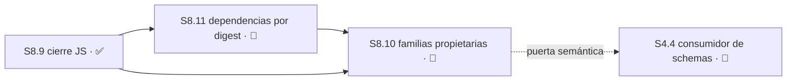
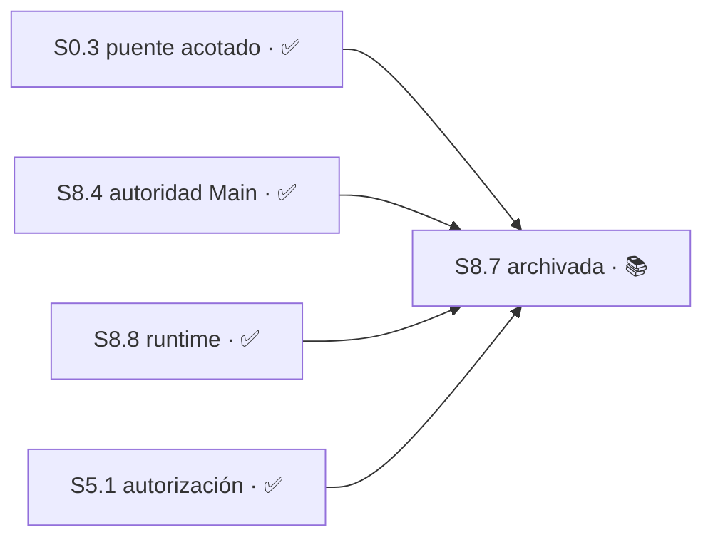

# Plan 8 — Installable V1 release

**Estado:** 🔵 EN CURSO

## Resumen

| Campo | Detalle |
|---|---|
| Lane | `installable-v1`, ahora sólo como afinidad de trabajo. Desde la [unificación del 2026-08-01](../release-chain.md) no es una identidad de producto: hay un roadmap único y P8 dejó de ser "el producto que sale primero y solo". |
| Dependencias | Base entregada `master@44da5ff6bb584485bd7eea1b092cce02130dd591`; `S8.1`–`S8.4`, `S8.8` y `S8.9` están verificadas y publicadas. |
| Bloqueo operativo | `S8.11` está 🔴 BLOQUEADO: el primer intento final del contrato nocturno falló y, por regla sellada, no admite corrección ni reintento. La brecha 5 de registro permanece saneada; `S8.5` y `S8.6` siguen 🟡 DIFERIDO. |
| Alcance aprobado | Release local-first con lifecycle versionado, inmutable, idempotente y reversible; sin activar autonomía. |
| Próxima acción | Reabrir de forma atendida un contrato acotado para reconciliar fixtures de `test/install/lifecycle.test.mjs` y `test/install/launch-worker-cli.test.mjs` con árboles owner-read-only; luego ejecutar una nueva verificación final autorizada. El ejecutable local queda congelado en `388109f`, sin push. `S8.10` permanece 🔴 BLOQUEADO y parqueado en Engram 9176; `S4.4` sigue detrás de su puerta semántica. |
| Flujo | La regla V1 sigue para las Sesiones históricas. `S8.10` y `S8.11` usan explícitamente `design-tasks`: elaboración técnica compacta en Engram y luego el mismo ejecutor general, sin proposal/spec, sin SDD y sin PR. |
| Brecha 6 — cierre de envío verificado (2026-08-20) | **`S8.9` ✅ COMPLETO por la decisión 54 y su enmienda de contrato visible (Engram 9132).** El contrato exacto es `RUNTIME_PAYLOAD_FILES === ['bin/torre', ...staticJsClosure(fourRoots)]`, en orden canónico estable. `bin/torre` es el único asset no-JS explícito; las cuatro raíces son `install/active-pointer.mjs`, `install/lifecycle.mjs`, `core.mjs` y `hosts/launch-worker-cli.mjs`. `hosts/launcher.mjs` queda fuera por inalcanzable, sin borrar su archivo ni su test. **El cableado del producto no instalado sigue sin enumerar y `S8.9` no lo cubre.** Detalle en [implementation-state](../implementation-state.md). |
| Referencias | [tasks de V1](../../changes/v1-release/tasks.md); [change archivado](../../changes/archive/2026-07-31-installable-v1-autonomous-v2-split/), [spec](../../changes/archive/2026-07-31-installable-v1-autonomous-v2-split/specs/installable-control-tower-v1/spec.md). |
| Actualización de cierre | `S8.8` y `S5.1` están ✅ COMPLETO. `S8.7` queda 📚 ARCHIVADO: Telegram/Hermes/Remote Control, callbacks y TTL/replay fueron retirados del producto activo por la autoridad Moshi/Main/OpenCode. No se enumera `enroll/**` para ese puente. |
| Mantenimiento operativo · 2026-08-11 | El registro que expone `torre status` fue saneado: se desregistraron tres agentes sin worktree, se purgó la cola y se corrigieron las ramas de `Main` y `v2`. **Deuda que esto destapa, dentro del dominio de P8:** el producto instalado no tiene forma soportada de corregir su propio registro. El único comando es `torre reset` (`bin/torre:209-218`), que hace `rm -rf "$ROOT"` y pide confirmación interactiva; un desregistro puntual o una purga de cola exigen hoy tocar SQLite a mano. No bloquea ninguna Sesión enumerada y no tiene ID todavía. Detalle en [implementation-state](../implementation-state.md). |

## Sesiones

| ID | Resultado | Estado | Requisito | Dependencias | Evidencia |
|---|---|---|---|---|---|
| S8.1 | Provenance surfaces, tareas históricas 1.1–1.3 | ✅ COMPLETO | — | — | PR #65, merge `b1269a2d2f4b791c6f9e2e29650660160e99f382` |
| S8.2 | Immutable lifecycle foundation | ✅ COMPLETO | Versioned lifecycle | — | issue #75; PR #76; candidato `d7ddd3d6221139ea399df66da1748458c748535d`; merge `a4ca761e0ad1d5f4bd3662ead7a00c30bff77b1b`; `verify-report.md`: PASS WITH WARNINGS, 0 CRITICAL |
| S8.3 | Enrollment explícito de proyectos y validación de layout | ✅ COMPLETO | Explicit project enrollment and safe layout | `registry/`, ya integrado | issue #109; PR #110; merge `9d0842172728780ba089c168c110e2de8538228b`; enrollment 10/10; registry 27/27; diff-check PASS |
| S8.4 | Autoridad única de Main y briefs read-only de Support | ✅ COMPLETO | Sole Main authority and manual worker boundary | `S8.3` | issue #123 cerrado; PR #122 (contrato) y PR #126 (implementación); merge `6fbd97c3b1f84735db61ccbd1fd510482206e4eb`; candidato `9458c78`; enfocada 22/22, acotada 59/59, suite completa 431/431 con Torre desarmada; diff-check PASS sobre exactamente los 4 archivos del Área |
| S8.5 | Detección de hosts e integración opt-in | 🟡 DIFERIDO | Optional host detection and integration | ninguna | Diferida el 2026-07-31: la integración es opt-in y su ausencia es diagnóstico, no fallo de instalación |
| S8.6 | Evidencia de release en máquina limpia | 🟡 DIFERIDO | Versioned lifecycle and release evidence | `S8.3`, `S8.4` | Diferida el 2026-07-31: se cubre con validación manual durante `S8.8` en vez de una Sesión formal |
| S8.7 | Puente Hermes/Telegram | 📚 ARCHIVADO | Supersedido por Moshi/Main/OpenCode | — | Evidencia histórica preservada; no es prerequisito activo |
| S8.9 | Payload derivado y guardia de deriva | ✅ COMPLETO | Versioned lifecycle | ninguna | Candidato rebasado `ebeb07450f9939fba09a69bddff68028657011ff`, tree `4d16d021aee910ea7ef81cab34ff26b1650b2944`, base/parent `e55a9d0214a817a02e6ae1c69455f0dd7d9a1796`; 8/8 criterios; focused 67/0, full 898/0 y harness runtime PASS |
| S8.10 | Familias propietarias y validación exacta del payload de runtime | ✅ COMPLETO | Payload instalable cerrado sobre schemas declarados | `S8.9` ✅, `S8.11` | Candidato preservado en `feat/s8.10-runtime-payload-model@0891cc7`; checkpoint de parqueo Engram 9176, antes del commit de comportamiento y de la verificación final; su puerta semántica mantiene bloqueada `S4.4` |
| S8.11 | Entorno de dependencias compartido por digest de lock | 🔴 BLOQUEADO | Dependencias instaladas, inmutables y reutilizables por versiones compatibles | `S8.9` ✅ | WU1 `812703d` y WU2 `388109f` quedaron locales; generador `unchanged`. El primer focused final terminó 78/11 porque fixtures intentaron escribir/eliminar dentro del árbol owner-read-only; harness y full no se ejecutaron por la regla terminal sellada. |
| S8.8 | Adopción del instalable en el runtime en uso | ✅ COMPLETO | Versioned lifecycle | `S8.2` ✅ | Todos los Módulos verificados. `M8.8.7` en `e118f33`: la copia aislada cae al legado y un puntero presente roto falla cerrado. `M8.8.8` en `d56e8cb`: checkout Git genuino, staging estricto incluso con `.git` sintético y shim opt-in. `bun test test/install` 44/0; `bun test` 465/0 con Torre desarmada; cero accesos a runtime real en los fixtures. |

Las Sesiones se derivan de los cinco requisitos de la [spec de Installable V1](../../changes/archive/2026-07-31-installable-v1-autonomous-v2-split/specs/installable-control-tower-v1/spec.md). `S8.2` construyó el lifecycle versionado; `S8.8` lo pone efectivamente en uso, que es la parte del requisito que quedaba abierta.

**`S8.5` y `S8.6` están diferidas, no descartadas.** `S8.6` sigue siendo el cierre formal del requisito de evidencia de release; mientras esté 🟡 DIFERIDO, P8 puede darse por usable pero no por certificado en máquina limpia.

**`S8.6` es la puerta de la distribución a terceros — decidido el 2026-08-03.** El maintainer evaluó darle un descargable a su socio y resolvió esperar. Motivo, con evidencia:

- 🔴 **`install.sh` no deja una instalación funcional en una máquina limpia.** La línea 79 copia `bin/torre` a `~/.local/bin/`, y `bin/torre:20` resuelve `CORE` a `$HOME/.config/opencode/control-tower/core.mjs`. **`install.sh` nunca copia `core.mjs` a esa ruta** — no aparece en el script salvo en la línea 20, para `--provision-main`, con la variable seteada a mano. En la máquina del maintainer funciona porque ese directorio existe desde julio como residuo; en una máquina nueva no hay residuo que lo salve.
- Es **el mismo modo de falla que `M8.8.2`**: algo que pasa porque la verificación se apoya en una copia local que en otra máquina no existe. `S8.6` es exactamente la Sesión que lo detectaría.
- El maintainer todavía no corre el producto: `M8.8.3` está abierto y su Torre diaria sigue en `681a0e5`. Distribuir lo que uno no usa es entregar sin probar.
- `S8.5` diferida implica que un tercero tendría que cablear la integración del host a mano.

Orden acordado: cerrar `M8.8.6` —✅ hecho el 2026-08-03— y `M8.8.3` —con lo cual el maintainer pasa a correr el producto, que es la mejor prueba disponible— y recién entonces levantar `S8.6` de 🟡 DIFERIDO. El hueco de `core.mjs` en `install.sh` entra en su alcance.

## Alcance por Sesión

### S8.3 — Enrollment explícito y layout seguro

Registra proyectos, aísla identidad y estado de Torre, y valida el clon dueño `<project>/Main/` junto a `Worktrees/` antes de mutar. Acepta layouts existentes sólo cuando el directorio común de Git, remote, branch, propiedad y rutas son seguros. **No** reubica, recicla, resetea, limpia, stashea ni reemplaza contenido; un layout inseguro cierra fail-closed.

Se apoya en `registry/` (`resolveProjectRegistryPath`, `createProjectRegistryStore`, `preflightLegacyImport`), construido en el lane `autonomous-v2` y ya integrado.

| Campo | Valor |
|---|---|
| Estado | ✅ COMPLETO |
| Depende de | `registry/`, integrado en `origin/master` |
| Área | `enroll/**`, `test/enroll/**` |
| Recurso | ninguno — sin DB, sin migraciones, sin token fuera de la entrega |

**Criterios de aceptación** — todos deben pasar para cerrar:

- [x] Con dos repositorios registrados explícitamente, identidad, rutas, cola e historial de cada uno resuelven sólo a su propio proyecto
- [x] Un `Main/Worktrees` sucio, con symlinks, incompatible o con remote equivocado reporta un error preciso y **no** reubica ni repara destructivamente
- [x] Ninguna ruta fuera de `Área` aparece en el diff
- [x] `core.mjs`, `mcp.mjs`, `package.json` y `bun.lock` quedan sin modificar
- [x] `bun test test/enroll` pasa completo, y `bun test` no introduce fallos nuevos respecto de la base

**Evidencia verificada:** PR #110 mergeada el 2026-07-31 en `9d0842172728780ba089c168c110e2de8538228b`; issue #109 cerrado; enrollment 10/10, registry 27/27 y diff-check PASS sobre exactamente `enroll/index.mjs` y `test/enroll/enroll.test.mjs`.

### S8.4 — Autoridad única de Main y frontera de workers

`Main/` es el único orquestador V1 de cada proyecto registrado. Support puede preparar briefs read-only de decomposición, conflicto o capacidad, pero no se registra, no toma locks, no muta repositorios y no entrega. Los workers se preparan a mano: V1 no crea sesiones, worktrees, workers, assignments ni lanzamientos.

La denegación `CT_V2_ONLY` de `bin/torre` ya cubre parte de esta frontera.

| Campo | Valor |
|---|---|
| Estado | ✅ COMPLETO — mergeada en `6fbd97c` (PR #126), verificada el 2026-07-31 |
| Owner | `installable-v1` |
| Depende de | `S8.3` ✅ COMPLETO |
| Área | `support/manifest.mjs`, `support/agent.mjs`, `support/snapshot.mjs`, `test/support/**` |
| Recurso | `db_mode=read-only`; SQLite `{ readonly: true, create: false }` con `PRAGMA query_only=ON`; sin migraciones, locks ni token de entrega |

**Superficie de invocación:** `createSupportBrief(input, ports)` se exporta desde `support/agent.mjs`; `resolveSupportManifest(entry, ports)` desde `support/manifest.mjs` y `captureSupportSnapshot(manifest, ports)` desde `support/snapshot.mjs` son sus únicas dependencias de Support. No se agrega comando a `bin/torre`, proceso residente, registro de agente ni escritura de archivos. `ports` contiene exactamente `loadRegistry()`, `readText(path)`, `inspectGit(path)` y `openDatabase(path, options)`; la implementación rechaza claves adicionales. `openDatabase` se invoca exactamente con `{ readonly: true, create: false }`, ejecuta y verifica `PRAGMA query_only=ON` antes de cualquier consulta fija, no expone SQL del caller y siempre cierra la conexión.

**Input mínimo** — objeto JSON exacto, sin claves adicionales:

```json
{
  "schema": "support-request",
  "schema_version": 1,
  "project_id": "<registered project_id>",
  "report_type": "decomposition | conflict | capacity"
}
```

**Output mínimo** — objeto JSON exacto, sin claves adicionales y ordenado de forma determinista por `sources.path`, `observations.code` y `observations.subject`:

```json
{
  "schema": "support-brief",
  "schema_version": 1,
  "project_id": "<registered project_id>",
  "registry_entry_revision": 1,
  "report_type": "decomposition | conflict | capacity",
  "sources": [{ "path": "<absolute canonical path>", "sha256": "<lowercase hex digest>" }],
  "observations": [{ "code": "<stable code>", "subject": "<plan or Sesión ID>", "detail": "<read-only finding>" }]
}
```

`project_id` debe resolver una única entrada del registro. `resolveSupportManifest` parte exclusivamente de `canonical_root/roadmap_path`: ambos se normalizan y resuelven sin seguir symlinks; el resultado debe permanecer bajo `canonical_root`, ser un archivo regular único y llamarse `master-index.md`, y su directorio padre debe existir, ser directorio y no ser symlink. Del cuerpo del roadmap se toman únicamente los links Markdown de la columna `Ref` de filas `P<entero>` cuyo texto sea exactamente `STATUS`; cada target se resuelve relativo al directorio del roadmap, debe permanecer bajo `canonical_root`, coincidir con `plan-<mismo entero>/STATUS.md`, existir una sola vez y ser archivo regular sin ningún componente symlink. Los STATUS válidos se ordenan por ID numérico de Plan. Cierra fail-closed ante `roadmap_path` ausente, absoluto, vacío, no regular o ambiguo; padre ausente/no directorio; symlink; escape; roadmap ilegible o tabla inválida; ID/target discordante; link STATUS ausente, duplicado, ambiguo, no regular o fuera del proyecto.

Las fuentes quedan limitadas al `manifest_path`, al roadmap validado, a esos STATUS resueltos, a metadatos Git obtenidos por `inspectGit` y a `<git_common_dir>/control-tower/tower.db`. La DB ausente falla sin crearla; la DB presente se abre sólo con `{ readonly: true, create: false }`, activa y verifica `PRAGMA query_only=ON`, ejecuta consultas fijas dentro de una transacción diferida y cierra. Cualquier identidad ambigua, esquema desconocido, clave adicional, fallo de `query_only` o intento de operación no read-only falla cerrado. Un pedido de crear sesiones, worktrees, workers, assignments, lanzamientos, locks, commits, entregas o mutaciones devuelve `CT_V2_ONLY` antes de abrir DB o invocar otro puerto.

#### M8.4.1 — Contrato read-only de Support

- [x] T8.4.1.1 RED: agregar `test/support/support.test.mjs` para esquema exacto, traversal roadmap→STATUS, SQLite read-only/query-only, resolución aislada, orden determinista y rechazo fail-closed
- [x] T8.4.1.2 GREEN: agregar únicamente `support/manifest.mjs`, `support/snapshot.mjs` y `support/agent.mjs` con los tres exports definidos y sin superficie de escritura
- [x] T8.4.1.3 REFACTOR: mantener consultas y exports fijos, normalizar errores estables y volver a ejecutar la prueba enfocada

**Pruebas exactas:**

- `bun test test/support/support.test.mjs`
- `bun test test/registry test/enroll test/support`
- `bun test`
- `git diff --name-only 88b1c5198c08cefbe886df62c3cb4f97214d1506...9458c78ee8fa00e4edfe0869beb6743308ad7f03` lista únicamente `support/manifest.mjs`, `support/agent.mjs`, `support/snapshot.mjs` y `test/support/support.test.mjs`

El fixture enfocado debe capturar antes y después existencia, bytes, modo, inode, tamaño, `mtimeNs` y `ctimeNs` de `projects.yaml`, `.git/control-tower/tower.db`, sus archivos `-wal`/`-shm` y cada fuente; además debe comparar `git status --porcelain=v1`, la lista de worktrees y el estado de locks. Todos los valores deben permanecer idénticos tanto en éxito como en cada rechazo, y una DB ausente no puede crear DB, WAL ni SHM.

**Criterios de aceptación** — todos deben pasar para cerrar:

- [x] Los tres exports y los tres archivos de Support coinciden exactamente con la superficie definida; `createSupportBrief` acepta sólo el input y los ports exactos, resuelve un proyecto registrado y devuelve exactamente el output versionado y determinista definido arriba
- [x] Los tres `report_type` producen observaciones trazables únicamente a fuentes permitidas, sin otorgar autoridad de orquestación a Support
- [x] El traversal parte de `roadmap_path`, resuelve sólo links `Ref` exactos y falla cerrado para todas las condiciones de ruta, symlink, escape, ausencia, tipo, duplicidad y ambigüedad enumeradas
- [x] La DB se abre read-only sin creación, `PRAGMA query_only` queda verificado en `ON`, sólo corren consultas fijas y ausencia/error no crea ni modifica DB/WAL/SHM
- [x] Identidad, ruta o esquema inválido y toda solicitud V2 fallan cerrado con código estable antes de cualquier capacidad no necesaria
- [x] Support no registra agentes, toma locks, migra DB, crea sesiones/worktrees/workers/assignments/launches, ejecuta entrega Git ni escribe archivos
- [x] Los testigos de bytes, existencia y metadatos de fuentes/DB/WAL/SHM, Git, worktrees y locks son idénticos antes y después en éxito y rechazo
- [x] Las tres pruebas exactas pasan y ninguna ruta fuera de `Área` aparece en el diff de implementación

**Evidencia de cierre:** issue #123 cerrado; PR #126 mergeada; candidato `9458c78ee8fa00e4edfe0869beb6743308ad7f03`; merge `6fbd97c3b1f84735db61ccbd1fd510482206e4eb`; tree compartido `0a2b61d3939fd7c2f4ffa9fcf0ab246411f317a1`; baseline y binding contractual inmutable `f2d1132f51236b66269b55b356f3c7f11a759b14`. El diff exacto contiene cuatro archivos modo `100644` — `support/agent.mjs`, `support/manifest.mjs`, `support/snapshot.mjs` y `test/support/support.test.mjs` — con 372 inserciones y 0 eliminaciones. Pasaron la prueba enfocada 22/22, la prueba acotada 59/59 y la suite completa 431/431; los testigos Strict TDD y de no mutación pasaron. La corrección del prerrequisito de migración se integró antes mediante PR #125 en `88b1c5198c08cefbe886df62c3cb4f97214d1506`; por eso la prueba del alcance de implementación usa ese parent del candidato, no el baseline contractual.

**Re-verificación independiente (2026-07-31):** los siete criterios están cubiertos por las 22 aserciones de `test/support/support.test.mjs`, todas en verde. Las tres pruebas exactas del contrato se volvieron a correr desde un worktree limpio: 22/22, 59/59 y `bun test` **429 pass · 2 fail**. Los 2 fallos son `P0 frozen snapshot restore` y aparecen porque ese worktree tenía la Torre armada — es la diferencia con el `431/431` de arriba, que se midió con la Torre desarmada. No es una regresión. `git show --name-only 9458c78` confirma el diff-check.

**Rollback y frontera de no mutación:** revertir juntos los cuatro archivos entregados — `support/manifest.mjs`, `support/agent.mjs`, `support/snapshot.mjs` y `test/support/support.test.mjs` — preservando la frontera que impide crear, migrar o modificar DB/WAL/SHM y que prohíbe mutar registro, estado de Tower, locks, worktrees o repositorios inspeccionados. El rollback no autoriza cambios en `registry/**`, `enroll/**`, `install/**`, `bin/**`, otros archivos bajo `support/**`, `core.mjs`, `mcp.mjs`, `package.json`, `bun.lock` ni configuración.

### S8.8 — Adopción del instalable en el runtime en uso

**Esta es la Sesión de mayor palanca de todo P8.** `S8.2` construyó y probó el lifecycle versionado (`install/lifecycle.mjs`, `install/active-pointer.mjs`, `install/version-store.mjs`), pero nadie instaló nunca a través de él. Lo que corre a diario es un checkout independiente, sin remote, de 398 líneas en `~/.config/opencode/control-tower/core.mjs`, congelado el 2026-07-21 en `681a0e5`.

La consecuencia es que **nada de lo construido después del 2026-07-21 está en uso**. Cerrar esta Sesión es lo que convierte el trabajo hecho en producto usable.

| Campo | Valor |
|---|---|
| Estado | ✅ COMPLETO |
| Owner | `installable-v1` |
| Depende de | `S8.2` ✅ COMPLETO |
| Área | `install/**`, `bin/torre`, `test/install/**` |
| Recurso | data-root XDG; **sin** migraciones de DB y sin token de entrega |

**Decisiones:**

- `derivable` — qué versión publicar en la adopción de `M8.8.2`. **Criterio:** el `HEAD` de `master` que contenga `3d2ef57`, porque es el commit que cierra el contrato de payload. Falsificable: si el payload publicado no valida contra `RUNTIME_PAYLOAD_FILES`, la elección estaba mal. **Autoridad:** `install/runtime-payload.mjs`.
- `derivable` — si `M8.8.3` puede avanzar. **Criterio:** la versión activa en `~/.local/share/control-tower/versions/<sha>/` contiene los cinco miembros, `core.mjs` incluido. Falsificable por `ls`. **Resuelta ✅ el 2026-08-03**: `34f56a6` los tiene los cinco y `diagnose` devuelve `missing:[]`. El criterio se evaluó dos veces con resultados opuestos —**no** sobre `b72e450`, **sí** sobre `34f56a6`— que es exactamente para lo que un criterio falsificable sirve. **Autoridad:** `install/runtime-payload.mjs`.
- `escala` — ejecutar el `torre install` real. **Clase:** operaciones irreversibles. Muta `~/.local/share/control-tower/`, fuera del repositorio. **Contamina:** `M8.8.3` (no puede cortar hacia un runtime que no existe todavía), `S8.7` (declara `S8.8` como dependencia). **Resuelta y ejecutada el 2026-08-03** por el maintainer: activo `34f56a6`, `previous` `b72e450`, rollback disponible.
- `escala` — repuntar `~/.local/bin/torre` al runtime instalado (`M8.8.3`). **Clase:** operaciones irreversibles. Un fallo deja la Torre inoperable, y el entrypoint del PATH era un script bash del 2026-07-21 sin `install` ni `diagnose`, así que la recuperación no se hace con la propia herramienta. **Contamina:** `S8.7`. **Resuelta y ejecutada el 2026-08-03**: `M8.8.6` construyó el mecanismo y `M8.8.3` realizó el corte atendido con respaldo restaurable.

> **`M8.8.3` no es un comando atendido, es un Módulo de código.** Verificado el 2026-08-03: `bin/torre` **nunca lee `active.json`** —no hay resolución del runtime instalado en el script—, `CORE` sigue defaulteando a `$HOME/.config/opencode/control-tower/core.mjs` **incluso en la versión instalada** (`bin/torre:20`), y no existe código que instale el shim del PATH en `install/`, `scripts/` ni `bin/torre`.
>
> Consecuencia: copiar el `bin/torre` instalado a `~/.local/bin/` **no corta nada** —seguiría cargando el `core.mjs` legado—, y un symlink rompe la resolución de `LIFECYCLE`, que usa `dirname "${BASH_SOURCE[0]}"` y daría `~/.local/install/lifecycle.mjs`.
>
> El Módulo tiene que **construir el mecanismo** antes de ejecutar el corte: que `CORE` y `LIFECYCLE` se resuelvan desde el puntero activo en vez de rutas fijas, y que exista una ruta de recuperación que no dependa del entrypoint que se está reemplazando. Que `M8.8.2` esté cerrado destrabó el prerrequisito del payload, no el corte.

Absorbe la validación práctica que `S8.6` haría de forma formal: la instalación real en la máquina del maintainer es la evidencia de smoke y rollback.

**Modo de ejecución — la Sesión es una, la ejecución se parte.** No se crea una Sesión nueva: eso inventaría un nivel que la convención no tiene. Lo que cambia es quién puede correr cada Módulo.

| Módulo | Modo | Área | Motivo |
|---|---|---|---|
| `M8.8.1` Cobertura legado → XDG | 🔒 SELLABLE, autónomo | `install/**`, `test/install/**` | PR #132 mergeada; ejecución autónoma verificada sin instalación real |
| `M8.8.2` Diagnóstico y adopción real | 👤 ATENDIDO | `bin/torre`, data-root XDG, `~/.config/opencode/control-tower/` | `torre install` real sobre la máquina del maintainer |
| `M8.8.3` Corte al runtime legado | 👤 ATENDIDO — ✅ COMPLETO el 2026-08-03 | `~/.local/bin/torre`, PATH del maintainer | Repunta el entrypoint; ejecutado con respaldo restaurable sin la herramienta |
| `M8.8.4` Preflight de adopción y payload verificable | 🔒 SELLABLE, autónomo | `install/**`, `scripts/publish-runtime.mjs`, `test/install/**` | Valida el payload cerrado y deja segura la continuación atendida de `M8.8.2` |
| `M8.8.5` `diagnose` detecta payload incompleto | 🔒 SELLABLE, autónomo | `install/lifecycle.mjs`, `test/install/**` | El instrumento que verifica la adopción no detectaba el modo de falla que bloquea `M8.8.3` |
| `M8.8.6` Resolución desde el puntero activo | 🔒 SELLABLE, autónomo — ✅ COMPLETO en `a87c9e9` | `bin/torre`, `install/active-pointer.mjs`, `test/install/**` | Construye el mecanismo que `M8.8.3` necesita, sin tocar el PATH ni el runtime real |
| `M8.8.7` El entrypoint copiado no puede resolver | 🔒 SELLABLE, autónomo — ✅ COMPLETO en `e118f33` | `bin/torre`, `test/install/**` | La copia aislada vuelve al core legado cuando falta el mecanismo; un puntero presente roto sigue fallando cerrado |
| `M8.8.8` Instalación desde un checkout y shim del PATH | 🔒 SELLABLE, autónomo — ✅ COMPLETO en `d56e8cb` | `install/lifecycle.mjs`, `install/runtime-payload.mjs`, `test/install/**` | Checkout Git genuino, staging estricto y shim opt-in con fixtures aislados |

**Riesgo operativo de `M8.8.3` que no es técnico y conviene tener escrito.** El `torre` del PATH (`/home/emili/.local/bin/torre:20`) carga hoy `$HOME/.config/opencode/control-tower/core.mjs`, un checkout en `681a0e5` del 2026-07-21: **398 líneas y 15.7 KB**, contra las **4646 líneas y 384 KB** del repo. Son **192 commits** de diferencia, y `681a0e5` sí pertenece a esta historia — no es un fork. Nada de lo construido desde julio (`contracts/`, `registry/`, `main-store/`, `install/`, `support/`, la frontera `CT_V2_ONLY`, los schemas) está en lo que el maintainer usa a diario. **El día que `M8.8.3` cierre, la Torre de uso diario salta esos 192 commits de golpe.** No es un defecto del corte, pero sí la primera vez que se va a usar en serio lo construido, así que el `previous` de `active.json` tiene que estar a mano y verificado antes de ejecutarlo.

**`M8.8.6` es posterior en número y previo en ejecución.** El ID es un nombre posicional, no un orden — la misma regla que el `master-index` aplica a los Planes. Se numera al final porque se enumeró al final; `M8.8.3` no se renumera porque el bloque `Decisiones` de esta Sesión ya lo referencia y reescribir un ID vigente rompe punteros.

El motivo es duro: **un contrato sellado no autoriza efectos fuera del repositorio**, y nadie debería despertarse con `torre` roto porque un agente repuntó el runtime sin supervisión. El contrato de `M8.8.1` vive en [`seal-M8.8.1.md`](../../changes/v1-release/seal-M8.8.1.md).

#### M8.8.1 — Cobertura del caso legado → XDG

| Campo | Valor |
|---|---|
| Estado | ✅ COMPLETO |
| Modo | 🔒 SELLABLE, autónomo |
| Depende de | `S8.2` ✅ COMPLETO |
| Área | `install/**`, `test/install/**` |
| Recurso | data-root temporal; sin migraciones de DB y sin token de entrega |

**Tareas** — todas completadas:

- [x] `T8.8.1.1` RED: cobertura de instalación sobre runtime legado sin data-root XDG, preservando configuración e historial
- [x] `T8.8.1.2` RED: idempotencia de instalación y `rollback` sin pérdida de configuración ni historial
- [x] `T8.8.1.3` GREEN: ajuste de `install/**` sólo donde fue necesario
- [x] `T8.8.1.4` REFACTOR: errores estables y nueva ejecución de la prueba enfocada

**Criterios de aceptación** — todos verificados:

- [x] Los casos de legado → XDG, idempotencia y rollback existen y pasan
- [x] Lifecycle enfocado: `13/13`; suite de instalación: `18/18`
- [x] Suite completa: `433 pass / 0 fail`
- [x] Los testigos de filesystem quedan idénticos antes y después
- [x] El diff queda restringido estrictamente a `install/**` y `test/install/**`

**Evidencia de cierre:** issue #131 cerrado por PR #132; implementación `b7715ed34357b6e5ea25d920d558a9137efe2558`; merge en `master` como `d280214c8de78f90e88982d90642427b55a72f2b`. La reconciliación autorizada del baseline reemplaza `429 pass / 2 fail` por `433 pass / 0 fail`: los dos tests históricos P0 ahora pasan y M8.8.1 agrega dos tests.

`S8.8` cierra sólo cuando la secuencia atendida de `M8.8.2` y el corte de `M8.8.3` estén completos; `M8.8.4` ✅ COMPLETO es un prerrequisito y no otorga crédito parcial a la Sesión.

#### M8.8.3 — Corte al runtime legado

Repunta `~/.local/bin/torre` desde el script bash del 2026-07-21 hacia el runtime instalado. Es el Módulo que hace que el maintainer **corra el producto** en vez de un checkout de julio.

| Campo | Valor |
|---|---|
| Estado | ✅ COMPLETO — ejecutado el 2026-08-03 |
| Modo | 👤 ATENDIDO; muta `~/.local/bin/`, fuera del repositorio |
| Depende de | `M8.8.2` ✅ COMPLETO y `M8.8.6` ✅ COMPLETO |
| Área | `~/.local/bin/torre`, PATH del maintainer |
| Recurso | ninguno en el repositorio; el runtime real del maintainer |

**Decisiones:**

- `escala` — repuntar el entrypoint del PATH. **Clase:** operaciones irreversibles. **Resuelta y ejecutada el 2026-08-03** por el maintainer, con respaldo previo.
- `derivable` — symlink o copia. **Criterio:** symlink. La copia queda sin `install/` al lado y `bin/torre` aborta; verificado ejecutándolo, no leyéndolo. Falsificable por una copia aislada que devuelva `exit 1`. **Autoridad:** `bin/torre` tras `a87c9e9`. **Consecuencia:** la copia rota es un defecto en sí mismo y se enumera como `M8.8.7`.
- `derivable` — cuál es la ruta de rollback. **Criterio:** un respaldo del entrypoint anterior que se restaure con `cp`, sin `torre` ni `bun`. Un rollback que dependa de la herramienta que se está reemplazando no es un rollback. **Autoridad:** la decisión `escala` de esta Sesión.

**Tareas** — todas completadas:

- [x] `T8.8.3.1` Publicar e instalar una versión que contenga `a87c9e9`, con staging del payload de seis miembros
- [x] `T8.8.3.2` Verificar `diagnose` **ejecutando la copia instalada**, no la del repo
- [x] `T8.8.3.3` Respaldar el entrypoint del PATH en una ruta restaurable sin la herramienta
- [x] `T8.8.3.4` Repuntar `~/.local/bin/torre` por symlink al `bin/torre` de la versión activa
- [x] `T8.8.3.5` Verificar que `CORE` resuelve dentro de la versión instalada y **no** al legado

**Criterios de aceptación** — todos verificados:

- [x] `~/.local/bin/torre` es un symlink a `versions/<sha>/bin/torre`
- [x] El binario del PATH contiene la resolución por puntero activo
- [x] `resolveActiveRuntime` devuelve `core` y `lifecycle` dentro de `versions/<sha>/`
- [x] Existe respaldo del entrypoint anterior, restaurable con `cp`
- [x] `active.json` conserva un `previous` con su versión presente en disco
- [x] `torre status` corre contra la DB real sin migración previa

**Evidencia de cierre:** activo `4f9400191afa32e26daae3c19ed722d8fd1700f5`, `previous` `012a251`. `diagnose` desde la copia instalada → `{"healthy":true,"missing":[]}`. `~/.local/bin/torre` → symlink a `versions/4f94001/bin/torre`; `readlink -f` lo confirma. Respaldo en `~/.local/bin/torre.legacy-20260803` (6.9 KB, 2026-07-21), restaurable con un `cp`. Cinco versiones en disco para rollback.

**El salto quedó medido:** el core que el maintainer usaba tenía **398 líneas / 15.7 KB**; el que ejecuta ahora tiene **4.646 líneas / 384 KB**. Son los 192 commits que esta Sesión venía anunciando. `contracts/`, `registry/`, `main-store/`, `install/`, `support/` y la frontera `CT_V2_ONLY` pasan de existir sólo en el repositorio a ejecutarse cuando se escribe `torre`.

**El riesgo de esquema se evaluó y se descartó con evidencia.** La DB diaria es la de julio —tablas `agent`, `lock`, `message`, **sin `ct_schema_migration`**— y `inspectSchema` tira `CT_SCHEMA_INVALID` cuando esa tabla falta (`core.mjs:866`). Se corrió el core nuevo contra una **copia** de la DB real: `torre status` funciona y `torre off` desarma limpio con `exit 0`. Las validaciones duras viven detrás de `CT_V2_ONLY`, apagado por defecto. **No hubo ni hace falta migración.**

**Lo que este Módulo NO hace:** automatizar nada. El staging del payload y el symlink se hicieron a mano, con `mktemp` y `ln -sfn`. `torre install` sigue sin aceptar un checkout y sin instalar el shim del PATH. Eso es `M8.8.8`.

#### M8.8.7 — El entrypoint copiado no puede resolver

`a87c9e9` introdujo una regresión: `bin/torre` resuelve `$ENTRYPOINT_DIR/../install/active-pointer.mjs` **incondicionalmente**, antes de cualquier comando. Cuando el entrypoint es una **copia** en un directorio sin `install/` al lado —exactamente lo que produce `install.sh:79`— el módulo no existe, `bun` falla y `set -euo pipefail` aborta el script.

Verificado ejecutándolo, no leyéndolo: una copia aislada devuelve `exit 1` en todo comando, con `Cannot find module '.../bin/../install/active-pointer.mjs'`. **Antes de `a87c9e9` esa copia funcionaba** — cargaba el core legado, que era el comportamiento esperado. Es una regresión de distribución introducida por este lane.

Los tests de `M8.8.6` no la detectaron porque todos ejercitan el entrypoint **dentro del checkout**, donde `install/` siempre está al lado. Es el mismo modo de falla que `M8.8.2` y que `S8.6`: verificar apoyándose en una vecindad que en el destino no existe.

| Campo | Valor |
|---|---|
| Estado | ✅ COMPLETO — entregado en `e118f33` |
| Modo | 🔒 SELLABLE, autónomo; cero efectos fuera del repositorio |
| Depende de | `M8.8.6` ✅ COMPLETO |
| Área | `bin/torre`, `test/install/**` |
| Prohibido | `~/.local/bin/**`, `~/.local/share/control-tower/**`, `~/.config/opencode/control-tower/**`, `core.mjs`, `install/**` |
| Recurso | ninguno; sin DB, sin migraciones, sin token de entrega |

**Decisiones:**

- `derivable` — qué hace el entrypoint cuando no alcanza `active-pointer.mjs`. **Criterio:** cae al default legado, que es exactamente lo que ya manda la decisión 2 de `M8.8.6` para el caso "sin puntero activo". No poder leer el mecanismo del puntero y no tener puntero son el mismo resultado observable: no hay versión activa que resolver. Falsificable por una copia aislada que deba comportarse como antes de `a87c9e9`. **Autoridad:** `bin/torre:39-40` y la decisión 2 de `M8.8.6`.
- `derivable` — por qué esto **no** contradice el fallo cerrado de `M8.8.6`. **Criterio:** son estados distintos. Puntero legible y versión incompleta → falla cerrado nombrando el faltante. Mecanismo de resolución inalcanzable → legado. Falsificable: si un puntero válido con versión incompleta pasara a caer al legado, el fix estaría mal. **Autoridad:** la decisión 3 de `M8.8.6`.
- `derivable` — cómo se detecta la inalcanzabilidad. **Criterio:** presencia del archivo antes de invocar `bun`, no captura del error de `bun`. Capturar el fallo mezcla "no está" con "está y explotó", y el segundo caso debe propagarse. Falsificable por un `active-pointer.mjs` presente pero con error de sintaxis: debe fallar, no caer al legado. **Autoridad:** `bin/torre:24-38`.

**Ninguna decisión escala.** No toca nada fuera del repositorio.

**Tareas** — todas completadas:

- [x] `T8.8.7.1` RED: copiar `bin/torre` a un directorio **sin** `install/` hermano y verificar que resuelve al default legado con `exit 0`, en vez de abortar
- [x] `T8.8.7.2` RED: con `active-pointer.mjs` presente pero inválido, verificar que **falla** y no cae al legado
- [x] `T8.8.7.3` GREEN: condicionar la resolución por puntero a que el módulo exista, conservando intactos los cuatro casos de `M8.8.6`
- [x] `T8.8.7.4` VERIFY: `bun test test/install` enfocada y `bun test` completa **con la Torre desarmada**

**Criterios de aceptación** — binarios, todos deben pasar para cerrar:

- [x] Una copia aislada de `bin/torre` responde `exit 0` y resuelve al `CORE` legado
- [x] Un `active-pointer.mjs` presente pero roto propaga el error; **no** hay degradación silenciosa
- [x] Los cuatro casos de `M8.8.6` siguen pasando sin modificación: sin puntero, con puntero, versión incompleta, symlink
- [x] `bun test test/install` pasa completo
- [x] `bun test` da `465 pass / 0 fail` con la Torre desarmada
- [x] El diff no toca ninguna ruta fuera del `Área`

**Evidencia de cierre:** `e118f33` y verificación integral posterior sobre `d56e8cb`: `bun test test/install` 44/0 y `bun test` 465/0, con Torre desarmada. La prueba de copia aislada no requiere `install/` hermano; el puntero presente inválido propaga su error. No se tocaron rutas de runtime real.

#### M8.8.8 — Instalación desde un checkout y shim del PATH

`M8.8.3` se ejecutó a mano porque no existe código que haga ninguna de las dos cosas que necesita. Verificado el 2026-08-03:

- `runCli` llama a `readRuntimePayload(source)` en modo **strict**. ~~`scanClosure` rechaza todo directorio que no sea `bin` o `install`~~ **CORREGIDO el 2026-08-20:** `scanClosure` (`install/runtime-payload.mjs:57`) admite **cinco** directorios — `bin`, `hosts`, `install`, `jornada`, `main-store` — y el filtro real no es la lista de directorios sino la **igualdad exacta de conjunto** contra `RUNTIME_PAYLOAD_FILES`: si falta un archivo falla `CT_RUNTIME_PAYLOAD_INCOMPLETE` y si sobra uno falla `CT_RUNTIME_PAYLOAD_INVALID`. Un checkout del repositorio **nunca** puede ser `source`: falla en `console/`, y detrás vienen `contracts/`, `test/` y `openspec/`. El maintainer tuvo que armar un staging con `mktemp` y seis `cp`.
- `scripts/publish-runtime.mjs` sí lee el repositorio en modo no-strict, pero sólo llama a `storeVersion`: **almacena y no repunta**. No hay un camino de un solo comando entre un checkout y una versión activa.
- No existe código que instale el shim del PATH. `install.sh:79` copia `bin/torre`, y la copia está rota — ver `M8.8.7`. `install/lifecycle.mjs` no toca `~/.local/bin/` en ninguna acción.

| Campo | Valor |
|---|---|
| Estado | ✅ COMPLETO — entregado en `d56e8cb` |
| Modo | 🔒 SELLABLE, autónomo; cero efectos fuera del repositorio |
| Depende de | `M8.8.7` ✅ COMPLETO |
| Área | `install/lifecycle.mjs`, `install/runtime-payload.mjs`, `test/install/**` |
| Prohibido | `~/.local/bin/**`, `~/.local/share/control-tower/**`, `~/.config/opencode/control-tower/**`, `core.mjs`, `bin/torre` |
| Recurso | ninguno; sin DB, sin migraciones, sin token de entrega |

**Decisiones:**

- `derivable` — cómo entra un checkout como fuente sin debilitar `strict`. **Criterio:** se deriva el payload por la enumeración de `RUNTIME_PAYLOAD_FILES` y se conserva `strict` para el caso staging; el modo laxo no se vuelve el default. Falsificable: si un directorio de staging con un miembro extra dejara de ser rechazado, la garantía se perdió. **Autoridad:** `install/runtime-payload.mjs` y el uso no-strict ya existente en `scripts/publish-runtime.mjs`.
- `derivable` — symlink o copia para el shim. **Criterio:** symlink, por la decisión ya resuelta de `M8.8.3`. Falsificable por un test que instale el shim y verifique que `readlink -f` cae dentro de la versión activa. **Autoridad:** la decisión `derivable` de `M8.8.3`.
- `derivable` — si el shim se instala siempre o bajo opción. **Criterio:** bajo opción explícita y apagada por defecto. Escribir en el PATH del usuario es un efecto fuera del repositorio, y ningún Módulo sellado puede hacerlo sin pedirlo. Falsificable: si la suite tocara `~/.local/bin/` en una corrida normal, el default estaba mal. **Autoridad:** la decisión `escala` de `M8.8.3`.
- `derivable` — qué pasa si el destino del shim ya existe y no es un symlink nuestro. **Criterio:** no se sobrescribe sin respaldo; se conserva el archivo previo en una ruta restaurable con `cp`. Falsificable por un fixture con un archivo regular en el destino. **Autoridad:** `T8.8.3.3`, que ya lo hizo a mano.

**Ninguna decisión escala** mientras el shim quede detrás de una opción apagada por defecto y las pruebas usen un data-root de fixture. Ésa es la condición que mantiene el Módulo sellable.

**Tareas** — todas completadas:

- [x] `T8.8.8.1` RED: `install` con un checkout como `source` almacena exactamente los seis miembros y nada más
- [x] `T8.8.8.2` RED: un directorio de staging con un miembro extra sigue siendo rechazado — `strict` no se debilitó, incluso con `.git` sintético
- [x] `T8.8.8.3` RED: con la opción de shim activada, el destino queda como symlink dentro de la versión activa
- [x] `T8.8.8.4` RED: con un archivo regular preexistente en el destino, se respalda antes de reemplazar y el respaldo se restaura con una copia de bytes
- [x] `T8.8.8.5` RED: sin la opción, no se escribe una sola ruta bajo el directorio de binarios del fixture
- [x] `T8.8.8.6` GREEN: implementar el origen-checkout y el shim opcional en `install/lifecycle.mjs`
- [x] `T8.8.8.7` REFACTOR: dejar `scripts/publish-runtime.mjs` y el nuevo camino compartiendo una sola derivación del payload, sin duplicar la enumeración
- [x] `T8.8.8.8` VERIFY: `bun test test/install` enfocada y `bun test` completa **con la Torre desarmada**, con `HOME` y XDG temporales y sin accesos a rutas reales

**Criterios de aceptación** — binarios, todos deben pasar para cerrar:

- [x] `install` acepta un checkout Git genuino como `source` y almacena los seis miembros exactos
- [x] Un staging con un miembro extra, incluso con `.git` sintético, sigue siendo rechazado con `CT_RUNTIME_PAYLOAD_INVALID`
- [x] Con la opción activada, el shim queda como symlink resuelto dentro de la versión activa
- [x] Un destino preexistente se respalda antes de reemplazarse, y el respaldo se restaura sin la herramienta
- [x] Sin la opción, cero escrituras bajo el directorio de binarios del fixture
- [x] La enumeración del payload vive en un solo lugar
- [x] `bun test test/install` pasa completo y `bun test` da `465 pass / 0 fail` con la Torre desarmada
- [x] Los fixtures usan `HOME` y XDG temporales; cero accesos a `~/.local/**`, `~/.config/**` y el data-root real
- [x] El diff no toca ninguna ruta fuera del `Área`

**Evidencia de cierre:** `d56e8cb` instala desde un checkout verificado por Git sin relajar `strict` para staging, y crea el shim sólo mediante `--shim`, con respaldo restaurable. La corrección integral aisló todos los subprocesos de prueba en `HOME` y XDG temporales. `bun test test/install` 44/0; `bun test` 465/0; Torre desarmada y ningún runtime real tocado.

#### M8.8.4 — Preflight de adopción y payload verificable

Corrige el cierre del payload publicado antes de reanudar la adopción atendida. El payload canónico queda limitado a cinco archivos, rechaza miembros faltantes, extraños o symlinks, y la validación ocurre antes de crear raíces temporales. El lifecycle conserva limpieza atómica de versiones y puntero fallidos y el rollback de primera adopción restaura el fixture legado completo.

| Campo | Valor |
|---|---|
| Estado | ✅ COMPLETO |
| Modo | 🔒 SELLABLE, autónomo; no autoriza adopción real |
| Depende de | `M8.8.1` ✅ COMPLETO |
| Área | `install/**`, `scripts/publish-runtime.mjs`, `test/install/**` |
| Recurso | data-root descartable; sin runtime real, DB ni token de entrega |

**Tareas** — todas completadas:

- [x] `T8.8.4.1` RED: cubrir el cierre exacto del payload y rechazar miembros faltantes, extraños, traversal y symlinks
- [x] `T8.8.4.2` GREEN: validar el payload canónico desde publicación e instalación antes de cualquier mutación
- [x] `T8.8.4.3` REFACTOR: conservar digest inmutable, limpieza atómica y rollback completo de la primera adopción
- [x] `T8.8.4.4` VERIFY: ejecutar pruebas enfocadas y suite completa en checkout aislado con fixture descartable

**Criterios de aceptación** — todos verificados:

- [x] Payload canónico: `5 pass / 0 fail`
- [x] Instalación y lifecycle enfocados: `27 pass / 0 fail`
- [x] Suite aislada completa: `442 pass / 0 fail`, `2688 expect()` calls en 24 archivos
- [x] La instalación congelada preserva el lock y no produce efectos sobre runtime o DB reales; el fixture descartable se destruye al finalizar
- [x] La implementación queda referenciada por `3d2ef57` y acotada a `install/**`, `scripts/publish-runtime.mjs` y `test/install/**`

**Evidencia de cierre:** implementación `3d2ef57`; payload 5/0, instalación 27/0 y suite aislada completa 442/0. `bun install --frozen-lockfile` pasó, el lock permaneció intacto, no se accedió ni mutó el runtime o la DB reales y todos los recursos del checkout/fixture descartable fueron eliminados. `M8.8.4` deja habilitada la continuación atendida de `M8.8.2`, pero no cambia el estado de `M8.8.2` ni adelanta `M8.8.3`.

#### M8.8.5 — `diagnose` detecta payload incompleto

`M8.8.4` cerró el contrato del payload en la **publicación**. Este Módulo cierra el hueco correspondiente en la **verificación**: `diagnose` era el instrumento con el que se iba a comprobar que la adopción de `M8.8.2` había salido bien, y no detectaba el único modo de falla que hoy bloquea `M8.8.3`.

El chequeo era `existsSync(<version>/.manifest)` — un archivo presente, nada más. El `.manifest` es un digest pelado, no enumera miembros. Por eso `torre diagnose` devolvía `healthy:true` sobre `b72e450`, a la que le falta `core.mjs`. Verificar la adopción con un instrumento ciego al modo de falla no es verificar.

| Campo | Valor |
|---|---|
| Estado | ✅ COMPLETO |
| Modo | 🔒 SELLABLE, autónomo; sólo lectura sobre el runtime real |
| Depende de | `M8.8.4` ✅ COMPLETO |
| Área | `install/lifecycle.mjs`, `test/install/**` |
| Recurso | ninguno; sin migraciones de DB y sin token de entrega |

**Decisiones:**

- `derivable` — dónde vive la validación. **Criterio:** `lifecycle()` es el motor genérico y acepta `files` arbitrarios; el contrato del runtime lo conoce `runCli`. Falsificable: si los tests genéricos de lifecycle tuvieran que declarar los cinco miembros, la capa elegida estaba mal. **Autoridad:** el layering ya existente en `install/lifecycle.mjs:202`.
- `derivable` — comportamiento sin `expectedMembers`. **Criterio:** se preserva la semántica anterior, así que ningún llamador genérico cambia. Falsificable por el test dedicado.

**Tareas** — todas completadas:

- [x] `T8.8.5.1` RED: cubrir que una versión instalada a la que le falta un miembro esperado reporte `healthy:false` y nombre el faltante, y que sin `expectedMembers` se preserve la salud por manifest
- [x] `T8.8.5.2` GREEN: aceptar `expectedMembers` en `diagnose` y pasar `RUNTIME_PAYLOAD_FILES` desde `runCli`
- [x] `T8.8.5.3` VERIFY: suite enfocada y suite completa, más el comando real contra el data-root del maintainer

**Criterios de aceptación** — todos verificados:

- [x] Una versión instalada sin un miembro esperado reporta `healthy:false` y lo enumera en `missing`
- [x] Una versión completa reporta `healthy:true` con `missing: []`
- [x] Sin `expectedMembers`, `diagnose` conserva exactamente la semántica anterior
- [x] `lifecycle()` sigue siendo genérico: no importa el contrato del runtime en su firma obligatoria
- [x] `bun test test/install` pasa completo
- [x] `diagnose` es read-only: retorna antes de cualquier escritura, verificado en `install/lifecycle.mjs:149`
- [x] El diff no toca ninguna ruta fuera del `Área`

**Evidencia de cierre:** `test/install` 29/0; suite completa 448/2. Los dos fallos son `test/migration.test.mjs` — *P0 frozen snapshot restore* —, **preexistentes**: verificados en 58/2 sobre `HEAD` con los cambios guardados, así que no son regresión.

Contra el data-root real del maintainer, el mismo comando pasó de `{"healthy":true}` a `{"healthy":false,"missing":["core.mjs"]}` sin mutar nada. Eso convierte el bloqueo de `M8.8.3` en una condición detectable por herramienta en vez de por inspección manual. **No adelanta `M8.8.2` ni `M8.8.3`**: sigue haciendo falta el `torre install` atendido.

> **Nota de entorno:** este worktree no tenía `node_modules`. La primera corrida dio 348/10 con todos los fallos en `Cannot find package 'yaml'` (`package.json:7`), no en código. `bun install --frozen-lockfile` los resolvió dejando el lock intacto. Una medición de suite en un worktree sin dependencias no es un baseline.

#### M8.8.6 — Resolución desde el puntero activo

`M8.8.3` no podía ejecutarse porque el mecanismo que necesita no existía. Verificado contra el código el 2026-08-03, **antes** de este Módulo:

- `bin/torre:20` — `CORE="${CONTROL_TOWER_CORE:-$HOME/.config/opencode/control-tower/core.mjs}"`. El default apunta al checkout legado **incluso en la copia instalada**, y `active.json` no se lee en ninguna parte del script.
- `bin/torre:21` — `LIFECYCLE` se resuelve con `dirname "${BASH_SOURCE[0]}"/..`, relativo al archivo. Bajo symlink, `${BASH_SOURCE[0]}` es el enlace y la ruta cae fuera de la instalación.

Consecuencia doble: **copiar** el entrypoint instalado a `~/.local/bin/` no corta nada —sigue cargando el `core.mjs` legado— y **enlazarlo** rompe `LIFECYCLE`. Las dos formas obvias de hacer `M8.8.3` fallan, y por eso `M8.8.3` es código y no un comando.

Este Módulo construye ese mecanismo y **nada más**: no toca el PATH, no repunta nada y no muta el runtime real. Es la mitad reversible de lo que antes era un solo Módulo irreversible.

> **Estuvo 🔴 BLOQUEADO unas horas el mismo día que se enumeró**, porque la versión activa de
> entonces no cargaba: le faltaba `install/runtime-payload.mjs`, que `lifecycle.mjs:8` importa.
> Implementarlo ahí habría dado un mecanismo correcto apuntando a un runtime roto, **y sus criterios
> habrían pasado igual porque miden el repo** — el mismo error que causó el fallo. Se desbloqueó al
> cerrar el contrato (`fed8fb0`) y reinstalar: activo `012a251`, `diagnose` verde desde la copia
> instalada. El diseño no cambió; sólo cuándo se despacha.

| Campo | Valor |
|---|---|
| Estado | ✅ COMPLETO — entregado el 2026-08-03 en `a87c9e9` |
| Modo | 🔒 SELLABLE, autónomo; cero efectos fuera del repositorio |
| Depende de | `M8.8.5` ✅ COMPLETO y `M8.8.2` ✅ COMPLETO |
| Worktree | `/home/emili/projects/control-tower/Worktrees/s3-1`, rama `fix/installable-v1/m8-8-6-active-pointer-resolution`, base `origin/master@58a927a`, rebasada a `04b22b3` para entregar |
| Área | `bin/torre`, `install/active-pointer.mjs`, `test/install/**` |
| Prohibido | `~/.local/bin/**`, `~/.local/share/control-tower/**`, `~/.config/opencode/control-tower/**`, `core.mjs`, `mcp.mjs` |
| Recurso | ninguno; sin DB, sin migraciones, sin token de entrega |

**Por qué no se despachó en `v1`**, que sería el worktree natural por Área: estaba en `e747572`, once commits atrás, con siete archivos modificados cuyo código ya se había rescatado a `master` en `fed8fb0`. Arrancar ahí habría puesto al agente a competir contra su propia versión ya mergeada. Ese worktree hay que limpiarlo antes de reutilizarlo; nada se pierde, porque el código vive en `fed8fb0` y sus docs quedaron superados.

**Decisiones:**

- `derivable` — de dónde sale el data-root. **Criterio:** el mismo que ya usa `install/lifecycle.mjs` para instalar; si el Módulo tuviera que inventar una segunda convención de ruta, la fuente elegida estaba mal. Falsificable: dos rutas distintas en el árbol para el mismo data-root. **Autoridad:** `install/lifecycle.mjs`.
- `derivable` — cómo resuelve `bin/torre` cuando **no** hay puntero activo. **Criterio:** conserva exactamente el comportamiento de hoy —el default legado— porque un checkout de desarrollo no tiene data-root y debe seguir funcionando. Falsificable por un test que corra `bin/torre` sin `active.json` y espere la ruta actual. **Autoridad:** `bin/torre:20`.
- `derivable` — qué hacer si el puntero existe pero la versión está incompleta. **Criterio:** falla cerrado nombrando el miembro faltante, reusando `RUNTIME_PAYLOAD_FILES`; no cae silenciosamente al legado, porque un fallback silencioso es exactamente el verde falso que `M8.8.5` acaba de eliminar. Falsificable por un fixture al que se le borra `core.mjs`. **Autoridad:** `install/runtime-payload.mjs`.
- `derivable` — cómo sobrevive a un symlink. **Criterio:** la resolución no depende de `${BASH_SOURCE[0]}` cuando hay puntero activo. Falsificable por un test que enlace el entrypoint desde otro directorio y verifique que `LIFECYCLE` sigue resolviendo dentro de la instalación. **Autoridad:** `bin/torre:21`.

**Ninguna decisión escala.** El Módulo no toca nada fuera del repositorio, así que no entra en ninguna de las ocho clases. Ése es el punto: es el trozo de `M8.8.3` que sí se puede sellar.

**Tareas** (RED → GREEN → REFACTOR → VERIFY):

- [x] `T8.8.6.1` RED: agregar `test/install/entrypoint-resolution.test.mjs` — sin `active.json`, `CORE` y `LIFECYCLE` resuelven exactamente a las rutas de hoy
- [x] `T8.8.6.2` RED: con `active.json` válido, ambos resuelven dentro de `<dataRoot>/versions/<version>/` y no al checkout legado
- [x] `T8.8.6.3` RED: con puntero a una versión sin `core.mjs`, falla cerrado nombrando el faltante y **no** cae al legado
- [x] `T8.8.6.4` RED: invocado a través de un symlink desde otro directorio, `LIFECYCLE` sigue resolviendo dentro de la instalación
- [x] `T8.8.6.5` GREEN: implementar la resolución en `bin/torre` leyendo el puntero con `readActivePointer`, sin duplicar la convención de data-root
- [x] `T8.8.6.6` REFACTOR: dejar una ruta de recuperación que no dependa del entrypoint reemplazado —`previous` de `active.json` alcanzable sin el `torre` instalado— y documentarla en el propio script
- [x] `T8.8.6.7` VERIFY: `bun test test/install` enfocada y `bun test` completa **con la Torre desarmada**, más testigos de bytes de que no se tocó `~/.local/**` ni `~/.config/**`

**Criterios de aceptación** — binarios, todos deben pasar para cerrar:

- [x] Sin `active.json`, `bin/torre` se comporta exactamente como hoy — verificado por test, no por lectura
- [x] Con `active.json` válido, `CORE` y `LIFECYCLE` resuelven dentro de la versión activa
- [x] Un puntero a una versión incompleta falla cerrado y nombra el miembro faltante; **no** hay fallback silencioso al legado
- [x] La invocación por symlink resuelve `LIFECYCLE` dentro de la instalación
- [x] Existe una ruta de recuperación documentada que no requiere el entrypoint instalado
- [x] `bun test test/install` pasa completo y `bun test` da `450 pass / 0 fail` o más, sin fallos nuevos
- [x] Testigos de bytes confirman cero escrituras en `~/.local/**`, `~/.config/**` y el data-root real
- [x] El diff no toca ninguna ruta fuera del `Área`

**Evidencia de cierre:** implementación `a87c9e9`, exactamente tres archivos —`bin/torre`, `install/active-pointer.mjs` y el nuevo `test/install/entrypoint-resolution.test.mjs`—, +228/−3. Suite sellada 457/0 con la Torre desarmada. `test/install` 36/0. Testigos externos intactos: cero escrituras en `~/.local/**`, `~/.config/**` y el data-root real.

**Qué construye, concretamente:** `resolveDataRoot` y `resolveActiveRuntime` en `install/active-pointer.mjs`, y un `bin/torre` que los consulta antes de caer al default legado. La resolución valida contra `RUNTIME_PAYLOAD_FILES` —el contrato que `M8.8.5` acaba de cerrar— y **lanza** `CT_ACTIVE_RUNTIME_INCOMPLETE` nombrando el faltante en vez de degradar en silencio. `readlink -f` sobre `${BASH_SOURCE[0]}` es lo que vuelve viable el symlink, así que `M8.8.3` ya tiene una forma de corte que no rompe `LIFECYCLE`. El módulo es ejecutable directamente, de modo que leer `active.json` y su `previous` no requiere el entrypoint que `M8.8.3` va a reemplazar — ésa es la ruta de recuperación.

**Fuera del candidato, por procedencia ajena al Módulo:** `.gitignore` —agrega `.atl/`, estado local del runtime de Pi— y `.bun-install-cache/`, el caché que materializó la dependencia `yaml` sin tocar `package.json` ni el lockfile. Quedan sin commitear en el worktree `s3-1`.

**Este Módulo no cerraba por sí solo `S8.8`:** construyó el mecanismo; el corte al PATH quedó atendido en `M8.8.3` y los Módulos posteriores `M8.8.7` y `M8.8.8` completaron la regresión de distribución y la automatización segura.

> **Nota de verificación posterior a la entrega:** una recorrida de `bun test` con la Torre **armada** da 455/2, y los dos fallos son los `P0 frozen snapshot restore` de `test/migration.test.mjs`, que abortan en `assertRuntimeInactive` porque `.git/control-tower/ACTIVE` está presente. Es la precondición que `T8.8.6.7` ya exigía —"con la Torre desarmada"—, no una regresión: el guard corta antes de tocar nada del candidato.

### S8.9 — Payload derivado y guardia de deriva

**Estado:** ✅ COMPLETO · **Route:** `direct` · **Depende de:** —

**Autoridad:** decisión 54 y enmienda de contrato visible aprobada por el maintainer (Engram 9132).

#### Problema, contradicción y resolución

El contrato original mantenía `RUNTIME_PAYLOAD_FILES` a mano. La decisión 54 autorizó derivarlo en tiempo de autoría desde imports estáticos, preservando la igualdad exacta del instalador. La primera implementación siguió literalmente ese cierre y expuso una contradicción: `bin/torre` es Bash, no aparece en el grafo JS, pero es el entrypoint visible del producto. El RED enfocado autoritativo quedó preservado: **65 pass / 1 fail**, porque omitía `bin/torre`.

Esto **no era derivable**: cambiar la presencia del ejecutable visible es contrato visible del producto. El maintainer resolvió la contradicción en Engram 9132. Invariante exacto:

```js
RUNTIME_PAYLOAD_FILES === ['bin/torre', ...staticJsClosure(fourRoots)]
```

El orden es canónico y estable. `bin/torre` es el único asset no-JS explícito. `fourRoots` contiene exactamente `install/active-pointer.mjs`, `install/lifecycle.mjs`, `core.mjs` y `hosts/launch-worker-cli.mjs`. `hosts/launcher.mjs` queda fuera porque es inalcanzable; su archivo y su test permanecen en el repositorio. La derivación ocurre durante la autoría y se committea como array literal: el runtime instalado no analiza imports para arrancar.

| Campo | Valor |
|---|---|
| Área | `install/runtime-payload.mjs`, `scripts/payload-closure.mjs`, `test/install/payload-closure.test.mjs`, `test/install/runtime-payload.test.mjs`, `test/install/entrypoint-resolution.test.mjs`, `test/install/lifecycle.test.mjs` |
| Prohibido | `core.mjs`, `hosts/**`, `main-store/**`, `install/lifecycle.mjs`, `install/active-pointer.mjs`, `scripts/publish-runtime.mjs` y toda ruta fuera del Área |
| Recurso | contrato `RUNTIME_PAYLOAD_FILES` |
| Candidato rebasado | `ebeb07450f9939fba09a69bddff68028657011ff` |
| Tree | `4d16d021aee910ea7ef81cab34ff26b1650b2944` |
| Base / parent / merge-base | `e55a9d0214a817a02e6ae1c69455f0dd7d9a1796` |
| Reconciliación paralela | Rebase autorizado sobre los cinco commits de P0; `decision-register.md` conserva las decisiones remotas 55/56 y la decisión 54/enmienda 9132 de `S8.9` |

#### Decisiones de S8.9

- `derivable` — la lista se genera y committea en tiempo de autoría, conservando el sello exacto. **Autoridad:** decisión 54. **Falsificador:** el instalador acepta deriva o el runtime instalado debe resolver imports.
- `escala`, resuelta — `bin/torre` se conserva como único asset no-JS explícito delante del cierre JS. **Clase:** contrato visible del producto. **Evidencia:** RED 65/1. **Resolución:** Engram 9132. **Contaminaba:** los tres Módulos y los ocho criterios de `S8.9`.
- `derivable` — `hosts/launcher.mjs` sale del payload por inalcanzable, sin borrar archivo ni test. **Falsificador:** una raíz o miembro alcanzable lo importa.

#### Módulo M8.9.1 — Cierre de imports computable · ✅ COMPLETO

- [x] T8.9.1.1 — RED: cubrir cierre estático relativo, orden determinista y fallos por raíz/import irresoluble.
- [x] T8.9.1.2 — GREEN: calcular sin ejecutar el código analizado.
- [x] T8.9.1.3 — REFACTOR: consolidar orden estable e idempotencia.

#### Módulo M8.9.2 — Guardia de deriva · ✅ COMPLETO

- [x] T8.9.2.1 — RED: comparar lista committeada y cierre, nombrando faltantes y sobrantes.
- [x] T8.9.2.2 — GREEN: reconciliar `['bin/torre', ...staticJsClosure(fourRoots)]` y retirar `hosts/launcher.mjs`.
- [x] T8.9.2.3 — REFACTOR: cubrir ambas direcciones de deriva.

#### Módulo M8.9.3 — Reconciliar los conjuntos hardcodeados · ✅ COMPLETO

- [x] T8.9.3.1 — RED: actualizar conjuntos esperados; la contradicción dejó 65 pass / 1 fail por omitir `bin/torre`.
- [x] T8.9.3.2 — GREEN: emitir la lista generada con marca y comando de regeneración.
- [x] T8.9.3.3 — REFACTOR: normalización convergente y verificación enfocada, completa y runtime.

#### Criterios de aceptación de S8.9 — 8/8

- [x] `RUNTIME_PAYLOAD_FILES` equivale elemento a elemento a `['bin/torre', ...staticJsClosure(fourRoots)]`, en orden canónico estable.
- [x] La guardia falla ante deriva en cualquiera de las dos direcciones.
- [x] `bin/torre` es el único asset no-JS explícito y las raíces JS son exactamente las cuatro aprobadas.
- [x] `hosts/launcher.mjs` no integra el payload; su archivo y su test permanecen.
- [x] El instalador conserva fallo cerrado ante miembros faltantes (`CT_RUNTIME_PAYLOAD_INCOMPLETE`) o extra (`CT_RUNTIME_PAYLOAD_INVALID`).
- [x] La lista sigue siendo un array literal generado; el runtime instalado no resuelve imports al arrancar.
- [x] Normalización convergente; fresh focused **67/0**, fresh full **898/0** y harness del `torre` instalado/almacenado **PASS** sobre los bytes rebasados.
- [x] El commit toca exactamente los cinco paths del Área, 220 líneas authored; Prohibido y estado de Tower intactos.

**Evidencia fresca después del rebase.** `BUN_RUNTIME_TRANSPILER_CACHE_PATH=0 bun scripts/payload-closure.mjs --write` devolvió `unchanged`; no hubo mutación fuente posterior. `BUN_RUNTIME_TRANSPILER_CACHE_PATH=0 bun test test/install`: 67 pass / 0 fail / 240 expectations / 6 files / 4.58 s. `BUN_RUNTIME_TRANSPILER_CACHE_PATH=0 bun test`: 898 pass / 0 fail / 5308 expectations / 68 files / 108.28 s. El harness ejecutó `diagnose`, `install` y `torre launch-worker` desde el runtime instalado/almacenado. El dispatch read-only `review-reliability` ya había quedado tipado como no disponible (`no current controller-owned candidate view lineage binding`) y no se repitió tras el rebase por instrucción expresa; fue asesor, no gate.

> **Esta Sesión no cablea nada.** El cableado del producto no instalado sigue sin enumerar. Orden preservado: primero cablear, después enviar; `S8.9` automatiza la mitad «enviar» sin expandir Área.

### S8.10 — Familias propietarias y validación exacta del payload de runtime

**Estado:** 🔴 BLOQUEADO · **Route:** `design-tasks` · **Depende de:** `S8.9` ✅ COMPLETO, `S8.11`

**Checkpoint de parqueo:** candidato preservado en `feat/s8.10-runtime-payload-model@0891cc7`; Engram 9176. Se detuvo antes del commit de comportamiento y de la verificación final. Sus Tareas, criterios sin marcar y autoridad de diseño Engram 9171 permanecen intactos. No se reanuda hasta que `S8.11` cierre. Al reanudar debe reconciliar explícitamente los dos paths compartidos que `S8.11` modificó como baseline —`test/install/launch-worker-cli.test.mjs` y `test/install/entrypoint-resolution.test.mjs`— porque sus expectativas quedaron acopladas al contrato instalado; ninguna evidencia histórica de esos tests sustituye esa reconciliación posterior.

**Autoridad:** delta técnico de Engram 9171 y resolución expresa del maintainer: `bin/torre` sigue siendo el único asset manual; las familias no-JS se declaran por su propietario; la familia de schemas deriva exclusivamente de las declaraciones canónicas del registro; los directorios válidos derivan del payload esperado, sin una segunda allowlist; todo miembro faltante, extra, no declarado o symlink se rechaza estrictamente.

**Puerta semántica de S4.4:** `S8.10` no edita ni cierra `S4.4`. `S4.4` no puede considerarse semánticamente habilitada mientras una copia instalada no pueda importar el registro y resolver cada `schemaName` declarado contra un schema incluido en el payload exacto. `S8.11` es ahora el prerrequisito explícito que cierra la resolución de dependencias de `S8.10`; la puerta hacia `S4.4` sigue siendo contaminación semántica, no una dependencia inventada sobre P4.

| Campo | Valor |
|---|---|
| Resultado | El payload generado incorpora familias no-JS declaradas por su propietario y el validador acepta sólo el árbol exacto derivado de sus archivos esperados. |
| Estado | 🔴 BLOQUEADO — parqueada antes del commit de comportamiento y la verificación final |
| Route | `design-tasks` — la elaboración técnica compacta quedó resuelta en Engram 9171; no queda decisión abierta y el mismo ejecutor general reanudará Strict TDD, sin proposal/spec ni SDD, sólo después de `S8.11`. |
| Depende de | `S8.9` ✅ COMPLETO, `S8.11` |
| Área | `contracts/schema-registry.mjs`; `scripts/payload-closure.mjs`; `install/runtime-payload.mjs`; `test/install/payload-closure.test.mjs`; `test/install/runtime-payload.test.mjs`; `test/install/entrypoint-resolution.test.mjs`; `test/install/launch-worker-cli.test.mjs`; `openspec/plans/plan-8/STATUS.md`; `openspec/plans/master-index.md` |
| Input sólo lectura | `schemas/*.json`; en particular, `schemas/execution-contract-v1.schema.json` existe pero permanece no declarado, excluido y rechazado. |
| Prohibido | Editar contenido de schemas; declarar `execution-contract-v1.schema.json`; crear un segundo propietario de la familia; tocar hosts o `main-store` de `S4.4`; cambiar `core.mjs`, package, lock, runtime instalado, DB, `ACTIVE`, Moshi o Notion; cualquier ruta fuera del Área. |
| Recurso | Contrato compartido `RUNTIME_PAYLOAD_FILES` y registro canónico `schemaFiles`; sin DB, migraciones, estado de Tower ni token de entrega. |
| Forecast | 150–260 líneas authored de implementación y pruebas; un commit de comportamiento ≤400 líneas authored, con pruebas y código juntos. Este contrato documental queda en un commit separado. |
| Commit de comportamiento | Un único commit revisable; rollback: revertir juntos registro, derivador, literal generado y cuatro pruebas, sin tocar schemas ni package/lock. |
| Commit documental previsto | `docs(plan): define S8.10 runtime payload tasks` |

#### Decisiones de S8.10 — todas resueltas

- `escala`, resuelta — preservar `RUNTIME_PAYLOAD_ASSETS === ["bin/torre"]` y declarar las demás familias no-JS desde su propietario, sin convertirlas en assets manuales. **Clase:** contrato visible del producto. **Autoridad:** resolución del maintainer y Engram 9171. **Criterio falsificable:** cualquier segundo path manual, o cualquier schema agregado directamente a `RUNTIME_PAYLOAD_ASSETS`, contradice la resolución. **Contamina:** `S8.10`, `S4.4`.
- `escala`, resuelta — la familia de schemas deriva sólo de los valores canónicos de `schemaFiles`; `execution-contract-v1.schema.json`, al no estar declarado, sigue excluido y debe ser rechazado. **Clase:** contrato visible del producto. **Autoridad:** resolución del maintainer y propiedad existente de `contracts/schema-registry.mjs`. **Criterio falsificable:** si un schema no declarado entra al payload o uno declarado falta, hay una segunda fuente de verdad. **Contamina:** `S8.10`, `S4.4`.
- `derivable` — exportar `schemaAssetPaths` como colección inmutable, locale-sorted y repo-relative POSIX, derivada directamente de los valores de `schemaFiles`. **Autoridad:** Engram 9171 y el registro canónico existente. **Criterio falsificable:** orden no local, separadores de plataforma, mutabilidad o una lista mantenida aparte invalidan la derivación.
- `derivable` — agregar el registro como raíz JS y componer en un único punto assets manuales, familias de propietarios y cierre JS estático, con de-duplicación y orden locale. **Autoridad:** Engram 9171 y el mecanismo cerrado por `S8.9`. **Criterio falsificable:** si drift y render consumen colecciones distintas, si el literal generado no queda ordenado o si el scanner ejecuta imports/detecta imports dinámicos, el diseño está roto.
- `escala`, resuelta — eliminar la allowlist manual de directorios y derivar todos los prefijos admitidos desde los miembros exactos de `RUNTIME_PAYLOAD_FILES`, excluyendo `.`; cualquier otro directorio se rechaza. **Clase:** contrato visible del producto. **Autoridad:** resolución del maintainer. **Criterio falsificable:** aceptar un directorio vacío, extra o permitido sólo por una lista secundaria contradice el cierre exacto. **Contamina:** `S8.10`, `S4.4`.
- `derivable` — preservar las validaciones existentes de `lstat`, symlink, tipo no-file, faltantes, extras y bytes, y comprobar la copia instalada sin agregar dependencias. **Autoridad:** Engram 9171 y el contrato estricto de `S8.9`. **Criterio falsificable:** si la prueba instalada requiere editar package/lock, o no puede importar el registro y resolver cada `schemaName` con el Ajv ya disponible, la ejecución se detiene sin improvisar otra resolución.

**No hay decisiones abiertas.** Las tres decisiones de contrato visible ya fueron resueltas por el maintainer; el ejecutor sólo puede aplicar sus criterios falsificables.

#### Módulo M8.10.1 — Propiedad de schemas, cierre generado y validación derivada

**Estado:** 🔵 EN CURSO · **Orden estricto:** `T8.10.1.1` → `T8.10.1.2` → `T8.10.1.3` → `T8.10.1.4`

- [ ] `T8.10.1.1` — RED: extender exactamente las cuatro pruebas enfocadas del Área para demostrar la familia propietaria, la inclusión por cierre del registro, la deriva que permanece roja hasta regenerar y los rechazos de schema faltante, extra o no declarado, archivo/directorio extra o vacío, tipo no-file y symlink; preservar como excluido `execution-contract-v1.schema.json`.
- [ ] `T8.10.1.2` — GREEN: exportar `schemaAssetPaths` desde `schemaFiles`, sumar el registro como raíz JS y hacer que una sola composición de assets manuales + familias propietarias + cierre JS alimente tanto drift como render; regenerar el literal ordenado sin cambiar `RUNTIME_PAYLOAD_ASSETS`.
- [ ] `T8.10.1.3` — TRIANGULATE/REFACTOR: derivar prefijos de directorio exclusivamente desde `RUNTIME_PAYLOAD_FILES`, excluir `.`, conservar la validación exacta de `lstat`/symlink/tipo/bytes/faltantes/extras y triangular aceptación exacta de `contracts/**` y `schemas/**` contra directorios vacíos, extraños o declarados por una segunda fuente.
- [ ] `T8.10.1.4` — VERIFY: ejecutar primero el generador, después las cuatro pruebas enfocadas exactas y finalmente la suite completa una sola vez; probar desde una copia instalada que el registro importa y que cada `schemaName` resuelve su archivo. Si Ajv no resuelve con las dependencias existentes, detenerse: package y lock están fuera de Área.

**Comandos y orden obligatorio:**

1. `BUN_RUNTIME_TRANSPILER_CACHE_PATH=0 bun scripts/payload-closure.mjs --write`
2. `BUN_RUNTIME_TRANSPILER_CACHE_PATH=0 bun test test/install/payload-closure.test.mjs test/install/runtime-payload.test.mjs test/install/entrypoint-resolution.test.mjs test/install/launch-worker-cli.test.mjs`
3. `BUN_RUNTIME_TRANSPILER_CACHE_PATH=0 bun test`

**Criterios de aceptación** — 13 binarios; todos deben pasar para cerrar:

- [ ] `schemaAssetPaths` es inmutable, usa paths POSIX relativos al repo, queda locale-sorted y deriva directamente de todos y sólo los valores canónicos de `schemaFiles`.
- [ ] `schemas/execution-contract-v1.schema.json` permanece sin declarar, fuera de `schemaAssetPaths` y del payload, y una copia que lo incluya es rechazada.
- [ ] `RUNTIME_PAYLOAD_ASSETS` permanece exactamente igual a `["bin/torre"]`; no aparece un segundo asset manual ni un segundo propietario de schemas.
- [ ] `contracts/schema-registry.mjs` es raíz JS y una sola composición de-duplica y locale-sorts assets manuales, familias propietarias y cierre JS estático para alimentar tanto drift como render.
- [ ] `RUNTIME_PAYLOAD_FILES` queda como array literal generado, exacto y ordenado; el runtime instalado no escanea imports para arrancar.
- [ ] Antes de regenerar, una divergencia de familia o cierre hace fallar la guardia; el generador obligatorio la reconcilia y una segunda corrida es convergente.
- [ ] El validador deriva todos los prefijos de directorio desde los miembros exactos de `RUNTIME_PAYLOAD_FILES`, excluye `.` y no conserva una allowlist manual de directorios.
- [ ] Se preservan los rechazos por miembro faltante o extra, bytes distintos, `lstat` inválido, symlink y tipo no-file; además se rechazan archivo, directorio extra y directorio vacío.
- [ ] `contracts/**` y `schemas/**` se aceptan sólo cuando coinciden con los miembros exactos esperados; schema faltante, extra o no declarado falla cerrado con error estable.
- [ ] Las cuatro pruebas enfocadas exactas cubren familia propietaria, cierre estático, deriva hasta generación, directorios derivados y todos los casos positivos y negativos enumerados.
- [ ] Una copia instalada importa `contracts/schema-registry.mjs` y cada `schemaName` declarado resuelve un archivo presente y validable con el Ajv ya disponible.
- [ ] No cambian package ni lock; si Ajv no resuelve en la copia instalada con las dependencias existentes, la Sesión se detiene y no agrega dependencias ni una resolución alternativa.
- [ ] El generador corre antes de las pruebas enfocadas y de la suite completa; los tres comandos pasan en ese orden y el diff no toca rutas fuera del Área ni modifica contenido de schemas, hosts, `main-store`, runtime real, DB o `ACTIVE`.

#### Grafo y puerta semántica de S8.10/S8.11



`S8.11` depende sólo de `S8.9`; `S8.10` conserva `S8.9` y agrega `S8.11` como prerrequisito. La arista punteada registra contaminación semántica: hasta cerrar `S8.10`, `S4.4` no puede apoyarse honestamente en schemas instalados.

### S8.11 — Entorno de dependencias compartido por digest de lock

**Autoridad:** contrato de producto resuelto por el maintainer y elaboración técnica compacta Engram 9177 rev2. Prueba de factibilidad: Bun `1.3.14`; SHA-256 de los bytes exactos de `bun.lock` `28e5ea2301beee6666b39c406b00c9099277ccb395d0bb923383b3b62709ebf4`. El maintainer aprobó **Option A** para reabrir la corrección: validación inmediata antes de importar, publicación owner-read-only, revalidación en cada entrypoint y detección de corrupción, sin prometer inmutabilidad específica del kernel. La carrera maliciosa de `chmod`/replace por un atacante con el mismo UID queda explícitamente fuera del threat model portable. **Clases:** seguridad y permisos; dependencias o evidencia contradictorias. **Contamina:** `S8.11`, `S8.10`, `S4.4` y el contrato de entrypoints instalados.

Las dos enmiendas anteriores sobre `test/install/launch-worker-cli.test.mjs` y `test/install/entrypoint-resolution.test.mjs` quedan preservadas como evidencia del baseline. Ambos paths son compartidos con `S8.10` y todavía requieren reconciliación al reanudarla: sus expectativas deben alinearse con el payload exacto y el contrato de entrypoint corregidos; el verde histórico de `S8.11` no los cierra por adelantado.

| Campo | Valor |
|---|---|
| Estado | 🔴 BLOQUEADO — corrección ejecutable local en `388109f`; primer focused final 78/11, sin harness ni full por regla terminal |
| Depende de | `S8.9` ✅ COMPLETO |
| Área | `install/dependency-environment.mjs`; `test/install/dependency-environment.test.mjs`; `install/version-store.mjs`; `test/install/version-store.test.mjs`; `install/lifecycle.mjs`; `test/install/lifecycle.test.mjs`; generado `install/runtime-payload.mjs`; `test/install/runtime-payload.test.mjs`; `test/install/payload-closure.test.mjs`; `test/install/launch-worker-cli.test.mjs`; `test/install/entrypoint-resolution.test.mjs`; `bin/torre`; `install/active-pointer.mjs`; `hosts/launch-worker-cli.mjs`; `scripts/payload-closure.mjs`; `openspec/plans/plan-8/STATUS.md`; `openspec/plans/master-index.md` |
| Recurso | `dependency-environments/<sha256-lock>/node_modules`, una materialización por digest; cache compartida de Bun sólo como input read-only; publicación atómica y bindings retenidos |
| Decisiones | Option A resuelta por el maintainer; límite portable y contaminación registrados abajo; no hay decisión abierta |
| Input sólo lectura | `package.json`, `bun.lock` y cache compartida de Bun; ningún otro input |
| Route | `design-tasks` — diseño compacto aprobado en Engram 9177 rev2; ejecutor general con Strict TDD, sin proposal/spec ni SDD |
| Forecast | Baseline ya authored: 705 líneas. Corrección nueva: máximo 405 líneas staged authored. Hard cap total: 1110. Detenerse si el total staged nuevo supera 405; cada commit debe quedar por debajo de 400 líneas authored. |
| Commit documental | `docs(plan): reopen S8.11 security correction`; debe existir antes de RED |

**Prohibido:** editar `package.json`, `bun.lock`, código/contenido de `S8.10`, schemas o `S4.4`; tocar cualquier script, publisher, host o entrypoint fuera de los cuatro paths expresamente agregados al Área; tocar `main-store`, `core.mjs`, `install.sh`, runtime/DB/`ACTIVE` reales, `node_modules` del repo, resolución global o del worktree, red, configuración, Moshi o Notion. No hay dueño reciclado por worktree ni descarga/copia por versión.

#### Decisiones de S8.11 — 9 resueltas, 0 abiertas

- `escala`, resuelta — **Option A** exige validación inmediata pre-import, publicación owner-read-only, revalidación por entrypoint y detección de corrupción. La garantía es portable y acotada: no cubre una carrera maliciosa de `chmod`/replace por el mismo UID ni promete flags de inmutabilidad específicos del kernel. **Clases:** seguridad y permisos; dependencias o evidencia contradictorias. **Autoridad:** aprobación expresa del maintainer. **Falsificador:** importar sin revalidación inmediata, publicar con escritura de owner, aceptar corrupción o declarar protección contra same-UID fuera del límite. **Contamina:** `S8.11`, `S8.10`, `S4.4` y el contrato de entrypoints instalados.
- `escala`, resuelta — los bytes exactos de `bun.lock` se vinculan por SHA-256 a cada versión y un único entorno real se comparte entre versiones compatibles; no existe contrato por versión/worktree. **Clase:** contrato visible del producto. **Autoridad:** maintainer + Engram 9177 rev2. **Falsificador:** dos entornos para el mismo digest o resolución mutable. **Contamina:** `S8.11`, `S8.10`, `S4.4`.
- `escala`, resuelta — rollback conserva y resuelve el binding anterior de código + digest, y retention no elimina entornos aún referenciados. **Clase:** operaciones irreversibles. **Autoridad:** maintainer + Engram 9177 rev2. **Falsificador:** rollback parcial o recolección de un digest retenido. **Contamina:** `S8.11`, `S8.10`, `S4.4`.
- `derivable` — digest SHA-256 sobre bytes exactos de `bun.lock` y atestación Bun `1.3.14`. **Criterio:** cualquier normalización, otro algoritmo o versión no atestada falla.
- `derivable` — `install/dependency-environment.mjs` es el único owner. **Criterio:** cualquier materializador/resolutor alternativo o dueño por worktree invalida el diseño.
- `derivable` — entorno real `dependency-environments/<digest>/node_modules`; sólo el binding local inmutable `node_modules` puede ser symlink tras validar target. **Criterio:** root/target symlink, mutable `NODE_PATH` o sibling env se rechaza.
- `derivable` — seleccionar entradas host-compatible por `package.json` name/version desde `Bun.JSONC.parse`; copiar sin hardlinks a cache privada, snapshot antes/después, install frozen con registry/proxies en loopback no escuchado y timeout 30s. **Criterio:** selección ambigua, cambio de fuente, inode compartido, red posible o timeout abierto falla cerrado; opcionales incompatibles ausentes no se inventan.
- `derivable` — publicar con temp privado same-parent, fsync y rename; ante carrera validar al ganador. **Criterio:** ningún estado parcial es visible y dos creadores convergen al mismo metadata/tree digest.
- `derivable` — retention escanea bindings retenidos y limpia sólo temporales propios. **Criterio:** todo digest referenciado permanece resoluble y ningún archivo ajeno se elimina.

#### Corrección autorizada antes de RED — unidades de commit reversibles

`WU1` y `WU2` nombran exclusivamente agrupaciones de commit según `work-unit-commits`; **no son un quinto nivel del Plan** y no reemplazan Plan → Sesión → Módulo → Tarea.

- **WU1 — validación antes de imports de runtime (reversible):** agregar primero el RED que demuestre que `bin/torre`, `install/active-pointer.mjs`, `hosts/launch-worker-cli.mjs` y el cierre de `scripts/payload-closure.mjs` no pueden ejecutar ni importar contra un binding no revalidado o corrupto. Aplicar la revalidación común, ejecutar launch desde el root activo y reconciliar payload/pruebas; rollback conjunto de esos cuatro paths, artefacto generado y pruebas asociadas. Forecast 170–220 authored; commit <400.
- **WU2 — publicación owner-read-only (reversible):** agregar primero el RED que demuestre modos finales `0500`/`0400`, execute preservado, `.bin` confinado, digest posterior al hardening, fsync posterior al rename y cleanup exclusivo del temp perdedor. Implementar el mínimo sólo en el owner y su prueba, preservando rollback/retention y sin deshacer WU1. Forecast 140–180 authored; commit <400.

**Guardia de tamaño:** el baseline conserva 705 líneas authored. WU1 + WU2 admiten como máximo 405 líneas staged authored nuevas, para un hard cap total de 1110. Detener la ejecución antes del commit si `git diff --cached --numstat` supera 405 líneas nuevas acumuladas; ningún commit puede alcanzar 400.

**RED y criterios vigentes de la corrección — todos sin marcar antes de implementar:**

- [x] La publicación final queda owner-read-only y se verifica después del rename; no se declara inmutabilidad del kernel.
- [x] Cada entrypoint revalida inmediatamente antes de importar/ejecutar; una validación anterior en el flujo no satisface el criterio.
- [x] Metadata y tree digest detectan bytes, miembros o modos corruptos antes de runtime.
- [x] La garantía documentada excluye la carrera maliciosa same-UID de `chmod`/replace y no afirma cubrirla.
- [x] WU1 y WU2 son reversibles por separado: 100 y 62 authored, total nuevo 162/405; ambos commits quedan <400 y el total S8.11 es 867/1110.
- [ ] La verificación final no cerró: generador `unchanged`, focused final 78 pass/11 fail; harness y full quedaron `not_run` por la regla terminal del contrato.

#### Módulo M8.11.1 — Owner y materializador · baseline histórico ≤380 authored

- [x] `T8.11.1.1` — RED: probar digest/atestación, selección exacta desde cache, red no disponible y rechazos sintéticos antes de runtime.
- [x] `T8.11.1.2` — GREEN: implementar el owner único, cache privada y materialización frozen con fence y timeout.
- [x] `T8.11.1.3` — TRIANGULATE: cubrir missing/corrupt/extra/wrong, root/target symlink, opcionales incompatibles y dos invocaciones concurrentes.
- [x] `T8.11.1.4` — REFACTOR: consolidar errores `CT_DEPENDENCY_*`, attestations y publicación atómica; focused verde y rollback eliminando sólo estos dos archivos.
- [x] `T8.11.1.5` — CORRECCIÓN WU2, RED→GREEN→REFACTOR: publicación owner-read-only, digest sobre modos finales, durabilidad post-rename y cleanup del temp privado; commit `388109f`, targeted 12/0.

#### Módulo M8.11.2 — Binding, reutilización y cierre generado · baseline histórico ≤340 authored

- [x] `T8.11.2.1` — RED: dos versiones con igual digest exigen un solo entorno y bindings locales inmutables; checkout/global ocultos.
- [x] `T8.11.2.2` — GREEN: integrar binding validado en version-store y cerrar el payload generado con el nuevo owner.
- [x] `T8.11.2.3` — TRIANGULATE: Ajv y transitivas resuelven aisladas; binding wrong/missing/mutable o target symlink falla antes de runtime.
- [x] `T8.11.2.4` — REFACTOR: una sola ruta de resolución/reuse; focused verde y rollback conjunto de owner, version-store, literal y pruebas del Módulo.
- [x] `T8.11.2.5` — CORRECCIÓN WU1, RED→GREEN→REFACTOR: binding activo revalidado antes de paths package-bearing y cierre de imports dinámicos literales preservado; commit `812703d`, targeted 21/0.

#### Módulo M8.11.3 — Activación, fallo, rollback y retention · baseline histórico ≤390 authored

- [x] `T8.11.3.1` — RED: activación fail-closed, rollback de código + digest previo y retention de bindings aún referenciados.
- [x] `T8.11.3.2` — GREEN: integrar lifecycle sin activar runtime/DB/`ACTIVE` reales.
- [x] `T8.11.3.3` — TRIANGULATE: ganador concurrente, entorno corrupto y binding anterior ausente no dejan activación parcial ni borran ajenos.
- [x] `T8.11.3.4` — REFACTOR: converger cleanup propio, metadata/tree digest y errores estables; ejecutar la verificación final en orden y dejar rollback reversible por commit.
- [ ] `T8.11.3.5` — CORRECCIÓN INTEGRAL BLOQUEADA: el focused final no alcanzó cierre integral porque fixtures preexistentes intentaron escribir o limpiar el árbol ya owner-read-only.

#### Módulo M8.11.4 — Cierre sellado de la corrección

- [x] `T8.11.4.1` — preservar el checkpoint WU1 21/0 y commitear validación pre-import como `812703d`.
- [x] `T8.11.4.2` — ejecutar RED 10/2, GREEN/REFACTOR 12/0 y commitear publicación read-only como `388109f`.
- [ ] `T8.11.4.3` — verificación integral BLOQUEADA: focused 78/11; los fallos son `EACCES` en setup/cleanup de fixtures read-only, antes de completar rollback/launch integral.
- [ ] `T8.11.4.4` — generador `unchanged`; focused ejecutado una vez y fallido; corrupt-binding harness y full `not_run` por regla terminal, sin retry.
- [x] `T8.11.4.5` — evidencia pasiva reconciliada, candidato local congelado sin push y wake report nocturno preparado.

**Intento final sellado — BLOQUEADO.** Contrato `control-tower-S8.11-20260820-night`, digest `b03985756cec3f10353a99b8320a86d64db0ef5ed5b578a9b49f1a1f9785beea`. Ejecutable local `388109f1e79f50ce05582d2b0a7b3ff8a9685f72`, tree `489d042d3cba3939dedfdfd64fd20d74c9c8a638`; generator `unchanged`; focused final 78 pass/11 fail/418 expectations/89 tests. Los fallos no habilitan inferir un defecto del runtime ni declarar PASS: `test/install/lifecycle.test.mjs` y `test/install/launch-worker-cli.test.mjs` intentan crear corrupción o limpiar dentro de directorios `0500`. El contrato prohíbe toda corrección posterior al primer fallo final; harness y full no se ejecutaron. Checkpoint de retoma: nueva autoridad atendida para adaptar exclusivamente esos fixtures al contrato read-only y emitir un nuevo candidato verificable.

**Verificación final histórica del baseline — preservada, pero invalidada como cierre de la corrección:**

1. `BUN_RUNTIME_TRANSPILER_CACHE_PATH=0 bun scripts/payload-closure.mjs --write`
2. `BUN_RUNTIME_TRANSPILER_CACHE_PATH=0 bun test test/install/dependency-environment.test.mjs test/install/version-store.test.mjs test/install/lifecycle.test.mjs test/install/runtime-payload.test.mjs test/install/payload-closure.test.mjs`
3. `BUN_RUNTIME_TRANSPILER_CACHE_PATH=0 bun test`
4. `review-resilience` read-only, advisory; nunca gate.

**Criterios del baseline histórico — evidencia preservada; los criterios invalidados por la reapertura vuelven a quedar sin marcar:**

- [x] Bun `1.3.14` y SHA-256 `28e5ea2301beee6666b39c406b00c9099277ccb395d0bb923383b3b62709ebf4` atestan los bytes exactos e intactos de `bun.lock`.
- [ ] Ajv y sus transitivas resuelven desde el entorno aislado con checkout, `NODE_PATH`, global y cache compartida ocultos durante runtime. **Invalidado hasta revalidar inmediatamente antes del import.**
- [x] Dos versiones con el mismo digest comparten exactamente un entorno real y cada una conserva un binding local inmutable validado.
- [x] Con red no disponible, la primera materialización usa sólo la cache read-only mediante copia privada sin hardlinks; la segunda reutiliza sin instalar ni copiar.
- [x] La cache fuente conserva bytes, árbol y metadatos antes/después; `package.json`, `bun.lock` y todos los inputs canónicos quedan idénticos.
- [x] La selección cubre exactamente registros host-compatible name/version; opcionales binarios incompatibles ausentes no son errores ni se materializan.
- [x] Registry y todos los proxies apuntan a loopback no escuchado, frozen install usa hoisted/copyfile/ignore-scripts/no-save y vence a 30s.
- [ ] Missing, corrupt, wrong y extra package/metadata/tree fallan con `CT_DEPENDENCY_*` estable antes de ejecutar runtime. **Invalidado hasta repetir aceptación pre-runtime sobre los bytes corregidos.**
- [ ] Root de entorno, target `node_modules` o componentes symlink se rechazan; sólo se permite el binding local inmutable tras validar el target real. **Invalidado hasta comprobar publicación owner-read-only y revalidación por entrypoint.**
- [x] No existe resolución mutable por `NODE_PATH`, entorno sibling, worktree/global owner ni descarga/copia por versión.
- [ ] Publicación temp same-parent + fsync + rename no expone parciales; dos materializadores concurrentes validan/reutilizan un ganador idéntico. **Invalidado hasta verificar publicación atómica owner-read-only después del rename.**
- [ ] Metadata y tree digest permiten rechazar corrupción, miembro extra y bytes equivocados antes de runtime. **Invalidado hasta repetir detección de corrupción inmediatamente antes del import.**
- [ ] Activación vincula versión de código y digest; fallo no cambia el activo ni deja binding parcial. **Invalidado hasta triangular la nueva revalidación pre-runtime.**
- [x] Rollback restaura juntos código + digest anteriores y comprueba que el entorno previo sigue resoluble.
- [x] Retention conserva todo digest referenciado por bindings retenidos y cleanup elimina sólo temporales propios.
- [x] El diff queda dentro del Área y respeta ≤380/≤340/≤390; cerró en 705 authored, debajo del forecast y del hard cap 1110, sin ningún Módulo ni corrección >400.
- [x] No se toca runtime/DB/`ACTIVE` real, repo `node_modules`, red, package/lock, `S8.10`, schemas, `S4.4` ni ninguna ruta prohibida.
- [ ] El generador corre primero; las cinco pruebas enfocadas y la suite completa cache-disabled pasan exactamente una vez sobre los bytes finales; `review-resilience` queda advisory. **Invalidado: la verificación final debe repetirse sobre la corrección.**

**Evidencia histórica del baseline rechazado.** La cadena culminó en `e56bc3420729a6dbb614772a3faac239f6d0d7d0`, tree `5542c681c24b7791aab39cdee998133a29b098eb`; el baseline integrado para esta reapertura es `9c7f18e` y fue **REJECTED** de forma independiente. Commits y authored preservados: `ca80321` 259, `f744880` 172, `e0a0e2f` 266, `5f30c2d` 16 y `e56bc34` 22; total 705. Históricamente el generador devolvió `unchanged`, focused 76/0 y full 923/0. Esos resultados describen la base desde la que se corrige; no son evidencia final, pre-runtime ni atómica/read-only de Option A.

**Review e invariantes históricos.** `review-resilience` quedó tipado como no disponible — `review subagent dispatch has no current controller-owned candidate view lineage binding`— y no se sustituyó bajo RDD OFF. `package.json` SHA-256 `bc2f33bd55f6994ac06496a97b05bb58c51b599571a176979fc66cff001ade0d`; `bun.lock` SHA-256 `28e5ea2301beee6666b39c406b00c9099277ccb395d0bb923383b3b62709ebf4`; `tower.db` SHA-256 `fa3a4b0d2c3d4f37d326af7da7ebb2cd392ca3b46f4c3fbcb365bafc783685f6`; `ACTIVE` ausente. No hubo push ni mutación de runtime, DB, configuración, Moshi o Notion. **No hay estado de entrega final: S8.11 queda 🔴 BLOQUEADO tras el primer focused final del contrato sellado; la retoma requiere nueva autoridad atendida.**

### S8.5 — Detección de hosts e integración opt-in

Detecta Bun, Git y las instalaciones disponibles de OpenCode, Pi y Claude, e informa versiones y capacidades. La integración es opt-in y se limita a los hosts presentes; un host opcional ausente es diagnóstico, nunca un fallo de instalación. Una configuración de host insegura cierra fail-closed.

No depende de `S8.3` ni de `S8.4`: es la Sesión paralelizable del lane.

### S8.6 — Evidencia de release

Cubre systemd en Linux y WSL, launchd en macOS, smoke y rollback por host, y una corrida en máquina limpia. Cierra la parte del requisito de lifecycle que `S8.2` dejó abierta.

### S8.7 — Puente Hermes/Telegram acotado

Habilitable de forma explícita para presentar estado y dar instrucciones acotadas de arm/disarm o intención al `Main` del proyecto registrado. **No** expone shell cruda, selección o lanzamiento de workers, entrega Git, merge ni autoridad oculta sobre proyectos. La operación local por CLI y Support debe seguir completa con Hermes ausente.

Va última pese a su prioridad declarada: el propio [tasks.md](../../changes/archive/2026-07-31-installable-v1-autonomous-v2-split/tasks.md) la condiciona a la primera Sesión segura por dependencias, y la frontera de autoridad que la hace segura la entrega `S8.4`.

**Estado:** 📚 ARCHIVADO — supersedido por la rebase de autoridad 2026-08-17. Este registro conserva alcance histórico; no se implementa ni bloquea OpenCode.

**Dependencias históricas:** `S8.4` ✅, `S0.3` ✅, `S8.8` ✅, `S5.1` ✅; no son prerequisitos activos.

**Área:** `hermes-plugin/control-tower.mjs`, `telegram/projection.mjs`, `telegram/bridge.mjs`, `test/hermes-plugin/control-tower.test.mjs`, `test/telegram/projection.test.mjs`, `test/telegram/bridge.test.mjs`

**Recurso:** credencial y camino outbound de Telegram propiedad de Remote Control, consumidos sólo por un puerto de transporte inyectado; el plugin Tower no lee token, no importa código de Remote Control y sólo conecta el worktree `Main` de cada repositorio.

**Ruta:** no ejecutable. **Autoridad de archivo:** rebase del maintainer 2026-08-17.

**Decisiones:**

- `derivable` — qué puede hacer el puente. **Criterio:** presenta y transporta; **nunca** crea, valida ni consume autoridad. Main crea, valida y consume. Falsificable: cualquier camino en el que una acción del puente produzca un efecto que Main no haya autorizado. **Autoridad:** la frontera de autoridad de `S8.4` y la enmienda de `S0.3`.
- `derivable` — qué queda explícitamente fuera. **Criterio:** shell cruda, selección o lanzamiento de workers, entrega Git, merge y selección implícita de proyecto. La lista es cerrada y está declarada arriba; ampliarla no es derivación sino expansión de alcance. Falsificable: una capacidad del puente que no esté en el alcance escrito. **Autoridad:** el alcance declarado de `S8.7`.
- `derivable` — qué pasa con la operación local si Hermes no está. **Criterio:** sigue completa. El CLI y Support no pueden degradarse por la ausencia de un transporte opcional; un puente que se vuelve requisito dejó de ser acotado. Falsificable por una operación local que falle sólo con Hermes ausente. **Autoridad:** el alcance declarado de `S8.7`.
- `derivable` — sobre qué proyecto actúa una instrucción entrante. **Criterio:** el proyecto registrado y nombrado explícitamente; nunca uno inferido del contexto de la conversación. Falsificable: una instrucción sin proyecto explícito que igual se ejecute. **Autoridad:** la prohibición de selección implícita de proyecto.
- `escala` — cómo se autentica quien manda una instrucción por el puente. **Clase:** seguridad y permisos. **RESUELTA el 2026-08-10:** Remote Control y Control Tower usan el mismo bot/gateway Hermes, pero plugins separados; Remote Control posee `/remote`, Tower posee `/torre remote`, y el interlock existente conserva una sola autoridad activa. No se fusionan productos, repositorios, plugins ni release paths. **Contamina:** `S7.1`, cuyo piloto de denegación mide esta frontera.
- `escala` — qué se muestra del estado por un canal externo. **Clase:** seguridad y permisos. **RESUELTA el 2026-08-10:** sólo una tarjeta operacional redactada: proyecto, Sesión/Módulo, decisión exacta, opciones/consecuencias, estado, referencias de evidencia y expiración. Código, diffs, logs completos, IDs crudos y secretos no cruzan el límite. Main autoriza/redacta; Hermes presenta/transporta. **Contamina:** el contrato de privacidad del producto.
- `escala` — qué pasa con un callback de aprobación que llega después de expirado. **Clase:** seguridad y permisos. **RESUELTA el 2026-08-10:** modo remoto de Tower y cada solicitud visible vencen por separado a las ocho horas; callbacks expirados fallan cerrados y exigen solicitud/autorización nueva. El reloj sensible de implementación/entrega sigue siendo independiente y menor. **Contamina:** `S5.5`, cuya decisión estacionada puede sobrevivir la solicitud visible.
- `escala` — decisión histórica 25: el owner propuesto era `enroll/**`. No se enumera ni bloquea nada porque `S8.7` está 📚 ARCHIVADO.

**Criterios de aceptación** — todos deben pasar para cerrar:
- [ ] `/torre remote` pertenece sólo al plugin Tower y `/remote` sólo al plugin Remote Control; el interlock rechaza toda autoridad simultánea
- [ ] El puente acepta sólo un `project_id` registrado y un request identity exacto `(project_id, native_id, relay_revision)` con `scope_hash`; nunca selecciona proyecto, worktree o worker implícitamente
- [ ] Main crea, valida y consume la decisión mediante CAS; el plugin sólo presenta/transfiere y callbacks repetidos no producen una segunda decisión ni un segundo envío
- [ ] Toda tarjeta saliente contiene sólo proyecto, Sesión/Módulo, decisión, opciones/consecuencias, estado, referencias de evidencia y expiración; rechaza código, diffs, logs completos, IDs crudos y secretos
- [ ] Modo remoto Tower y solicitud visible vencen por separado a las ocho horas; callback vencido falla cerrado y la autorización sensible de `S5.1` conserva su reloj independiente
- [ ] La credencial/outbound sigue siendo de Remote Control: Tower usa un puerto inyectado, no importa su código ni conecta worktrees distintos de `Main`
- [ ] Hermes ausente deja completa la operación local de CLI y Support, y un transporte caído conserva la solicitud pendiente y recuperable localmente
- [ ] Provider confiable ausente, inválido o sustituible bloquea el puente antes de aceptar callback, cambiar modo o emitir transporte
- [ ] El diff no toca rutas fuera de `Área`

### Módulo M8.7.1 — Plugin Tower y frontera de comandos

**Paths:** `hermes-plugin/control-tower.mjs`, `test/hermes-plugin/control-tower.test.mjs`

- [ ] Tarea T8.7.1.1 — RED: demostrar que `/remote`, proyecto implícito, worktree no `Main`, shell, worker o entrega Git son rechazados por el plugin Tower
- [ ] Tarea T8.7.1.2 — GREEN: implementar el comando `/torre remote` con request identity/scope hash exactos y sólo el puerto de Main autorizado
- [ ] Tarea T8.7.1.3 — REFACTOR: fijar errores de frontera y probar que el plugin no lee token ni importa código de Remote Control

### Módulo M8.7.2 — Proyección operacional redactada

**Paths:** `telegram/projection.mjs`, `test/telegram/projection.test.mjs`

- [ ] Tarea T8.7.2.1 — RED: cubrir exclusión de código, diff, log completo, ID crudo, secreto y cualquier campo fuera de la tarjeta aprobada
- [ ] Tarea T8.7.2.2 — GREEN: proyectar únicamente los campos aprobados desde la solicitud canónica creada por Main, con expiración visible
- [ ] Tarea T8.7.2.3 — REFACTOR: canonicalizar la proyección y su digest para que datos equivalentes no cambien identidad ni privacidad

### Módulo M8.7.3 — Callback, TTL y transporte idempotente

**Paths:** `telegram/bridge.mjs`, `test/telegram/bridge.test.mjs`

- [ ] Tarea T8.7.3.1 — RED: cubrir CAS de callback repetido, scope hash distinto, modo/request vencidos y provider confiable ausente o sustituible
- [ ] Tarea T8.7.3.2 — GREEN: usar el puerto outbound de Remote Control para envío idempotente y delegar creación/validación/consumo de decisión exclusivamente a Main
- [ ] Tarea T8.7.3.3 — REFACTOR: separar los TTL remotos de ocho horas del reloj de `S5.1`, conservando solicitud pendiente cuando Hermes/transporte no está disponible

## Grafo de dependencias de S8.7



## Límites y prioridad

`S8.2` entregó únicamente almacenamiento de versiones, puntero activo, install/diagnose/upgrade/rollback/uninstall, preservación de configuración e historial, y sus pruebas Strict TDD. No modificó `core.mjs`, `mcp.mjs`, `package.json`, `bun.lock`, DB ni estado de Tower.

Con `S8.11` 🔴 BLOQUEADO tras su primer focused final y `S8.10` 🔴 BLOQUEADO, P8 queda en `64% (7/11 S)`; sólo las siete Sesiones ✅ COMPLETO/📚 ARCHIVADO cuentan, `EN CURSO` y `BLOQUEADO` aportan cero, y `S8.5` y `S8.6` permanecen 🟡 DIFERIDO.

Cada Sesión es una unidad entregable dirigida a `master`. **Desde el 2026-08-01 (`46edd14`) eso es un commit directo + push, no un PR** — ver [Política de entrega](../../../AGENTS.md). El alcance de la Sesión no cambia: sigue siendo el que entraría en un PR. Las referencias a PRs de las Sesiones ya cerradas son historia y quedan como están.

**El alcance de `S8.7` es histórico.** Su puente y sus dependencias se conservan para trazabilidad, pero quedaron supersedidos por Moshi/Main/OpenCode y no se reactivan por el inicializador `enroll/**`.

**Orden de ejecución:** `S8.7` no integra la cola ejecutable. `S8.5` y `S8.6` siguen 🟡 DIFERIDO. Pi/Intercom podrá reutilizar más adelante el contrato host-neutral con Intercom sólo como transporte de wake/comunicación; wake nunca concede autoridad.

Las actualizaciones sobre los archivos de planificación reclamados por `installable-v1-provenance` en [`product-version-map.yaml`](../product-version-map.yaml) deben serializarse.

## `S8.10` cerrada — evidencia (2026-08-21)

**Integrada en `master@7b58ad8`.** Suite completa **863 pass · 13 todo · 0 fail**; `bun test test/install` **67 pass / 0 fail**.

**`T8.10.1.3`** — los prefijos de directorio de `scanClosure` se derivan de los miembros exactos de `RUNTIME_PAYLOAD_FILES` en vez de la lista fija `["bin","hosts","install","jornada","main-store"]`, que el payload ya había superado.

**`T8.10.1.2`** — `contracts/schema-registry.mjs` exporta `schemaAssetPaths`, derivado de su propio `schemaFiles`: es el propietario de la familia, así que es él quien la declara. El generador compone **una sola vez** —assets manuales, familias propietarias, cierre JS— y esa composición alimenta tanto `runtimePayloadDrift` como `renderRuntimePayloadDeclaration`, de modo que no pueden discrepar. **Una familia viaja sólo si su propietario viaja.** El payload pasó de **28 a 53 miembros** y `RUNTIME_PAYLOAD_ASSETS` permanece exactamente `["bin/torre"]`.

**Cinco listas paralelas eliminadas en total.** Además de la de `scanClosure`: `payloadMembers` en `entrypoint-resolution.test.mjs`, dos listados fijos de directorios de primer nivel en `lifecycle.test.mjs`, y la composición de dos partes que asertaba `payload-closure.test.mjs`. Todas habían fallado en silencio y todas derivan ahora del payload.

**La verificación final encontró el defecto que tenía parqueado al candidato.** `assertCurrentHost` construía la identidad de época con `({ fence_path, ...identity })` — descartaba sólo `fence_path` y reenviaba todo lo demás que trae el binding, incluidos `brief`, `brief_ref` y `worktree`. `inspectIdentity` exige **exactamente** `project_id`, `assignment_ref`, `candidate_revision` y `host_epoch`, así que su chequeo de claves exactas rechazaba **todo binding real** con `CT_FENCE_INVALID: "Exact host identity is invalid"`, y `launch-worker` moría en un lanzamiento válido. Los cuatro campos se seleccionan ahora **por nombre**: el rest-spread codifica *«todo salvo lo que me acordé de excluir»*, y cualquier campo nuevo del binding habría vuelto a romper el contrato exacto.

**Qué destrabó al cerrar:** la puerta semántica de `S4.4`, la reconciliación del `master-index` y de `release-chain`, y la mudanza de `S8.12` desde el §12 del [inventario](../inventario-de-producto.md) a este documento.

## Sesión 8.12 — Canal único de distribución

**Tercera de las tres Sesiones que nacen de la reconciliación ([decisión 63](decision-register.md)).** Pertenece a **P8**, cuyo propósito —que la Torre se instale como producto— la cubre exactamente. **Mudada desde el §12 del [inventario](../inventario-de-producto.md) el 2026-08-21**, al cerrar `S8.10` y liberar este archivo. El contrato no cambió.

**Estado:** 📋 PLANIFICADO
**Depende de:** `S8.10` ✅ COMPLETO — toca el mismo contrato de payload. **Elegible desde el 2026-08-21.**

**Área:** `scripts/payload-closure.mjs`, `install/runtime-payload.mjs`, `install/lifecycle.mjs`, `install.sh`, `test/install/**`.
**Prohibido:** `core.mjs`, `mcp.mjs`, `plugin/tower-spike.js` — esta Sesión decide **cómo viajan**, no los modifica.
**Recurso:** contrato `RUNTIME_PAYLOAD_FILES` y el puntero de runtime activo.
**Ruta:** `design-tasks`.

**Resultado:** una sola ruta de instalación versionada entrega la Torre completa. El canal de agentes deja de depender de un script sin versionado, sin respaldo y sin puntero activo.

### El problema, medido

`install.sh` escribe con `jq` el bloque `.mcp["control-tower"]` en `opencode.json` y copia `plugin/tower-spike.js`. `install/lifecycle.mjs` **nunca lo escribe**: lo lee (línea 194), lo respalda (225) y en rollback lo restaura (252, `outcome: "legacy-restored"` en la 333). Y el payload **no puede incluirlo por contrato**: `scripts/payload-closure.mjs:7-10` declara cuatro raíces y ni `mcp.mjs` ni el plugin son una de ellas, con igualdad exacta de conjunto exigida.

**Hoy, si `install.sh` queda viejo respecto del payload versionado, nadie lo detecta.**

### La corrección que esta Sesión tiene que resolver, y que un resumen apresurado pasa por alto

Agregar `mcp.mjs` y el plugin a las raíces pone los **bytes** en el almacén versionado. **Pero eso no los instala.** Alguien todavía tiene que escribir el bloque MCP en `opencode.json` —un archivo que pertenece a OpenCode, no a la Torre— y copiar el plugin a `~/.config/opencode/plugins/`. **Son dos trabajos distintos:**

1. **Membresía del payload** — qué bytes viajan en la caja versionada.
2. **Acción de instalación** — quién los enchufa al llegar, con respaldo y rollback, sobre un archivo de configuración ajeno.

`install/lifecycle.mjs` hoy hace deliberadamente sólo la primera y trata la segunda como legado. **Una Sesión que resuelva sólo la membresía deja el producto igual de partido.**

### Decisiones que esta Sesión debe declarar antes de implementar

- `escala` — **si el producto sigue teniendo dos mitades o pasa a una.** **Clase:** contrato visible del producto; expansión de alcance. Unificar significa que `torre install` toque `opencode.json`, que es de otro producto — con su respaldo y su rollback. No unificar significa aceptar dos instaladores y **declararlo**, con una verificación que detecte la desalineación. **Ninguna de las dos la puede tomar un agente.**
- `derivable` — **qué pasa si `opencode.json` no existe o no es de la Torre.** **Criterio:** falla cerrado y no lo crea. La Torre no inventa configuración de otro producto.

### Criterios de aceptación

- [ ] Una instalación limpia por una sola ruta deja la Torre **completa**: payload versionado y canal de agentes
- [ ] El rollback revierte las dos mitades juntas o ninguna
- [ ] Una desalineación entre el canal de agentes y el payload versionado **se detecta y se reporta**
- [ ] `opencode.json` ausente, ajeno o ilegible falla cerrado, con respaldo previo intacto
- [ ] `RUNTIME_PAYLOAD_FILES` conserva igualdad exacta de conjunto
- [ ] `bun test` no introduce fallos nuevos; el diff no toca el `Prohibido`

**Módulos y Tareas:** pendientes de enumerar, después de resolver la decisión que escala.

### `T8.10.1.3` — hecha el 2026-08-21

Los prefijos de directorio admitidos por `scanClosure` **se derivan ahora de los miembros exactos de `RUNTIME_PAYLOAD_FILES`**, incluyendo todo segmento ancestro, con el root excluido porque `relative` lo devuelve como cadena vacía. La lista escrita a mano —`bin`, `hosts`, `install`, `jornada`, `main-store`— desapareció: **no puede desincronizarse una lista que no existe.**

`test/install` pasó de **5 fallos a 3**.

**Los 3 que quedan son `T8.10.1.2`, una tarea distinta:** el payload lleva `contracts/schema-registry.mjs` pero **no lleva los `schemas/*.json` que ese módulo lee**, así que el runtime instalado falla con `ENOENT` sobre `project-registry-v1.schema.json`. El contrato de `S8.10` ya la describe: exportar `schemaAssetPaths` desde `schemaFiles` y sumar el registro como raíz JS, sin agregar un segundo asset manual — `RUNTIME_PAYLOAD_ASSETS` permanece exactamente `["bin/torre"]`.

### Dónde quedó todo el 2026-08-21

| Rama | Contenido | Suite |
|---|---|---|
| `master@3c2acab` | Toda la documentación de la sesión: decisiones 57–63, inventario, P9 reescrito, P11 nuevo, `S4.6`, auditorías | **verde** |
| `origin/feat/s8.10-runtime-payload-model@a448af2` | El candidato de `S8.10` **más** `T8.10.1.3` | 860 pass · 13 todo · **3 fail** |

**El candidato no se integró a `master` a propósito.** Master está verde y se conserva verde; el candidato queda subido y seguro en su rama, listo para que `T8.10.1.2` lo cierre en la próxima sesión.
