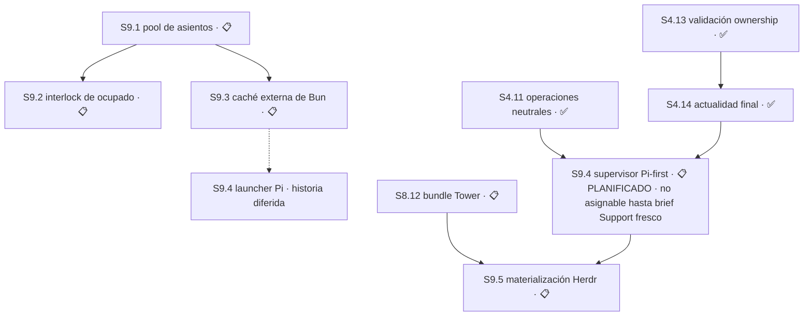

# Plan 9 — Asientos de trabajo y reciclado seguro

**Propósito:** que existan asientos de trabajo estables que Main pueda asignar, materializar visualmente y reciclar sin pisar a un agente trabajando, y que tener varios no cueste una instalación de dependencias por cada uno.

**Estado:** 🔵 EN CURSO
**Avance:** 0% (0/5 S)

> **Reordenado y recortado el 2026-08-21 por la [decisión 62](../decision-register.md), tras la auditoría exclusiva de P9.**
> Los IDs son posicionales según el [estándar de planes](/home/emili/.claude/skills/_shared/plan-naming-convention.md), así que
> cambiar el orden cambia el número. La tabla de migración de abajo conserva la trazabilidad de toda referencia histórica.

## Entrega de sustrato del 2026-08-30 — ninguna Sesión cerró

**El avance de P9 sigue siendo 0% (0/5 S).** Esta entrega no cierra `S9.1` ni `S9.5`, no las
vuelve asignables y no altera la cola. Se registra porque cambia el sustrato sobre el que ambas
se van a implementar, y porque retira una causa de deriva que era real y estaba medida.

**Causa medida.** `hosts/production-provider.mjs:257` creaba el pane del worker con
`herdr pane split --current`, que parte el pane enfocado; el código **no tenía concepto de
pestaña**. La topología obligatoria `MAIN → SUPPORT → AGENTES` existía sólo como prosa en
`skills/torre-control/SKILL.md`, así que un orquestador compactado la perdía y los workers
nacían en la pestaña equivocada. El commit `078f160` del 2026-08-30 endureció esa prosa y no
agregó enforcement.

**Entregado** en `origin/master@6c79223`, tres commits directos verificables y revertibles:

| Commit | Resultado | Líneas |
|---|---|---:|
| `cb3ed7e` | `hosts/herdr-topology.mjs` resuelve la pestaña `AGENTES`, la crea sosteniendo el primer asiento, parte de lado desde su último pane y **verifica pestaña, `cwd` y `foreground_cwd` por readback**, cerrando lo que abrió ante cualquier mismatch. No lee `ACTIVE`. | 215 |
| `4f3a022` | `workspace/seat-inventory.mjs` clasifica cada worktree en `main`/`support`/`permanent`/`temporary` y decide si el descarte *podría* ser seguro; `hosts/seat-cli.mjs` lo expone como `torre asiento list \| abrir \| limpiar`. | 342 |
| `6c79223` | El skill deja de repetir la topología y enruta a la cerradura: su primera regla dura es *nunca invoques `herdr` para sentar un worker, siempre `torre asiento`*. | 79 |

**Regla de asientos temporales, ahora en código.** El pool permanente es `implementer-1`,
`implementer-2`, `implementer-3` más `support-agent`; **cualquier otro worktree nace temporal y
debe descartarse cuando su trabajo aterriza**. El descarte nunca es automático: `limpiar`
previsualiza, y `--confirmar` sólo retira asientos probadamente en rama, limpios, desocupados y
totalmente mergeados; una ocupación de panes ilegible **falla cerrado** en vez de borrar un
asiento cuyo agente no se pudo ver.

**Qué NO entregó, y hay que decirlo con precisión.** No existe registro de asientos ni binding
de asignación por Main —eso es `S9.1`—; no hay lock exclusivo ni interlock de asiento ocupado
—eso es `S9.2`—; no hay caché de dependencias —`S9.3`—; y no hay materialización automática
posterior al brief —`S9.5`—. `torre asiento` es operado a mano por Main, exactamente como
`jornada.sh --reciclar`.

**Efecto sobre las Sesiones abiertas.** `S9.1` conserva su contrato íntegro, pero su `Área`
`PENDIENTE DE ENUMERAR` ahora tiene un vecino entregado que debe respetar en vez de reimplementar:
`workspace/seat-inventory.mjs` ya nombra el pool y `hosts/herdr-topology.mjs` ya es dueño de la
topología. `S9.5` conserva sus siete criterios de aceptación; dos de ellos —pane dentro de la
pestaña aprobada y prueba de `cwd`/`foreground_cwd` antes del prompt— ya tienen implementación
verificable que `S9.5` debe **invocar, no reescribir**. Ninguna de las dos queda cerrada ni
parcialmente acreditada.

**Evidencia:** `bun test` 978 pass / 0 fail sobre `6c79223`; `torre asiento list` ejecutado
contra este repositorio identifica los tres asientos permanentes, `support-agent`, `Main` y dos
temporales reclamables (`diagnostic-launch-timeout`, `implementer-temp-s4-14`).

## Tabla de migración de IDs

Las decisiones 49–54 del [registro](../decision-register.md) y las referencias en [release-chain](../release-chain.md) y el
[master-index](../master-index.md) usan los IDs anteriores. **No se reescribe la historia**: esta tabla es el puente.

| Antes | Ahora | Qué pasó |
|---|---|---|
| `S9.4` | **`S9.1`** | Pasa al frente. No cambia su contrato: no rompe ningún contrato existente y usa `jornada.sh --reciclar` tal como está. |
| `S9.1` | **`S9.2`** | **Reducida de nueve Módulos a un solo resultado.** Sobrevive el interlock de asiento ocupado; se descarta el resto. |
| `S9.2` (mitad caché) | **`S9.3`** | La Sesión se parte. Sobrevive la caché externa de Bun, que es lo que abarata tener varios asientos. |
| `S9.2` (mitad Pi) | **`S9.4`** | La otra mitad. 🟡 DIFERIDO junto a `S1.17`–`S1.19`: Pi es un **segundo host**, posterior a cerrar la ruta OpenCode. |
| `S9.3` | — | **Eliminada.** Existía para volver a encender el reciclador que el primer Módulo de la vieja `S9.1` apagaba. Sin apagado no hay reencendido. |
| `M9.1.7`, `M9.1.8`, `M9.1.9` | — | **Eliminados.** 640 líneas de RFC V2, requirements V2 y guarda de procedencia que el maintainer nunca pidió. |

## Qué se retiró y por qué

**La escala no cerraba.** `jornada.sh:257-286` recicla un worktree en **28 líneas de bash** que funcionan hoy: exige `--nueva-rama`, aborta con `git status --porcelain` si el árbol está sucio, crea rama fresca con `git switch -c <nueva> <trunk> --no-track`, y sólo borra la rama vieja después de que `git cherry` pruebe que nada quedó sin mergear. La vieja `S9.1` proyectaba **~1.900 líneas en nueve Módulos** para reemplazarlas.

**Tres de los nueve Módulos no entregaban código.** `M9.1.7` era un RFC V2 de 240 líneas, `M9.1.8` un requirements V2 de 240 y `M9.1.9` un manifest con guarda de procedencia de 160. **640 líneas de documentación sobre el reciclado, dentro de una Sesión que existe para rotarle la rama a una carpeta.** El maintainer no las pidió y se eliminan. La [decisión 58](../decision-register.md) ya nombró a `console/vocabulary.mjs` autoridad de alcance y la 60 dejó el [inventario](../inventario-de-producto.md) como mapa; un RFC V2 sería un tercer documento gobernando lo mismo.

**La maquinaria de seguridad defendía de un atacante ajeno a este proyecto.** `M9.1.3` exigía por archivo la secuencia `pre-lstat → open O_RDONLY|O_NOFOLLOW → fstat inmediato → digest → post-fstat → post-lstat`, más dos observaciones canónicas independientes RFC8785/JCS, matrices de precedencia de siete códigos y once arreglos `argv` exactos para `git`. Eso defiende de ataques de enlace simbólico y carreras TOCTOU, que exigen **un atacante con el mismo usuario en la misma máquina** — quien llegó ahí ya tiene las claves SSH y el token de GitHub. Es la misma clase que la [decisión 59](../decision-register.md) resolvió para `capabilities/registry.mjs`: maquinaria correcta y bien probada para un modelo de amenaza que no es el de este proyecto.

**El riesgo real es más chico y sí justifica trabajo:** una carrera entre el maintainer y Main. El bash es manual y una persona no compite consigo misma; la invocación programática de Main sí puede reciclar un asiento ocupado, o dos Main pueden tocar el mismo. Eso es lo que conserva la nueva `S9.2`.

**El plan estaba invertido.** La pieza más barata y más útil —el pool de asientos— era la última y dependía de una Sesión cuyo primer Módulo apagaba el mecanismo que ella necesitaba.

## Resumen auditable

| Campo | Contrato |
|---|---|
| Orden histórico OpenCode-first | `S9.1 → S9.2 → S9.3`; `S9.4` estaba 🟡 DIFERIDO. La autoridad Pi-first vigente está en la reconciliación del 2026-08-27. |
| Avance canónico | 0% (0/5 S). Ninguna Sesión está ✅ COMPLETO. `S9.5` entra al denominador como objetivo nuevo autorizado; `S9.4` conserva su historia diferida y su contrato Pi-first vigente. |
| Entrega | Commit directo a `master`, sin PR. Cada resultado independientemente verificable y revertible, ≤400 líneas authored. |
| Próxima acción | `S9.4` vuelve a 📋 PLANIFICADO y no es asignable hasta recibir un brief fresco de Support sobre la base entregada de `S4.14` que recalcule dependencias, `Área`, `Recurso` y riesgos y, antes de asignar, confirme capacidad viva y valide el worktree exacto. Su estado parcial queda preservado sin resume ni corrección. `S9.5` conserva `S8.12 + S9.4`. |
| Decisión abierta | **Ninguna.** `S4.14` está ✅ COMPLETO; el único gate actual es un brief fresco de Support con esas comprobaciones, no otra decisión. |
| Autoridad histórica | Engram 8478 rev8, 8506, 8645, 8646, 8647 rev2, 8894, 8898, 8950, 8955, 8908; decisiones 49–54 y 62. Los artefactos SDD de la vieja `S9.1` viven en `openspec/changes/s9-1-safe-slot-lifecycle/` y describen un alcance **superado**: se conservan como evidencia, no como autoridad de implementación. |

---

## Sesión 9.1 — Pool de asientos permanentes y asignación por Main

**Estado:** 📋 PLANIFICADO — primera de la cola de P9.

**Depende de:** nada dentro de P9. No rompe ningún contrato existente.

**Área:** `PENDIENTE DE ENUMERAR`, acotada por el contrato de abajo. Enumerarla es trabajo, no decisión.

**Recurso:** el registro de asientos y el binding de asignación. Sin transporte propio.

**Ruta:** `design-tasks`.

### Por qué no rompe nada — verificado el 2026-08-20 y reconfirmado el 2026-08-21

| Lo que necesita | Estado hoy |
|---|---|
| Identidad estable del asiento | `core.mjs:4328-4331` identifica un worktree **por su path, nunca por su rama**, con el comentario explícito *"jornada scripts recycle a worktree across branches, so the branch is not stable between sessions"*. La identidad del asiento **ya es el path**. |
| Rotar rama y base sin tocar el asiento | `schemas/assignment-v1.schema.json` ya separa `workspace.path`, `workspace.branch` y `workspace.base_sha`. Fijar el path y rotar los otros dos es lo que el contrato **ya permite**. |
| Rotación efectiva de la rama | `jornada.sh --reciclar <ruta> --nueva-rama <nombre>` ya la implementa, con sus salvaguardas. **Esta Sesión lo usa tal como está.** |
| Precedente de asiento con nombre fijo | `Worktrees/support-agent` ya existe y funciona así. |

### Contrato — aprobado por la decisión 51, conservado íntegro

1. **Pool fijo de asientos con nombre permanente.** Los asientos no se crean ni se destruyen por Sesión; existen y se reciclan. El nombre es estable y no describe el trabajo que aloja.
2. **El rol pertenece a la asignación, no al agente.** Se usa el `assignment-v1.role` existente (`planning` | `implementation`) más su `lane`. Un asiento no se especializa.
3. **Asientos intercambiables.** Un pool de N debe poder atender N trabajos del mismo tipo.
4. **Main asigna.** Main consulta asientos libres y liga cada uno a una asignación con su rama y su `base_sha`.
5. **Formato de rama:** `<tipo>/s<sesión>-<slug>` — por ejemplo `feat/s1.3-idempotent-delivery`, `audit/s2.1-lock-huerfano`.

### Decisiones

- `escala` — **el tamaño del pool. RESUELTA por el maintainer el 2026-08-21: tres asientos.** **Clase:** expansión de alcance; dinero y cuotas, porque cada asiento cuesta una instalación de dependencias hasta que `S9.3` la abarate. **Resolución:** tres — uno planificando, uno implementando, uno libre para una urgencia. Cubre el patrón de trabajo real sin abrir un costo indefinido, y con la caché de `S9.3` el tercero es casi gratis. **Falsificable:** un pool de tres que no pueda atender el patrón real de trabajo sin crear asientos nuevos. **Contamina:** `S9.1` y el dimensionamiento de `S9.3`.

**P9 queda decision-clean.** No resta ninguna decisión abierta en todo el Plan.

---

## Sesión 9.2 — Interlock de asiento ocupado

**Estado:** 📋 PLANIFICADO

**Depende de:** `S9.1` — el interlock protege asientos, así que primero tienen que existir.

**Área:** `PENDIENTE DE ENUMERAR`.

**Recurso:** lock exclusivo de mutación de asiento; estado de ocupación.

**Ruta:** `design-tasks`.

**Resultado, uno solo:** **Main no puede reciclar un asiento ocupado.** La ocupación es legible y el reciclado toma un lock exclusivo que falla cerrado si el asiento está tomado o si otro Main lo está mutando.

**Qué NO entrega, y es deliberado.** Se descartan de la vieja `S9.1`: la seguridad de descriptores contra symlink y TOCTOU, la doble observación canónica RFC8785/JCS, las matrices de precedencia de siete códigos, la enumeración de once arreglos `argv` exactos, y el interlock one-way que apagaba `jornada.sh --reciclar`. **El reciclador manual se conserva intacto** — la [decisión 50](../decision-register.md) ya había reabierto ese Módulo justamente porque apagaba una herramienta en uso.

**Decisiones:** ninguna abierta. La frontera quedó fijada por la decisión 62.

---

## Sesión 9.3 — Caché externa congelada de Bun

**Estado:** 📋 PLANIFICADO

**Depende de:** `S9.1` — la caché existe para abaratar un pool de N asientos.

**Área:** `workspace/dependency-cache.mjs`, `schemas/dependency-fingerprint-v1.schema.json`, `schemas/dependency-install-receipt-v1.schema.json`, `test/workspace/**`, tests de schemas bajo `test/contracts/**`.

**Recurso:** roots externas exactas de caché y estado; lock por `input-digest`.

**Ruta:** `design-tasks`.

**Autoridad:** decisión 53 del 2026-08-20 — **fast-frozen-only**. Siempre `bun ci`, con caché de descargas Bun externa y acotada al proyecto, manteniendo `materialized_node_modules_reuse: disabled` y `authorizes_install_skip: false`. Cada asiento instala desde cero pero descarga de caché local; si algo no cierra, falla en vez de improvisar. **Descartada:** el árbol materializado reutilizable entre asientos — más rápido a la larga, pero abre un contrato nuevo y otra ronda de decisiones.

**Criterios de aceptación:**

- [ ] `bun ci` corre siempre; caché, receipt o árbol previo nunca autorizan omitirlo
- [ ] El fingerprint liga inputs, versión de Bun, CPU/OS, roots, argv y environment exactos
- [ ] La publicación del receipt ocurre atómicamente después de una instalación exitosa
- [ ] Una instalación parcial falla cerrado en vez de aceptarse
- [ ] El diff toca sólo `Área` y no introduce autoridad Main, SQLite ni API pública

**Módulos:** los dos primeros de la vieja `S9.2` se conservan — fingerprint y schemas cerrados, y caché externa con receipt de instalación. El tercero era el binding del launcher Pi y se movió a `S9.4`.

---

## Sesión 9.4 — Binding del launcher Pi y failure fence — contrato histórico

**Estado histórico:** 🟡 DIFERIDO

**Razón registrada.** Pi es un **segundo host** para la Torre, no un transporte. Su `Área` es `hosts/pi-launcher.mjs` y su `Recurso` es un namespace de proceso y raíz Pi. Queda diferido bajo el mismo criterio que `S1.17`–`S1.19` de P1: **la Torre opera con un provider a la vez, y OpenCode va primero.** Se reactiva cuando la ruta OpenCode esté cerrada.

**Corrección registrada.** La auditoría exclusiva de P9 afirmó en su primera versión que «Pi root fresco se va con Moshi». **Era falso**, y repetía el mismo error que el maintainer ya había corregido sobre `S1.17`–`S1.19`. Moshi reemplaza el **transporte remoto**, no un host de ejecución. Nada de Pi se elimina.

**Depende de:** `S9.3` al reactivar, y de que la ruta OpenCode esté cerrada.

**Efecto sobre el avance:** permanece en el denominador. Bajo la regla de la [decisión 57](../decision-register.md), un diferido-con-intención se conserva; sólo sale del denominador lo archivado-fuera-de-alcance.

---

## Grafo de dependencias

`S9.2` y `S9.3` no dependen entre sí. `S9.5` no espera el pool: consume asientos exactos ya aprobados por el brief y no crea, asigna ni recicla worktrees.

## Qué queda pendiente de reconciliar fuera de este Plan

- ~~**`master-index.md`** conserva los IDs anteriores y no se toca en esta pasada: tiene cambios sin commitear de `S8.10` y esta sesión no toca trabajo en implementación. Es el mismo bloqueo que la tarea 0.4 del plan de depuración.~~ **Resuelto el 2026-08-25 en `master@37fd3e3`**: el bloqueo era el árbol sucio de `S8.10`, y `S8.10` cerró e integró. El `master-index` quedó reconciliado contra `master@49825aa` con el punto de retoma reescrito.
- **`release-chain.md`** referencia la vieja `S9.2`; se reconcilia junto con el `master-index`.
- Los artefactos SDD en `openspec/changes/s9-1-safe-slot-lifecycle/` describen el alcance superado. **Se conservan como evidencia histórica**, con su autoridad Engram intacta, y **no son autoridad de implementación** de la nueva `S9.2`.

## Reconciliación de asientos — 2026-08-25

**Cerrada en `master@4720f02`.** Cadena de entrega: `a303145` (AGENTS.md) → `49825aa` (este
registro) → `37fd3e3` (master-index) → `4720f02` (cierre del bloqueo del master-index).

Reconciliación completa de los nueve checkouts sobre `master@a303145`. Ningún asiento queda
sucio. Ninguna rama previa se borró. Disposición aprobada por el maintainer: rescatar
planificación, estacionar código.

### Entregado

- **`a303145`** — `AGENTS.md` incorpora la excepción *Bootstrap de coordinación con la Torre
  apagada*, que venía preparada sin commitear en el asiento `s9-1-planning` sobre una base 39
  commits atrás. Es la regla que exige disposición explícita del maintainer —entregar,
  estacionar o abandonar— por cada worktree sucio antes de reciclarlo. No toca el bloque
  `delivery-policy` y por lo tanto no colisiona con el Área de `S5.13`.

### Estacionado — commiteado en su rama, nunca entregado

| Asiento | Rama | Commit | Contenido |
|---|---|---|---|
| `s5-13-main-policy-evidence` | `feat/plan-5/s5-13-main-policy-evidence` | `fd56b80` | SDD completo de la `S5.13` **anterior** a la Fase 3 |
| `s5-5` | `feat/plan-5/s5-5-parking-resume` | `acd8f7f` | `escalation/{parked,resume}.mjs` + 3 tests |
| `s10-2-integration` | `feat/s8.11-shared-dependency-environment` | `3cb83fe` | 12 commits de `S8.11` + reescritura de fixtures |

Las tres ramas existen **sólo en local**. No hay respaldo remoto.

### Descartado — verificado superado antes de descartar

- **`s5-9`**: los once archivos ya estaban en `master`. Diez byte-idénticos; el undécimo,
  `hosts/production-provider.mjs:179`, era la versión previa a la selección explícita de campos.
- **Cuatro documentos de plan** duplicados byte-a-byte entre `s5-5` y `s5-13`
  (`decision-register`, `master-index`, `plan-5/STATUS`, `release-chain`): borrador anterior a
  la Fase 3. `plan-5/STATUS.md` tenía 956 líneas contra 1137 entregadas.
- **`s8-11-fixture-rewrite`**: segundo intento divergente del mismo arreglo de fixtures que
  `s10-2-integration`, sobre los mismos 12 commits. Sobrevive el de `s10-2-integration`.

Respaldo de todo lo descartado —parches y untracked— tomado antes de descartar.

### El SDD estacionado de `S5.13` no es autoridad de implementación

Describe *Trusted Main Policy Evidence and Main-Only Dispatch* bajo la decisión 57. La Fase 3
redefinió `S5.13` como **retiro de la verificación de proceso de la entrega** bajo la decisión
64. Mismo ID, Sesión distinta. Se conserva como evidencia histórica, igual que
`openspec/changes/s9-1-safe-slot-lifecycle/`, y **no se entrega a `master`**.

### Contradicción abierta — la suite no está verde

`test/install/launch-worker-cli.test.mjs:51` falla por timeout a los 5000 ms esperando
`CT_LAUNCH_BINDING_INVALID`, y recibe `""`. Reproducido de forma determinista en tres corridas.
**Es preexistente**: falla igual en el árbol limpio de `ee03ec5`, sin ningún cambio aplicado.
La suite completa da **862 pass / 13 todo / 1 fail**, contra los 863 / 13 / 0 registrados al
cerrar la Fase 3. Sin dueño asignado.

## Reconciliación Pi-first — 2026-08-27

La tabla de migración y los contratos completos de `S9.1`–`S9.3` anteriores permanecen como autoridad OpenCode preservada; no se eliminan ni se sustituyen por Git history. Para hacerlos ejecutables sin reinterpretación se cierran aquí sus campos faltantes, manteniendo resultados y orden históricos.

### Contratos ejecutables preservados de S9.1–S9.3
- **S9.1 — Pool de tres asientos.** **Estado:** 📋 PLANIFICADO · **Depende de:** — · **Área:** `workspace/slots.mjs`, `test/workspace/slots.test.mjs` · **Recurso:** tres worktrees/asientos persistentes · **Decisiones:** tamaño tres, resuelto por decisión 62 · **Ruta:** `design-tasks`, porque debe fijar layout/ownership sin reemplazar `jornada.sh --reciclar`. **Aceptación:** crea exactamente tres asientos; asignación Main es determinista; reciclador manual queda intacto; sólo toca `Área`. **Módulo M9.1.1:** `T9.1.1.1` RED pool incompleto/duplicado; `T9.1.1.2` GREEN crear/listar/asignar; `T9.1.1.3` REFACTOR aislar layout y readback.
- **S9.2 — Interlock de asiento ocupado.** **Estado:** 📋 PLANIFICADO · **Depende de:** `S9.1` · **Área:** `workspace/slot-lock.mjs`, `test/workspace/slot-lock.test.mjs` · **Recurso:** lock exclusivo por asiento · **Decisiones:** frontera reducida, resuelta por decisión 62; la decisión histórica 53 permanece trazable por la tabla de migración · **Ruta:** `design-tasks`, por concurrencia y fallo parcial. **Aceptación:** Main no recicla ocupado; dos Main no mutan el mismo asiento; lock stale se resuelve fail-closed; `jornada.sh --reciclar` no cambia; sólo toca `Área`. **Módulo M9.2.1:** `T9.2.1.1` RED ocupado/concurrencia/stale; `T9.2.1.2` GREEN lock y readback; `T9.2.1.3` REFACTOR cleanup determinista.
- **S9.3 — Caché externa congelada de Bun.** **Estado:** 📋 PLANIFICADO · **Depende de:** `S9.1` · **Área:** `workspace/dependency-cache.mjs`, `schemas/dependency-{fingerprint,install-receipt}-v1.schema.json`, `test/workspace/**`, `test/contracts/**` · **Recurso:** caché externa por fingerprint · **Decisiones:** `derivable`, contenido exacto por lock/runtime/arquitectura; autoridad contrato histórico, falsificador: dos inputs distintos comparten fingerprint · **Ruta:** `full-sdd`, porque crea schemas y lifecycle compartido. **Aceptación:** fingerprint exacto; publicación inmutable/atómica; instalación parcial falla cerrado; ningún binding Pi entra; sólo toca `Área`. **Módulo M9.3.1:** `T9.3.1.1` RED fingerprint/partial/corrupción; `T9.3.1.2` GREEN schemas+caché+receipt; `T9.3.1.3` REFACTOR atomicidad y cleanup.

### Contrato vigente de S9.4 — Supervisor y binding del launcher Pi

**Historia preservada:** el contrato anterior “Pi segundo host, después de OpenCode” queda etiquetado arriba como plan histórico parqueado.

**Estado:** 📋 PLANIFICADO — `S4.11`, `S4.13` y `S4.14` están entregadas. La Sesión no es asignable y no se reanuda ni corrige ningún estado parcial hasta recibir un brief fresco de Support contra la nueva base canónica que recalcule dependencias, `Área`, `Recurso` y riesgos y, antes de asignar, confirme capacidad viva y valide el worktree exacto.

**Depende de:** `S4.11` ✅ COMPLETO, `S4.13` ✅ COMPLETO y `S4.14` ✅ COMPLETO.

**Área:** `workspace/pi-supervisor.mjs`, `workspace/pi-binding.mjs`, `test/workspace/pi-supervisor.test.mjs`, `test/workspace/pi-binding.test.mjs`.

**Recurso:** un broker/listener exacto por worktree sólo después de `broker.start`; keepalive Tower-owned; IDs aleatorios; ownership y capacidad de cierre exacta retenidos por `S4.10`. `runtimeRoute` es dato y no reclama recurso.

**Decisiones:**

- `escala`, resuelta — decisiones 82–84 y 86–87 fijan aislamiento, capacidades, contrato neutral, topología y mailbox.
- `escala`, resuelta — decisión 96 fija `runtimeRoute` puro y `broker.start` como primera adquisición dentro del ownership neutral.
- `escala`, resuelta — decisión 97 / Engram 9755 fija el puerto opcional caller-neutral `acquire → validate unpublished → publish`, con `close` exacto privado y exact-close o cuarentena ante fallo.
- `escala`, resuelta — decisión 98 / Emilio Engram 9773 aprobó el guard sincrónico final-currentness de `S4.14`; su entrega levantó esa contaminación de `S9.4` y downstream. **Clase:** contrato visible del producto; API pública; seguridad y permisos; expansión de alcance; dependencias o evidencia contradictorias.
- `derivable` — nombres de helpers privados, sólo si no cambian ninguna forma pública ni introducen efectos antes de `broker.start`. **Autoridad:** decisiones 84, 96–98. **Falsificador:** el nombre o la extracción altera el shape público, adquiere un recurso o crea una capacidad de cleanup.

**Ruta:** `direct` después del gate — se preserva el contrato route-as-data de Engram 9747/9748. El pipeline `full-sdd` ya corrió una vez; su diseño fallido y sus intentos quedan como evidencia, no como ruta de continuación. Sólo un brief fresco de Support sobre la base entregada de `S4.14`, con dependencias, `Área`, `Recurso` y riesgos recalculados, puede asignar un executor general nuevo después de confirmar capacidad viva y validar el worktree exacto, sin segundo SDD ni SDD por Módulo.

**Autoridad de ejecución:**

- Engram 9746 — raíz causal verificada.
- Engram 9747 — resolución del maintainer y cierre de la decisión escalada.
- Engram 9748 — contrato final de `session-plan`, criterios y matriz de Tareas.
- Decisión 96 — serialización canónica de la frontera route-as-data.
- Emilio Engram 9755 y decisión 97 — validación neutral pre-publicación aprobada.
- Engram 9756 revisión 2 — gate corregido y orden de reanudación; Engram 9754 conserva la evidencia del bloqueo.

**Secuencia de ownership:**

| Momento | Contrato |
|---|---|
| Preparación | Construye y valida `runtimeRoute`; cero efectos y cero cleanup. |
| Verificación | Comprueba el binding exacto antes y después de cada `await`. `F1` devuelve el `close` exacto al registro antes de su `validateUnpublished` async. |
| Primera adquisición | `broker.start` corre dentro de `S4.10 acquireAtReservation`. |
| Ownership | `S4.10` retiene el `close` exacto devuelto por `broker.start`. |
| Fallo posterior | Usa ese `close` exacto o deja cuarentena explícita. |

**Safety gate previo a ejecución:**

| Gate | Estado actual | Evidencia necesaria para avanzar |
|---|---|---|
| Autoridad de producto | Resuelta | Decisiones 97–98 / Emilio Engram 9755 y 9773 |
| Guardia final neutral | Entregada | `S4.14` ✅ COMPLETO, decisión 98 / Engram 9773–9774 |
| Estado implementer-1 | Parcial, no asignable | M1 en `a7d724dc`; M2 son exactamente dos archivos no trackeados, checkpoint Engram 9772; corrección no consumida hasta recibir un brief fresco de Support |
| Estado implementer-2/3 | Evidencia inmutable | Se preserva sin resume, corrección, rebase ni promoción a capacidad |
| Brief Support | No vigente | Emitir uno fresco contra la base entregada de `S4.14` que recalcule dependencias, `Área`, `Recurso` y riesgos, confirme capacidad viva y valide el worktree exacto |
| Executor | No asignable | Sólo después de que ese brief confirme capacidad viva y valide el worktree exacto |

**Qué permanece congelado:**

- Candidato histórico: `304d534`, tree `8049d32`; evidencia inmutable del bloqueo verificado.
- Implementer-1: M1 `a7d724dc`; M2 exactamente dos archivos no trackeados, checkpoint Engram 9772; corrección disponible no consumida.
- Implementer-2 e implementer-3: evidencia inmutable, sin promoción a capacidad.
- Hasta el brief fresco: cero resume, corrección, rebase, cherry-pick o mutación; valor como capacidad: ninguno.

**Condición de retoma:**

1. `S4.14` está entregada sobre la nueva base canónica.
2. Support relee esa base, recalcula dependencias, `Área`, `Recurso` y riesgos, confirma capacidad viva y valida el worktree exacto.
3. Support emite un brief nuevo con esas comprobaciones; no enmienda evidencia previa.
4. Sólo después de que ese brief confirme capacidad viva y valide el worktree exacto, un executor fresco comienza desde la base canónica; no consume la corrección disponible ni retoma estados parciales.
5. Los criterios y Módulos siguientes se conservan como contrato, sujetos al brief fresco.

**Criterios de aceptación — los ocho son binarios:**

- [ ] El binding exacto se valida antes y después de cada `await`; ningún cambio de identidad, cwd, proceso, incarnation o binding atraviesa esa frontera.
- [ ] `runtimeRoute` es dato puro: preparación y validación no crean socket, archivo, listener, lock, reserva ni capacidad de `close`/`release`.
- [ ] Ruta inválida o stale, pérdida del binding actual o `dispose` antes de start dejan cero broker/listener y ejecutan cero cleanup.
- [ ] `broker.start`, llamado dentro de `S4.10 acquireAtReservation`, es el primer efecto y devuelve el `close` exacto que `S4.10` retiene como owner.
- [ ] Todo fallo posterior a start consume ese `close` exacto o deja la adquisición en cuarentena explícita; ninguna capa reconstruye o adivina cleanup.
- [ ] Repetir el mismo input converge; conflicto o pérdida de actualidad fallan cerrado sin promover una ruta o binding rival.
- [ ] El mailbox sigue volátil y no autoritativo: no se agrega mensajería durable, broker compartido, adopción de procesos ajenos, aislamiento de OS ni cambios a Pi/`pi-intercom`.
- [ ] Strict TDD registra RED enfocado, suite combinada y suite completa verdes; el diff toca exactamente `Área` y cada Módulo queda en un commit independiente/revertible de ≤400 líneas authored.

#### Módulo M9.4.1 — Verificador de binding exacto

**Área del Módulo:** `workspace/pi-binding.mjs`, `test/workspace/pi-binding.test.mjs`.

**Resultado verificable:** el binding no cambia inadvertidamente a través de fronteras async.

**Pronóstico:** 160–230 líneas authored.

**Entrega:** commit independiente; rollback limitado a esos dos archivos.

- [ ] Tarea T9.4.1.1 — RED: fijar la matriz de binding exacto antes/después de `await`, stale, conflicto y pérdida de actualidad.
- [ ] Tarea T9.4.1.2 — GREEN: implementar el verificador mínimo sin cambiar forma pública ni adquirir recursos.
- [ ] Tarea T9.4.1.3 — TRIANGULATE/REFACTOR: cubrir alternos negativos y simplificar manteniendo el RED enfocado verde.

#### Módulo M9.4.2 — Supervisor de ruta pura y adquisición broker-first

**Depende de:** `M9.4.1`.

**Área del Módulo:** `workspace/pi-supervisor.mjs`, `test/workspace/pi-supervisor.test.mjs`.

**Resultado verificable:** la ruta permanece dato hasta que `S4.10` adquiere y retiene el broker/listener exacto.

**Pronóstico:** 270–360 líneas authored.

**Entrega:** commit independiente; rollback limitado a esos dos archivos.

- [ ] Tarea T9.4.2.1 — RED: cubrir la matriz async/effect completa — invalid, stale, dispose pre-start, start, fallo post-start, cuarentena, convergencia, conflicto y pérdida de actualidad.
- [ ] Tarea T9.4.2.2 — GREEN: producir `runtimeRoute` puro y hacer `broker.start` primero dentro de `S4.10 acquireAtReservation`, preservando ownership y `close` exactos de `S4.10`.
- [ ] Tarea T9.4.2.3 — TRIANGULATE/REFACTOR: cerrar alternos, correr suites combinada y completa y verificar límites de `Área`, efectos y rollback.

**Evidencia congelada — no es implementación ni capacidad:**

- El candidato exacto `304d534` (tree `8049d32`) y sus cinco intentos conservan evidencia de la raíz causal y del diseño fallido.
- Queda inmutable: cero corrección, rebase, cherry-pick, resume o mutación sobre esos bytes.
- Su existencia no satisface ningún criterio de `S9.4` y no autoriza runtime, Tower, DB, worktree ni peer actions; `S9.4` está 📋 PLANIFICADO y no es asignable hasta recibir un brief fresco de Support sobre la base entregada de `S4.14` que recalcule dependencias, `Área`, `Recurso` y riesgos y, antes de asignar, confirme capacidad viva y valide el worktree exacto.
- Implementer-1 conserva M1 en `a7d724dc` y M2 como exactamente dos archivos no trackeados registrados en Engram 9772; su corrección sigue sin consumirse.
- La evidencia de implementer-2 e implementer-3 permanece inmutable y no se promueve a capacidad.
- Sólo un brief fresco sobre la base entregada de `S4.14`, con esas comprobaciones, puede asignar un executor nuevo después de confirmar capacidad viva y validar el worktree exacto; ninguna evidencia previa es continuación.

## Sesión 9.5 — Materialización visual Herdr posterior al brief confirmado

**Estado:** 📋 PLANIFICADO

**Depende de:** `S8.12`, `S9.4`.

**Área:** `skills/torre-control-entregas/**`, `skills/torre-herdr-seat-materialization/**`, `workspace/herdr-seat-materializer.mjs`, `test/skills/herdr-seat-materialization.test.mjs`, `test/workspace/herdr-seat-materializer.test.mjs`.

**Recurso:** sesión Herdr enfocada, panes y nombres de agente exactos del brief; binding Pi/Intercom de `S9.4`. Sin DB, migraciones, worktree lifecycle ni token de entrega.

**Decisiones:**
- `escala`, **resuelta por la decisión 91 / Engram 9652** — el brief explícitamente confirmado autoriza automáticamente sólo los asientos visibles exactos que enumera. **Clase:** seguridad y permisos; contrato visible del producto. **Contaminaba:** toda `S9.5` antes del primer RED.
- `derivable` — reutilización segura. **Criterio:** nombre de agente, worktree exacto, readiness Pi y conectividad Intercom coinciden con el brief; cualquier mismatch falla cerrado y no se repara por inferencia. **Autoridad:** decisión 91. **Falsificador:** un pane o proceso preexistente se reutiliza con uno de los cuatro hechos distinto o no probado.
- `derivable` — contrato Herdr. **Criterio:** la hija obtiene sintaxis y capacidades del runtime instalado mediante `herdr --skill`; no copia comandos ni toma el foco implícito de otro pane. **Autoridad:** decisión 91 y contrato dinámico Herdr. **Falsificador:** una actualización compatible exige editar sintaxis duplicada en la skill Tower.
- `derivable` — fallback manual. **Criterio:** Herdr ausente o incompatible devuelve instrucciones acotadas para los asientos aún no materializados, conserva evidencia de los ya validados y nunca declara el conjunto listo. **Autoridad:** Engram 9652. **Falsificador:** éxito parcial presentado como total o creación adicional fuera del brief.

**Ruta:** `design-tasks` — producto, autoridad y fallos están cerrados; falta fijar el seam técnico mínimo entre skill hija y materializador sin duplicar el CLI Herdr.

**Autoridad:** decisiones 91 y 101; Engram 9652 (`Automático tras brief`); decisiones 88 y 100 para el source root Tower-owned que entrega `S8.12`; contrato vivo leído exclusivamente con `herdr --skill`.

**Frontera de implementación:** `S9.5` sigue sin implementar. Debe automatizar y materializar la topología ya definida —madre Tower → hija Tower/Herdr → materializador— y el binding de asiento ya vigente; no vuelve a diseñar ownership, routing, roles ni membresía del bundle.

**Criterios de aceptación** — todos deben pasar para cerrar:
- [ ] Sólo después de confirmar un brief con path y rama exactos, Main crea o reutiliza exactamente sus panes y sesiones nombrados; cero asiento no aprobado se abre o recibe prompt.
- [ ] `MAIN`, `SUPPORT` y cada worker prueban `cwd` y `foreground_cwd` iguales a su worktree aprobado antes del prompt/dispatch; Support/worker desde Main, cambio de cwd o worktree ausente fallan cerrados sin `cd`, reciclado ni reuse cruzado.
- [ ] Repetir el mismo input converge sin duplicar panes, procesos, nombres ni prompts, y produce el mismo reporte por asiento.
- [ ] El contrato padre/router Tower-owned conserva autoridad; `torre-control-entregas` carga una sola hija Tower/Herdr, la hija no planifica ni despacha y el materializador no lee planes.
- [ ] La integración usa el contrato dinámico `herdr --skill`, no sintaxis duplicada, foco implícito ni cierre de panes/sesiones ajenos.
- [ ] Herdr ausente o incompatible produce fallback manual acotado y veraz, sin mutación parcial presentada como éxito.
- [ ] El diff toca sólo `Área`; no modifica Pi, Pi-intercom, skills genéricas Gentle AI, `S8.12`, `S8.13`, worktrees ni runtime vivo.

### Matriz skill-composer

| Componente | Responsabilidad | Trigger | Entrada | Salida | Dependencias / autoridad |
|---|---|---|---|---|---|
| Madre `torre-control-entregas` | Custodiar brief confirmado, orden y dispatch | brief exacto confirmado | lista inmutable de asientos aprobados | invocación única de la hija o rechazo | Main; nunca controla Herdr directamente |
| Hija `torre-herdr-seat-materialization` | Traducir esa lista a una operación Tower/Herdr | sólo la madre, después del gate | asientos exactos + contrato `herdr --skill` | reporte creado/reutilizado/pendiente | decisión 91; sin autoridad de planificación o dispatch |
| `herdr-seat-materializer` | Crear/reusar y validar hechos de runtime de forma idempotente | llamada tipada de la hija | nombre, path/rama, `cwd`, `foreground_cwd`, pane/session y binding `S9.4` | evidencia por asiento + fallback acotado | decisiones 91/101; Herdr, Pi e Intercom |

**Topología:** madre → hija lazy-loaded → materializador. No hay ciclos, doble autoridad ni trigger público alternativo. Herdr aporta mecánica; la Torre no la reimplementa. La hija y el materializador son una ruta especializada, no un segundo dispatcher.

### Módulo M9.5.1 — Routing madre/hija Tower/Herdr · commit directo ≤400 authored

- [ ] Tarea T9.5.1.1 — RED: probar que brief no confirmado, asiento extra, trigger directo o contrato Herdr ausente no alcanzan el materializador.
- [ ] Tarea T9.5.1.2 — GREEN: agregar la hija lazy-loaded y el único route gate desde `torre-control-entregas` con input exacto e inmutable.
- [ ] Tarea T9.5.1.3 — REFACTOR: eliminar duplicación de reglas, probar autoridad única y dejar las skills genéricas fuera del grafo.

### Módulo M9.5.2 — Materializador determinista y fallback · commit directo ≤400 authored

- [ ] Tarea T9.5.2.1 — RED: cubrir create/reuse, mismatch de nombre/cwd/readiness/Intercom, repetición idempotente, incompatibilidad y parcialidad.
- [ ] Tarea T9.5.2.2 — GREEN: materializar y validar exactamente cada asiento aprobado usando IDs/respuestas reales del contrato Herdr.
- [ ] Tarea T9.5.2.3 — REFACTOR: estabilizar reporte/fallback, preservar foco y prohibir cierre o prompt sobre recursos ajenos.

**Forecast:** dos commits directos, uno por Módulo; cada uno debe quedar independientemente verificable, revertible y ≤400 líneas authored. Si cualquiera supera 400 de forma inseparable, se divide en otra Sesión; nunca se amplía `S8.12` o `S8.13`.
