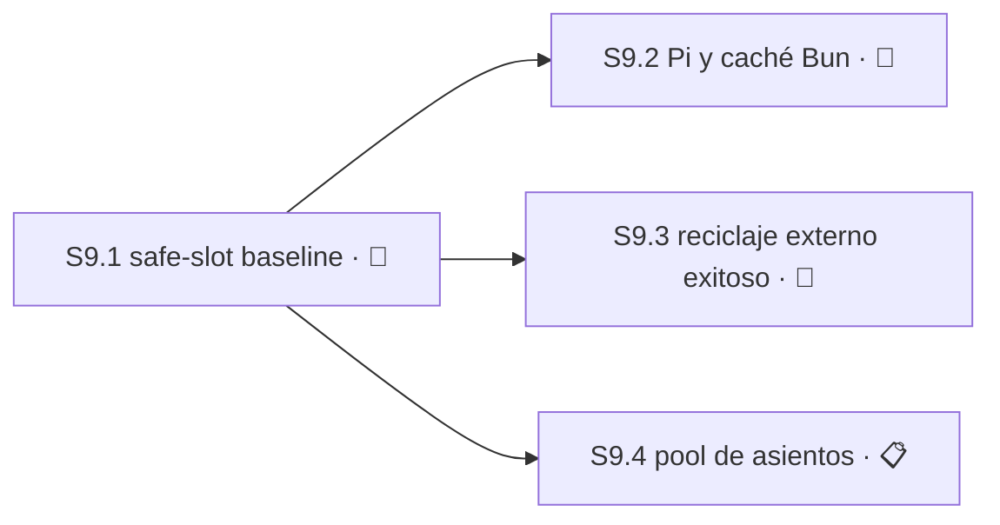

# Plan 9 — Slots seguros de Jornada y caché externa de Bun

**Estado:** 🔵 EN CURSO
**Avance:** 0% (0/4 S)

> Engram 8478 revisión 8 autoriza P9. Engram 8506 fija la semántica eventual de reciclaje exitoso como una única mutación `inspect → retire → create`, fail-closed, sin branch-switch sobre un worktree ocupado, borrado automático de ramas ni una segunda implementación legacy. Engram 8647 revisión 2 excluye todo transporte ejecutable y todo éxito externo de `--reciclar` de `S9.1`, y mueve ese resultado a una Sesión separada. Engram 8894 autoriza el primer interlock como baseline de seguridad one-way. Engram 8898 preserva ambos documentos V1 byte-for-byte y autoriza sucesores canónicos V2 con provenance externa exacta.

**Actualizado el 2026-08-20 por las decisiones 49–53.** `S9.1` está 🔵 EN CURSO con **cero Módulos entregados**: `M9.1.1` estuvo declarado congelado y completo hasta el 2026-08-20, cuando se verificó que su código nunca llegó a `master`, y la decisión 50 lo reabrió. P9 pasa a **cuatro** Sesiones: la decisión 51 suma `S9.4`, dueña de la capa de asientos permanentes. El diseño y las tasks re-gated reconcilian exactamente nueve Módulos directos secuenciales, independientemente verificables y revertibles, cada uno con hard cap de 400 líneas authored. La expansión de alcance quedó resuelta mediante el segundo split exacto; no queda una decisión de planificación abierta de clase que siempre escala. El candidato terminal de M9.1.2 permanece intacto como evidencia de diagnóstico y **sigue sin ser aceptado, reutilizable ni entregable**; la decisión 49 otorgó la autorización de reescritura que faltaba, conservando los bytes en su rama y ordenando un RED fresco. `S9.3` ya tiene transporte elegido por la decisión 52 —ejecutable con autoridad atada al arranque— y le queda enumerar `Área`, `Recurso` y Módulos, que es trabajo y no decisión. `S9.2` quedó decision-clean por la decisión 53. `S9.2` depende sólo de `S9.1`; no existe evidencia aprobada para una dependencia entre `S9.2` y `S9.3`.

## Resumen auditable

| Campo | Contrato |
|---|---|
| Autoridad | Engram 8478 rev8, 8506, 8645, 8646, 8647 rev2, 8894, 8898, factibilidad 8955, verificación terminal 8950 y M9.1.1 congelado 8908; diseño Engram 8644 rev7 SHA-256 `d28151af51d619085d65eff21aef4b08b5fb51a646865380c450aced287715ba` y tasks Engram 8901 rev5 SHA-256 `147fff4a1b19b00fc1bdb400b60cca46c37e9adba0dcdb93b029764c577e215d`. |
| Orden aprobado | `S9.1 → S9.2`, `S9.1 → S9.3` y `S9.1 → S9.4`. No hay edge entre `S9.2`, `S9.3` y `S9.4`. |
| Capacidad derivada | `S9.1` está en curso y **decision-clean**; `S9.2`, `S9.3` y `S9.4` están dependency-blocked detrás de ella. Ninguna sigue bloqueada por una decisión. `S9.3` y `S9.4` necesitan enumeración antes de ejecutar. |
| Avance canónico del Plan | 0% (0/4 S): ninguna Sesión está ✅ COMPLETO ni 📚 ARCHIVADO; `S9.1` EN CURSO aporta cero al porcentaje de P9. El denominador pasó de 3 a 4 por la decisión 51. |
| Avance operacional de S9.1 | `0/9 M = 0%` · `0/27 T = 0%`. Bajó de `1/9` el 2026-08-20: la decisión 50 reabrió `M9.1.1` al verificarse que su código no está en `master`. |
| Entrega | Commit directo a `master`, sin PR. Cada resultado independientemente verificable y revertible queda en un commit directo de ≤400 líneas authored. |
| Próxima acción | `plan-M9.1.1-redesign`: rediseñar `M9.1.1` bajo la decisión 52 para que distinga la invocación manual del maintainer de la programática de Main, y decidir el tamaño del pool de `S9.4`. La autorización de reescritura que antes faltaba la otorgó la decisión 49. |
| Dónde vive la implementación | Rama `work/s9-1-planning-20260817`, rebaseada sobre `master@e71161a` y **publicada en `origin`** el 2026-08-18. Contiene `workspace/slot-lifecycle.mjs`, `test/workspace/slot-lifecycle.test.mjs`, `test/jornada/reciclar.test.mjs` y cambios en `jornada.sh`; suite completa 739 pass / 0 fail. **No se entregó a `master` a propósito**: el candidato terminal de `M9.1.2` no está aceptado y su reescritura exige la autorización de arriba. Sólo esta planificación se integró. |

## Sesión 9.1 — Baseline one-way y lifecycle seguro de slots físicos

**Estado:** 🔵 EN CURSO

**Avance operacional:** `0/9 M = 0%` · `0/27 T = 0%`. La planificación no suma implementación, y desde el 2026-08-20 **ningún Módulo está entregado**: la decisión 50 reabrió `M9.1.1` al verificarse que su código nunca llegó a `master`.

**Ruta:** `full-sdd` — proposal, spec, design y tasks están completos para toda `S9.1`, nunca por Módulo. El diseño y las tasks pasaron sus gates y el segundo split resolvió exactamente la expansión de alcance. `S9.1` espera una autorización explícita y separada del maintainer antes de descartar/reescribir el candidato terminal de diagnóstico y comenzar un RED fresco.

**Autoridad:**
- `openspec/changes/s9-1-safe-slot-lifecycle/proposal.md` — Engram 8640 rev5.
- `openspec/changes/s9-1-safe-slot-lifecycle/specs/safe-slot-lifecycle/spec.md` — Engram 8641 rev5.
- `openspec/changes/s9-1-safe-slot-lifecycle/design.md` — Engram 8644 rev7; SHA-256 `d28151af51d619085d65eff21aef4b08b5fb51a646865380c450aced287715ba`.
- `openspec/changes/s9-1-safe-slot-lifecycle/tasks.md` — Engram 8901 rev5; SHA-256 `147fff4a1b19b00fc1bdb400b60cca46c37e9adba0dcdb93b029764c577e215d`.
- Engram 8955: factibilidad del segundo split.
- Engram 8950: verificación terminal del candidato de diagnóstico.
- Engram 8908: M9.1.1 congelado.
- Engram 8647 rev2: no transport/no external success in `S9.1`; successful recycling moves to a separate Sesión.
- Engram 8894: first interlock is a one-way safety baseline.
- Engram 8898: V2 successors govern S9.1; V1 remains immutable provenance.

**Depende de:** `S3.1`, `S3.4` (ambas ✅ COMPLETO).

**Área writable exacta:**
- `workspace/**`
- `jornada.sh`
- `test/workspace/**`
- `test/jornada/**`
- `plugin/tower-spike.js`
- `test/plugin/tower-spike.test.mjs`
- `openspec/rfc/sdd-tower-implementation-v2.md`
- `openspec/specs/sdd-tower-implementation-v2-requirements.md`
- `openspec/plans/sdd-tower-implementation/manifest.yaml` — sólo V2 ArtifactRefs externos, precedence acotada y preservación exacta de referencias V1.

**Inputs de provenance read-only; NO son write targets:**
- `openspec/rfc/sdd-tower-implementation-v1.md`
- `openspec/specs/sdd-tower-implementation-v1-requirements.md`

**Prohibido:** ambos V1 como write targets; cambios de manifest ajenos a la extensión V2 acotada; `core.mjs`, `mcp.mjs`, `main-store/**`, `.opencode/plugins/**`, cualquier otro `plugin/**` o `test/plugin/**`, `hosts/**`, roots de `S1.12`/`S5.8`, schemas, package entrypoints, bin/scripts, comandos, IPC, API/tool pública, autoridad Main serializada o caller/env-substitutable y cualquier ruta fuera del Área writable exacta.

**Recurso:** registro Git de common-dir/worktrees; raíz de estado de slots físicos; lock exclusivo de mutación de slot.

**Resultado:** `jornada.sh --reciclar` sigue siendo sintaxis reconocida pero retorna un unavailable estable y no-cero antes de todo efecto; el mutador legacy queda ausente o inalcanzable; la librería privada transport-independent inspecciona y ejecuta lifecycle sólo in-process con autoridad constructor-bound; V2 publica la autoridad canónica de S9.1 con provenance V1 externa exacta. No existe reciclaje externo exitoso en esta Sesión.

### Decisiones de S9.1

- `escala` — **RESUELTA por autorización del maintainer y el segundo split exacto:** conservar `S9.1` como una Sesión coherente con nueve resultados directos secuenciales. **Clase:** expansión de alcance. **Autoridad:** diseño Engram 8644 rev7, tasks Engram 8901 rev5 y task re-gate PASS. **Criterio falsificable:** cualquiera de los nueve resultados deja de ser independientemente verificable/revertible o proyecta >400 líneas authored; en ese caso la planificación debe volver a escalar antes de implementación. **Contamina:** `S9.1`. No queda una decisión de planificación abierta de clase que siempre escala; la reescritura/RED del candidato terminal sigue sin autorización separada.
- `escala` — **RESUELTA por Engram 8647 rev2:** S9.1 no selecciona transporte ejecutable y no implementa éxito externo de `--reciclar`. **Clase:** contrato visible del producto, API pública, seguridad y permisos, expansión de alcance. **Falsificador:** cualquier comando, IPC, ejecutable, API/tool, entrypoint, bootstrap de autoridad o delegación exitosa en `S9.1` viola la decisión.
- `escala` — **RESUELTA por Engram 8894:** el primer interlock es un baseline one-way. **Clase:** operación irreversible. **Falsificador:** un revert o corrección que restaure `git switch -c`, `branch -D` o un reciclador legacy equivalente.
- `escala` — **RESUELTA por Engram 8898:** V2 gobierna el scope safe-slot de S9.1; ambos V1 son provenance histórica immutable. **Clase:** contrato visible del producto y evidencia contradictoria. **Falsificador:** cambiar bytes V1, omitir commit/digests V1 exactos en provenance externa, hacer self-reference desde V2 o dejar que V1 gobierne este scope.
- `derivable` — composición privada constructor-bound. **Autoridad:** Engram 8645/8646 y diseño rev4. **Criterio falsificable:** la superficie devuelta por `TowerSpikePlugin` cambia, la capability sale del proceso, o autoridad/resolver aparece en argv, env, JSON, Support, Workspace, logs, eventos o receipts.

### Módulo M9.1.1 — One-way `jornada.sh` interlock · 📋 PLANIFICADO (reabierto)

> **REABIERTO por la decisión 50 del 2026-08-20.** Este Módulo estuvo declarado `✅ COMPLETO` y congelado, y **esa declaración era falsa**: su código nunca llegó a `master`. Verificado el 2026-08-20 — en `master` no existe el interlock en `jornada.sh` ni el archivo `test/jornada/reciclar.test.mjs`; ambos viven sólo en `4e6b5af` sobre `work/s9-1-planning-20260817`. En `master`, `jornada.sh --reciclar` (líneas 257-286) está **completo y operativo**, con sus salvaguardas: aborta si el worktree está sucio y preserva una rama vieja con commits no mergeados al tronco. Entregar el interlock tal como está diseñado **apagaría una herramienta que el maintainer usa a mano hoy**, a cambio de un piso pensado para un mundo sin transporte autorizado — mundo que la decisión 52 cerró. El rediseño debe distinguir la invocación manual del maintainer de la invocación programática de Main. Las Tareas de abajo quedan como historia del diseño anterior y **no** son autoridad de implementación.

**Direct-commit outcome:** frozen one-way safety floor. **Allowed paths:** `jornada.sh`, `test/jornada/reciclar.test.mjs`. **Prerequisite/order:** first and complete. **Focused command/evidence:** frozen checkpoint reports `3 pass / 0 fail / 25 expects`; do not rerun. **Actual/cap:** `117 / ≤400` authored lines. **Rollback boundary:** forward correction only; never restore `git switch -c`, `branch -D`, or an equivalent recycler. **Frozen evidence:** Engram 8908 and `sdd/s9-1-safe-slot-lifecycle/apply-progress` observation 8906. **Engram checkpoint:** frozen focused result, actual count, unavailable code/message, legacy-reachability proof, and forward-only confirmation.

- [x] Tarea T9.1.1.1 — RED: add failing `test/jornada/reciclar.test.mjs` cases that require recognized `--reciclar` to return a stable non-zero unavailable result before fetch, discovery, diagnostics, Git, filesystem, or lock effects, including precedence over `--nueva-rama` validation.
- [x] Tarea T9.1.1.2 — GREEN: in `jornada.sh`, place the early interlock immediately after flag parsing; remove the reachable legacy recycle block and reconcile recycle-specific help so no fallback, second mutator, or successful delegation remains.
- [x] Tarea T9.1.1.3 — REFACTOR: consolidate stable unavailable messaging and static reachability assertions in the allowed paths; confirm no correction path can undo the one-way fail-closed floor.

### Módulo M9.1.2 — Canonical request, authority, and Git evidence foundation · 📋 PLANIFICADO

**Direct-commit outcome:** closed, inspection-only request/authority/Git foundation. **Allowed paths:** `workspace/slot-lifecycle.mjs`, `test/workspace/slot-lifecycle.test.mjs` only. **Prerequisite/order:** after frozen M9.1.1 and future explicit implementation plus candidate discard/rewrite authorization. **Focused command:** `bun test test/workspace/slot-lifecycle.test.mjs` (plan only; do not run in this phase). **Runtime evidence:** temporary real-Git fixtures capture complete Git before/after identity and zero writes, locks, ref changes, worktree changes, or process effects outside the fixed read-only Git calls. **Forecast/cap:** `220–290 / ≤400` cumulative authored additions + deletions. **Rollback boundary:** remove only M9.1.2 while retaining M9.1.1; return filesystem and persisted semantics as public `UNSAFE`. **Engram checkpoint:** candidate bytes, focused result, Git zero-effect witness, count, and rollback-floor confirmation.

> **AUTORIZACIÓN DE REESCRITURA otorgada por la decisión 49 del 2026-08-20.** Los bytes congelados fueron localizados y verificados: existen en `4e6b5af` sobre `work/s9-1-planning-20260817` y sus hashes coinciden exactos con los registrados abajo. **No están en el árbol de trabajo ni en `master`.** El candidato implementa `createPhysicalSlotLifecycle().inspect()` y **toda** su salida es `state: "UNSAFE"`; el camino feliz devuelve `SEMANTIC_PROOF_REQUIRED`. Eso no es un defecto: es el alcance declarado de este Módulo, que entrega cimientos de inspección y delega el veredicto a `M9.1.4`/`M9.1.5`. **Resolución:** los bytes quedan intactos en su rama como evidencia de diagnóstico, no se reutilizan, la rama no se borra, y `M9.1.2` arranca un ciclo RED limpio bajo el contrato de asientos de `S9.4`.

**Rewrite boundary:** the terminal diagnosis-only candidate remains untouched evidence: `workspace/slot-lifecycle.mjs` SHA-256 `c8ff86c82905b5543fce201797c5e6108034b693044823a05e015e7e8869cb26` and `test/workspace/slot-lifecycle.test.mjs` SHA-256 `bfcd652b6f494f9072138ee9163d17aaa5ca25bcf491243cf41a69f69c448776`; `181` authored lines. These bytes are not accepted, reusable, deliverable, or implementation authority. They require explicit separate discard/rewrite authorization before any future RED.

- [ ] Tarea T9.1.2.1 — RED: in `workspace/slot-lifecycle.mjs` and `test/workspace/slot-lifecycle.test.mjs` only, add a table-driven failing request/authority/Git negative and multi-fault precedence matrix, executed later only by `bun test test/workspace/slot-lifecycle.test.mjs`, for expected failures `REQUEST_INVALID`, `AUTHORITY_MISMATCH`, and `GIT_EVIDENCE_INVALID` in first-match order `REQUEST_INVALID -> AUTHORITY_MISMATCH -> GIT_EVIDENCE_INVALID -> FILESYSTEM_UNSAFE -> EVIDENCE_UNVERIFIABLE -> OBSERVATION_DIVERGED -> SEMANTIC_PROOF_REQUIRED`. The matrix must falsify closed request grammar; constructor-confined scalar-only authority isolation; fixed executable `git` with `GIT_OPTIONAL_LOCKS=0`; exact eleven argv arrays `["rev-parse","--show-toplevel"]`, `["rev-parse","--git-common-dir"]`, `["symbolic-ref","--quiet","HEAD"]`, `["rev-parse","--verify","HEAD^{commit}"]`, `["rev-parse","--verify","HEAD^{tree}"]`, `["rev-parse","--verify",baseOid+"^{commit}"]`, `["rev-parse","--verify",baseOid+"^{tree}"]`, `["rev-parse","--verify",branchRef+"^{commit}"]`, `["rev-parse","--verify",branchRef+"^{tree}"]`, `["show-ref","--head"]`, and `["worktree","list","--porcelain"]`; strict OID/ref/duplicate grammar; full root/common-dir/worktree/HEAD/branch/ref/base commit+tree cross-binding; requested-branch absence; non-secret deep-frozen output; and early zero effects. Runtime evidence is temporary real-Git fixture before/after identity with no write, lock, ref, or worktree effect; rollback removes only this ≤400 unit and restores public `UNSAFE` handoff; checkpoint records the failing matrix and cumulative authored count.
- [ ] Tarea T9.1.2.2 — GREEN: after the separate future authorization, implement only `workspace/slot-lifecycle.mjs` plus the focused `test/workspace/slot-lifecycle.test.mjs` proof under `bun test test/workspace/slot-lifecycle.test.mjs`: closed request validation, constructor-confined scalar non-secret authority snapshot, fixed `git` allowlist/environment, strict parsing and complete Git cross-binding, requested absence, deterministic precedence, and deeply frozen non-secret plain result. Do not add a caller shortcut, filesystem/persisted classification, lock, mutation, or external surface; hand filesystem/persisted uncertainty to public `UNSAFE`. Runtime evidence is complete real-Git zero-effect identity; rollback removes only this `220–290 / ≤400` unit while retaining M9.1.1; checkpoint records focused result, bytes, count, and `UNSAFE` handoff.
- [ ] Tarea T9.1.2.3 — REFACTOR: in only `workspace/slot-lifecycle.mjs` and `test/workspace/slot-lifecycle.test.mjs`, freeze the authorized candidate bytes, `220–290 / ≤400` cumulative count, fixed-command evidence, precedence matrix, deep-freeze/non-secret proof, and real-Git zero-effect witness from `bun test test/workspace/slot-lifecycle.test.mjs`; preserve the no-caller-shortcut and public `UNSAFE` handoff. Rollback removes only this foundation and retains M9.1.1. Record the explicit checkpoint that the terminal diagnosis candidate hashes above cannot be discarded or rewritten before any future RED without separate maintainer authorization.

### Módulo M9.1.3 — Descriptor-safe dual-root and complete double observation · 📋 PLANIFICADO

**Direct-commit outcome:** independently safe repository-target and external-common-dir descriptor observation. **Allowed paths:** `workspace/slot-lifecycle.mjs`, `test/workspace/slot-lifecycle.test.mjs` only. **Prerequisite/order:** after M9.1.2 and future explicit implementation authorization. **Focused command:** `bun test test/workspace/slot-lifecycle.test.mjs` (plan only; do not run in this phase). **Runtime evidence:** temporary real-Git fixtures capture both complete independently recomputable observations and complete before/after zero-effect identity. **Forecast/cap:** `230–300 / ≤400` cumulative authored additions + deletions. **Rollback boundary:** remove only M9.1.3 while retaining M9.1.1/M9.1.2; persisted semantics remain public `UNSAFE` with `SEMANTIC_PROOF_REQUIRED`. **Engram checkpoint:** focused result, dual-root witness/equality evidence, count, and rollback confirmation before M9.1.4.

- [ ] Tarea T9.1.3.1 — RED: in `workspace/slot-lifecycle.mjs` and `test/workspace/slot-lifecycle.test.mjs` only, add table-driven failing fixtures, later run only with `bun test test/workspace/slot-lifecycle.test.mjs`, for independently rooted repository-target and external-common-dir owner/type/mode/link/symlink/escape safety and exact `pre-lstat -> open O_RDONLY|O_NOFOLLOW -> immediate fstat -> raw read/content digest -> post-fstat -> post-lstat` identity. Falsify timestamp, content, descriptor, and component drift; require two complete independently recomputable RFC8785/JCS observations, deterministic divergence, full zero-effect identity, and adjacent/all-later multi-fault precedence against `REQUEST_INVALID -> AUTHORITY_MISMATCH -> GIT_EVIDENCE_INVALID -> FILESYSTEM_UNSAFE -> EVIDENCE_UNVERIFIABLE -> OBSERVATION_DIVERGED -> SEMANTIC_PROOF_REQUIRED`. Runtime evidence is temporary real-Git dual-root before/after identity without effects; rollback removes only this `≤400` unit and retains M9.1.1/M9.1.2; checkpoint records expected failures and count.
- [ ] Tarea T9.1.3.2 — GREEN: in only `workspace/slot-lifecycle.mjs` and its focused `test/workspace/slot-lifecycle.test.mjs` proof under `bun test test/workspace/slot-lifecycle.test.mjs`, implement inspection-only independent dual-root descriptor reads and complete double RFC8785/JCS witnesses with deterministic equality/divergence and zero-effect identity. Return public `UNSAFE`/`SEMANTIC_PROOF_REQUIRED` for uncertain semantics; do not add shifted M9.1.4 classifications, M9.1.5 mutation, locks, repair, or an external/caller surface. Runtime evidence is real-Git dual-root readback; rollback removes only this `230–300 / ≤400` unit; checkpoint records focused result, witness digests, and public handoff.
- [ ] Tarea T9.1.3.3 — REFACTOR: in only `workspace/slot-lifecycle.mjs` and `test/workspace/slot-lifecycle.test.mjs`, consolidate dual-root no-follow identity, complete witness construction, deterministic reason selection, and zero-effect assertions while preserving `bun test test/workspace/slot-lifecycle.test.mjs` as the focused proof. Keep public `UNSAFE`/`SEMANTIC_PROOF_REQUIRED`, no persisted classification or mutation, and no shifted M9.1.4 behavior. Rollback removes only this independently verifiable `≤400` unit; freeze its count, candidate evidence, dual-root witness equality, and the checkpoint before M9.1.4.

### Módulo M9.1.4 — Persisted evidence and full classifications · 📋 PLANIFICADO

**Direct-commit outcome:** complete read-only persisted semantics. **Allowed paths:** `workspace/slot-lifecycle.mjs`, `test/workspace/slot-lifecycle.test.mjs` only. **Prerequisite/order:** after the independently safe M9.1.3 foundation. **Focused command:** `bun test test/workspace/slot-lifecycle.test.mjs`. **Runtime boundary evidence:** temporary real-Git fixtures capture two complete independent persisted observations and zero effects. **Forecast/cap:** `240–310 / ≤400` authored lines. **Rollback boundary:** return only to M9.1.3's safe foundation; no mutation surface exists. **Engram checkpoint:** focused result, classification precedence/witness evidence, zero-effect proof, changed-line count, and rollback confirmation.

- [ ] Tarea T9.1.4.1 — RED: in the two allowed paths only, add failing fixtures for canonical no-follow reading and cross-binding of lock; operation events/head; slot pointer; immutable envelope; Jornada; occupancy; conditional assignment; prior binding; and lineage. Require two complete independent canonical observations, stable precedence, exact `ABSENT`, `SAFELY_RETIRED`, `OCCUPIED`, or `UNSAFE`, and divergence only after both observations are safe and complete.
- [ ] Tarea T9.1.4.2 — GREEN: extend the read-only library to parse and cross-bind all persisted evidence against request, constructor authority, Git, path, and each other; return only the exact classifications with before/after witness digests and deeply frozen plain data. Do not introduce replace, recover, lock acquisition, fetch, repair, normalization, creation, write, ref/worktree mutation, branch switch, prune, or removal.
- [ ] Tarea T9.1.4.3 — REFACTOR: consolidate full-observation parsing and stable fail-closed precedence while retaining `UNSAFE` for unknown schema, incomplete chain, changed witness, contradiction, unsafe component, or unverifiable binding; preserve the M9.1.3 safety handoff and zero effects.

### Módulo M9.1.5 — Physical evidence, exclusive lifecycle, publication, idempotency, and recovery · 📋 PLANIFICADO

**Direct-commit outcome:** lifecycle/evidence/recovery. **Allowed paths:** `workspace/slot-lifecycle.mjs`, `test/workspace/slot-lifecycle.test.mjs`. **Prerequisite/order:** after complete M9.1.4 inspection; retain its inspection contract and M9.1.1's floor. **Focused command:** `bun test test/workspace/slot-lifecycle.test.mjs`. **Runtime boundary evidence:** temporary real-Git and failure-injection fixtures record exact effect ordering, lock ownership/readback, durable event/publication reads, and preservation of unknown artifacts. **Forecast/cap:** `175–220 / ≤400` authored lines. **Rollback boundary:** remove this mutating library behavior only if the resulting tree retains M9.1.1 and no legacy recycle route. **Engram checkpoint:** focused result, failure-injection matrix, ordered Git/evidence witnesses, changed-line count, and rollback-floor confirmation.

- [ ] Tarea T9.1.5.1 — RED: extend the lifecycle fixtures to fail until they prove `inspect → lock → inspect → retire → verify retirement → create → verify creation → validate → publish`, exact lock ownership, no create after unverified retirement, full-base-OID fresh creation, and unknown-evidence preservation.
- [ ] Tarea T9.1.5.2 — GREEN: implement `replace` and `recover` in `workspace/slot-lifecycle.mjs` with exact-operation no-follow lock/journal evidence, verified non-forced retire-before-create, immutable envelope plus atomic pointer, same-input replay/resume only, and observation-first recovery.
- [ ] Tarea T9.1.5.3 — REFACTOR: separate inspection, effects, publication, and recovery helpers while preserving fsync/readback and fail-closed behavior; prohibit forced removal, branch deletion, `switch`, `reset`, `clean`, `prune`, implicit fetch, a second mutation path, or launch before durable proof.

### Módulo M9.1.6 — Private constructor-bound plugin composition · 📋 PLANIFICADO

**Direct-commit outcome:** private composition. **Allowed paths:** `plugin/tower-spike.js`, `test/plugin/tower-spike.test.mjs`. **Prerequisite/order:** after M9.1.5; composition remains private and does not make the shell reachable. **Focused command:** `bun test test/plugin/tower-spike.test.mjs`. **Runtime boundary evidence:** N/A — plugin test proves trusted binding before/after resolver use, unchanged returned keys, and no public/external surface. **Forecast/cap:** `55–85 / ≤400` authored lines. **Rollback boundary:** revert private composition while retaining M9.1.1; do not add an external substitute or legacy route. **Engram checkpoint:** focused result, returned-surface comparison, authority-leakage/reachability evidence, changed-line count, and rollback-floor confirmation.

- [ ] Tarea T9.1.6.1 — RED: extend `test/plugin/tower-spike.test.mjs` to preserve Support behavior and fail on changed returned keys, missing trusted binding checks, caller-controlled authority substitution, serialization, or an external recycle reachability claim.
- [ ] Tarea T9.1.6.2 — GREEN: compose `createPhysicalSlotLifecycle` privately in `plugin/tower-spike.js` from a constructor-bound opaque read-only resolver after trusted Main/session verification, without changing the returned Support/dispose/event surface.
- [ ] Tarea T9.1.6.3 — REFACTOR: keep authority and callable values out of requests, argv, environment, JSON, Support, Workspace state, logs, events, envelopes, and errors; add no `main-store/**` access, tool, API, command, IPC, executable, or entrypoint.

### Módulo M9.1.7 — V2 RFC successor · 📋 PLANIFICADO

**Direct-commit outcome:** V2 RFC. **Allowed paths:** `openspec/rfc/sdd-tower-implementation-v2.md`. **Prerequisite/order:** after M9.1.6; commit this V2 RFC before M9.1.9 so its actual predecessor commit and raw-byte digest can be referenced externally. **Focused command:** structural checklist/readback of `openspec/rfc/sdd-tower-implementation-v2.md` (no test path is authorized in this Módulo). **Runtime boundary evidence:** N/A — standalone canonical documentation only. **Forecast/cap:** hard cap `240 / ≤400` authored lines. **Rollback boundary:** before manifest publication, this document may be reverted without changing V1 or runtime; after publication, correct forward while preserving V2 governance. **Engram checkpoint:** structural checklist, committed predecessor SHA and raw-byte digest after direct commit, changed-line count, and V1-byte exclusion confirmation.

- [ ] Tarea T9.1.7.1 — RED: define the structural checklist in the new RFC draft so it fails review if safe-slot architecture, interlock, inspection, lifecycle, authority, evidence, recovery, V2 governing scope, or the no-transport boundary is absent, or if V2 self-references.
- [ ] Tarea T9.1.7.2 — GREEN: create `openspec/rfc/sdd-tower-implementation-v2.md` as the standalone canonical safe-slot RFC, with no V1 edit/copy/repair and no self ArtifactRef, source commit, or content digest.
- [ ] Tarea T9.1.7.3 — REFACTOR: reduce duplication and improve traceability to the approved proposal/spec/design while preserving no successful recycling, immutable V1 provenance, and the separate unimplemented S9.3 transport decision.

### Módulo M9.1.8 — V2 requirements successor · 📋 PLANIFICADO

**Direct-commit outcome:** V2 requirements. **Allowed paths:** `openspec/specs/sdd-tower-implementation-v2-requirements.md`. **Prerequisite/order:** after M9.1.7; commit this V2 requirements document before M9.1.9 so both actual predecessor commit/raw-byte digests exist. **Focused command:** structural checklist/readback of `openspec/specs/sdd-tower-implementation-v2-requirements.md` (no test path is authorized in this Módulo). **Runtime boundary evidence:** N/A — standalone canonical documentation only. **Forecast/cap:** hard cap `240 / ≤400` authored lines. **Rollback boundary:** before manifest publication, this document may be reverted without changing V1 or runtime; after publication, correct forward while preserving V2 governance. **Engram checkpoint:** structural checklist, committed predecessor SHA and raw-byte digest after direct commit, changed-line count, and V1-byte exclusion confirmation.

- [ ] Tarea T9.1.8.1 — RED: define the structural MUST/scenario checklist in the new requirements draft so it detects missing fail-closed behavior, zero mutation, lifecycle ordering, idempotency, publication/launch gating, authority isolation, V1 immutability, V2 scope, or a successful external recycling claim.
- [ ] Tarea T9.1.8.2 — GREEN: create `openspec/specs/sdd-tower-implementation-v2-requirements.md` with binary S9.1 outcomes and scenarios, V2 governing scope, and no V1 mutation, self-reference, transport, or successful `--reciclar` behavior.
- [ ] Tarea T9.1.8.3 — REFACTOR: align terms and identifiers with the approved RFC/spec/design without editing V1, adding self-provenance, or pre-implementing S9.3.

### Módulo M9.1.9 — External V2 ArtifactRefs, bounded precedence, and provenance guard · 📋 PLANIFICADO

**Direct-commit outcome:** manifest/provenance guard and integral verification. **Allowed paths:** `openspec/plans/sdd-tower-implementation/manifest.yaml`, `test/workspace/s9-1-provenance.test.mjs`. **Prerequisite/order:** after committed M9.1.7 and M9.1.8; use their real predecessor commit SHAs and raw-byte digests, never self-reference. **Focused command:** `bun test test/workspace/s9-1-provenance.test.mjs`. **Runtime boundary evidence:** N/A — provenance/schema validation only; no runtime or external transport boundary. **Forecast/cap:** hard cap `160 / ≤400` authored lines. **Rollback boundary:** correct forward after publication while retaining exact V1 mappings and V2 governance; never edit V1 or make V1 govern S9.1. **Engram checkpoint:** focused and final integral results, manifest revision/readback, actual predecessor SHAs/raw-byte digests, exact V1 mapping proof, all per-Módulo changed-line counts and rollback boundaries, and frozen post-verification candidate identity.

- [ ] Tarea T9.1.9.1 — RED: create `test/workspace/s9-1-provenance.test.mjs` assertions for exact V1 bytes/digests and mappings, schema-valid namespaced extension, real predecessor V2 ArtifactRefs/raw-byte digests, bounded scope precedence, and absence of V2 self-reference.
- [ ] Tarea T9.1.9.2 — GREEN: after both V2 direct commits exist, increment only the manifest artifact revision and add the bounded `control-tower/s9-1-canonical-successors` extension in `openspec/plans/sdd-tower-implementation/manifest.yaml`, preserving existing V1 mappings byte-for-byte.
- [ ] Tarea T9.1.9.3 — REFACTOR: concentrate provenance assertions and manifest readback; run the ordered focused commands and one final `bun test` on post-normalization bytes; inspect the exact Writable-Area-only diff for prohibited external reachability, legacy recycling, successful `--reciclar`, transport, public surface, or authority substitution; prove V1 bytes/source commit/digests and bounded V2 predecessor references/no self-reference; record the complete frozen-candidate Engram checkpoint. Leave schema, V1 documents, unrelated manifest authority, and runtime untouched.

### Criterios de aceptación de S9.1

Todos deben pasar para cerrar:

- [ ] `jornada.sh --reciclar` retorna unavailable estable/no-cero antes de todo efecto y no delega exitosamente.
- [ ] `git switch -c`, `branch -D` y todo recycler legacy equivalente están ausentes o inalcanzables; no existe fallback ni segundo mutador.
- [ ] Corrección o rollback preserva el baseline one-way fail-closed y nunca restaura el mutador inseguro.
- [ ] M9.1.2 entrega sólo la foundation cerrada de request/authority/Git y mantiene `UNSAFE` toda incertidumbre de filesystem o semántica persistida.
- [ ] M9.1.3 completa la observación descriptor-safe de repository-target y external-common-dir mediante dos observaciones completas e independientemente recomputables.
- [ ] M9.1.4 completa la evidencia persistida y devuelve exactamente `ABSENT`, `SAFELY_RETIRED`, `OCCUPIED` o `UNSAFE` después de dos observaciones completas.
- [ ] Inspection liga todas las identidades aprobadas mediante doble observación read-only; evidencia insegura o unverificable produce cero mutación.
- [ ] Lifecycle ejecuta y verifica retirement antes de create, usa fresh branch/worktree al full base OID y preserva estado desconocido.
- [ ] Lock, journal, immutable envelope y atomic pointer ligan input/evidence/lineage; launch queda denegado hasta publication durable y lock absence probada.
- [ ] Retry exacto sólo replay/resume evidence operation-owned; input/evidence divergent, stale, partial o unknown falla cerrado.
- [ ] `TowerSpikePlugin` conserva su superficie devuelta y autoridad constructor-bound privada, sin external reachability ni serialización.
- [ ] RFC V2 y requirements V2 gobiernan S9.1; no se self-referencian; el manifest conserva commit/digests V1 exactos y publica V2 externamente con precedence acotada.
- [ ] Ambos V1 permanecen byte-for-byte iguales y no aparecen como write targets.
- [ ] Cada Módulo se entrega como el resultado directo aprobado correspondiente, con ≤400 líneas authored, focused test, runtime evidence o `N/A`, Engram checkpoint y rollback boundary; después pasa `bun test` integral sobre bytes finales.
- [ ] El diff de implementación no toca ninguna ruta fuera del Área writable exacta.

### Forecast y progreso de S9.1

| Orden | Módulo | Resultado directo verificable | Forecast / actual |
|---:|---|---|---:|
| 1 | M9.1.1 | One-way `jornada.sh` interlock | **actual 117** |
| 2 | M9.1.2 | Canonical request, authority, and Git evidence foundation | **220–290; hard ≤400** |
| 3 | M9.1.3 | Descriptor-safe dual-root and complete double observation | **230–300; hard ≤400** |
| 4 | M9.1.4 | Persisted evidence and full classifications | **240–310; hard ≤400** |
| 5 | M9.1.5 | Physical evidence, exclusive lifecycle, publication, idempotency, and recovery | **175–220; hard ≤400** |
| 6 | M9.1.6 | Private constructor-bound plugin composition | **55–85; hard ≤400** |
| 7 | M9.1.7 | V2 RFC successor | **hard cap 240** |
| 8 | M9.1.8 | V2 requirements successor | **hard cap 240** |
| 9 | M9.1.9 | External V2 ArtifactRefs, bounded precedence, and provenance guard | **hard cap 160** |

**Derivación agregada:** subtotal runtime `117 + (220–290) + (230–300) + (240–310) + (175–220) + (55–85) = 1,037–1,322`; máximos cap-only `240 + 240 + 160 = 640`, sin mínimo cap-only; ceiling agregado `1,322 + 640 = 1,962` authored additions + deletions.

**Progreso actual:** `0/9 M = 0%` y `0/27 T = 0%` desde la decisión 50. Después de M9.1.1 rediseñado: `1/9 = 11%` y `3/27 = 11%`; después de M9.1.2: `2/9 = 22%` y `6/27 = 22%`; después de M9.1.3: `3/9 = 33%` y `9/27 = 33%`. Estos checkpoints son forecast operacional y no alteran el porcentaje canónico de P9: `0% (0/4 S)` hasta que una Sesión cierre.

La planificación confirma nueve resultados dentro de una sola Sesión coherente y nueve commits directos secuenciales a `master`, sin PR, cada uno con hard cap ≤400. El candidato terminal de M9.1.2 sigue intacto como evidencia de diagnóstico: no está aceptado ni es reutilizable o entregable. Su descarte/reescritura y un RED fresco requieren autorización explícita y separada del maintainer. Estado siguiente exacto: `await-fresh-rewrite-authorization`.

## Sesión 9.2 — Pi root fresco y caché externa congelada de Bun

**Estado:** 🔴 BLOQUEADO

> **Decision-clean desde el 2026-08-20** (decisión 53). Su único `escala` está resuelto. Sigue `🔴 BLOQUEADO` **por dependencia**, no por decisión: espera `S9.1`.

**Ruta:** `blocked` — depende de `S9.1` y falta autoridad del maintainer sobre la frontera fast-frozen-only. Tras resolverla, la ruta proyectada es `full-sdd` una sola vez para `S9.2`.

**Autoridad:** Engram 8478 revisión 8 autoriza planificar el resultado, no seleccionar la frontera de caché ni implementar.

**Depende de:** `S9.1`.

**Área:** `hosts/pi-launcher.mjs`, `workspace/dependency-cache.mjs`, `schemas/dependency-fingerprint-v1.schema.json`, `schemas/dependency-install-receipt-v1.schema.json`, `test/hosts/**`, `test/workspace/**`, tests de schemas bajo `test/contracts/**`, `openspec/rfc/sdd-tower-implementation-v1.md`, `openspec/specs/sdd-tower-implementation-v1-requirements.md`.

**Recurso:** namespace de proceso/raíz Pi; roots externas exactas de caché/estado; lock por `input-digest`.

**Decisiones:**
- `escala` — **RESUELTA por la decisión 53 del 2026-08-20: opción 1, fast-frozen-only.** Se aprueba ejecutar siempre `bun ci` en una raíz Pi fresca con caché de descargas Bun externa y acotada al proyecto, manteniendo `materialized_node_modules_reuse: disabled` y `authorizes_install_skip: false`. **Razón declarada:** el pool de asientos fijos de `S9.4` multiplica el costo de dependencias por la cantidad de asientos; la caché compartida es lo que hace que N asientos no cuesten N instalaciones completas. Cada slot instala desde cero pero descarga de caché local, y si algo no cierra falla en vez de improvisar. **Descartada:** la opción 2, árbol materializado reutilizable entre slots — más rápido a la larga, pero abre un contrato nuevo y otra ronda de decisiones. **Falsificable:** un slot reutiliza un `node_modules` materializado de otro slot, o una instalación incompleta se acepta en vez de fallar. **Clase resuelta:** contrato visible del producto. **Contamina:** `S9.2`; por acoplamiento de costo, el dimensionamiento del pool de `S9.4`.

### Módulo M9.2.1 — Fingerprint y schemas cerrados

- [ ] Tarea T9.2.1.1 — RED: rechazar fields ausentes/extra, digest/Bun/CPU/OS/config distintos, roots ajenas, symlinks y bindings no canónicos.
- [ ] Tarea T9.2.1.2 — GREEN: implementar schemas cerrados y digest canónico.
- [ ] Tarea T9.2.1.3 — REFACTOR: reutilizar canonicalization/validation existente sin abrir API pública ni mover autoridad.

### Módulo M9.2.2 — Caché externa y receipt de instalación

- [ ] Tarea T9.2.2.1 — RED: probar root fresca, `bun ci` obligatorio, lock por input, partial failures y rechazo de install skip/tree reuse.
- [ ] Tarea T9.2.2.2 — GREEN: implementar cache acotada y publication atómica del receipt después de `bun ci` y exact binding verification.
- [ ] Tarea T9.2.2.3 — REFACTOR: separar cache mutable de prueba immutable, preservando idempotency y cleanup sólo de temporales propios.

### Módulo M9.2.3 — Binding del launcher Pi y failure fence

- [ ] Tarea T9.2.3.1 — RED: impedir launch con receipt missing/partial/stale/foreign, bindings distintos o stop no probado.
- [ ] Tarea T9.2.3.2 — GREEN: ligar launcher a root fresca, receipt verificado y namespace exacto.
- [ ] Tarea T9.2.3.3 — REFACTOR: centralizar launch fence y errores sin ampliar hosts ni superficie pública.

### Criterios de aceptación de S9.2

- [ ] Cada ejecución Pi usa una root nueva y vacía.
- [ ] `bun ci` corre siempre; cache/receipt/tree previo nunca autoriza omitirlo.
- [ ] Fingerprint y receipt ligan inputs, Bun, CPU/OS, roots, argv y environment exactos.
- [ ] Publication del receipt ocurre atómicamente después de instalación exitosa.
- [ ] Pi no lanza sin exact bindings, valid receipt y previous-process stop probado.
- [ ] El diff toca sólo `Área` y no introduce autoridad Main/SQLite ni API pública.

**Forecast:** 340–395 líneas authored. Si el diseño supera 400, dividir `S9.2` en Sesiones antes de implementar.

## Sesión 9.3 — Reciclaje externo exitoso con autoridad de transporte explícita

**Estado:** 🔴 BLOQUEADO

> **Decision-clean desde el 2026-08-20** (decisión 52). Sigue `🔴 BLOQUEADO` **por dependencia** (`S9.1`) y con `Área`/`Recurso`/Módulos **por enumerar**, que es trabajo y no decisión.

**Ruta:** `blocked` **por dependencia**, ya no por decisión. Engram 8647 rev2 exigía una Sesión separada sin seleccionar transporte; la **decisión 52 del 2026-08-20** lo seleccionó. Queda enumerar `Área`, `Recurso`, Módulos y Tareas antes de RED, y esperar a que `S9.1` cierre.

**Autoridad:** Engram 8506 conserva la semántica eventual `inspect → retire → create`; Engram 8647 rev2 mueve el éxito externo fuera de `S9.1`; diseño rev4, sección “Separate successful-recycling Sesión constraints”, prohíbe inferir transporte, paths o entrypoint.

**Depende de:** `S9.1`.

**Área:** `PENDIENTE DE ENUMERAR — ya no bloqueada por autoridad`. La decisión 52 seleccionó el transporte, así que el boundary técnico es derivable. Enumerar `Área`, `Recurso`, tests, forecast de líneas y fronteras de rollback/cutover es **trabajo de planificación, no una decisión**: corresponde a `planificador-granular` antes del primer RED.

**Recurso:** `PENDIENTE DE ENUMERAR — ya no bloqueado por autoridad`. Acotado por la decisión 52 al ejecutable constructor-bound: sin socket, sin endpoint, sin token serializado y sin lock adicional más allá del lifecycle de `S9.1`.

> **Actualizado el 2026-08-20.** La ausencia de `Área` y `Recurso` ya **no** proviene de una decisión pendiente: la decisión 52 la cerró. Esta Sesión sigue sin ser ejecutable ni contable como capacidad parallel-safe **hasta que se enumeren** `Área`, `Recurso` y sus Módulos, y sigue `🔴 BLOQUEADO` **por dependencia** detrás de `S9.1`.

### Decisión de S9.3 — RESUELTA el 2026-08-20 (decisión 52)

> **Transporte elegido: opción 3, ejecutable con la autoridad atada al arranque (constructor-bound).** Main invoca el reciclaje a través de un ejecutable cuya autoridad se fija en el constructor y **nunca** viaja por argv, environment, JSON de petición, Support, Workspace state ni caller context. **Descartadas:** la opción 1 (comando host-private), que amplía la superficie visible del producto; la opción 2 (IPC local owner-only), que agrega permisos, lifecycle, replay y fronteras de fallo parcial antes de escribir una línea; y la opción 5 (ningún transporte), que dejaría esta Sesión bloqueada indefinidamente. **Consecuencia declarada:** exige una prueba explícita de que la autoridad no se puede serializar ni suplantar, y agrega bootstrap y entrypoint al alcance. **Falsificable:** la autoridad aparece en argv, environment, JSON, logs, eventos o receipts; o el ejecutable acepta autoridad sustituida por el caller. **Clase resuelta:** contrato visible del producto; API pública; seguridad y permisos; expansión de alcance.

El registro original de escalamiento se conserva abajo como historia de la pregunta.

#### Registro original de escalamiento (histórico)

- **Tipo:** `escala`.
- **Pregunta exacta:** ¿qué transporte ejecutable, si alguno, autoriza el maintainer para que la sintaxis externa `jornada.sh --reciclar` solicite el lifecycle constructor-bound aprobado sin serializar, exponer ni aceptar sustitución caller-authored de autoridad Main?
- **Clases:** contrato visible del producto; API pública; seguridad y permisos; expansión de alcance.
- **Evidencia:** Engram 8647 rev2 confirma que no existe transporte aprobado en `S9.1`; el diseño rev4 muestra intencionalmente que no hay process-boundary arrow y prohíbe inferir command, IPC, executable, API, tool, entrypoint o bootstrap; Engram 8506 exige conservar la semántica eventual segura.
- **Opciones y consecuencias:**
  1. **Tool/comando host-private:** amplía el contrato visible/host API y exige authority/session binding y tests de reachability.
  2. **IPC local owner-only:** agrega paths, authentication/permissions, lifecycle, replay y partial-failure boundaries.
  3. **Executable constructor-bound:** agrega bootstrap, entrypoint y una prueba explícita de que autoridad no se serializa ni se sustituye.
  4. **Otro transporte nombrado por el maintainer:** exige una nueva delimitación explícita de contrato, API, seguridad, Área, Recurso y forecast; no puede derivarse de estos artefactos.
  5. **Ningún transporte exitoso:** `--reciclar` permanece unavailable/fail-closed y `S9.3` no avanza a ejecución.
- **Origen:** `S9.3`; Módulo aún no enumerado porque el boundary técnico depende de la respuesta.
- **Checkpoint:** antes de proposal/spec/design de `S9.3`; registrar la respuesta y reconciliar `Área`, `Recurso`, tests, forecast, rollback/cutover y Módulos/Tareas antes de RED.
- **Contamina:** `S9.3`. No contamina `S9.1` ni `S9.2`; el grafo no crea una dependencia entre `S9.2` y `S9.3`.

### Constraints no negociables de S9.3

- Retener el wrapper fail-closed hasta un cutover autorizado por separado.
- Usar el lifecycle de S9.1 como única mutación `inspect → retire → create`.
- Nunca restaurar/duplicar el mutador legacy, cambiar de rama un worktree ocupado, autoeliminar una rama ni force-remove unknown content.
- Nunca serializar Main authority ni aceptarla desde argv, environment, request JSON, Support, Workspace state o caller context.
- Preservar same-input idempotency, observation-first recovery, exact lock ownership, immutable publication y unknown evidence.
- Definir sólo después de la decisión: Área, Recurso, tests, authored-line forecast, direct-commit boundaries y rollback/cutover proof.

### Módulos y Tareas de S9.3

No enumerados hasta que el maintainer seleccione la autoridad de transporte. Inventarlos ahora obligaría a inventar paths y boundary, en contradicción directa con Engram 8647 rev2 y el diseño rev4. Esto crea una tensión canónica explícita con la regla “mínimo 3 Tareas por Módulo”: se resuelve manteniendo **cero Módulos** mientras la Sesión está `🔴 BLOQUEADO`; al desbloquear, `planificador-granular` debe enumerar cada Módulo y al menos tres Tareas RED → GREEN → REFACTOR antes de ejecución.

### Criterios de aceptación de S9.3

Estos criterios son de desbloqueo y siguen binarios; los criterios de implementación se enumeran sólo después de seleccionar transporte:

- [ ] El maintainer responde una opción exacta y la decisión queda registrada con sus cuatro clases.
- [ ] `Área` y `Recurso` quedan enumerados sin inferencia y no solapan autoridad prohibida.
- [ ] La frontera mantiene el lifecycle de S9.1 como única mutation path y conserva todos los constraints anteriores.
- [ ] Tests, forecast, direct-commit boundaries y rollback/cutover proof quedan definidos antes de RED.
- [ ] Módulos/Tareas canónicos quedan enumerados con ≥3 Tareas RED → GREEN → REFACTOR por Módulo.
- [ ] El diff futuro queda restringido al `Área` aprobada.

## Sesión 9.4 — Pool de asientos permanentes y asignación por Main

**Estado:** 📋 PLANIFICADO

> **Nace de la decisión 51 del 2026-08-20.** Ninguno de los nueve Módulos de `S9.1` cubre esta capa: los nueve son sobre hacer
> segura la *mutación* de reciclado. El modelo operativo —quién ocupa qué asiento y con qué alcance— no tenía dueño en ningún plan.

**Área:** `PENDIENTE DE ENUMERAR`. Acotada por el contrato de abajo; enumerarla es trabajo de `planificador-granular`, no una decisión.

**Recurso:** el registro de asientos y el binding de asignación. No introduce transporte propio: usa el de la decisión 52.

**Depende de:** `S9.1` (el lifecycle seguro es el mecanismo que esta capa opera). No depende de `S9.2` ni de `S9.3`.

### Premisa ya presente en el producto — esta Sesión no cambia contratos

Verificado el 2026-08-20. La capa de asientos **no requiere romper nada**:

- `core.mjs:4328-4331` identifica un worktree **por su path, nunca por su rama**, con el comentario explícito
  *"Identity is the worktree PATH, never the branch: jornada scripts recycle a worktree across branches, so the branch is not
  stable between sessions"*, y expone `name: basename(worktree)`. La identidad del asiento **ya es el path**.
- `schemas/assignment-v1.schema.json` ya separa `workspace.path`, `workspace.branch` y `workspace.base_sha`. Fijar el `path`
  y rotar los otros dos es lo que el contrato **ya permite**.
- `jornada.sh --reciclar <ruta> --nueva-rama <nombre>` (`master`, líneas 257-286) ya implementa la rotación de rama sobre un
  worktree existente, con salvaguardas: aborta si está sucio y preserva una rama vieja con commits no mergeados.

### Contrato de S9.4 — aprobado por la decisión 51

1. **Pool fijo de asientos con nombre permanente.** Los asientos no se crean ni se destruyen por Sesión; existen y se reciclan.
   El nombre es estable y no describe el trabajo que aloja. Precedente vivo en el repositorio: `Worktrees/support-agent`.
2. **El rol pertenece a la asignación, no al agente.** Se usa el `assignment-v1.role` existente (`planning` | `implementation`)
   más su `lane` (`planning` | `apply`). Un asiento no se especializa.
3. **Asientos intercambiables.** Un pool de N debe poder atender N trabajos del mismo tipo. Especializar asientos por área
   desperdicia capacidad y fue descartado explícitamente.
4. **Main asigna.** Main consulta asientos libres y liga cada uno a una asignación con su rama y su `base_sha`.
5. **Formato de rama:** `<tipo>/s<sesión>-<slug>` — por ejemplo `feat/s1.3-idempotent-delivery`, `audit/s2.1-lock-huerfano`,
   `fix/s5.2-toctou`. Derivable del plan aprobado, sin repetir el número de Plan (los IDs ya son posicionales) y **sin codificar
   la ruta de ejecución**, que puede cambiar a mitad de Sesión sin renombrar la rama.
6. **`jornada.sh` es la fuente de estado de los asientos.** Su diagnóstico ya clasifica cada worktree; esta Sesión lo consume
   en vez de construir un segundo inventario.

### Decisiones de S9.4

- `escala` — **RESUELTA por la decisión 51:** ubicación, contrato de roles, intercambiabilidad y formato de rama.
  **Clase:** expansión de alcance; contrato visible del producto. **Falsificable:** un rol queda atado al nombre de un asiento
  en vez de a la asignación, o un asiento se especializa de forma que un pool de N no pueda atender N trabajos del mismo tipo.
- `escala` — **ABIERTA: el tamaño del pool.** **Pregunta exacta:** ¿cuántos asientos permanentes se aprovisionan por defecto?
  **Clase:** contrato visible del producto. **Evidencia de costo:** cada asiento cuesta un árbol de dependencias propio
  (mitigado, no eliminado, por la decisión 53) y un índice CodeGraph propio. **Evidencia de techo:** el límite real no es el
  número de asientos sino la capacidad de revisión del maintainer, porque todo merge es human-gated.
  **Checkpoint:** antes de proposal/spec/design de `S9.4`. **Contamina:** `S9.4`, y el forecast de costo de `S9.2`.

### Módulos y Tareas de S9.4

No enumerados. Corresponden a `planificador-granular` una vez que `S9.1` cierre y el tamaño del pool esté decidido.
Cada Módulo debe llevar al menos tres Tareas RED → GREEN → REFACTOR antes de ejecución.

### Criterios de aceptación de S9.4

- [ ] Un asiento conserva su nombre a través de al menos dos asignaciones consecutivas con ramas distintas.
- [ ] El rol de un trabajo se lee de su `assignment-v1`, y ningún rol se deriva del nombre del asiento.
- [ ] Un pool de N asientos libres acepta N asignaciones del mismo `role` sin rechazar ninguna por especialización.
- [ ] Toda rama creada por una asignación satisface `<tipo>/s<sesión>-<slug>`.
- [ ] El estado de ocupación se deriva de `jornada.sh` y no de un inventario paralelo.
- [ ] El diff no toca ninguna ruta fuera del `Área` ni ninguna del `Prohibido`.

## Grafo del Plan 9

El grafo es acíclico. `S9.2`, `S9.3` y `S9.4` no dependen entre sí. **Actualizado el 2026-08-20:** `S9.1` ya puede reanudar —la decisión 49 otorgó la autorización de reescritura y la 50 reabrió `M9.1.1`—. `S9.3` y `S9.4` siguen sin aportar capacidad ejecutable/parallel-safe, pero ya **no por una decisión abierta**: les falta enumerar `Área`, `Recurso` y Módulos. `S9.4` conserva una decisión `escala` abierta propia: el tamaño del pool.

## No objetivos

- Seleccionar o inferir transporte, API, IPC, paths o implementation de `S9.3`.
- Incluir successful external recycling en `S9.1`.
- Editar ambos V1 o hacerlos write targets de `S9.1`.
- Reutilizar `node_modules` materializado o autorizar install skip.
- Absorber `S1.12`, `S5.8`, `S3.5`, `S3.6`, Tower runtime, DB/SQLite o Main-store changes.
- Commit, push, PR, publication, deployment o delivery durante esta reconciliación.

## Forecast de revisión

Carga prevista alta, controlada por nueve resultados directos ≤400 para `S9.1`. `S9.2` mantiene forecast 340–395. `S9.3` no tiene forecast honesto hasta que el maintainer seleccione transporte, Área y Recurso. RDD, JD, 4R y native review permanecen OFF; este forecast no crea receipts ni gates.
