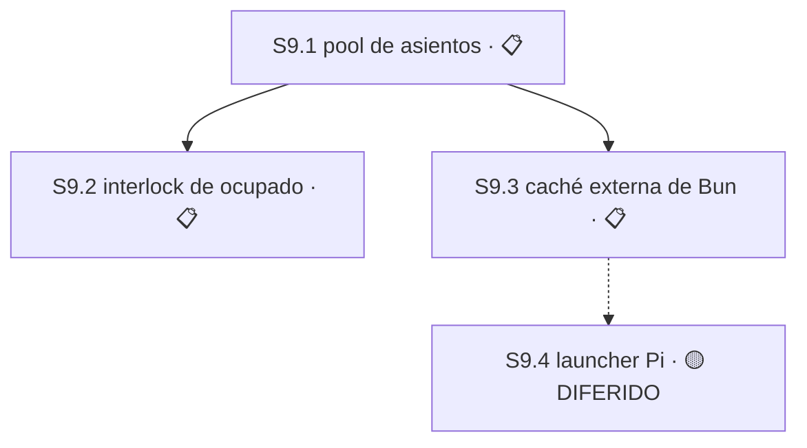

# Plan 9 — Asientos de trabajo y reciclado seguro

**Propósito:** que existan asientos de trabajo estables que Main pueda asignar y reciclar sin pisar a un agente trabajando, y que tener varios no cueste una instalación de dependencias por cada uno.

**Estado:** 🔵 EN CURSO
**Avance:** 0% (0/4 S)

> **Reordenado y recortado el 2026-08-21 por la [decisión 62](../decision-register.md), tras la auditoría exclusiva de P9.**
> Los IDs son posicionales según el [estándar de planes](/home/emili/.claude/skills/_shared/plan-naming-convention.md), así que
> cambiar el orden cambia el número. La tabla de migración de abajo conserva la trazabilidad de toda referencia histórica.

## Tabla de migración de IDs

Las decisiones 49–54 del [registro](../decision-register.md) y las referencias en [release-chain](../release-chain.md) y el
[master-index](../master-index.md) usan los IDs anteriores. **No se reescribe la historia**: esta tabla es el puente.

| Antes | Ahora | Qué pasó |
|---|---|---|
| `S9.4` | **`S9.1`** | Pasa al frente. No cambia su contrato: no rompe ningún contrato existente y usa `jornada.sh --reciclar` tal como está. |
| `S9.1` | **`S9.2`** | **Reducida de nueve Módulos a un solo resultado.** Sobrevive el interlock de asiento ocupado; se descarta el resto. |
| `S9.2` (mitad caché) | **`S9.3`** | La Sesión se parte. Sobrevive la caché externa de Bun, que es lo que abarata tener varios asientos. |
| `S9.2` (mitad Pi) | **`S9.4`** | La otra mitad. 🟡 DIFERIDO junto a `S1.17`–`S1.19`: Pi es un **segundo host**, posterior a cerrar la ruta OpenCode. |
| `S9.3` | — | **Eliminada.** Existía para volver a encender el reciclador que el primer Módulo de la vieja `S9.1` apagaba. Sin apagado no hay reencendido. |
| `M9.1.7`, `M9.1.8`, `M9.1.9` | — | **Eliminados.** 640 líneas de RFC V2, requirements V2 y guarda de procedencia que el maintainer nunca pidió. |

## Qué se retiró y por qué

**La escala no cerraba.** `jornada.sh:257-286` recicla un worktree en **28 líneas de bash** que funcionan hoy: exige `--nueva-rama`, aborta con `git status --porcelain` si el árbol está sucio, crea rama fresca con `git switch -c <nueva> <trunk> --no-track`, y sólo borra la rama vieja después de que `git cherry` pruebe que nada quedó sin mergear. La vieja `S9.1` proyectaba **~1.900 líneas en nueve Módulos** para reemplazarlas.

**Tres de los nueve Módulos no entregaban código.** `M9.1.7` era un RFC V2 de 240 líneas, `M9.1.8` un requirements V2 de 240 y `M9.1.9` un manifest con guarda de procedencia de 160. **640 líneas de documentación sobre el reciclado, dentro de una Sesión que existe para rotarle la rama a una carpeta.** El maintainer no las pidió y se eliminan. La [decisión 58](../decision-register.md) ya nombró a `console/vocabulary.mjs` autoridad de alcance y la 60 dejó el [inventario](../inventario-de-producto.md) como mapa; un RFC V2 sería un tercer documento gobernando lo mismo.

**La maquinaria de seguridad defendía de un atacante ajeno a este proyecto.** `M9.1.3` exigía por archivo la secuencia `pre-lstat → open O_RDONLY|O_NOFOLLOW → fstat inmediato → digest → post-fstat → post-lstat`, más dos observaciones canónicas independientes RFC8785/JCS, matrices de precedencia de siete códigos y once arreglos `argv` exactos para `git`. Eso defiende de ataques de enlace simbólico y carreras TOCTOU, que exigen **un atacante con el mismo usuario en la misma máquina** — quien llegó ahí ya tiene las claves SSH y el token de GitHub. Es la misma clase que la [decisión 59](../decision-register.md) resolvió para `capabilities/registry.mjs`: maquinaria correcta y bien probada para un modelo de amenaza que no es el de este proyecto.

**El riesgo real es más chico y sí justifica trabajo:** una carrera entre el maintainer y Main. El bash es manual y una persona no compite consigo misma; la invocación programática de Main sí puede reciclar un asiento ocupado, o dos Main pueden tocar el mismo. Eso es lo que conserva la nueva `S9.2`.

**El plan estaba invertido.** La pieza más barata y más útil —el pool de asientos— era la última y dependía de una Sesión cuyo primer Módulo apagaba el mecanismo que ella necesitaba.

## Resumen auditable

| Campo | Contrato |
|---|---|
| Orden aprobado | `S9.1 → S9.2 → S9.3`. `S9.4` está 🟡 DIFERIDO y no participa del orden activo. |
| Avance canónico | 0% (0/4 S). Ninguna Sesión está ✅ COMPLETO. El denominador se mantiene en 4 bajo la regla de la [decisión 57](../decision-register.md): `S9.4` es diferido-con-intención y por lo tanto se conserva. |
| Entrega | Commit directo a `master`, sin PR. Cada resultado independientemente verificable y revertible, ≤400 líneas authored. |
| Próxima acción | Enumerar `Área`, `Recurso` y Módulos de `S9.1`. No queda ninguna decisión que responder. |
| Decisión abierta | **Ninguna.** El tamaño del pool quedó resuelto el 2026-08-21: **tres asientos**. P9 es decision-clean. |
| Autoridad histórica | Engram 8478 rev8, 8506, 8645, 8646, 8647 rev2, 8894, 8898, 8950, 8955, 8908; decisiones 49–54 y 62. Los artefactos SDD de la vieja `S9.1` viven en `openspec/changes/s9-1-safe-slot-lifecycle/` y describen un alcance **superado**: se conservan como evidencia, no como autoridad de implementación. |

---

## Sesión 9.1 — Pool de asientos permanentes y asignación por Main

**Estado:** 📋 PLANIFICADO — primera de la cola de P9.

**Depende de:** nada dentro de P9. No rompe ningún contrato existente.

**Área:** `PENDIENTE DE ENUMERAR`, acotada por el contrato de abajo. Enumerarla es trabajo, no decisión.

**Recurso:** el registro de asientos y el binding de asignación. Sin transporte propio.

**Ruta:** `design-tasks`.

### Por qué no rompe nada — verificado el 2026-08-20 y reconfirmado el 2026-08-21

| Lo que necesita | Estado hoy |
|---|---|
| Identidad estable del asiento | `core.mjs:4328-4331` identifica un worktree **por su path, nunca por su rama**, con el comentario explícito *"jornada scripts recycle a worktree across branches, so the branch is not stable between sessions"*. La identidad del asiento **ya es el path**. |
| Rotar rama y base sin tocar el asiento | `schemas/assignment-v1.schema.json` ya separa `workspace.path`, `workspace.branch` y `workspace.base_sha`. Fijar el path y rotar los otros dos es lo que el contrato **ya permite**. |
| Rotación efectiva de la rama | `jornada.sh --reciclar <ruta> --nueva-rama <nombre>` ya la implementa, con sus salvaguardas. **Esta Sesión lo usa tal como está.** |
| Precedente de asiento con nombre fijo | `Worktrees/support-agent` ya existe y funciona así. |

### Contrato — aprobado por la decisión 51, conservado íntegro

1. **Pool fijo de asientos con nombre permanente.** Los asientos no se crean ni se destruyen por Sesión; existen y se reciclan. El nombre es estable y no describe el trabajo que aloja.
2. **El rol pertenece a la asignación, no al agente.** Se usa el `assignment-v1.role` existente (`planning` | `implementation`) más su `lane`. Un asiento no se especializa.
3. **Asientos intercambiables.** Un pool de N debe poder atender N trabajos del mismo tipo.
4. **Main asigna.** Main consulta asientos libres y liga cada uno a una asignación con su rama y su `base_sha`.
5. **Formato de rama:** `<tipo>/s<sesión>-<slug>` — por ejemplo `feat/s1.3-idempotent-delivery`, `audit/s2.1-lock-huerfano`.

### Decisiones

- `escala` — **el tamaño del pool. RESUELTA por el maintainer el 2026-08-21: tres asientos.** **Clase:** expansión de alcance; dinero y cuotas, porque cada asiento cuesta una instalación de dependencias hasta que `S9.3` la abarate. **Resolución:** tres — uno planificando, uno implementando, uno libre para una urgencia. Cubre el patrón de trabajo real sin abrir un costo indefinido, y con la caché de `S9.3` el tercero es casi gratis. **Falsificable:** un pool de tres que no pueda atender el patrón real de trabajo sin crear asientos nuevos. **Contamina:** `S9.1` y el dimensionamiento de `S9.3`.

**P9 queda decision-clean.** No resta ninguna decisión abierta en todo el Plan.

---

## Sesión 9.2 — Interlock de asiento ocupado

**Estado:** 📋 PLANIFICADO

**Depende de:** `S9.1` — el interlock protege asientos, así que primero tienen que existir.

**Área:** `PENDIENTE DE ENUMERAR`.

**Recurso:** lock exclusivo de mutación de asiento; estado de ocupación.

**Ruta:** `design-tasks`.

**Resultado, uno solo:** **Main no puede reciclar un asiento ocupado.** La ocupación es legible y el reciclado toma un lock exclusivo que falla cerrado si el asiento está tomado o si otro Main lo está mutando.

**Qué NO entrega, y es deliberado.** Se descartan de la vieja `S9.1`: la seguridad de descriptores contra symlink y TOCTOU, la doble observación canónica RFC8785/JCS, las matrices de precedencia de siete códigos, la enumeración de once arreglos `argv` exactos, y el interlock one-way que apagaba `jornada.sh --reciclar`. **El reciclador manual se conserva intacto** — la [decisión 50](../decision-register.md) ya había reabierto ese Módulo justamente porque apagaba una herramienta en uso.

**Decisiones:** ninguna abierta. La frontera quedó fijada por la decisión 62.

---

## Sesión 9.3 — Caché externa congelada de Bun

**Estado:** 📋 PLANIFICADO

**Depende de:** `S9.1` — la caché existe para abaratar un pool de N asientos.

**Área:** `workspace/dependency-cache.mjs`, `schemas/dependency-fingerprint-v1.schema.json`, `schemas/dependency-install-receipt-v1.schema.json`, `test/workspace/**`, tests de schemas bajo `test/contracts/**`.

**Recurso:** roots externas exactas de caché y estado; lock por `input-digest`.

**Ruta:** `design-tasks`.

**Autoridad:** decisión 53 del 2026-08-20 — **fast-frozen-only**. Siempre `bun ci`, con caché de descargas Bun externa y acotada al proyecto, manteniendo `materialized_node_modules_reuse: disabled` y `authorizes_install_skip: false`. Cada asiento instala desde cero pero descarga de caché local; si algo no cierra, falla en vez de improvisar. **Descartada:** el árbol materializado reutilizable entre asientos — más rápido a la larga, pero abre un contrato nuevo y otra ronda de decisiones.

**Criterios de aceptación:**

- [ ] `bun ci` corre siempre; caché, receipt o árbol previo nunca autorizan omitirlo
- [ ] El fingerprint liga inputs, versión de Bun, CPU/OS, roots, argv y environment exactos
- [ ] La publicación del receipt ocurre atómicamente después de una instalación exitosa
- [ ] Una instalación parcial falla cerrado en vez de aceptarse
- [ ] El diff toca sólo `Área` y no introduce autoridad Main, SQLite ni API pública

**Módulos:** los dos primeros de la vieja `S9.2` se conservan — fingerprint y schemas cerrados, y caché externa con receipt de instalación. El tercero era el binding del launcher Pi y se movió a `S9.4`.

---

## Sesión 9.4 — Binding del launcher Pi y failure fence

**Estado:** 🟡 DIFERIDO

**Razón registrada.** Pi es un **segundo host** para la Torre, no un transporte. Su `Área` es `hosts/pi-launcher.mjs` y su `Recurso` es un namespace de proceso y raíz Pi. Queda diferido bajo el mismo criterio que `S1.17`–`S1.19` de P1: **la Torre opera con un provider a la vez, y OpenCode va primero.** Se reactiva cuando la ruta OpenCode esté cerrada.

**Corrección registrada.** La auditoría exclusiva de P9 afirmó en su primera versión que «Pi root fresco se va con Moshi». **Era falso**, y repetía el mismo error que el maintainer ya había corregido sobre `S1.17`–`S1.19`. Moshi reemplaza el **transporte remoto**, no un host de ejecución. Nada de Pi se elimina.

**Depende de:** `S9.3` al reactivar, y de que la ruta OpenCode esté cerrada.

**Efecto sobre el avance:** permanece en el denominador. Bajo la regla de la [decisión 57](../decision-register.md), un diferido-con-intención se conserva; sólo sale del denominador lo archivado-fuera-de-alcance.

---

## Grafo de dependencias

`S9.2` y `S9.3` no dependen entre sí y pueden ejecutarse en cualquier orden una vez cerrada `S9.1`.

## Qué queda pendiente de reconciliar fuera de este Plan

- **`master-index.md`** conserva los IDs anteriores y no se toca en esta pasada: tiene cambios sin commitear de `S8.10` y esta sesión no toca trabajo en implementación. Es el mismo bloqueo que la tarea 0.4 del plan de depuración.
- **`release-chain.md`** referencia la vieja `S9.2`; se reconcilia junto con el `master-index`.
- Los artefactos SDD en `openspec/changes/s9-1-safe-slot-lifecycle/` describen el alcance superado. **Se conservan como evidencia histórica**, con su autoridad Engram intacta, y **no son autoridad de implementación** de la nueva `S9.2`.

## Reconciliación de asientos — 2026-08-25

Reconciliación completa de los nueve checkouts sobre `master@a303145`. Ningún asiento queda
sucio. Ninguna rama previa se borró. Disposición aprobada por el maintainer: rescatar
planificación, estacionar código.

### Entregado

- **`a303145`** — `AGENTS.md` incorpora la excepción *Bootstrap de coordinación con la Torre
  apagada*, que venía preparada sin commitear en el asiento `s9-1-planning` sobre una base 39
  commits atrás. Es la regla que exige disposición explícita del maintainer —entregar,
  estacionar o abandonar— por cada worktree sucio antes de reciclarlo. No toca el bloque
  `delivery-policy` y por lo tanto no colisiona con el Área de `S5.13`.

### Estacionado — commiteado en su rama, nunca entregado

| Asiento | Rama | Commit | Contenido |
|---|---|---|---|
| `s5-13-main-policy-evidence` | `feat/plan-5/s5-13-main-policy-evidence` | `fd56b80` | SDD completo de la `S5.13` **anterior** a la Fase 3 |
| `s5-5` | `feat/plan-5/s5-5-parking-resume` | `acd8f7f` | `escalation/{parked,resume}.mjs` + 3 tests |
| `s10-2-integration` | `feat/s8.11-shared-dependency-environment` | `3cb83fe` | 12 commits de `S8.11` + reescritura de fixtures |

Las tres ramas existen **sólo en local**. No hay respaldo remoto.

### Descartado — verificado superado antes de descartar

- **`s5-9`**: los once archivos ya estaban en `master`. Diez byte-idénticos; el undécimo,
  `hosts/production-provider.mjs:179`, era la versión previa a la selección explícita de campos.
- **Cuatro documentos de plan** duplicados byte-a-byte entre `s5-5` y `s5-13`
  (`decision-register`, `master-index`, `plan-5/STATUS`, `release-chain`): borrador anterior a
  la Fase 3. `plan-5/STATUS.md` tenía 956 líneas contra 1137 entregadas.
- **`s8-11-fixture-rewrite`**: segundo intento divergente del mismo arreglo de fixtures que
  `s10-2-integration`, sobre los mismos 12 commits. Sobrevive el de `s10-2-integration`.

Respaldo de todo lo descartado —parches y untracked— tomado antes de descartar.

### El SDD estacionado de `S5.13` no es autoridad de implementación

Describe *Trusted Main Policy Evidence and Main-Only Dispatch* bajo la decisión 57. La Fase 3
redefinió `S5.13` como **retiro de la verificación de proceso de la entrega** bajo la decisión
64. Mismo ID, Sesión distinta. Se conserva como evidencia histórica, igual que
`openspec/changes/s9-1-safe-slot-lifecycle/`, y **no se entrega a `master`**.

### Contradicción abierta — la suite no está verde

`test/install/launch-worker-cli.test.mjs:51` falla por timeout a los 5000 ms esperando
`CT_LAUNCH_BINDING_INVALID`, y recibe `""`. Reproducido de forma determinista en tres corridas.
**Es preexistente**: falla igual en el árbol limpio de `ee03ec5`, sin ningún cambio aplicado.
La suite completa da **862 pass / 13 todo / 1 fail**, contra los 863 / 13 / 0 registrados al
cerrar la Fase 3. Sin dueño asignado.
