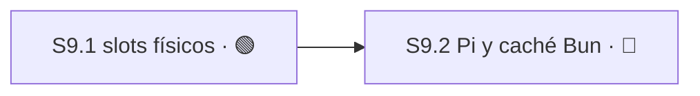

# Plan 9 — Slots seguros de Jornada y caché externa de Bun

**Estado:** 🟢 LISTO
**Avance:** 0% (0/2 S)

> Engram 8478 revisión 8 autoriza crear un Plan nuevo con este título y exactamente dos
> Sesiones secuenciales. No reabre P3: P3 conserva `✅ COMPLETO · 100% (4/4 S)`, y
> `S3.5`/`S3.6` siguen pendientes de una decisión de ubicación fuera de P9. Engram 8506
> resuelve el contrato visible de `S9.1`: preserva `jornada.sh --reciclar` como wrapper de
> compatibilidad cuya única ruta de mutación es `inspect → retire → create`, fail-closed,
> sin branch-switch de un worktree ocupado, borrado automático de ramas ni una segunda
> implementación legacy. La autoridad cubre planificación y habilita la ruta `full-sdd` de
> `S9.1`; no aprueba implementación, entrega ni la frontera de caché fast-frozen de `S9.2`.

P9 está 🟢 LISTO porque `S9.1` ya tiene contrato fijo y puede iniciar su elaboración
`full-sdd`. `S9.2` permanece 🔴 BLOQUEADO por dependencia de `S9.1` y por la decisión abierta
sobre la frontera fast-frozen de la caché externa de Bun.

## Resumen auditable

| Campo | Contrato |
|---|---|
| Autoridad | Engram 8478 revisión 8: Plan nuevo P9, título exacto y dos Sesiones secuenciales. Engram 8506: contrato visible de `S9.1` resuelto. |
| Frontera aprobada | Para planificar `S9.1`: wrapper compatible `jornada.sh --reciclar`, con única mutación `inspect → retire → create`, fail-closed, sin branch-switch ocupado, auto-delete de ramas ni segunda implementación. |
| No autorizado | Implementación, frontera fast-frozen de `S9.2`, commit, push o entrega. |
| Orden | `S9.1 → S9.2`. `S9.2` no puede avanzar antes de que `S9.1` esté ✅ COMPLETO. |
| Capacidad derivada | `S9.1` es una Sesión ejecutable ahora. Capacidad interna máxima: 1; `S9.2` no es ejecutable. |
| Avance | 0% (0/2 S): ninguna Sesión está ✅ COMPLETO ni 📚 ARCHIVADO. |
| Alcance ajeno | P9 no absorbe `S3.5`/`S3.6`, no depende de `S1.12`/`S5.8` y no desplaza ni colisiona con esas Sesiones. |

## Evidencia oficial de Bun

Estas referencias oficiales sustentan la recomendación técnica; **no convierten la
recomendación en autoridad aprobada**:

- Instalación congelada y `bun ci`: <https://bun.sh/docs/pm/cli/install>. `bun ci` instala
  desde el lockfile y equivale al modo congelado; un desacuerdo debe fallar en vez de
  actualizar el lock.
- Caché global por defecto y `BUN_INSTALL_CACHE_DIR`:
  <https://bun.sh/docs/pm/global-cache>. La caché de descargas puede ubicarse fuera de la
  raíz materializada del proyecto.
- Instalaciones aisladas, `node_modules/.bun` y enlaces:
  <https://bun.sh/docs/pm/isolated-installs>. El árbol materializado sigue siendo propio de
  la instalación y no constituye una prueba portable para otra raíz.
- Configuración de `install.cache` y `install.globalStore` en `bunfig.toml`:
  <https://bun.sh/docs/runtime/bunfig#install-cache>. La configuración permite controlar
  caché y store; cualquier uso en P9 debe quedar ligado de forma exacta al recibo.

Bun normaliza CPU y OS para resolver paquetes, pero el árbol resultante puede depender de
plataforma. Por eso la recomendación incluye `cpu` y `os` en el fingerprint cerrado y
rechaza tratar una caché mutable como prueba de instalación.

## Recomendación técnica pendiente de aprobación

### Raíces propuestas

Las siguientes rutas son una propuesta auditable, no autoridad de implementación:

- Estado de slots: `<git-common-dir>/control-tower/workspace-slots/v1/`.
- Lock exclusivo de mutación: `<git-common-dir>/control-tower/workspace-slots/v1/mutation.lock`.
- Estado por slot físico: `<git-common-dir>/control-tower/workspace-slots/v1/slots/<slot-id>.json`.
- Raíz Pi fresca por ejecución: `<git-common-dir>/control-tower/pi-roots/v1/<input-digest>/`.
- Caché de descargas Bun por proyecto y fingerprint:
  `<git-common-dir>/control-tower/bun-cache/v1/<fingerprint-digest>/downloads/`.
- Store global aislado opcional, sólo si Bun oficial lo soporta para la versión ligada:
  `<git-common-dir>/control-tower/bun-cache/v1/<fingerprint-digest>/global-store/`.
- Lock por input:
  `<git-common-dir>/control-tower/bun-cache/v1/locks/<input-digest>.lock`.
- Recibo de instalación:
  `<git-common-dir>/control-tower/bun-cache/v1/receipts/<input-digest>.json`.

Todas las raíces deben resolverse desde el `git common-dir` canónico del proyecto, quedar
bajo ese directorio, rechazar symlinks, dueños ajenos y modos permisivos, y no cruzarse
entre proyectos. No se propone una caché compartida entre proyectos.

### Fingerprint cerrado propuesto

`dependency-fingerprint-v1` tendría `additionalProperties: false` y exactamente:

- `schema`, `schema_version`, `project_id` y digest de la raíz Git canónica;
- SHA-256 de `package.json`, lockfile Bun y configuración de Bun admitida;
- versión y digest del ejecutable Bun;
- `cpu` y `os` normalizados por Bun;
- política fija `install_command: ["bun", "ci"]`;
- `materialized_node_modules_reuse: "disabled"`;
- `authorizes_install_skip: false`;
- rutas canónicas exactas de caché de descargas y store global aislado, si se habilita.

Su digest se calcula sobre JSON canónico. Cualquier campo ausente, extra o distinto crea
otro fingerprint y exige otra instalación. La caché es sólo una ayuda de entrada: su
presencia, mtime o contenido mutable nunca prueba que una instalación terminó bien.

### Recibo cerrado propuesto

`dependency-install-receipt-v1` tendría `additionalProperties: false` y ligaría:

- el fingerprint completo y su digest;
- el `input-digest`, la raíz Pi fresca y el directorio de trabajo exactos;
- el argv exacto `bun ci`, la versión/digest del ejecutable y las variables de caché
  permitidas;
- digests y modos de `package.json`, lockfile y configuración antes y después;
- `cpu`, `os`, timestamps de inicio/fin, exit code y digest de stdout/stderr saneados;
- testigo del `node_modules` recién materializado dentro de la raíz Pi;
- `materialized_node_modules_reuse: "disabled"` y `authorizes_install_skip: false`.

El recibo se escribe en un temporal regular dentro de su raíz, se verifica contra el schema
y los inputs actuales, se sincroniza y se publica por rename atómico antes del lanzamiento.
Un recibo ausente, parcial, de otro input, con lock/config alterados o con bindings distintos
impide lanzar Pi. El árbol `node_modules` nunca se toma de una ruta externa personalizada y
nunca habilita omitir `bun ci`.

## Enmiendas documentales requeridas

Cuando cada Sesión tenga su decisión aprobada, su única ejecución `full-sdd` debe reconciliar
antes de implementación:

1. [`openspec/rfc/sdd-tower-implementation-v1.md`](../../rfc/sdd-tower-implementation-v1.md):
   slots físicos, transición `retire → create`, raíz Pi fresca y frontera de caché.
2. [`openspec/specs/sdd-tower-implementation-v1-requirements.md`](../../specs/sdd-tower-implementation-v1-requirements.md):
   contratos fail-closed, fingerprints, recibos, locks, idempotencia y prohibiciones.
3. Los dos schemas cerrados de `S9.2`, con sus casos positivos y negativos, sin cambiar una
   API pública ni la autoridad Main/SQLite.

## Sesión 9.1 — Ciclo seguro de slots físicos y retiro del reciclaje legacy

**Estado:** 🟢 LISTO
**Ruta:** `full-sdd`, una sola vez para toda `S9.1`; nunca uno por Módulo. El contrato ya
está fijo, pero la implementación sigue siendo sustancial y riesgosa y requiere
proposal → spec → design → tasks → apply → verify una vez para toda la Sesión.
**Autoridad:** Engram 8478 revisión 8 aprueba P9; Engram 8506 resuelve el contrato visible
de `--reciclar` y autoriza únicamente la planificación `full-sdd` de `S9.1`, no su
implementación ni entrega.

**Depende de:** `S3.1` ✅, `S3.4` ✅. P3 documenta la entrega de Workspace/Jornada y el
ciclo de vida persistido; no se inventa otro ID. `S9.1` no depende de `S1.12` ni `S5.8` y
su `Área`/`Recurso` no los desplaza ni los contamina.

**Área:** `workspace/**`, `jornada.sh`, `test/workspace/**`, `test/jornada/**`,
`openspec/rfc/sdd-tower-implementation-v1.md`,
`openspec/specs/sdd-tower-implementation-v1-requirements.md`

**Prohibido:** `core.mjs`, `mcp.mjs`, `main-store/**`, `hosts/**`, las raíces de `S1.12`
y `S5.8`, cualquier ruta fuera de `Área`.

**Recurso:** registro Git de common-dir/worktrees; raíz de estado de slots físicos; lock
exclusivo de mutación de slot.

**Resultado de una PR:** inspección fail-closed y ciclo físico `retire → create` con recibo
persistido antes de lanzamiento; el wrapper legacy no cambia de rama ni elimina un
worktree ocupado en sitio.

### Decisiones de S9.1

- `derivable` — ubicación del trabajo en un Plan nuevo. **RESUELTA:** P9, sin reabrir P3.
  **Autoridad:** Engram 8478 revisión 8. **Criterio falsificable:** P3 permanece
  `100% (4/4 S)` y P9 contiene exactamente `S9.1` y `S9.2`; cualquier cambio del
  denominador de P3 contradice la autoridad.
- `derivable` — arquitectura de mutación física. **RESUELTA:** siempre `retire → create`;
  nunca cambiar de rama un worktree ocupado. **Autoridad:** Engram 8478 revisión 8.
  **Criterio falsificable:** cualquier argv o camino que ejecute branch-switch sobre el
  worktree ocupado, o que cree antes de completar el retiro, viola el contrato.
- `escala` — **RESUELTA POR EL MAINTAINER:** preservar el contrato CLI visible
  `jornada.sh --reciclar` como wrapper de compatibilidad. Su única ruta de mutación es
  `inspect → retire → create`; opera fail-closed, nunca cambia de rama un worktree
  ocupado, nunca autoelimina ramas y no conserva una segunda implementación legacy.
  **Clase:** contrato visible del producto. **Autoridad:** Engram 8506.
  **Historia auditable:** Engram 8478 revisión 8 dejó abiertas tres opciones —conservar,
  eliminar o redefinir— y detuvo `S9.1` antes de proposal/spec/design; Engram 8506 eligió
  conservar el nombre con la semántica segura anterior. La decisión ya no bloquea ni
  contamina `S9.1`.
- `derivable` — conformidad de la implementación con el contrato CLI ya resuelto.
  **Autoridad:** Engram 8506. **Criterio falsificable:** cualquier camino de código en
  `--reciclar` que no falle cerrado ante precondiciones inválidas, mute estado
  Git/worktree sin pasar por `inspect → retire → create`, cambie de rama un worktree
  ocupado, autoelimine una rama o mantenga una segunda implementación de mutación viola
  la autoridad 8506.

### Módulo M9.1.1 — Inspección read-only de slots

- [ ] Tarea T9.1.1.1 — RED: especificar pruebas que rechacen common-dir ambiguo, slot
  ausente/ocupado, symlink, dueño o modo inseguros, lock ocupado y estado divergente,
  demostrando cero mutación de refs, worktrees, ramas, archivos y locks.
- [ ] Tarea T9.1.1.2 — GREEN: implementar la inspección read-only mínima con identidad
  canónica de proyecto, worktree, rama, Jornada y slot físico, sin argv Git mutante.
- [ ] Tarea T9.1.1.3 — REFACTOR: unificar errores estables y testigos antes/después sin
  ampliar `Área` ni convertir inspección en reparación.

### Módulo M9.1.2 — Ciclo fresh create/retire

- [ ] Tarea T9.1.2.1 — RED: especificar retiro idempotente, creación de rama/worktree
  frescos, lock exclusivo, fallos parciales y prohibición absoluta de branch-switch sobre
  un worktree ocupado.
- [ ] Tarea T9.1.2.2 — GREEN: implementar `retire → create` con publicación atómica del
  estado y recibo exacto antes de que una Jornada pueda lanzar trabajo.
- [ ] Tarea T9.1.2.3 — REFACTOR: concentrar rollback seguro e idempotencia sin autoeliminar
  contenido desconocido ni relajar los fences de filesystem/Git.

### Módulo M9.1.3 — Migración del wrapper legacy

- [ ] Tarea T9.1.3.1 — RED: fijar la semántica visible de `--reciclar` resuelta por
  Engram 8506, sus errores y compatibilidad, y demostrar que su única mutación pasa por
  `inspect → retire → create`, sin branch-switch ocupado ni auto-delete de ramas.
- [ ] Tarea T9.1.3.2 — GREEN: hacer que `jornada.sh` delegue únicamente al ciclo seguro
  aprobado, sin una segunda implementación de mutación.
- [ ] Tarea T9.1.3.3 — REFACTOR: reducir el wrapper a traducción de CLI y preservar salida,
  códigos y documentación aprobados sin rutas legacy ocultas.

### Criterios de aceptación de S9.1

Todos deben pasar para cerrar:

- [ ] Common-dir ambiguo, raíz no canónica, symlink, dueño/modo inseguro, slot ocupado,
  lock ocupado, identidad divergente o estado parcial fallan cerrados.
- [ ] Cada rechazo deja en cero las mutaciones de refs, ramas, worktrees, registro Git,
  estado de slots, locks persistentes y archivos observados.
- [ ] Una creación exitosa usa rama nueva y worktree físico fresco; nunca cambia de rama
  el worktree ocupado.
- [ ] El orden observable es retiro completo y verificado antes de creación; nunca create
  sobre ocupación ni branch-switch en sitio.
- [ ] El recibo exacto de slot/Jornada queda validado y publicado atómicamente antes de
  cualquier lanzamiento.
- [ ] Repetir retire, create o recuperación con el mismo input es idempotente; un input
  distinto no reutiliza evidencia anterior.
- [ ] `jornada.sh` nunca ejecuta branch-switch ni borrado en sitio; sólo traduce la CLI a
  la operación segura aprobada.
- [ ] `--reciclar` preserva compatibilidad y cumple exactamente Engram 8506: única mutación
  `inspect → retire → create`, fail-closed, sin branch-switch ocupado, auto-delete de
  ramas ni segunda implementación de mutación.
- [ ] Pasan las pruebas enfocadas de `test/workspace/**` y `test/jornada/**` y luego
  `bun test` completo.
- [ ] El diff de implementación no toca ninguna ruta fuera de `Área` ni ninguna raíz de
  `S1.12`/`S5.8`.

**Forecast de implementación:** 330–390 líneas authored en 8–12 archivos. Si el diseño
proyecta más de 400 líneas, detenerse y dividir `S9.1` en dos Sesiones antes de implementar;
no pedir una excepción silenciosa ni crear otro nivel.

## Sesión 9.2 — Pi root fresco y caché externa congelada de Bun

**Estado:** 🔴 BLOQUEADO
**Ruta:** `blocked` — depende de `S9.1` y falta aprobación del maintainer para la frontera
fast-frozen-only.
**Ruta proyectada tras la decisión:** `full-sdd`, una sola vez para toda `S9.2`; nunca uno
por Módulo.
**Autoridad:** Engram 8478 revisión 8 autoriza planificar el resultado, no la frontera de
caché ni implementación.

**Depende de:** `S9.1`.

**Área:** `hosts/pi-launcher.mjs`, `workspace/dependency-cache.mjs`,
`schemas/dependency-fingerprint-v1.schema.json`,
`schemas/dependency-install-receipt-v1.schema.json`, `test/hosts/**`,
`test/workspace/**`, pruebas de schemas bajo `test/contracts/**`,
`openspec/rfc/sdd-tower-implementation-v1.md`,
`openspec/specs/sdd-tower-implementation-v1-requirements.md`

**Prohibido:** `core.mjs`, `mcp.mjs`, autoridad Main/SQLite, cambios de API pública,
`S3.5`, `S3.6`, las raíces de `S1.12`/`S5.8`, cualquier ruta fuera de `Área`.

**Recurso:** namespace de proceso/raíz Pi; raíces externas exactas de caché y estado; lock
por `input-digest`.

**Resultado de una PR:** cada Pi arranca desde una raíz fresca y sólo después de un
`bun ci` exitoso, ligado por fingerprint y recibo atómico; la caché externa acelera
descargas, pero nunca aporta un `node_modules` reutilizable ni autoriza omitir instalación.

### Decisiones de S9.2

- `escala` — **Pregunta exacta:** ¿se aprueba como frontera obligatoria ejecutar siempre
  `bun ci` en una raíz Pi fresca, con caché de descargas Bun externa y acotada al proyecto
  —y store global oficial aislado opcional—, manteniendo
  `materialized node_modules reuse=disabled` y `authorizes_install_skip=false`; o se exige
  diseñar aparte un contrato de árbol materializado reutilizable?
  **Clase:** contrato visible del producto.
  **Evidencia:** documentación oficial de Bun enlazada arriba: `bun ci`/frozen install,
  caché configurable, instalaciones aisladas bajo `node_modules/.bun` y resolución
  dependiente de CPU/OS. Engram 8478 revisión 8 deja esta frontera sin aprobar.
  **Opciones y consecuencias:**
  1. **Aprobar fast-frozen-only:** siempre corre `bun ci`; se reutilizan sólo descargas y,
     si la versión ligada lo soporta, el store global oficial aislado. Es más simple y
     fail-closed, pero paga materialización por cada raíz fresca.
  2. **Exigir contrato de árbol materializado:** no autoriza reutilización inmediata;
     obliga a otra decisión y otro alcance con identidad, inmutabilidad, relocalización,
     links y pruebas por plataforma. `S9.2` permanece bloqueada hasta aprobarlo.
  **Origen:** `S9.2`, `M9.2.2`.
  **Checkpoint:** antes de proposal/spec/design de `S9.2` y después de `S9.1` ✅ COMPLETO;
  no crear artefactos SDD ni código hasta registrar la opción aprobada.
  **Contamina:** toda `S9.2`; no contamina `S1.12`, `S5.8`, `S3.5` ni `S3.6` porque no
  comparten dependencia, `Área` o `Recurso` declarados con P9.

### Módulo M9.2.1 — Fingerprint y schemas cerrados

- [ ] Tarea T9.2.1.1 — RED: especificar casos de campos ausentes/extra, digest distinto,
  Bun distinto, lock/config drift, CPU/OS distintos, rutas de caché ajenas, symlinks y
  bindings no canónicos para ambos schemas cerrados.
- [ ] Tarea T9.2.1.2 — GREEN: implementar y registrar
  `dependency-fingerprint-v1` y `dependency-install-receipt-v1` con invariantes cerrados
  y digest canónico.
- [ ] Tarea T9.2.1.3 — REFACTOR: compartir canonicalización/validación existente sin abrir
  la API pública ni mover autoridad a Main/SQLite.

### Módulo M9.2.2 — Caché externa y recibo de instalación

- [ ] Tarea T9.2.2.1 — RED: especificar raíz fresca, `bun ci` obligatorio, lock por input,
  caché hit/miss, fallos parciales, lock/config inmutables y rechazo de `node_modules`
  externo o de cualquier install skip.
- [ ] Tarea T9.2.2.2 — GREEN: implementar la caché externa acotada al proyecto y publicar
  el recibo atómico sólo después de `bun ci` exitoso y verificación exacta de bindings.
- [ ] Tarea T9.2.2.3 — REFACTOR: separar ayuda mutable de caché y prueba inmutable del
  recibo, preservando idempotencia por `input-digest` y limpieza segura de temporales
  propios.

### Módulo M9.2.3 — Binding del launcher Pi y failure fence

- [ ] Tarea T9.2.3.1 — RED: especificar que Pi no arranca ante recibo ausente, parcial,
  stale o ajeno; bindings de raíz/Bun/fingerprint distintos; proceso anterior no detenido;
  o falta de prueba de stop.
- [ ] Tarea T9.2.3.2 — GREEN: ligar `hosts/pi-launcher.mjs` a la raíz fresca, al recibo
  verificado y al namespace de proceso exactos antes de lanzar.
- [ ] Tarea T9.2.3.3 — REFACTOR: centralizar el fence de lanzamiento y los errores estables
  sin soportar OpenCode/Claude ni ampliar la superficie pública.

### Criterios de aceptación de S9.2

Todos deben pasar para cerrar:

- [ ] Cada ejecución Pi recibe una raíz nueva y vacía, distinta de cualquier raíz ocupada
  o materializada anteriormente.
- [ ] `bun ci` corre siempre dentro de esa raíz; ninguna caché, recibo previo o árbol
  presente autoriza omitirlo.
- [ ] `package.json`, lockfile y configuración admitida conservan bytes, digest y modo
  antes/después; cualquier drift falla cerrado.
- [ ] El fingerprint cerrado liga versión/digest de Bun, `cpu`, `os`, inputs y rutas
  exactas; plataforma distinta no reutiliza identidad.
- [ ] Una caché mutable puede ayudar a descargar, pero nunca cuenta como prueba de
  instalación ni como recibo.
- [ ] No existe `node_modules` externo personalizado, reutilización de árbol materializado
  ni install skip; ambos flags contractuales permanecen deshabilitados.
- [ ] El recibo se valida y publica atómicamente después de `bun ci`, y liga exactamente
  raíz Pi, input, fingerprint, ejecutable, argv y ambiente permitido.
- [ ] Pi no lanza sin bindings exactos, recibo válido y prueba verificable de que el proceso
  anterior está detenido; un stop ambiguo falla cerrado.
- [ ] Repetir el mismo input serializa por lock y es idempotente respecto del recibo; un
  input distinto obtiene otra raíz, lock y recibo.
- [ ] Pasan las pruebas enfocadas de `test/hosts/**`, `test/workspace/**` y schemas, y luego
  `bun test` completo.
- [ ] El diff de implementación no toca ninguna ruta fuera de `Área`, autoridad Main/SQLite,
  API pública, `S3.5`/`S3.6` ni raíces de `S1.12`/`S5.8`.

**Forecast de implementación:** 340–395 líneas authored en 8–12 archivos. Si el diseño
proyecta más de 400 líneas, detenerse y dividir `S9.2` en dos Sesiones antes de implementar;
no pedir una excepción silenciosa ni crear otro nivel.

## Grafo del Plan 9

`S9.1` es una Sesión ejecutable bajo Engram 8506. `S9.2` no es ejecutable: sólo puede
avanzar cuando `S9.1` esté ✅ COMPLETO y la frontera de caché tenga aprobación. El máximo
interno derivado permanece en 1.

## No objetivos

- `S3.5` y `S3.6`, cuya ubicación sigue escalada fuera de P9.
- Reutilizar `node_modules` materializado o autorizar install skip.
- Caché compartida entre proyectos.
- Borrado automático de worktrees, slots, raíces Pi o cachés desconocidas.
- Launchers de OpenCode o Claude.
- Tower runtime, DB/SQLite, autoridad Main o cambios de API pública.
- `S1.12`, `S5.8` o cualquiera de sus raíces.
- Commit, push, PR, publicación, despliegue o cualquier entrega.

## Forecast de revisión

Carga de revisión prevista: **alta**. Son dos Sesiones secuenciales, cada una limitada a una
PR y con guardia explícita de 400 líneas. RDD, JD, 4R y la revisión nativa permanecen OFF;
este apartado es sólo forecast y no crea recibos, gates ni autorización de entrega.
