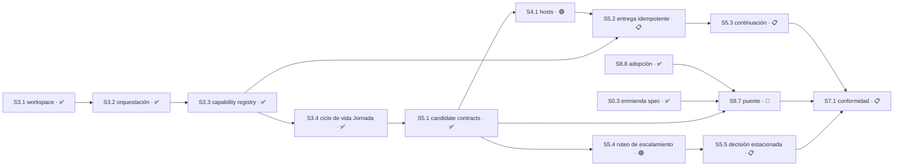

# Cadena de release — producto único

> Decidido el 2026-08-01 por el maintainer. Este archivo define **qué tiene que estar
> cerrado para declarar la primera versión del producto**, y en qué orden lo permite el
> grafo de dependencias.
>
> El [master-index](master-index.md) dice DÓNDE estamos. Este archivo dice QUÉ FALTA
> para salir. El estado del código vive en [implementation-state](implementation-state.md).

## La decisión

**Control Tower es un solo producto con un solo roadmap.** Las etiquetas `installable-v1`
y `autonomous-v2` dejan de ser identidades de producto.

Motivo: el maintainer definió que la primera versión no se declara hasta poder **aprobar
desde el teléfono** las decisiones que requieren su autoridad. Esa capacidad está
especificada en `sdd-tower-implementation-v1-requirements.md` §16–§17, y el split del
2026-07-31 la había reasignado al lane `autonomous-v2`. Con ese alcance dentro, la
frontera entre los dos "productos" ya no describe el trabajo: dejó de separar dos cosas
entregables y pasó a separar la primera versión de sí misma.

### Lo que NO cambia

1. **La entrega sigue siendo incremental.** Un roadmap único no significa que nada sale
   hasta que sale todo. Cada Sesión sigue siendo una unidad entregable a `master`, y el
   orden lo dicta el grafo, no un big bang.
2. **`CT_V2_ONLY` no se borra.** `bin/torre:28` corta capacidades en código, no en prosa.
   Al desaparecer la frontera de producto, esa línea pasa a ser un **flag de capacidad
   opt-in, apagado por defecto**. La autonomía se enciende porque alguien la enciende,
   nunca porque se cayó una etiqueta.
3. **Los lanes siguen sirviendo como afinidad de trabajo**, no como límite de producto.

## El punto de release

La primera versión se declara cuando el maintainer puede, desde Telegram:

- ver el estado de un proyecto registrado;
- recibir el escalamiento de toda decisión que requiera su autoridad;
- aprobar o rechazar esa decisión sobre un **objetivo exacto**, con sobre inmutable,
  nonce de un solo uso y expiración;
- prender y apagar el ruteo a Telegram según esté fuera o en casa.

Y cuando, con Hermes ausente, la operación local por CLI sigue completa.

## La cadena

| Orden | ID | Resultado | Estado | Depende de |
|---|---|---|---|---|
| ✅ | `S8.8` | Adopción del instalable en el runtime en uso | ✅ COMPLETO | `S8.2` ✅ |
| ✅ | `S0.3` | Enmienda del requisito de puente acotado | ✅ COMPLETO | — |
| ✅ | `S3.1` | Workspace | ✅ COMPLETO | `S2.4` ✅ |
| ✅ | `S3.2` | Orquestación | ✅ COMPLETO | `S3.1` ✅; implementación `22c43ae`, 14/14 criterios `CORROBORATED_FIXED` |
| ✅ | `S3.3` | Agent Capability Registry | ✅ COMPLETO | `S3.2` ✅; implementación `4621d3f`, 14/14 criterios verificados por el planner contra el SHA integrado |
| ✅ | `S3.4` | Persistencia y ciclo de vida de Jornada | ✅ COMPLETO | `S3.2` ✅, `S3.3` ✅; implementación `b6dda84`, 11/11 criterios verificados por el planner contra el SHA integrado. **Cierra P3 entero** |
| ✅ | `S5.1` | Candidate contracts, authorization store y frontera Support | ✅ COMPLETO | `S3.2` ✅, `S3.3` ✅, `S3.4` ✅; candidato `c7c2472`, 27/27 criterios y 537/537 tests |
| ▶ | `S4.1` | Hosts y línea exclusiva | 🟢 LISTO | `S3.1` ✅, `S3.2` ✅, `S5.1` ✅; contrato sellado, cero decisiones `escala` abiertas |
| ▶ | `S5.4` | Ruteo de escalamiento fuera/en casa | 🟢 LISTO | `S5.1` ✅; contrato sellado, cero decisiones `escala` abiertas. **No** depende de `S8.7` |
| 2 | `S5.2` | Entrega idempotente y post-check | 📋 PLANIFICADO | `S4.1`, `S3.3` ✅; contrato sellado, cero decisiones `escala` abiertas. Registro propio en `delivery/**` |
| 2 | `S5.5` | Decisión estacionada y continuación independiente | 📋 PLANIFICADO | `S5.4` |
| 3 | `S5.3` | Continuación | 📋 PLANIFICADO | `S5.2` |
| — | `S8.7` | Puente Hermes/Telegram | 🔴 BLOQUEADO | Dependencias ✅; tres decisiones `escala` abiertas del maintainer |
| 4 | `S7.1` | Conformidad de release | 📋 PLANIFICADO | `S5.3`, `S8.7`, `S5.5` |

**Catorce Sesiones · 7 cerradas.** A las trece anteriores se suma `S3.4`, enumerada el
2026-08-04: `jornada-v1` existía como contrato **sin implementación**, y `policy/jornada.mjs`
—que entregó `S3.2`— es un resolvedor puro que recibe la Jornada como argumento, no un store.
Su alcance es **pasivo**: incrementa `jornada_revision` en toda transición, con lo que una
Jornada terminada invalida por drift las entradas de capability ligadas a ella; no dispara
revocación activa en cascada.

De las trece anteriores, once ya estaban enumeradas más dos nuevas — `S3.3`, que estaba
declarada como dependencia de `S5.1` y `S5.2` en
[`autonomous-v2-role-routed-continuation`](../changes/autonomous-v2-role-routed-continuation/tasks.md)
pero no figuraba en ningún plan ni en este grafo, y `S5.5`, que es la Sesión que hace la
planificación **diferible**: registra la decisión que no se puede derivar, declara qué
Sesiones quedan contaminadas, sigue con las independientes y retoma desde el checkpoint.

`S7.1` pasa a depender de `S5.5` en vez de `S5.4`: verificar que el escalamiento **sale**
no alcanza como conformidad de release si la Torre igual se queda esperando la respuesta.
`S5.5` depende de `S5.4`, así que la cobertura de `S5.4` queda incluida.

`S0.3` cerró el 2026-08-01 en `9595b92`. Con eso, la contradicción entre specs sobre si el
puente puede transportar un callback de merge **ya no existe**. Con `S8.8` también completa,
las dependencias de `S8.7` están satisfechas; quedan sus tres decisiones `escala` abiertas.

## Capacidad paralela hoy

La capacidad se deriva del grafo, `Área`, `Recurso` y decisiones abiertas; no se declara como un número fijo.

`S5.1` está ✅ COMPLETO. `S4.1` y `S5.4` están 🟢 LISTO, son independientes en el grafo, tienen `Área` disjunta (`hosts/**` frente a `escalation/**`) y no comparten `Recurso`.

**Capacidad de ejecución hoy: 2.** Pueden avanzar `S4.1` y `S5.4` en paralelo. `S5.2` espera a `S4.1`; `S5.5` espera a `S5.4`; `S5.3` espera a `S5.2`. `S8.7` tiene sus dependencias satisfechas pero sigue 🔴 BLOQUEADO por tres decisiones del maintainer.

La planificación adelantada conserva el techo declarado de dos Sesiones. El siguiente cierre de cada hebra debe volver a derivar capacidad y contaminación desde el grafo vigente, no desde esta fotografía.

## Enmienda `S0.3` — ✅ COMPLETA

Había una contradicción entre dos documentos que describían la primera versión:

| Fuente | Qué dice |
|---|---|
| `openspec/specs/sdd-tower-implementation-v1-requirements.md` §16–§17 | La autorización de merge por Telegram es parte del alcance. Define canal, sobre, callback, fallback textual y revalidación. |
| `changes/archive/2026-07-31-installable-v1-autonomous-v2-split/specs/installable-control-tower-v1/spec.md:73-87` | El puente **MUST NOT** exponer Git delivery ni merge. El escenario *Remote authority is rejected* obliga a **rechazar** una solicitud de merge que venga de Hermes. |

Se resolvió sin interpretación. En una frontera de autoridad, la ambigüedad es el incidente.
`S0.3` enmendó el requisito del puente acotado para que el puente pueda **presentar** una
autorización y **transportar** un callback acotado, manteniendo intacto el principio de
§16.1: *Hermes presenta; Main crea, valida y consume.* El puente nunca tiene autoridad;
transporta la decisión de quien sí la tiene.

## Drift reconciliado — ✅ CERRADO el 2026-08-03

`schemas/authorization-v1.schema.json` y `main-store/store.mjs` **ya coinciden**. Se resolvió
como prerrequisito, fuera del freno de ejecución, porque era un contrato que dos archivos leían
distinto y no trabajo nuevo de `S5.1`.

Eran **seis** divergencias, no las dos que este documento registraba:

| Schema exigía | Store exigía | Resolución |
|---|---|---|
| `pr` (PR-specific), opcional | `target`, `source_sha`, `target_sha` | `delivery` con `shape` (`pull-request`/`direct-push`) |
| `required_checks_digest`, `policy_report_digest` | `checks` | ganan los digests |
| `registry_revision` + `jornada_revision` | un solo `revision` | ganan los dos del schema |
| `nonce_hash`, `created_at`, `action`, `state`, `schema`, `schema_version` | no los exigía | el store los exige |
| clave `state` | clave `status` | `state` |
| valores `PENDING\|CONSUMED\|REJECTED\|EXPIRED\|REVOKED` | `PENDING\|APPROVED\|REVOKED\|EXPIRED` | `PENDING\|APPROVED\|REJECTED\|EXPIRED\|REVOKED` |

**El schema mandaba**, por `sdd-tower-implementation-v1-requirements.md:111` (lista normativa) y
`contracts/schema-registry.mjs:12`. Pero necesitaba enmienda antes de que el store se le adaptara:
su `action` era `MERGE_PR` y su único binding de entrega era `pr`, las dos cosas atadas a entrega
por pull request, incompatibles con el corte política/seguridad de `d232fdf`. Ahora `action` es
`MERGE` y el binding es `delivery`, con condicionales que exigen `number` sólo en `pull-request`
y prohíben `delivery` en `START_JORNADA`.

**Dos cosas que la reconciliación destapó y arregló de paso:**

- El store **no podía registrar un rechazo**. Sus decisiones terminales eran `APPROVED`, `REVOKED`
  y `EXPIRED`; `REJECTED` no existía pese a estar en el enum canónico. Ahora sí.
- `createAuthorization` validaba contra un array `required` escrito a mano al lado de un schema
  canónico — que es exactamente cómo se produjo el drift. Ahora valida contra `authorization-v1`
  vía `contracts/validate.mjs`, así que la clase de bug es estructuralmente imposible.

`S5.1` cerró como dueña del authorization store, sin el contrato roto que existía antes de su ejecución.

Corresponde a `S5.1`, que es la Sesión que toma posesión del authorization store.

## Alcance sin ID

Se registra explícitamente en lugar de esconderse:

- **P2 — responsabilidades posteriores de Change B.** Sin límite de un PR demostrable. Ver
  el [apéndice de migración](plan-vocabulary-migration-appendix.md).
- **P6 — Campañas multiproyecto.** Sin Sesiones enumeradas. Fuera de la cadena de release.
- **P1 — `S1.11`–`S1.19`.** Enumeradas pero **fuera de la cadena**: ningún Plan de la
  cadena declara a P1 como dependencia. No bloquea la primera versión.
- **P8 — `S8.5` y `S8.6`.** 🟡 DIFERIDO por decisión del 2026-07-31. Se mantienen fuera.
