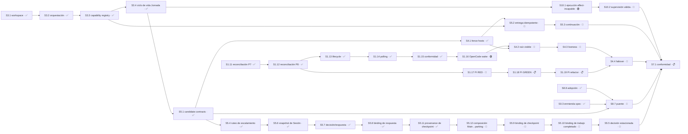

# Cadena de release — producto único

> Decidido el 2026-08-01 por el maintainer. Este archivo define **qué tiene que estar
> cerrado para declarar la primera versión del producto**, y en qué orden lo permite el
> grafo de dependencias.
>
> El [master-index](master-index.md) dice DÓNDE estamos. Este archivo dice QUÉ FALTA
> para salir. El estado del código vive en [implementation-state](implementation-state.md).

## La decisión

**Control Tower es un solo producto, con un solo roadmap y un solo release.** Las etiquetas
`installable-v1`, `autonomous-v2`, “V1” y “V2” sobreviven sólo como nombres de artefactos
históricos; no son identidades vigentes de producto ni de release.

Motivo: el maintainer definió que la primera versión no se declara hasta poder **aprobar
desde el teléfono** las decisiones que requieren su autoridad. Esa capacidad está
especificada en `sdd-tower-implementation-v1-requirements.md` §16–§17, y el split del
2026-07-31 la había reasignado al lane `autonomous-v2`. Con ese alcance dentro, la
frontera entre los dos "productos" ya no describe el trabajo: dejó de separar dos cosas
entregables y pasó a separar la primera versión de sí misma.

### Lo que NO cambia

1. **La entrega sigue siendo incremental.** Un roadmap único no significa que nada sale
   hasta que sale todo. Cada Sesión sigue siendo una unidad entregable a `master`, y el
   orden lo dicta el grafo, no un big bang.
2. **`CT_V2_ONLY` no se borra.** `bin/torre:28` corta capacidades en código, no en prosa.
   Al desaparecer la frontera de producto, esa línea pasa a ser un **flag de capacidad
   opt-in, apagado por defecto**. La autonomía se enciende porque alguien la enciende,
   nunca porque se cayó una etiqueta.
3. **Las etiquetas históricas pueden orientar la lectura de artefactos**, nunca dividir el producto,
   el roadmap o el release.
4. **El orden de hosts se conserva.** OpenCode va primero: `S1.13`–`S1.15` están cerradas y
   `S1.16` está lista. Pi es el segundo host/fallback obligatorio antes del release: `S1.17`
   está bloqueada y `S1.18`–`S1.19` siguen sin implementar.

## El punto de release

La primera versión se declara cuando el maintainer puede, desde Telegram:

- ver el estado de un proyecto registrado;
- recibir el escalamiento de toda decisión que requiera su autoridad;
- aprobar o rechazar esa decisión sobre un **objetivo exacto**, con sobre inmutable,
  nonce de un solo uso y expiración;
- prender y apagar el ruteo a Telegram según esté fuera o en casa.

Y cuando, con Hermes ausente, la operación local por CLI sigue completa.

## La cadena

| Orden | ID | Resultado | Estado | Depende de |
|---|---|---|---|---|
| ✅ | `S8.8` | Adopción del instalable en el runtime en uso | ✅ COMPLETO | `S8.2` ✅ |
| ✅ | `S0.3` | Enmienda del requisito de puente acotado | ✅ COMPLETO | — |
| ✅ | `S3.1` | Workspace | ✅ COMPLETO | `S2.4` ✅ |
| ✅ | `S3.2` | Orquestación | ✅ COMPLETO | `S3.1` ✅; implementación `22c43ae`, 14/14 criterios `CORROBORATED_FIXED` |
| ✅ | `S3.3` | Agent Capability Registry | ✅ COMPLETO | `S3.2` ✅; implementación `4621d3f`, 14/14 criterios verificados por el planner contra el SHA integrado |
| ✅ | `S3.4` | Persistencia y ciclo de vida de Jornada | ✅ COMPLETO | `S3.2` ✅, `S3.3` ✅; implementación `b6dda84`, 11/11 criterios verificados por el planner contra el SHA integrado. **Cierra P3 entero** |
| ✅ | `S5.1` | Candidate contracts, authorization store y frontera Support | ✅ COMPLETO | `S3.2` ✅, `S3.3` ✅, `S3.4` ✅; candidato `c7c2472`, 27/27 criterios y 537/537 tests |
| ✅ | `S4.1` | Hosts y línea exclusiva | ✅ COMPLETO | `S3.1` ✅, `S3.2` ✅, `S5.1` ✅; cierre técnico `1f5fea7`, 19/19 criterios |
| ✅ | `S1.11` | Reconciliación independiente legacy P7 | ✅ COMPLETO | `S1.9` ✅, `S1.10` ✅; publicado en `origin/master@3db3c121` |
| ✅ | `S1.12` | Reconciliación independiente P8 | ✅ COMPLETO | `S1.11` ✅; integrada y verificada localmente en `master@6bb7019`, sin push remoto |
| ✅ | `S1.13` | Root lifecycle e invalidación sincrónica | ✅ COMPLETO | `S1.12` ✅; integrada localmente en `master@794611f` mediante `2bbeddb`, compatibilidad de fixture en `794611f`, focused 10/0/73 y full 620/0/3691, sin push remoto |
| ✅ | `S1.14` | Polling y wake safety | ✅ COMPLETO | `S1.13` ✅; integrada localmente en `master@9886af9`, focused 18/0/175, full 628/0/3793, 392 líneas authored, sin push remoto |
| ✅ | `S1.15` | Conformidad lifecycle OpenCode | ✅ COMPLETO | `S1.14` ✅; integrada localmente en `master@428b3ed` (tree `388b4ca`) después del fixture `6c968e0`; full 643/0/3818 en 41 archivos, 399 líneas authored, sin push remoto |
| ▶ | `S1.16` | Transporte reconciliado y composición wake | 🟢 LISTO | `S1.15` ✅; siguiente Sesión soportada por su única dependencia cerrada, sin inicio ni crédito |
| — | `S4.2` | Lanzamiento visible de raíz OpenCode | 🔴 BLOQUEADO | `S4.1` ✅, `S1.16` 🟢; ruta `design-tasks`, interfaz Herdr/OpenCode pendiente |
| — | `S4.3` | Inspección, liveness y rehidratación segura | 🔴 BLOQUEADO | `S4.2` 🔴, `S1.16` 🟢; ruta `design-tasks` |
| — | `S1.17` | Gate de reconciliación y pruebas RED Pi | 🔴 BLOQUEADO | `S1.12` ✅; `T1.17.1.1`–`.2` pasaron, `.3` carece de `assignment_id`, `session_id` y capacidad de binding Workspace Manager/Main reales, `.4`–`.5` no iniciaron |
| — | `S1.18` | Pi adapter GREEN | 📋 PLANIFICADO | `S1.17` 🔴 |
| — | `S1.19` | Refactor y regresión Pi | 📋 PLANIFICADO | `S1.18` 📋 |
| — | `S4.4` | Enforzamiento de epoch y failover exclusivo | 🔴 BLOQUEADO | `S4.3` 🔴, `S1.19` 📋; ruta `full-sdd` |
| ✅ | `S5.4` | Ruteo de escalamiento fuera/en casa | ✅ COMPLETO | `S5.1` ✅; publicado en `origin/master` mediante `976b8d0`, `75549a7`, `f9f2869` y reconciliado en `d114677`; 9/9 Tareas, 15/15 criterios. **No** depende de `S8.7` |
| — | `S5.2` | Entrega idempotente y post-check | 🔴 BLOQUEADO | `S4.1` ✅, `S3.3` ✅; recheck 8193 mantiene abiertos 1/3/5 y decisión 8195 estaciona el candidato NOT READY |
| ✅ | `S5.6` | Contrato canónico de snapshot de Sesión | ✅ COMPLETO | `S5.4` ✅; publicado en `origin/master@75ddcf9`, 10/10 Tareas, 10/10 criterios, focused 75/0/348 y full 588/0/3452 |
| ✅ | `S5.7` | Contratos canónicos de decisión estacionada y respuesta | ✅ COMPLETO | `S5.6` ✅; publicado en `origin/master@3db3c121` e integrado en `master@427b14e` |
| ✅ | `S5.8` | Binding de opción seleccionada en autoridad canónica | ✅ COMPLETO | `S5.7` ✅; integrada y verificada localmente en `master@427b14e` mediante `6bb7019`, focused 42/0/250 y full 610/0/3618, sin push remoto |
| ✅ | `S5.11` | Productores canónicos de provenance del checkpoint | ✅ COMPLETO | `S5.8` ✅; integrada y verificada localmente en `master@b4d7fcd` (tree `7873570`), 12/12 criterios, full 656/0/3941 en 42 archivos, 620 líneas authored bajo `size:exception`, sin push remoto |
| ▶ | `S5.12` | Composición única de productores hacia parking bajo Main | 🔵 EN CURSO | `S5.11` ✅ integrada; candidato PREPARED y verificado, pendiente de entrega por push directo, sin crédito |
| — | `S5.9` | Binding autoritativo del checkpoint estacionado | 🔴 BLOQUEADO | `S5.12` integrada; route `full-sdd` pausada antes de tasks/apply; proposal/spec/design y falsificador permanecen no integrados en el worktree separado `s5-9`; el archivo no trackeado `design.md` tiene SHA-256 `a349747ceb0580ef700155499125c89a025232e85ec64677d65d8e8d0bff29b1` / Engram 8604 y no es identidad Git |
| — | `S5.10` | Binding inmutable del trabajo independiente completado | 🔴 BLOQUEADO | `S5.9` integrada y su propio contrato de provenance/seguridad resuelto; route `blocked` |
| — | `S5.5` | Decisión estacionada y continuación independiente | 🔴 BLOQUEADO | `S5.10` integrada; transitivamente `S5.9`, `S5.12`, `S5.11` y `S5.8` ✅; pausada antes de tasks/apply |
| — | `S5.3` | Continuación | 🔴 BLOQUEADO | Bloqueo transitivo por `S5.2` |
| — | `S8.7` | Puente Hermes/Telegram | 🔴 BLOQUEADO | Dependencias propias ✅ y decisiones Telegram resueltas; bloquea el inicializador confiable de producción pendiente |
| ▶ | `S10.1` | Ejecución del contrato sellado de Jornada | 🟢 LISTO | `S3.4` ✅; route `design-tasks`; puede construirse primero sólo effect-incapable y no aporta crédito |
| — | `S10.2` | Supervisión válida sin armado local | 🔴 BLOQUEADO | `S10.1`; decisión pendiente entre modo nuevo de `ACTIVE`, centinela separado o supervisión externa, más decisión separada sobre el interlock de `remote-control` |
| 4 | `S7.1` | Conformidad de release | 📋 PLANIFICADO | `S4.4`, `S5.3`, `S8.7`, `S5.5`, `S10.1`, `S10.2` |

> **Contradicción reconciliada el 2026-08-11.** Hasta esta fecha el grafo Mermaid declaraba
> `S44 --> S71` y esta tabla omitía `S4.4`, con la prosa sin mencionar su retiro. Las dos
> lecturas tenían autoridad idéntica dentro del mismo archivo, y la diferencia valía siete
> Sesiones — `S4.2`–`S4.4` más `S1.16`–`S1.19`, la mitad del trabajo restante.
>
> **Resuelta por el maintainer: gana el grafo.** `S7.1` depende de `S4.4`; la rama de
> recuperación y failover entra en la cadena de release. La tabla se corrige para coincidir.
> La decisión histórica fue explícita —construir las catorce Sesiones que ese corte enumeraba como restantes— y no una derivación; la reconciliación actual agrega los prerrequisitos omitidos sin reescribir aquella evidencia.

**Treinta y cinco Sesiones · 18/35 cerradas (51%).** Re-enumeración independiente: los 35 nodos de la tabla son `S8.8`, `S0.3`, `S3.1`–`S3.4`, `S5.1`, `S4.1`–`S4.4`, `S1.11`–`S1.19`, `S5.2`–`S5.12`, `S8.7`, `S10.1`, `S10.2` y `S7.1`. El numerador suma los diecisiete cierres previos más `S5.11`; sólo `COMPLETO` cuenta. `S5.12` aporta cero mientras está 🔵 EN CURSO con disposición PREPARED y pendiente de entrega directa; `S10.1` aporta cero mientras está `LISTO` y `S10.2`, mientras está `BLOQUEADO`. P10 integra explícitamente la primera release mediante `S3.4 → S10.1 → S10.2 → S7.1`. Esta métrica mide sólo la cadena de release y no reemplaza el `27/48` de planificación del [master-index](master-index.md). `S5.6`–`S5.12` agregan siete unidades revisables y
secuenciales entre `S5.4` y `S5.5`: snapshot/parser canónico, contratos de decisión/respuesta,
binding terminal, productores de provenance, composición Main→parking, binding autoritativo de
checkpoint y binding inmutable del trabajo completado bajo la autoridad exclusiva de Main. La
separación fue aprobada por el maintainer porque expandir `S5.5` ad hoc, validar localmente o
sintetizar provenance en consumidores duplicaba contratos y autoridad.

Las siete Sesiones no implementan ledger, contaminación, selección de trabajo ni retoma. `S5.6`–`S5.10`
entregan los contratos que `S5.5` consume; `S5.11` produce la provenance canónica y `S5.12` compone su
transporte inmutable hasta parking. `S5.5` sigue siendo la Sesión que hace la planificación **diferible**:
registra la decisión que no se puede derivar, declara qué Sesiones quedan contaminadas, sigue con las
independientes y retoma desde el checkpoint.

`S3.4`, enumerada el 2026-08-04, existía porque `jornada-v1` era contrato **sin implementación**,
y `policy/jornada.mjs` —que entregó `S3.2`— es un resolvedor puro que recibe la Jornada como
argumento, no un store. Su alcance es **pasivo**: incrementa `jornada_revision` en toda
transición, con lo que una Jornada terminada invalida por drift las entradas de capability
ligadas a ella; no dispara revocación activa en cascada.

`S7.1` pasa a depender de `S5.5` en vez de `S5.4`: verificar que el escalamiento **sale**
no alcanza como conformidad de release si la Torre igual se queda esperando la respuesta.
`S5.5` depende transitivamente de `S5.4` a través de `S5.6`–`S5.12`, así que la cobertura
de `S5.4` queda incluida.

`S0.3` cerró el 2026-08-01 en `9595b92`. Con eso, la contradicción entre specs sobre si el
puente puede transportar un callback de merge **ya no existe**. La decisión aceptada de
2026-08-10 agrega que Remote Control y Tower comparten bot/gateway pero usan plugins,
comandos, repositorios y releases separados; el interlock conserva una única autoridad.
Tower adapta los contratos de identidad/scope hash, CAS, receipts, envío idempotente,
privacidad y TTL sin importar código de Remote Control. `S8.7` conserva el bloqueo de
seguridad sobre el inicializador confiable de producción.

Hermes es opcional: con su gateway ausente, la operación local por CLI y Support sigue
completa. Esa degradación no crea productos ni releases independientes, y el canal remoto nunca
extiende la autorización sensible de implementación/entrega. El modo remoto Tower y cada
solicitud Telegram-visible vencen separadamente tras ocho horas; un callback vencido falla
cerrado y exige una solicitud/autorización nueva.

## Capacidad paralela hoy

La capacidad se deriva del grafo, `Área`, `Recurso` y decisiones abiertas; no se declara como un número fijo.

`S1.15` y `S5.11` están ✅ COMPLETO e integradas localmente; el HEAD técnico es `master@b4d7fcd` (tree `7873570`). El ref local `origin/master` permanece en `3db3c121`, por lo que no hay push ni publicación remota. `S1.16` queda 🟢 LISTO, soportada por su dependencia cerrada y sin inicio ni crédito. `S5.12` está 🔵 EN CURSO con disposición PREPARED y verificación completa, pendiente de entrega por push directo y sin crédito.

La capacidad se sigue derivando, no se fija como cupo. `S1.17` mantiene su bloqueo propio por `assignment_id`, `session_id` y capacidad de binding Workspace Manager/Main reales ausentes y, con él, `S1.18`–`S1.19` y `S4.4`. `S5.2`/`S5.3`, `S5.9`/`S5.10`/`S5.5`, `S8.7` y `S10.2` conservan sus bloqueos registrados. `S5.12` es el nodo activo de la cadena `S5.11 → S5.12 → S5.9 → S5.10 → S5.5`; ningún nodo posterior recibe crédito. `S10.1` también está 🟢 LISTO por ruta `design-tasks`, siempre effect-incapable; `S10.2` carece de `Área` y queda excluida de capacidad. `S7.1` mantiene sus dependencias previas y agrega `S10.1` y `S10.2`.

El siguiente inicio debe volver a derivar capacidad y contaminación desde el grafo vigente, no desde esta fotografía. El cierre de `S5.11` habilitó sólo `S5.12`, ahora 🔵 EN CURSO con disposición PREPARED y entrega directa pendiente; no acredita ni destraba por sí solo `S5.9`, `S5.10`, `S5.5` o `S7.1`.

## Enmienda `S0.3` — ✅ COMPLETA

Había una contradicción entre dos documentos que describían la primera versión:

| Fuente | Qué dice |
|---|---|
| `openspec/specs/sdd-tower-implementation-v1-requirements.md` §16–§17 | La autorización de merge por Telegram es parte del alcance. Define canal, sobre, callback, fallback textual y revalidación. |
| `changes/archive/2026-07-31-installable-v1-autonomous-v2-split/specs/installable-control-tower-v1/spec.md:73-87` | El puente **MUST NOT** exponer Git delivery ni merge. El escenario *Remote authority is rejected* obliga a **rechazar** una solicitud de merge que venga de Hermes. |

Se resolvió sin interpretación. En una frontera de autoridad, la ambigüedad es el incidente.
`S0.3` enmendó el requisito del puente acotado para que el puente pueda **presentar** una
autorización y **transportar** un callback acotado, manteniendo intacto el principio de
§16.1: *Hermes presenta; Main crea, valida y consume.* El puente nunca tiene autoridad;
transporta la decisión de quien sí la tiene.

## Drift reconciliado — ✅ CERRADO el 2026-08-03

`schemas/authorization-v1.schema.json` y `main-store/store.mjs` **ya coinciden**. Se resolvió
como prerrequisito, fuera del freno de ejecución, porque era un contrato que dos archivos leían
distinto y no trabajo nuevo de `S5.1`.

Eran **seis** divergencias, no las dos que este documento registraba:

| Schema exigía | Store exigía | Resolución |
|---|---|---|
| `pr` (PR-specific), opcional | `target`, `source_sha`, `target_sha` | `delivery` con `shape` (`pull-request`/`direct-push`) |
| `required_checks_digest`, `policy_report_digest` | `checks` | ganan los digests |
| `registry_revision` + `jornada_revision` | un solo `revision` | ganan los dos del schema |
| `nonce_hash`, `created_at`, `action`, `state`, `schema`, `schema_version` | no los exigía | el store los exige |
| clave `state` | clave `status` | `state` |
| valores `PENDING\|CONSUMED\|REJECTED\|EXPIRED\|REVOKED` | `PENDING\|APPROVED\|REVOKED\|EXPIRED` | `PENDING\|APPROVED\|REJECTED\|EXPIRED\|REVOKED` |

**El schema mandaba**, por `sdd-tower-implementation-v1-requirements.md:111` (lista normativa) y
`contracts/schema-registry.mjs:12`. Pero necesitaba enmienda antes de que el store se le adaptara:
su `action` era `MERGE_PR` y su único binding de entrega era `pr`, las dos cosas atadas a entrega
por pull request, incompatibles con el corte política/seguridad de `d232fdf`. Ahora `action` es
`MERGE` y el binding es `delivery`, con condicionales que exigen `number` sólo en `pull-request`
y prohíben `delivery` en `START_JORNADA`.

**Dos cosas que la reconciliación destapó y arregló de paso:**

- El store **no podía registrar un rechazo**. Sus decisiones terminales eran `APPROVED`, `REVOKED`
  y `EXPIRED`; `REJECTED` no existía pese a estar en el enum canónico. Ahora sí.
- `createAuthorization` validaba contra un array `required` escrito a mano al lado de un schema
  canónico — que es exactamente cómo se produjo el drift. Ahora valida contra `authorization-v1`
  vía `contracts/validate.mjs`, así que la clase de bug es estructuralmente imposible.

`S5.1` cerró como dueña del authorization store, sin el contrato roto que existía antes de su ejecución.

Corresponde a `S5.1`, que es la Sesión que toma posesión del authorization store.

## Alcance sin ID

Se registra explícitamente en lugar de esconderse:

- **P2 — responsabilidades posteriores de Change B.** Sin límite de un PR demostrable. Ver
  el [apéndice de migración](plan-vocabulary-migration-appendix.md).
- **P6 — Campañas multiproyecto.** Sin Sesiones enumeradas. Fuera de la cadena de release.
- **P8 — `S8.5` y `S8.6`.** 🟡 DIFERIDO por decisión del 2026-07-31. Se mantienen fuera.
