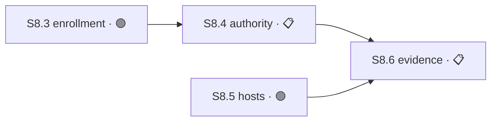

# Plan Naming Convention (shared across all agents and projects)

**Status**: canonical. Approved 2026-07-29.

This file is the SINGLE source of truth for how a plan is decomposed and how a
`master-index.md` is written. Where any skill, project file, or agent config
contradicts it, THIS file wins — fix the other file, do not fork the rule.

Applies to Claude, opencode, codex, and pi, in every project.

Why it exists: four conflicting hierarchies were live at once (`architecture-audit`,
`project-kickoff`, ServiTask `methodology.md`, ServiTask `master-index.md`). Agents
were not inventing vocabulary — they were reading different rules. One rule now.

---

## 1. Hierarchy — exactly four levels

```
Plan 2 — Flujo de tarea
 └── Sesión 2.3 — Aceptación exclusiva de cotización     est: 4h
      └── Módulo 2.3.1 — quotes/accept.ts                est: 40min
           └── Tarea 2.3.1.T1
```

Never add a fifth level. Never rename a level.

The number IS the identifier: depth determines the level, so no prefix is needed
inside its own document. When referencing from another file, prefix the letter:
`S2.3`, `M2.3.1`, `T2.3.1.4`.

| Level | Defined by | Time |
|-------|-----------|------|
| **Plan** | One topic with its own identity | estimate |
| **Sesión** | **What fits in ONE pull request** | estimate |
| **Módulo** | Concrete files that change together | estimate |
| **Tarea** | One atomic action — minimum 3 per Módulo | — |

## 2. Time is an estimate, never a limit

Time appears only as an informational attribute: `est: 4h`.

It NEVER defines or constrains a level. A Sesión estimated at 4h that takes 9h is
still the same Sesión — the estimate was wrong, the plan did not change. Do not
split, rename, or reclassify a node because it exceeded its estimate.

This replaces the old "Sesión = 1–3h, ejecutable de una sentada" definition. That
temporal definition was the root cause of vocabulary drift: when work did not fit
in one sitting, agents had no legal name for it and invented `work unit` / `slice`.

## 3. Overflow rule

> If a Sesión does not fit in one PR, NO new level is created. Either split it into
> two Sesiones (2.3 and 2.4), or ship its Módulos as chained PRs under the same Sesión.

## 4. Banned nouns at plan level

Never use these to name a level in a plan, master-index, STATUS.md, or proposal:

```
work unit · WU · slice · paquete · bloque · fase · phase · stage
epic · hito · milestone · wave · ola · tramo · fragmento · track
```

Two terms survive, scoped:

- `slice` — only inside the `chained-pr` skill, describing PR mechanics.
- `work unit` — only inside the `work-unit-commits` skill, describing commit grouping.

Neither may appear as a plan-level noun. They do not climb into the hierarchy.

### Domain-entity exemption (read before any rename)

This ban governs **plan vocabulary only** — how work is decomposed and described.

If a banned word is a **domain entity of the product itself** — it has a schema, a field,
an identifier, a file path, a table, or an API contract — it is EXEMPT and MUST NOT be
renamed. Renaming it breaks code, not prose.

Real example: in `control-tower`, `slice` is a domain entity, not plan vocabulary:

```yaml
slices:
  - slice_id: notifications
# and file paths: openspec/plans/<plan_id>/binding-deltas/<slice_id>-r<revision>.yaml
```

Those stay exactly as they are. What must change there is only the *planning* use — a
Sesión of work must not be called "a slice" in a plan or master-index.

Test before renaming anything: **does this word name a thing the software manipulates, or
does it name a chunk of our work?** Only the second is in scope. When unsure, leave it and
report it — a wrong rename costs more than a surviving inconsistency.

## 5. Collapsed axes

- **A "Track" is a Plan.** Cross-cutting work does not get its own noun. Tag it.
- **The owner is NOT part of the ID.** Identifiers like `E4`, `D1`, `U-S1` fused
  Sesión + person into one token, making the node unlocatable in the tree. Owner
  is a column in the table. The ID stays purely positional.

## 6. Status vocabulary — closed set of seven

Do not add, translate, combine, or invent states.

| State | Meaning |
|-------|---------|
| 📋 `PLANIFICADO` | Exists, not started, dependencies unresolved |
| 🟢 `LISTO` | Dependencies met, can start today |
| 🔵 `EN CURSO` | Someone is working on it right now |
| 🔴 `BLOQUEADO` | Cannot advance — needs an external unblock |
| 🟡 `DIFERIDO` | Could advance, deliberately postponed |
| ✅ `COMPLETO` | Merged and verified |
| 📚 `ARCHIVADO` | Closed, kept for traceability |

Key distinction: `BLOQUEADO` is *cannot*, `DIFERIDO` is *chose not to*. Keeping
these separate is the whole point — legacy vocabularies mixed them into `WAITING`,
`DEFERRED`, and `REVIEW-ONLY`, hiding what was actually stuck.

Migration map from legacy values:

```
EN EJECUCIÓN, 🟡 EN CURSO                      → EN CURSO
PLANNING, FUTURE, PLANNED, NOT IMPLEMENTED     → PLANIFICADO
READY                                          → LISTO
WAITING, BLOCKED, REVIEW-ONLY, CANDIDATO BLOQ. → BLOQUEADO
DEFERRED                                       → DIFERIDO
Completo, DONE, COMPLETE                       → COMPLETO
HISTÓRICO                                      → ARCHIVADO
```

## 7. master-index.md format

Fixed sections, in this order. No sections added, none reordered.

```markdown
# Índice Maestro — <Proyecto>

> Fuente técnica de verdad. Los planes, STATUS.md y artefactos enlazados
> tienen el detalle; este archivo dice DÓNDE estamos.
> Última reconciliación: <fecha> contra <rama> <sha>

## 📍 Punto de retoma
<3 to 6 lines. What closed last, what comes next, what decision is pending.
Rewritten in full when each Sesión closes. Accumulates NO history.>

## Granularidad
Plan → Sesión (1 PR) → Módulo (archivos) → Tarea (mín. 3).
El tiempo es estimación, no límite. Ver <path to this file>.

## 📊 Estado de un vistazo

**Avance global**: <N>/<T> Planes cerrados (<X>%) · Sesiones cerradas en planes
activos: <n>/<t> (<y>%)

| ID | Plan | Estado | % | Est. | Dueño | Qué falta | Ref |
|----|------|--------|---|------|-------|-----------|-----|
| P2 | Flujo de tarea | 🔵 EN CURSO | 50% (2/4 S) | 12h | Emilio | S2.3, S2.4 | [plan-2.md](...) |

## 🗂️ Planes archivados
<ID, name, link only. No detail.>
```

Three rules that keep it from degrading:

1. **§Punto de retoma goes first and is REWRITTEN, not appended.** It is the first
   thing the human reads and the first thing an agent reads. It must never become a
   changelog. Dated history belongs in git, PRs, and `openspec/maintenance/`.
2. **One row per Plan.** Sesión-level detail lives in that plan's `STATUS.md`, never
   in the index. The index must not grow as work progresses.
3. **`Qué falta` is written with IDs, not prose.** `S2.3, S2.4` — not "assign a single
   owner and open Work Unit 3 in RED 3.1".

## 8. Progress percentage

The `%` column answers one question: how much of this Plan is left. It is **derived**,
never authored — recompute it from the Sesión states, never hand-adjust it.

1. **The denominator is the Plan's enumerated Sesiones.** `% = Sesiones COMPLETO /
   Sesiones defined`. Nothing else counts: not Módulos, not Tareas, not hours, not
   how far along it feels.
2. **Always show the fraction next to the number**: `29% (2/7 S)`. A percentage
   without its denominator cannot be audited, and an unauditable number gets trusted
   exactly once.
3. **A Sesión counts only at `COMPLETO` or `ARCHIVADO`.** `EN CURSO` contributes zero.
   No partial credit — partial credit is how progress reporting turns into fiction.
4. **No enumeration → no percentage.** Write `—` plus the reason (`S24.2 sin definir`).
   An open denominator has no percentage. That is a planning gap to close, not a
   number to invent.
5. **Never weight by `est:`** unless *every* Sesión in the Plan carries an estimate.
   Mixed estimates produce a worse number than plain counting.
6. **Global progress is two figures, never one**, on one line above the table:
   closed Plans / total Plans, and closed Sesiones / enumerated Sesiones across
   active Plans. A single blended number hides which of the two is moving.
7. **Pending work outside the enumeration invalidates the percentage.** A Plan at
   `5/5 S` that is still `EN CURSO` is not at 100% — it has work with no Sesión ID.
   Open the missing Sesión or close the Plan.

## 9. Sesión execution contract

Five fields make a Sesión executable by an agent without interpretation. Without them
a plan can be read but not scheduled, and capacity has to be assembled by hand.

| Field | Requirement |
|-------|-------------|
| `Estado` | One of the seven. |
| `Depende de` | Sesión IDs that must reach `COMPLETO` first, or `—`. IDs, never prose. |
| `Área` | The paths this Sesión may touch — globs, or the project's area taxonomy. Exclusive for its duration. |
| `Recurso` | Shared non-file resources it claims: DB mode, migration lane, delivery token. `—` if none. |
| `Decisiones` | The decision points this Sesión is expected to hit, each marked derivable or escalating. `—` if none. See §11. |

### Binary acceptance criteria

Every Sesión carries a checklist of observable outcomes. Each item is true or false by
inspection — never "mostly", "with warnings", or "pending follow-up".

```markdown
**Criterios de aceptación** — todos deben pasar para cerrar:
- [ ] Two enrolled projects keep identity and Tower state isolated
- [ ] An unsafe existing layout fails closed and mutates nothing
- [ ] The diff touches no path outside `Área`
```

Write them at planning time, not at closing time. Criteria authored after the work is
done describe the work; criteria authored before it constrain the work. Only the second
kind can fail.

### No-debt closure rule

> A Sesión reaches `COMPLETO` only when every acceptance box is checked.

There is no partial close. `PASS WITH WARNINGS` is not a closing state: a warning is
either irrelevant — delete it — or it is unfinished work, and then the Sesión is not
`COMPLETO`.

Scope discovered mid-Sesión that does not fit becomes a **new Sesión with its own ID**.
It never rides along, and it never closes silently with its parent. A Sesión that closes
carrying undone scope reappears weeks later as an unplanned Sesión, and by then nobody
remembers it was owed.

## 10. Parallel capacity — derived, never declared

How many agents a body of work admits is a function of the dependency graph. It is not a
field: declaring it makes it stale the moment a Sesión closes.

Two Sesiones may run concurrently only when all three hold:

1. **Graph independence** — neither is in the other's `Depende de`, transitively.
2. **Disjoint `Área`** — no overlapping path.
3. **Disjoint `Recurso`** — not the same DB mode, migration lane, or token.

Capacity is the largest set of `🟢 LISTO` Sesiones satisfying all three, computed
**across Plans, not inside one**. Fixing a number of agents per Plan wastes capacity: a
Plan with three independent ready Sesiones deserves three agents; a Plan that is one
chain deserves one.

### Agents are assigned to Sesiones

Never to Plans, apps, folders, or layers. Cutting by app leaves a cross-app result with
no owner, and a Sesión has exactly one owner end to end. An app or layer may orient who
gets assigned first — it is an affinity, not an execution boundary.

Worktrees remove the *editing* collision, not the *merge* collision. Two agents in
separate worktrees editing the same file do not corrupt each other; they still conflict
at merge, after both implementations exist. Disjoint `Área` is what prevents that.

### Every Plan renders its graph

A table sorted by ID reads as a queue and lies about a graph: consecutive integers
suggest an order the structure does not have. Render the dependencies alongside it.

````markdown

````

No linearization of a DAG is honest. Renumbering to "fix" the reading order only moves
the lie. The graph is the artifact; the ID is only a name.

### The execution queue — derived, written down, global

The graph is the truth, but a human cannot read a DAG as "what comes next", and an ID
that jumps `S1.8 → S2.3 → S1.2` reads as chaos even when the graph is correct. Every plan
set therefore carries a **Cola de ejecución**: one topological order over all `🟢 LISTO`
and `📋 PLANIFICADO` Sesiones, **across Plans**, recomputed whenever a Sesión closes.

````markdown
## 🎯 Cola de ejecución
`#1 S1.2` · `#2 S1.8` · `#3 S2.3` · `#4 S2.4` — recalculada 2026-08-17
````

1. It lives in `master-index.md` immediately after `📍 Punto de retoma`, and it is
   **rewritten**, never appended.
2. The position (`#3`) is the order. The ID (`S2.3`) is the name. They are allowed to
   disagree — the queue is what the human reads, the ID is what references point at.
3. **Number in topological order when a Plan is first authored**, so ID and queue agree in
   the common case. Never renumber afterwards: a stable ID outranks a pretty sequence.
4. An agent starting work states its position out loud — `#3 de 7 → S2.3, porque S1.2 y
   S1.8 cerraron`. Jumping between Plans is normal and expected; jumping **without naming
   the reason** is what loses the reader.
5. One Sesión `🔵 EN CURSO` per agent. Parallelism comes from §10 capacity across agents,
   never from one agent holding several Sesiones open at once.

## 11. Deferrable planning — declare the decisions, not only the work

A plan that enumerates work but not **decisions** stops at the first uncertainty. The
agent has nowhere to record what it could not resolve, no way to say which other work
that blocks, and no basis to pick something else. So it stops, and everything waits on
one answer that may not arrive for hours.

Deferrability is a property of the **plan**, not of whatever runtime executes it.
Everything below is declared at authoring time and is readable by any agent, alone or
orchestrated. An orchestrator can later automate and enforce it — it does not create it,
and none of this waits on one existing.

### The `Decisiones` field

Each decision point the Sesión is expected to hit, resolved one of two ways:

```markdown
**Decisiones:**
- `derivable` — index name for the new lookup. Criterio: matches the existing
  `idx_<table>_<column>` convention already used in `Área`. Autoridad: naming
  convention approved in P0.
- `escala` — whether expired entries are deleted or tombstoned. Clase: migración o
  pérdida de datos. Contamina: `S5.2` (its acceptance criteria assume the answer).
```

A decision is `derivable` only when **both** hold: an approved authority already covers
it, and the criterion that resolves it is **falsifiable** — you can state what would make
the answer wrong. "Use good judgement" is not a criterion. Anything else escalates.

Declaring a decision does not predict every one that will appear. It captures the ones
visible at authoring time, which is most of them, and it establishes that unlisted
decisions escalate by default rather than getting improvised.

### The eight classes that always escalate

Closed set, like the seven statuses. A decision touching any of these is **never**
derived, even when an approved authority and a falsifiable criterion both exist.

Visible product contract · irreversible operations · migrations or data loss · public
API · security and permissions · money, pricing or quotas · scope expansion ·
contradictory dependencies or evidence.

What they share: the cost of being wrong is not paid by the agent, and it is not paid at
the time of the mistake. Everything else is recoverable by editing code.

### Escalating is not blocking

An escalating decision makes the **decision** pending. It does NOT make the Sesión
`BLOQUEADO`. They are different objects with different lifetimes, and collapsing them is
what turns a freshly authored plan into a wall of red that nobody can start.

| Where the open decision lands | Sesión state |
|---|---|
| Contaminates the acceptance criteria, or the first Módulo | 🔴 `BLOQUEADO` — nothing honest can start |
| Contaminates a later Módulo only | 🟢 `LISTO` — mark that Módulo 🔴, park the decision, work up to it |
| Semantic contamination declared by another Sesión's `Contamina:` | 🔴 `BLOQUEADO`, citing that decision |
| No contamination | 🟢 `LISTO` — the decision rides in `Decisiones`, nothing else changes |

Almost every real Sesión touches one of the eight classes somewhere. So a planning pass
that returns most Sesiones `BLOQUEADO` has applied `BLOQUEADO` at Sesión level when the
contamination was at Módulo level. Recompute before reporting: a plan where nothing can
start is a planning defect, not a finding.

The same rule governs routes. A Sesión is `blocked` only under the first or third row;
an open decision that contaminates nothing the Sesión starts with routes normally.

### Contamination — derived by default, declared when invisible

An open decision contaminates every Sesión that cannot be honestly worked while it stays
open. Three of the four sources are already declared and need no new field:

1. **Graph dependency** on the blocked Sesión, transitively.
2. **Shared `Área`.**
3. **Shared `Recurso`.**

The fourth is **semantic** and is the only one that must be written down: a Sesión whose
acceptance criteria assume a particular answer, while sharing neither path nor resource
nor edge. Nothing in the graph reveals it. Declare it on the escalating decision with
`Contamina:` and Sesión IDs.

> **Ambiguous resolves to contaminated.** Over-including costs idle capacity for a few
> hours. Under-including ships work built on an assumption nobody approved, and it
> surfaces at merge, after both implementations exist.

### The parked decision record

A decision that escalates is written down before the agent moves on. It carries:

- the **exact question**, answerable without re-reading the codebase;
- the **evidence** that produced it — files, lines, the contradiction;
- the **options enumerated, each with its consequence**;
- the **origin** Sesión and Módulo;
- the **checkpoint** — where work stopped, precisely enough to resume;
- the **class**, when it is one of the eight.

Missing any of these, it is not parkable. A decision without enumerated options is not a
decision, it is a question: escalating "what do we do here?" costs a full round trip and
comes back "it depends."

### Continuing on something else

A Sesión is eligible only when all four hold — the three tests of §10, plus contamination:

1. Graph-independent from the blocked Sesión.
2. Disjoint `Área`.
3. Disjoint `Recurso`.
4. Not in the contamination scope of the open decision.

> **Zero eligible Sesiones means stop and report.** Never relax a criterion to find
> something to do. An agent that loosens its own constraints to stay busy is the failure
> this whole section exists to prevent.

### Resuming

The answer lifts the block **only over the scope recorded when the decision was parked**,
never a scope recomputed at resume time — the plan may have moved meanwhile, and a
recomputed scope silently unblocks work the maintainer never cleared.

Resume from the recorded checkpoint. If the base moved while the decision sat open,
reconcile first: a stale checkpoint does not resume on its own.

## 12. Proportional output — do not pay for machinery you do not use

The full apparatus — Mermaid graph, computed capacity, `%` with its denominator, three
Tareas per Módulo — is sized for a Plan several agents will work in parallel. Applied to a
three-Sesión linear plan it produces ceremony nobody reads, and a plan nobody reads stops
being consulted, which is worse than a plan that says less.

| Plan shape | Required | May be omitted |
|---|---|---|
| ≤ 3 Sesiones, one owner, linear chain | Sesión rows with the five fields, binary acceptance criteria, the queue | Mermaid graph, computed capacity, `%` (write `3 S, cadena lineal`) |
| 4+ Sesiones, or any parallelism, or more than one owner | Everything in this document | — |

Omission is a **declared choice** written on the plan (`Grafo omitido: cadena lineal`),
never a silent skip. The five Sesión fields, the acceptance criteria, and `Decisiones` are
never omitted at any size — those are exactly what make a Sesión executable by an agent.

## 13. Agent compliance checklist

Before writing or updating any plan, master-index, or STATUS.md:

- [ ] Every level is one of: Plan, Sesión, Módulo, Tarea — no other noun
- [ ] Every node has a positional ID; no owner initials inside it
- [ ] Time appears only as `est:`, never as a constraint
- [ ] Every status is one of the seven; no legacy or invented value
- [ ] A Sesión that outgrew one PR was split into Sesiones, not renamed
- [ ] master-index has all fixed sections, `Punto de retoma` first and rewritten
- [ ] `Qué falta` uses IDs
- [ ] `%` is recomputed from Sesión states and shown with its fraction, or `—` + reason
- [ ] Every Sesión carries `Estado`, `Depende de`, `Área`, `Recurso` and `Decisiones`
- [ ] Every Sesión carries binary acceptance criteria, authored before the work starts
- [ ] No Sesión is `COMPLETO` with an unchecked box; overflow scope got its own ID
- [ ] The Plan renders its dependency graph, not only a table sorted by ID
- [ ] The plan set carries a recomputed `Cola de ejecución` with positions across Plans
- [ ] Every start announces `#N de T → ID` and why the earlier positions are gone
- [ ] Parallel capacity is computed from the graph, never written as a field
- [ ] A Sesión is `BLOQUEADO` only when the open decision reaches its acceptance criteria
      or its first Módulo — never merely because a decision escalates
- [ ] Artifacts omitted on a small plan are declared on the plan, not silently skipped
- [ ] Every `derivable` decision names an approved authority **and** a falsifiable criterion
- [ ] No decision in the eight always-escalate classes is marked `derivable`
- [ ] Every escalating decision declares `Contamina:` when the contamination is semantic and invisible in graph, `Área` and `Recurso`
- [ ] A parked decision carries exact question, evidence, options with consequence, origin, checkpoint and class
